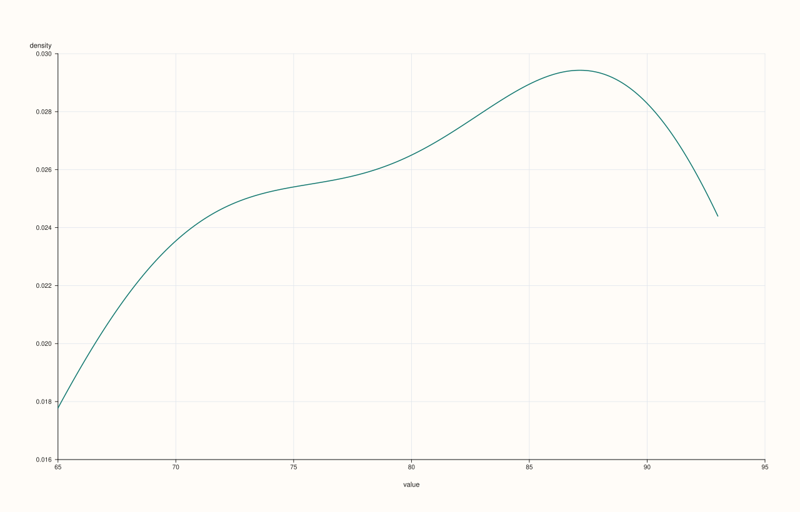
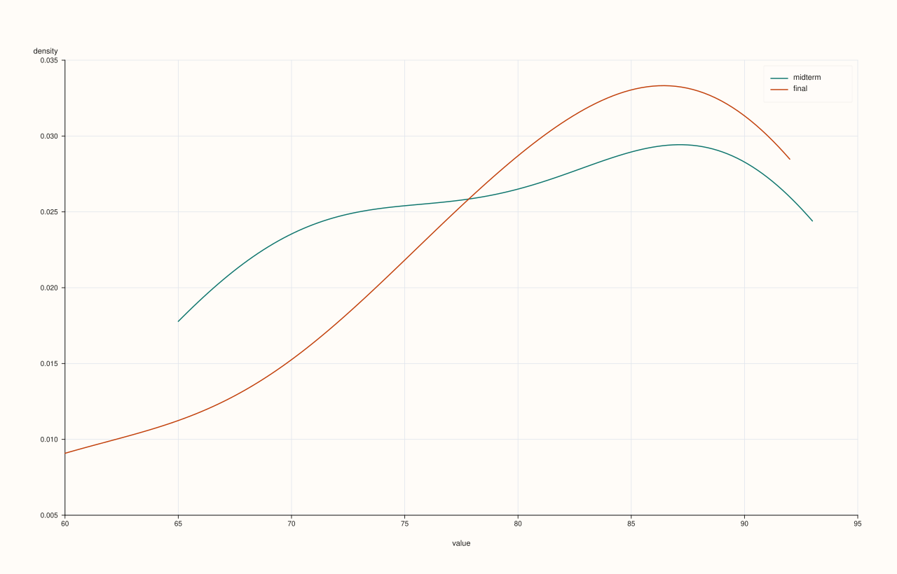
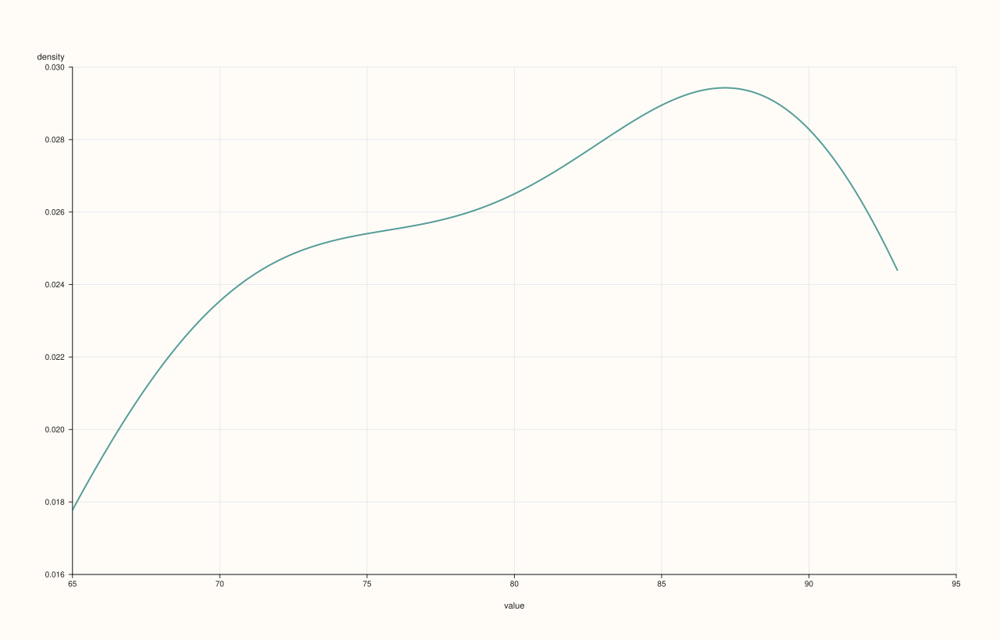
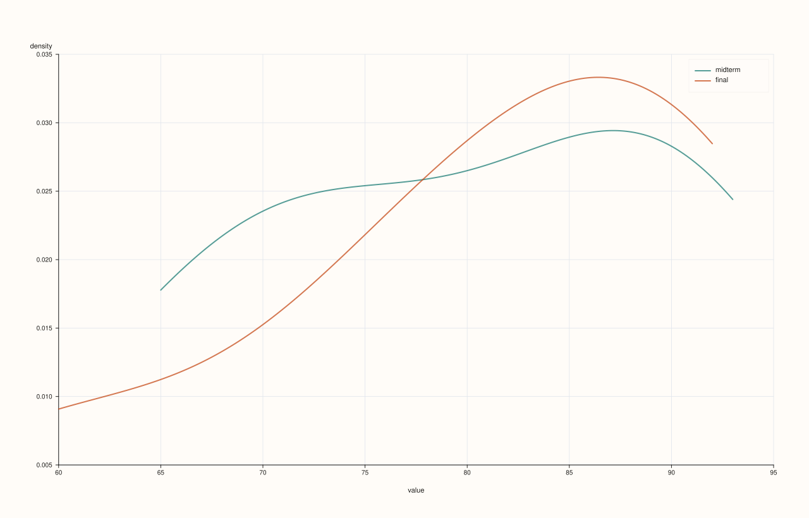

<!-- pluss-hand-authored -->
<!-- pluss-signature-hash: 1102243bd05b -->

# DataFramePlotAccessor::density

[Back to DataFramePlotAccessor API Reference](../../dataframe_plot_api_reference)

## Signatures

```cpp
DataFramePlotAccessor::density(std::string_view feature, std::int64_t points = 128) const -> pluss::pl::Studio

DataFramePlotAccessor::density(std::string_view feature, const DensityPlotOptions& options) const -> pluss::pl::Studio

DataFramePlotAccessor::density(pluss::msharp::RangeView::Of<std::string_view> features, std::int64_t points = 128) const -> pluss::pl::Studio

DataFramePlotAccessor::density(pluss::msharp::RangeView::Of<std::string_view> features, const DensityPlotOptions& options) const -> pluss::pl::Studio

DataFramePlotAccessor::density(std::initializer_list<std::string_view> features, std::int64_t points = 128) const -> pluss::pl::Studio

DataFramePlotAccessor::density(std::initializer_list<std::string_view> features, const DensityPlotOptions& options) const -> pluss::pl::Studio
```

## What It Does

Draws a kernel-density estimate (a smoothed distribution curve) for one or more numeric
features. Unlike [`hist()`](hist.md), `density()` **always** overlays every requested
feature's curve on a single shared pane, regardless of how many features are requested —
there is no mosaic-grid mode here. A legend is shown automatically whenever more than one
feature is requested.

Follows the same numeric-feature validation as [`box()`](box.md) for its `features`
parameter, though `density()` has no empty-list "infer everything" shorthand of its own —
every overload requires at least one named feature.

## Parameters

**feature** (`std::string_view`)
    A single numeric feature to draw as one density curve.

**features** (`RangeView<std::string_view>` or `std::initializer_list<std::string_view>`)
    Several numeric features, each drawn as its own curve on the shared pane.

**points** (`std::int64_t`, default `128`)
    The number of evaluation points used to draw each curve. Internally clamped to a
    minimum of `16` regardless of what's passed — `density(feature, 1)` still draws a
    16-point curve, not a degenerate one-point line.

**options** (`DensityPlotOptions`)
    ```cpp
    struct DensityPlotOptions {
      std::int64_t points{128};
      double alpha{1.0};
      double line_width{1.5};
    };
    ```

## Returns

`pluss::pl::Studio`
    A figure with one pane containing one kernel-density curve per requested feature,
    x-axis labeled `"value"`, y-axis labeled `"density"`.

## Examples

Example 1. A single feature, default point count.

```cpp
using namespace pluss::table;

auto exams = DataFrame({
    {"midterm", Slate(pluss::make_series({71.0, 82.0, 93.0, 65.0, 88.0, 74.0, 90.0}))},
    {"final",   Slate(pluss::make_series({75.0, 85.0, 91.0, 60.0, 92.0, 78.0, 88.0}))},
});

auto chart = exams.plot().density("midterm");
chart.show();
```


Example 2. A single feature with an explicit point count.

```cpp
auto chart = exams.plot().density("midterm", 256);
chart.show();
```

Higher `points` gives a smoother-looking curve at higher compute cost; lower `points`
(clamped to a minimum of 16) gives a coarser one.



Example 3. Two features, overlaid on the same pane, via `initializer_list`.

```cpp
auto chart = exams.plot().density({"midterm", "final"});
chart.save_pdf("both_density.pdf");
```

Both curves share one pane and one set of axes; a legend labeled `"midterm"`/`"final"`
appears automatically since more than one feature was requested — contrast
[`hist()`](hist.md), which would instead place these on two separate panes.


Example 4. The same multi-feature call via a reusable `RangeView`.

```cpp
std::vector<std::string_view> names{"midterm", "final"};
auto chart = exams.plot().density(pluss::msharp::RangeView::Of<std::string_view>(names));
```



Example 5. An explicit `DensityPlotOptions`.

```cpp
DensityPlotOptions density_options;
density_options.points = 200;
density_options.alpha = 0.7;
density_options.line_width = 2.0;

auto chart = exams.plot().density("midterm", density_options);
chart.show();
```



Example 6. Multiple features with an explicit options object.

```cpp
auto chart = exams.plot().density({"midterm", "final"}, density_options);
```



## Notes

- Always overlays every requested feature on one shared pane — never a mosaic, unlike
  [`hist()`](hist.md).
- `points` is clamped to a minimum of `16` regardless of what's requested.
- No empty-list "infer everything" shorthand — at least one feature must be named
  explicitly on every overload.
- Returns a `pluss::pl::Studio` — see [`line()`](line.md)'s important callout for how to
  view or save the result.

## See Also

- [`DataFramePlotAccessor::hist`](hist.md): binned frequency counts instead of a smoothed
  curve, with its mosaic-grid layout for multiple features.
- [`DataFramePlotAccessor::box`](box.md) / [`violin`](violin.md): other distribution-shape
  summaries.

<div class="pluss-inline-prev-next">
  <a class="prev-link" href="corr_heatmap.html">
    <span class="label">Previous</span>
    <span class="title">corr_heatmap</span>
  </a>
  <a class="next-link" href="heatmap.html">
    <span class="label">Next</span>
    <span class="title">heatmap</span>
  </a>
</div>
