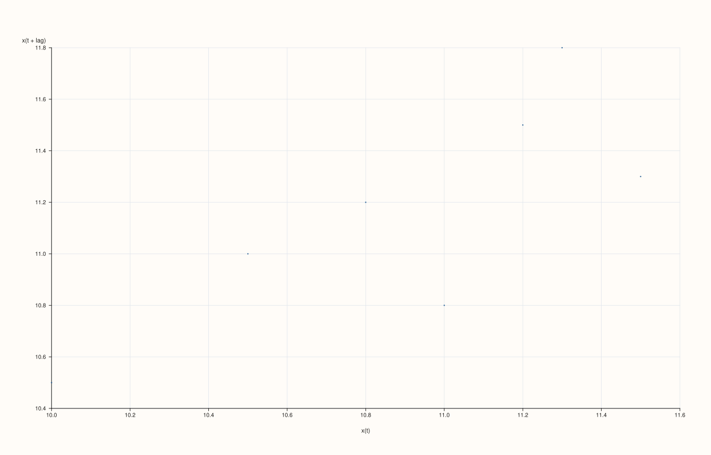
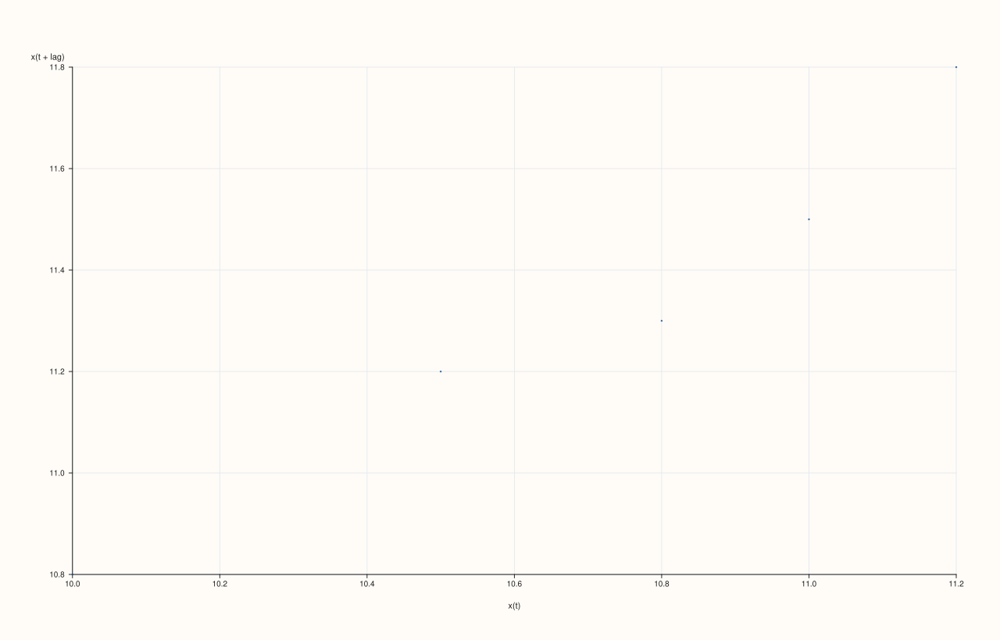
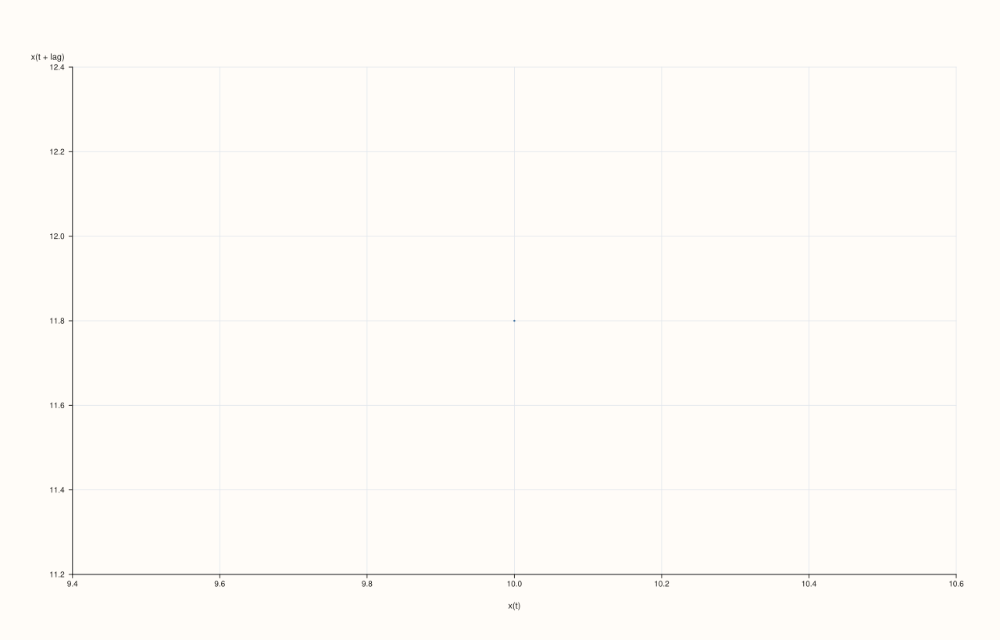
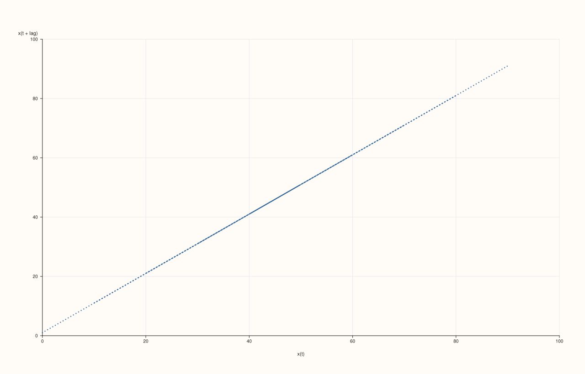
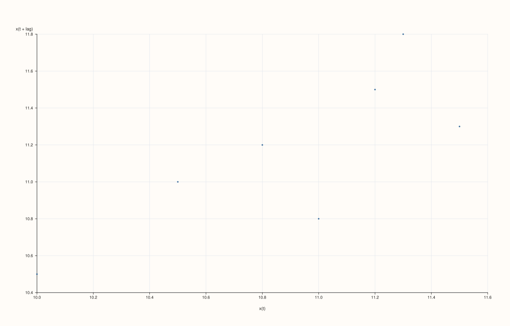

<!-- pluss-hand-authored -->
<!-- pluss-signature-hash: b6c9c311c9b4 -->

# DataFramePlotAccessor::lag

[Back to DataFramePlotAccessor API Reference](../../dataframe_plot_api_reference)

## Signature

```cpp
DataFramePlotAccessor::lag(
    std::string_view feature,
    const LagPlotOptions& options = {}) const -> pluss::pl::Studio
```

## What It Does

Draws a lag plot for one numeric feature: a scatter of `x(t)` against `x(t + lag)` — each
point's horizontal position is a value from the series, and its vertical position is the
value `lag` steps later in the same series. A cloud of points scattered along the diagonal
suggests strong positive autocorrelation at that lag; a cloud with no visible structure
suggests the series behaves close to random noise at that lag. This is the single-lag,
scatter-based sibling of [`act()`](act.md), which instead sweeps every lag and reduces each
one to a single correlation coefficient.

Shares the single-feature resolution rule with [`act()`](act.md) and
[`bootstrap()`](bootstrap.md): the named feature must resolve to exactly one numeric
(`Series`-kind) feature — see [`act()`](act.md)'s callout for the exact throw text.

```{note} At least two data points are required
A feature with fewer than two rows throws `"flash::lagplot requires at least two points"`.
```

## Parameters

**feature** (`std::string_view`)
    The single numeric feature to lag against itself. Must resolve to a `Series`-kind
    feature — see [`act()`](act.md)'s shared-diagnostics note.

**options** (`LagPlotOptions`)

### `LagPlotOptions` fields

| Field | Type | Default |
|---|---|---|
| `lag` | `std::int64_t` | `1` |
| `max_points` | `std::int64_t` | `2500` |
| `marker_area` | `double` | `16.0` |
| `trace_width` | `float` | `0.55F` |

`lag` is clamped internally to `[1, n - 1]` where `n` is the feature's row count — a
`lag` of `0` or larger than the data supports is silently clamped rather than throwing.
Given `n` rows and a clamped `lag`, `usable = n - lag` points are plotted: the point at
index `i` (for `i` in `0..usable`) is `(x[i], x[i + lag])`. `max_points` caps how many of
these `usable` points are actually drawn — when `usable` exceeds `max_points`, points are
subsampled at a stride (not randomly chosen) so the count stays within budget while still
spanning the full range. `marker_area` and `trace_width` control point size and marker
outline width respectively (`marker_area` is floored to a minimum of `2.0`).

## Returns

`pluss::pl::Studio`
    A figure with one pane containing a single scatter ("cloud") trace of `x(t)` vs.
    `x(t + lag)`, axis-labeled `"x(t)"` and `"x(t + lag)"`.

## Examples

Example 1. Default options (`lag = 1`): each point compares a value to the very next one in
the series.

```cpp
using namespace pluss::table;

auto readings = DataFrame({
    {"level", Slate(pluss::make_series({10.0, 10.5, 11.0, 10.8, 11.2, 11.5, 11.3, 11.8}))},
});

auto chart = readings.plot().lag("level");
chart.show();
```

With `n = 8` rows and `lag = 1`, `usable = 7` points are plotted: `(10.0, 10.5)`, `(10.5,
11.0)`, ..., `(11.3, 11.8)` — a tight, mostly increasing sequence suggests strong positive
lag-1 autocorrelation.



Example 2. An explicit `LagPlotOptions` with a larger lag.

```cpp
LagPlotOptions options;
options.lag = 3;

auto chart = readings.plot().lag("level", options);
chart.show();
```

With `lag = 3`, `usable = 8 - 3 = 5` points are plotted: `(10.0, 10.8)`, `(10.5, 11.2)`,
`(11.0, 11.5)`, `(10.8, 11.3)`, `(11.2, 11.8)`.



Example 3. A `lag` request larger than the data supports is silently clamped, not thrown.

```cpp
LagPlotOptions oversized;
oversized.lag = 100;

auto chart = readings.plot().lag("level", oversized);
```

With only 8 rows, `lag` is clamped to `n - 1 = 7`, leaving exactly one usable point: `(x[0],
x[7])`, i.e. `(10.0, 11.8)`.



Example 4. `max_points` subsampling on a larger series.

```cpp
std::vector<double> long_series;
for (int i = 0; i < 5000; ++i) {
  long_series.push_back(static_cast<double>(i % 50) + 0.01 * i);
}

auto big = DataFrame({
    {"trend", Slate(pluss::make_series(long_series))},
});

LagPlotOptions capped;
capped.max_points = 500;

auto chart = big.plot().lag("trend", capped);
chart.save_pdf("trend_lag.pdf");
```

`usable = 4999` points would otherwise be plotted; capped to roughly `500` by taking every
10th point (`step = ceil(4999 / 500) = 10`), not a random sample.



Example 5. Larger markers and a thicker outline.

```cpp
LagPlotOptions styled;
styled.marker_area = 40.0;
styled.trace_width = 1.5F;

auto chart = readings.plot().lag("level", styled);
chart.show();
```



Example 6. Fewer than two rows throws.

```cpp
auto single_row = DataFrame({
    {"level", Slate(pluss::make_series({10.0}))},
});

try {
  auto bad = single_row.plot().lag("level");
} catch (const std::exception& e) {
  std::cout << e.what();
}
```

### Output

```text
flash::lagplot requires at least two points
```

## Notes

- `feature` must resolve to exactly one numeric feature — see [`act()`](act.md)'s shared
  note.
- `lag` is clamped to `[1, n - 1]`, never throwing for an out-of-range request.
- `max_points` subsamples by stride, not randomly, when `usable` exceeds it.
- A feature with fewer than two rows throws before any point is drawn.
- Returns a `pluss::pl::Studio` — see [`line()`](line.md)'s important callout for how to
  view or save the result.

## See Also

- [`DataFramePlotAccessor::act`](act.md): every lag's correlation coefficient at once,
  instead of one lag's raw scatter.
- [`DataFramePlotAccessor::bootstrap`](bootstrap.md): another single-feature diagnostic,
  based on resampling rather than lags.
- [`DataFramePlotAccessor::scatter`](scatter.md): the general-purpose two-feature scatter
  this method specializes for a series against its own lagged copy.

<div class="pluss-inline-prev-next">
  <a class="prev-link" href="hist.html">
    <span class="label">Previous</span>
    <span class="title">hist</span>
  </a>
  <a class="next-link" href="line.html">
    <span class="label">Next</span>
    <span class="title">line</span>
  </a>
</div>
