<!-- pluss-hand-authored -->
<!-- pluss-signature-hash: e086af0d22e7 -->

# DataFramePlotAccessor::line

[Back to DataFramePlotAccessor API Reference](../../dataframe_plot_api_reference)

## Signatures

```cpp
pluss::pl::Studio DataFramePlotAccessor::line() const

pluss::pl::Studio DataFramePlotAccessor::line(const LinePlotOptions& options) const

pluss::pl::Studio DataFramePlotAccessor::line(std::string_view x_feature, const LinePlotOptions& options) const

pluss::pl::Studio DataFramePlotAccessor::line(std::string_view y_feature) const

pluss::pl::Studio DataFramePlotAccessor::line(std::string_view x_feature, std::string_view y_feature) const

pluss::pl::Studio DataFramePlotAccessor::line(std::string_view x_feature, std::string_view y_feature, const LinePlotOptions& options) const

pluss::pl::Studio DataFramePlotAccessor::line(pluss::RangeView<std::string_view> y_features) const

pluss::pl::Studio DataFramePlotAccessor::line(std::initializer_list<std::string_view> y_features) const

pluss::pl::Studio DataFramePlotAccessor::line(pluss::RangeView<std::string_view> y_features, const LinePlotOptions& options) const

pluss::pl::Studio DataFramePlotAccessor::line(std::initializer_list<std::string_view> y_features, const LinePlotOptions& options) const

pluss::pl::Studio DataFramePlotAccessor::line(std::string_view x_feature, pluss::RangeView<std::string_view> y_features) const

pluss::pl::Studio DataFramePlotAccessor::line(std::string_view x_feature, std::initializer_list<std::string_view> y_features) const

pluss::pl::Studio DataFramePlotAccessor::line(std::string_view x_feature, pluss::RangeView<std::string_view> y_features, const LinePlotOptions& options) const

pluss::pl::Studio DataFramePlotAccessor::line(std::string_view x_feature, std::initializer_list<std::string_view> y_features, const LinePlotOptions& options) const
```

## What It Does

Draws one line trace per requested y-feature over a shared x-axis, returning a
`pluss::pl::Studio` figure. This page also explains mechanics shared by every method on
this accessor — `step()`, `area()`, `scatter()`, `bar()`, and the rest all follow the same
"nothing is drawn until you export it" and x-axis-resolution rules described here, so their
own pages link back to this one instead of repeating it.

```{important} Every plot method returns a Studio, not a DataFrame — and nothing prints
`line()` (like every method on this accessor) builds and returns a `pluss::pl::Studio` — a
figure object from the separate `PlussPl` plotting library. It does **not** print a table,
and `Studio` has no `operator<<`, so `std::cout << chart` will not compile. To actually see
or persist the result, call one of `Studio`'s own methods afterward:

- `chart.show()` — opens the figure in a native window or the OS default browser/viewer.
- `chart.save_svg("out.svg")`, `chart.save_pdf("out.pdf")`, `chart.save_png("out.png", dpi)`
  — write the figure to a file (`save_png` shells out to an external SVG-to-raster
  converter such as `rsvg-convert`, `inkscape`, or ImageMagick, and throws if none is found).
- `chart.to_svg()` / `chart.to_pdf()` — return the rendered markup as a `std::string`, for
  embedding elsewhere instead of writing a file.

Every example on this page ends with one of these calls to make that visible; none of them
show a rendered "Output" block the way `DataFrame`/`Shelf` method pages do, because there
is no text form of a chart to display.
```

### Choosing the x-axis: three ways to end up with an x-feature

Every 2D chart method that takes an `x_feature` argument resolves it the same way:

1. **Pass it explicitly** — `plot.line("month", "sales")` always wins, regardless of any
   accessor-level default.
2. **Set a shared default on the accessor** — `df.plot(options)` where
   `options.default_x_feature = "month"` lets every subsequent chart method omit
   `x_feature` and still use `"month"`. An explicit `x_feature` argument on a given call
   still takes precedence over this default.
3. **Omit it entirely, with no default set** — the x-axis becomes the frame's own **row
   labels** (`DataFrame::labels()`), not a bare `0..n-1` index, and the axis title becomes
   the literal string `"case"`. If the row labels are text, a timestamp, or a time index,
   the axis renders as evenly spaced categorical positions with those values as tick
   labels; if the row labels are themselves numeric, they're used as real numeric x
   coordinates.

See Examples 1, 2, and 3 below for each of these three paths in turn.

### Which features are drawn

The order of the arguments is always **x first, then y**: `line("week", "visits")` puts `week` on
the x-axis and `visits` on the y-axis; `line("week", {"visits", "returns"})` draws two lines against
`week`. A single name, `line("visits")`, is a y-feature drawn against the row labels. The x-axis is
never guessed: it is the x-feature you name, the accessor default `options.default_x_feature`, or the
row labels, and nothing else (a time column is the x-axis only when you name it).

When no y-feature is named, the y-features come from a **feature selection**, and every one of them is
drawn on the same axes, one line per feature, with a legend:

| Field | Type | Meaning |
|---|---|---|
| `all_features` | `bool` | every numeric feature (the x-feature is left out) |
| `include_features` | `std::vector<std::string>` | exactly these features, in this order |
| `exclude_features` | `std::vector<std::string>` | every numeric feature except these |

The selection can be set for one call, in `LinePlotOptions::features`, or for every plot made from the
accessor, in the same three fields of `DataFramePlotOptions` (`df.plot({.include_features = {"a", "b"}})`).
It is resolved in this order, first match wins:

1. Features named in the call (`line("x", {"y1", "y2"})`).
2. `features` in the plot's own options.
3. The accessor-level selection in `DataFramePlotOptions`.
4. With none of those, every numeric feature, exactly as if `all_features` were set.

`include_features` and `exclude_features` cannot both be set, and `all_features` cannot be combined with
either; an unknown feature name, a non-numeric feature in `include_features`, or the x-feature listed in
`include_features` is an error. Each throws a `pluss::Error` that names what was wrong and what to do
(see Example 12). A time feature on the y-axis shows dates as its tick labels, not raw numbers.

## Parameters

**y_feature** (`std::string_view`)
    A single numeric feature to draw as one line trace.

**y_features** (`pluss::RangeView<std::string_view>` or `std::initializer_list<std::string_view>`)
    Several numeric features, each drawn as its own line trace on the same axes. A legend
    is shown automatically whenever more than one y-feature is requested (and suppressed
    for a single feature). At least one y-feature is required — an empty list throws
    `"DataFrame::plot().line: at least one y feature is required"`.

**x_feature** (`std::string_view`)
    The feature to use as the shared x-axis. See "Choosing the x-axis" above.

**options** (`LinePlotOptions`)

### `LinePlotOptions` fields

| Field | Type | Default |
|---|---|---|
| `alpha` | `double` | `1.0` |
| `line_width` | `double` | `1.6` |
| `y_limit_method` | `std::optional<pluss::pl::LimitMethod>` | `pluss::pl::LimitMethod::Padded` |
| `align` | `XYAlignOptions` | default constructed |
| `features` | `FeatureSelection` | nothing selected |

`alpha` controls trace opacity, `line_width` the stroke width. `y_limit_method` chooses
how the y-axis auto-fits to the data: `Padded` (the default) adds a small margin beyond
the data's min/max, `Tight` fits exactly to the data range with no margin, and
`TickAligned` snaps the limits outward to the nearest tick boundaries.

    ```{note} align is present on the struct but has no effect at this layer
    `align` (`XYAlignOptions`) exists so `Catalog::plot().line()` can reuse this exact
    struct type for its own key-to-key alignment — see
    [`CatalogPlotAccessor::line`](../catalog-plot/line.md)
    for where it actually does something. `DataFramePlotAccessor::line()` itself never reads
    `align`: every column in an already-constructed `DataFrame` shares one row count by
    construction, so there is no length mismatch here for `align` to resolve in the first
    place. Setting it to any `XYAlignMode`/`XYAlignBy` combination produces byte-identical
    output.
    ```

## Returns

`pluss::pl::Studio`
    A figure with one pane containing one line trace per requested y-feature.

## Examples

Example 1. Explicit x-feature: the most common and clearest form.

```cpp
using namespace pluss::table;

auto sales = DataFrame({
    {"month",  Shelf(pluss::make_note({"Jan", "Feb", "Mar", "Apr"}))},
    {"amount", Shelf(pluss::make_series({100.0, 120.0, 90.0, 150.0}))},
    {"cost",   Shelf(pluss::make_series({60.0, 80.0, 55.0, 95.0}))},
});

auto chart = sales.plot().line("month", "amount");
chart.show();
```

`sales.plot()` enters the accessor with no shared options; `.line("month", "amount")` draws
`amount` on the y-axis against the text feature `month` on the x-axis (rendered as four
evenly spaced categorical positions labeled `"Jan"`..`"Apr"`), producing a single unlabeled
(no-legend, since there's only one y-feature) line trace. `chart.show()` is what actually
opens the figure — nothing above it renders anything on its own.

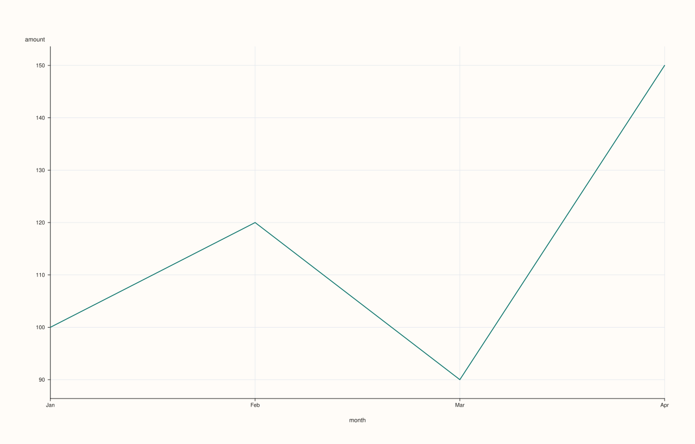

Example 2. A shared `default_x_feature` set once on the accessor, used implicitly by
multiple chart calls.

```cpp
DataFramePlotOptions options;
options.default_x_feature = "month";

auto plot = sales.plot(options);
auto chart1 = plot.line("amount");         // x defaults to "month"
auto chart2 = plot.line("cost");           // also defaults to "month"
auto chart3 = plot.line("cost", "amount"); // explicit x_feature="cost" overrides the default
```

`chart1` and `chart2` both use `"month"` as their x-axis without repeating it. `chart3`
demonstrates that an explicit `x_feature` argument (here, `"cost"`) always wins over
`options.default_x_feature`, even when both are present in the same call.

`chart1` (`amount` vs. `month`):


`chart2` (`cost` vs. `month`):

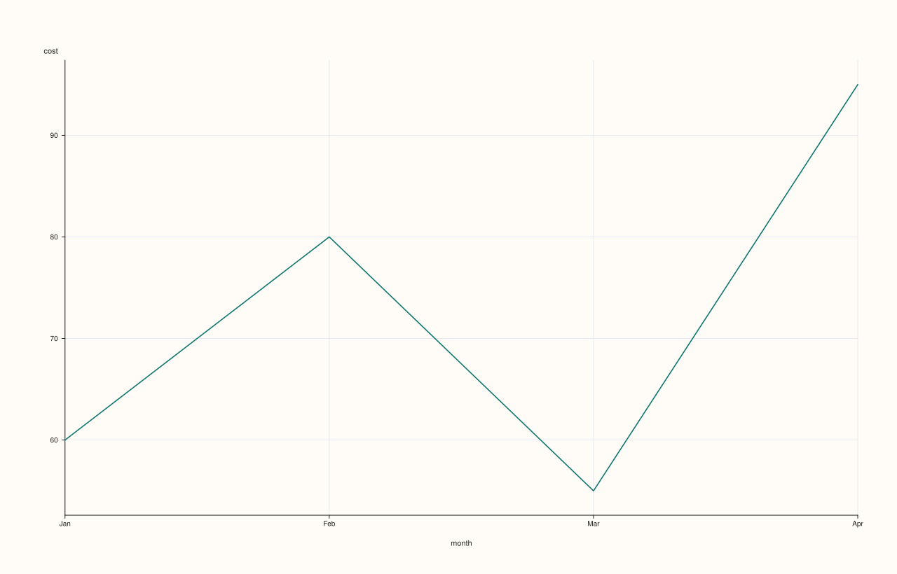

`chart3` (`amount` vs. explicit `cost`, overriding the default):

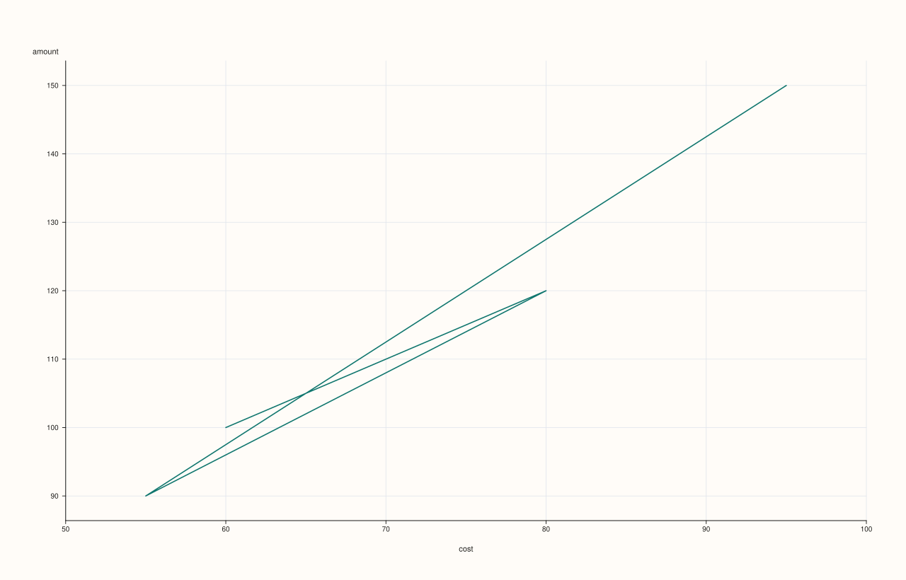

Example 3. No x-feature at all — falls back to the frame's own row labels.

```cpp
auto untitled = DataFrame({
    {"amount", Shelf(pluss::make_series({100.0, 120.0, 90.0, 150.0}))},
}, Shelf(pluss::make_note({"Q1", "Q2", "Q3", "Q4"})));

auto chart = untitled.plot().line("amount");
chart.show();
```

`untitled` was built with explicit row labels (`"Q1"`..`"Q4"`) and no `month`-style feature
at all. `line("amount")` with no `x_feature` and no `default_x_feature` set falls back to
those row labels: the x-axis renders `"Q1"`..`"Q4"` as categorical positions, and the axis
title becomes `"case"` (not `"amount"` and not the row-label feature's own name — literally
the string `"case"`).

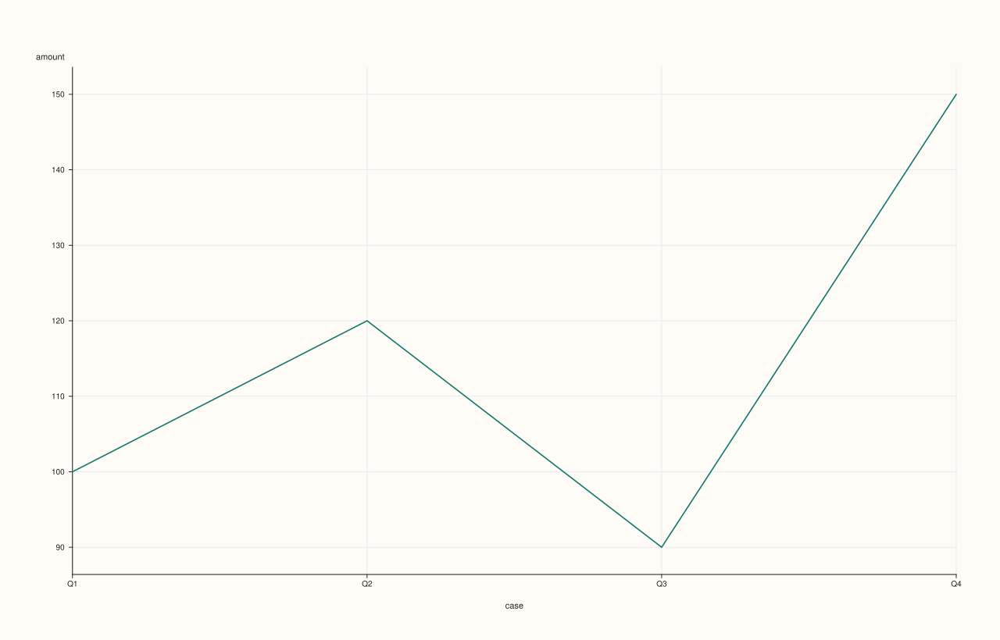

Example 4. Multiple y-features overlaid on one pane, drawn from a brace-init list.

```cpp
auto chart = sales.plot().line("month", {"amount", "cost"});
chart.show();
```

Two line traces share the same `month` x-axis and the same pane; a legend appears
automatically (labeled `"amount"` and `"cost"`) because more than one y-feature was
requested. `chart.show()` opens the figure directly instead of writing a file — useful
during interactive exploration.

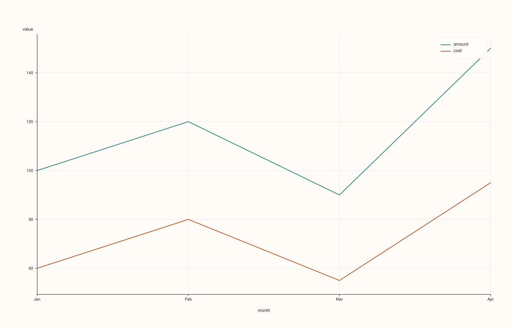

Example 5. The same multi-feature call using a reusable `RangeView` instead of a brace-init
list — useful when the feature list is built at runtime rather than known at the call site.

```cpp
std::vector<std::string_view> y_names{"amount", "cost"};
auto chart = sales.plot().line("month", y_names);
chart.save_pdf("monthly_lines.pdf");
```

Behaves identically to Example 4 — the `RangeView` overload and the `initializer_list`
overload are the same underlying call, just accepting the y-feature list in different forms.


Example 6. An explicit `LinePlotOptions`, tuning opacity, stroke width, and y-axis fit.

```cpp
LinePlotOptions line_options;
line_options.alpha = 0.85;
line_options.line_width = 2.5;
line_options.y_limit_method = pluss::pl::LimitMethod::Tight;

auto chart = sales.plot().line("month", "amount", line_options);
chart.show();
```

The line is drawn slightly translucent (`alpha = 0.85`), thicker (`line_width = 2.5`), and
the y-axis is fit tightly to the data's actual min/max instead of the default padded
margin.

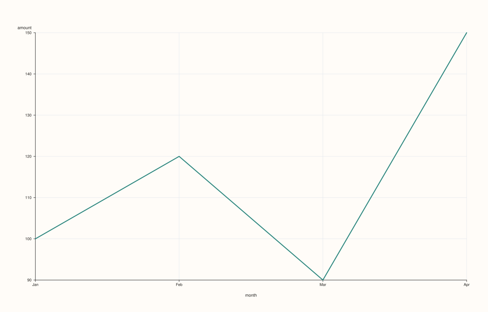

Example 7. Multiple y-features with an explicit options object — the three-argument
overload works the same way for the list-based forms as it does for the single-feature form.

```cpp
auto chart = sales.plot().line("month", {"amount", "cost"}, line_options);
```

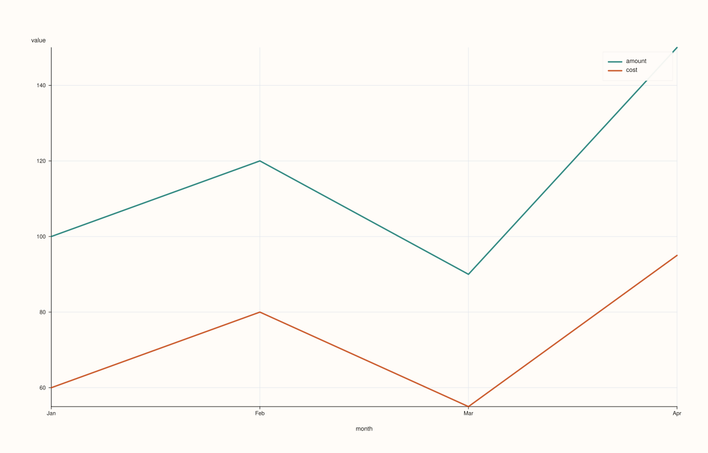

Example 8. No features named: every numeric feature is drawn on one axes, against the row labels.

```cpp
using namespace pluss::table;

auto traffic = DataFrame({
    {"web",    Shelf(pluss::make_series({120.0, 135.0, 128.0, 160.0, 171.0}))},
    {"mobile", Shelf(pluss::make_series({80.0, 95.0, 110.0, 130.0, 150.0}))},
    {"email",  Shelf(pluss::make_series({40.0, 38.0, 45.0, 41.0, 50.0}))},
});

auto chart = traffic.plot().line();
chart.show();
```

Three numeric features give three lines and a legend.

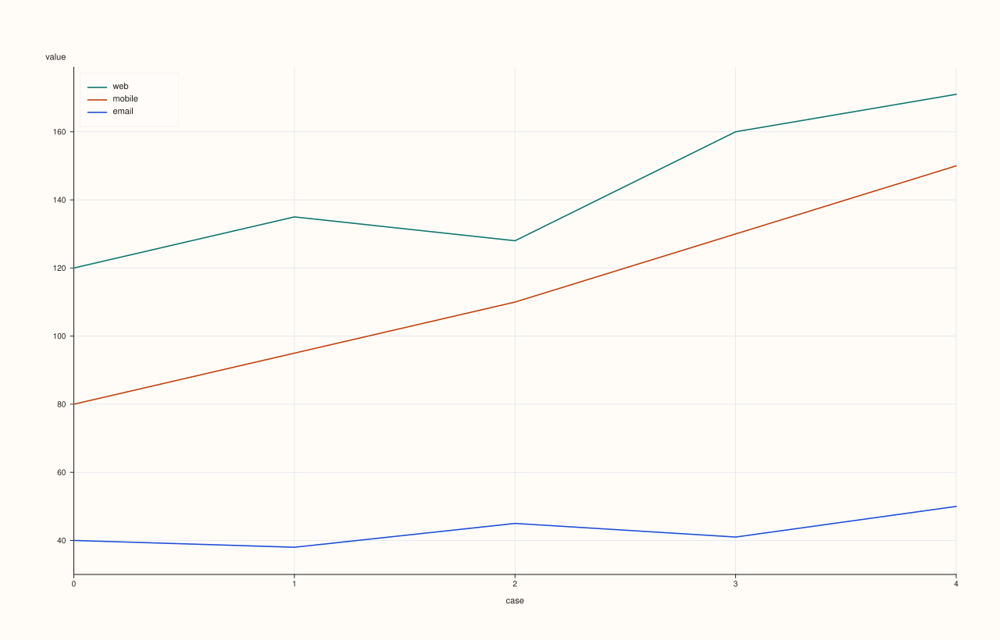

Example 9. `all_features` states the same thing explicitly.

```cpp
auto chart = traffic.plot().line({.features = {.all_features = true}});
```


Example 10. `include_features` draws exactly the listed features.

```cpp
auto chart = traffic.plot().line({.features = {.include_features = {"web", "email"}}});
```

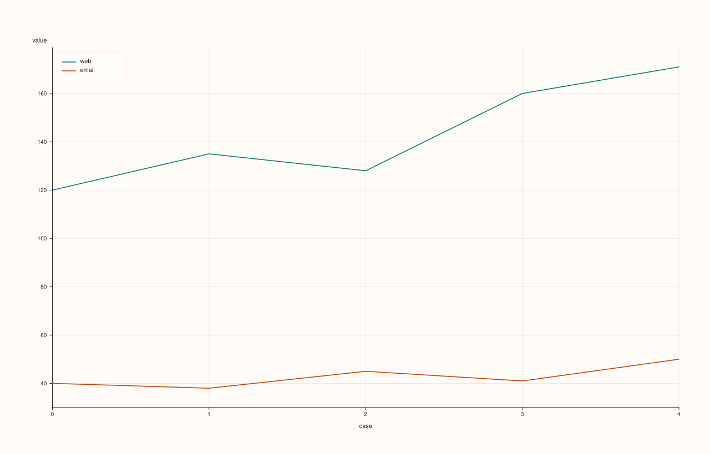

Example 11. `exclude_features` draws every numeric feature except the listed ones.

```cpp
auto chart = traffic.plot().line({.features = {.exclude_features = {"mobile"}}});
```


Example 12. A selection with an explicit x-feature: the x-feature is never also drawn as a line, and a
time feature named as x labels the axis with dates.

```cpp
auto daily = DataFrame({
    {"date",   Shelf(pluss::make_timeline({"2024-01-01T00:00:00Z", "2024-02-01T00:00:00Z",
                                           "2024-03-01T00:00:00Z", "2024-04-01T00:00:00Z"}))},
    {"amount", Shelf(pluss::make_series({100.0, 120.0, 90.0, 150.0}))},
    {"cost",   Shelf(pluss::make_series({60.0, 80.0, 55.0, 95.0}))},
});

auto chart = daily.plot().line("date", {.features = {.all_features = true}});
```

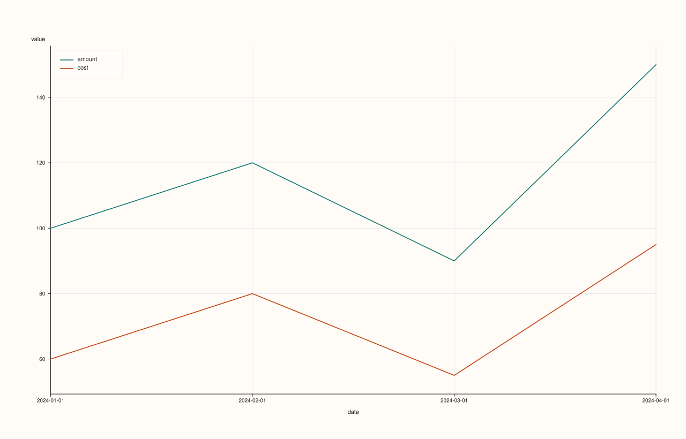

Example 13. Naming a time feature as y shows dates on the y-axis.

```cpp
auto chart = daily.plot().line("amount", "date");
```

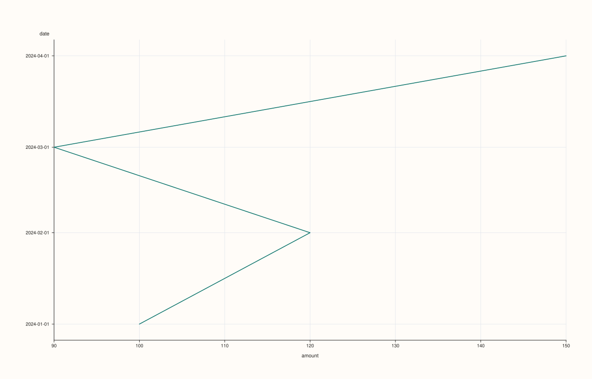

Example 14. Misuse throws a `pluss::Error` that says what was combined, why it is invalid and what to do.

```cpp
auto attempt = [](auto&& draw) {
  try { draw(); } catch (const pluss::Error& e) { std::cout << e.message() << "\n\n"; }
};

attempt([&] { traffic.plot().line({.features = {.all_features = true, .exclude_features = {"mobile"}}}); });
attempt([&] { traffic.plot().line({.features = {.include_features = {"web"}, .exclude_features = {"email"}}}); });
attempt([&] { traffic.plot().line({.features = {.include_features = {"wbe"}}}); });
attempt([&] { traffic.plot().line("web", {.features = {.include_features = {"web", "email"}}}); });

auto names = DataFrame({{"city", Shelf(pluss::make_note({"Accra", "Kumasi"}))}});
attempt([&] { names.plot().line(); });
```

```text
DataFrame::plot().line: all_features and exclude_features cannot be combined: all_features already means every numeric feature. To drop some features set exclude_features instead (and leave all_features false), or to plot everything remove exclude_features.

DataFrame::plot().line: include_features and exclude_features cannot both be set: include_features lists exactly the features to draw, while exclude_features drops features from every numeric feature. Use include_features to name the features you want, or exclude_features to remove the ones you do not, but not both.

DataFrame::plot().line: include_features names unknown feature 'wbe'. Did you mean 'web'? Available features = [web, mobile, email]. Fix the spelling or remove 'wbe' from include_features.

DataFrame::plot().line: include_features lists 'web', which is also the x feature; an x feature cannot be drawn as its own trace. Remove 'web' from include_features, or choose a different x.

DataFrame::plot().line: the frame has no numeric feature to draw (features = [city]). Add a numeric feature, or convert one of these features to numbers first.
```

## Notes

- Returns a `pluss::pl::Studio`, never a `DataFrame` and never printed text — see the
  important callout above for how to actually view or save the result.
- With no y-feature named, the feature selection decides (see "Which features are drawn"); a frame with no numeric feature throws.
- A legend is shown automatically once more than one y-feature is requested.
- The x-axis resolves in three steps — explicit argument, then `options.default_x_feature`,
  then the frame's own row labels titled `"case"` — see "Choosing the x-axis" above.
- `y_limit_method` only affects how the y-axis auto-fits; it does not change the data drawn.

## See Also

- [`DataFramePlotAccessor::step`](step.md): the same shape, drawn as a step function instead
  of straight line segments.
- [`DataFramePlotAccessor::area`](area.md) / [`area_stacked`](area_stacked.md): filled
  variants of the same y-features-over-shared-x-axis idea.
- [`DataFramePlotAccessor::scatter`](scatter.md): points instead of connected lines, with an
  optional hue/color feature.
- [`DataFrame::plot`](../dataframe/plot.md): how to enter this accessor in the first place.

<div class="pluss-inline-prev-next">
  <a class="prev-link" href="lag.html">
    <span class="label">Previous</span>
    <span class="title">lag</span>
  </a>
  <a class="next-link" href="parallel.html">
    <span class="label">Next</span>
    <span class="title">parallel</span>
  </a>
</div>
