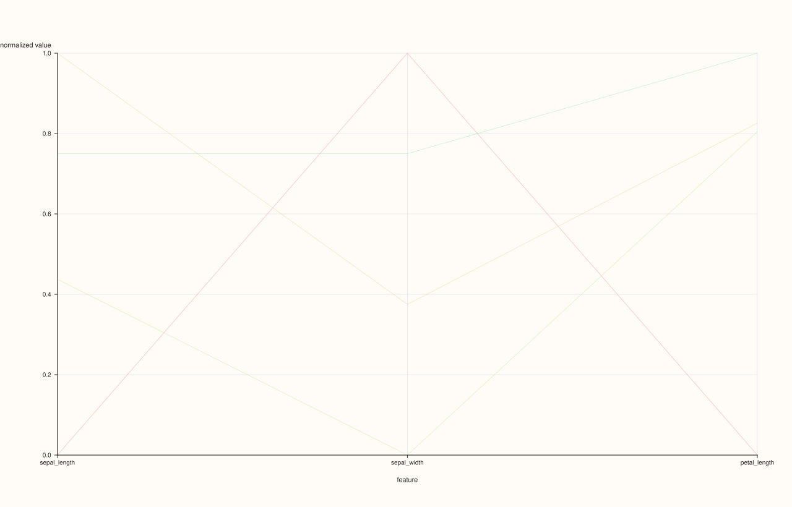
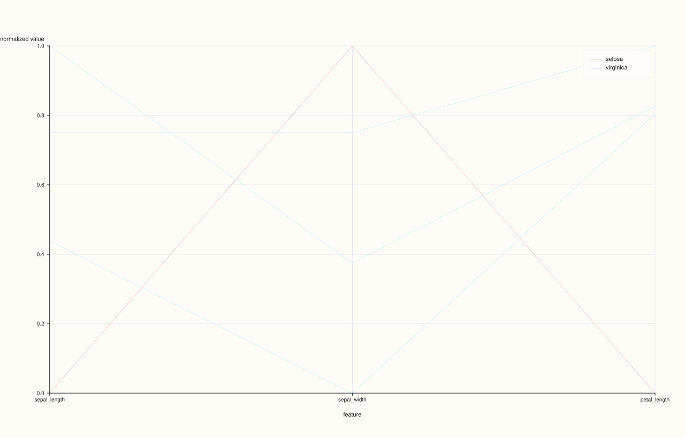
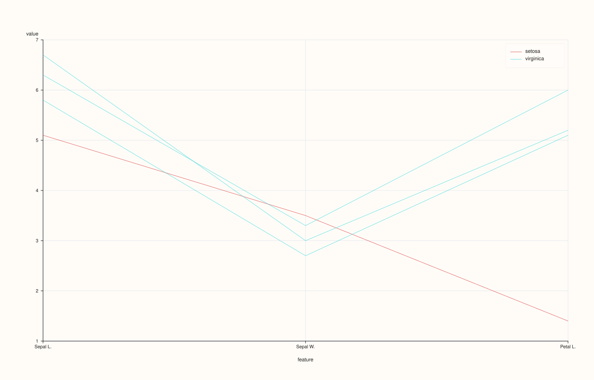
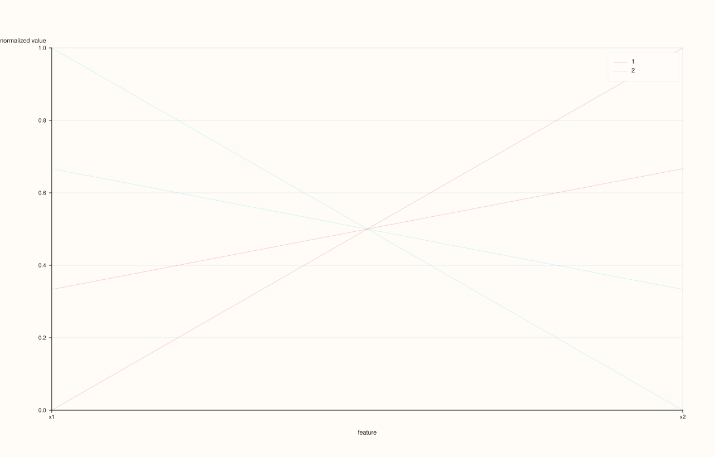

<!-- pluss-hand-authored -->
<!-- pluss-signature-hash: c2f8f8decfc6 -->

# DataFramePlotAccessor::parallel

[Back to DataFramePlotAccessor API Reference](../../dataframe_plot_api_reference)

## Signature

```cpp
pluss::pl::Studio DataFramePlotAccessor::parallel(
    pluss::msharp::RangeView::Of<std::string_view> features = {},
    std::optional<std::string_view> class_feature = std::nullopt,
    const ParallelPlotOptions& options = {}) const
```

## What It Does

Draws a parallel-coordinates plot: one vertical axis per selected numeric feature, laid out
side by side, and one connected line per row threading through each axis at that row's
value for that feature. This is a way to see multivariate structure across many features at
once — rows that behave similarly across several dimensions trace visually similar paths.

This page also establishes mechanics shared with [`andrews_curves()`](andrews_curves.md)
and [`radviz()`](radviz.md), which follow the same feature-selection, class-coloring, and
NaN-handling rules described here.

```{important} Masked/invalid cells become NaN gaps, not dropped rows — unlike box()/violin()
Unlike [`box()`](box.md) and [`violin()`](violin.md), which silently drop non-finite values
entirely before plotting, `parallel()` (and `andrews_curves()`/`radviz()`) convert an
invalid cell to `NaN` and keep the row's position in the data — the underlying per-row line
simply has a gap or break at that feature's axis rather than the row being omitted from the
figure altogether.
```

## Parameters

**features** (`RangeView<std::string_view>`, default `{}`)
    Numeric features to use as axes, in the given order. Empty (the default) infers every
    numeric feature in the frame — see [`box()`](box.md)'s important callout for the exact
    rule and throw text.

**class_feature** (`std::optional<std::string_view>`, default `std::nullopt`)
    An optional feature used to color/group the per-row lines. Unlike
    [`scatter()`](scatter.md)'s `hue_feature`, this accepts **any** feature kind — it's
    converted to text via a Note cast if it isn't already Note-kind, so a numeric class
    feature works too (each distinct value, stringified, becomes its own class), not just
    a text-like one.

**options** (`ParallelPlotOptions`)

### `ParallelPlotOptions` fields

| Field | Type | Default |
|---|---|---|
| `labels` | `std::vector<std::string>` | empty |
| `normalize` | `bool` | `true` |
| `max_points` | `std::int64_t` | `1200` |
| `alpha` | `double` | `0.24` |
| `trace_width` | `float` | `0.9F` |
| `show_grid` | `bool` | `true` |
| `show_legend` | `bool` | `true` |

`labels`, left empty, defaults to the resolved feature names — set it explicitly for
custom axis labels (must match the feature count). `normalize = true` (the default)
rescales each axis independently so features on very different numeric ranges remain
visually comparable. `alpha` defaults quite low (`0.24`) since parallel-coordinates
plots are typically drawn with many overlapping, semi-transparent lines. `max_points`
caps how many rows are drawn (for large frames, a subsample rather than every row).

## Returns

`pluss::pl::Studio`
    A figure with one pane containing the parallel-coordinates trace(s) — one combined
    trace, or one per class when `class_feature` is given.

## Examples

Example 1. No explicit features, no class: every numeric feature in the frame, one plain
trace per row.

```cpp
using namespace pluss::table;

auto flowers = DataFrame({
    {"sepal_length", Slate(pluss::make_series({5.1, 6.7, 5.8, 6.3}))},
    {"sepal_width",  Slate(pluss::make_series({3.5, 3.0, 2.7, 3.3}))},
    {"petal_length", Slate(pluss::make_series({1.4, 5.2, 5.1, 6.0}))},
    {"species",      Slate(pluss::make_note({"setosa", "virginica", "virginica", "virginica"}))},
});

auto chart = flowers.plot().parallel();
chart.show();
```

`parallel()` with no arguments uses `sepal_length`, `sepal_width`, and `petal_length` (the
three `Series`-kind features) as axes; `species` (Note-kind) is excluded from the axes
since it isn't numeric.



Example 2. An explicit feature subset, colored by a class feature.

```cpp
auto chart = flowers.plot().parallel({"sepal_length", "sepal_width", "petal_length"}, "species");
chart.show();
```

Each row's line is colored/grouped by its `species` value; a legend labeled with each
distinct species appears (since `show_legend` defaults to `true`).



Example 3. An explicit `ParallelPlotOptions`, with custom axis labels and reduced
transparency for a small dataset where overplotting isn't a concern.

```cpp
ParallelPlotOptions options;
options.labels = {"Sepal L.", "Sepal W.", "Petal L."};
options.alpha = 0.7;
options.normalize = false;

auto chart = flowers.plot().parallel({"sepal_length", "sepal_width", "petal_length"}, "species", options);
chart.show();
```

`normalize = false` plots each axis on its own raw numeric scale instead of a normalized
`0..1`-style range — meaningful here since `sepal_length`/`sepal_width`/`petal_length` are
all already in centimeters and comparable.



Example 4. `class_feature` accepts a numeric feature too — unlike `scatter()`'s
`hue_feature`, there's no type restriction here.

```cpp
auto numeric_class = DataFrame({
    {"x1",   Slate(pluss::make_series({1.0, 2.0, 3.0, 4.0}))},
    {"x2",   Slate(pluss::make_series({4.0, 3.0, 2.0, 1.0}))},
    {"code", Slate(pluss::make_series({1.0, 1.0, 2.0, 2.0}))},
});

auto chart = numeric_class.plot().parallel({"x1", "x2"}, "code");
```

`code` is a plain numeric `Series`, but `parallel()` still accepts it as `class_feature` —
its values are cast to text first (`"1"`, `"2"`), so rows with `code == 1.0` and `code ==
2.0` become two distinctly colored classes.



## Notes

- Empty (default) `features` infers every numeric feature — see [`box()`](box.md)'s
  important callout for the exact rule.
- Masked/invalid cells become `NaN` gaps in a row's line rather than dropping the row
  entirely — see the important callout above.
- `class_feature` accepts any feature kind (cast to text internally), unlike
  [`scatter()`](scatter.md)'s stricter `hue_feature`.
- `labels`, if set explicitly, must match the resolved feature count.
- Returns a `pluss::pl::Studio` — see [`line()`](line.md)'s important callout for how to
  view or save the result.

## See Also

- [`DataFramePlotAccessor::andrews_curves`](andrews_curves.md) /
  [`radviz`](radviz.md): other multivariate views sharing this page's feature-selection and
  class-coloring rules.
- [`DataFramePlotAccessor::scatter_matrix`](scatter_matrix.md): pairwise relationships
  instead of one line per row across every axis at once.

<div class="pluss-inline-prev-next">
  <a class="prev-link" href="line.html">
    <span class="label">Previous</span>
    <span class="title">line</span>
  </a>
  <a class="next-link" href="pie.html">
    <span class="label">Next</span>
    <span class="title">pie</span>
  </a>
</div>
