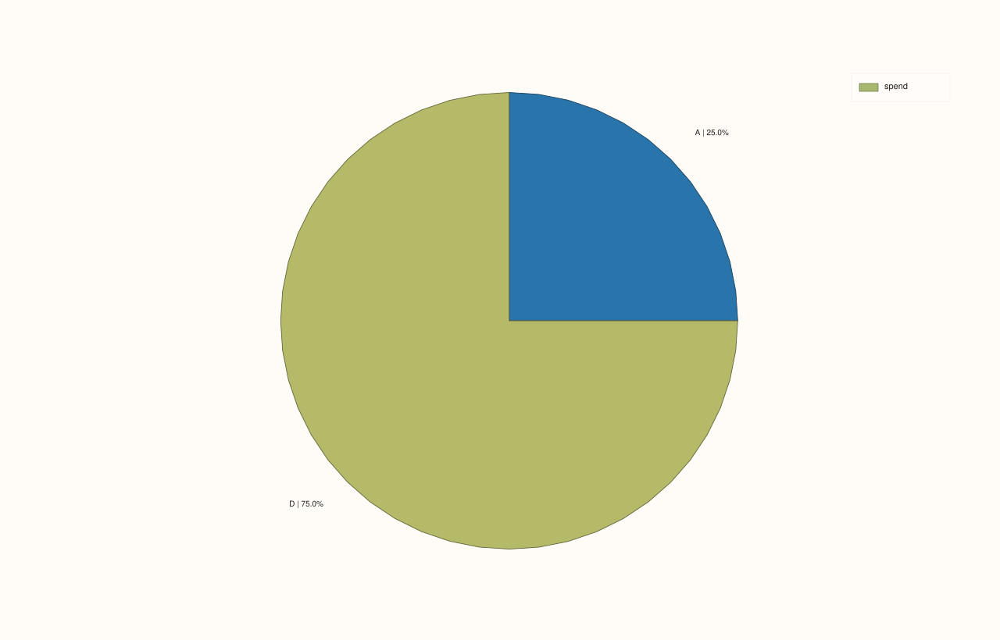
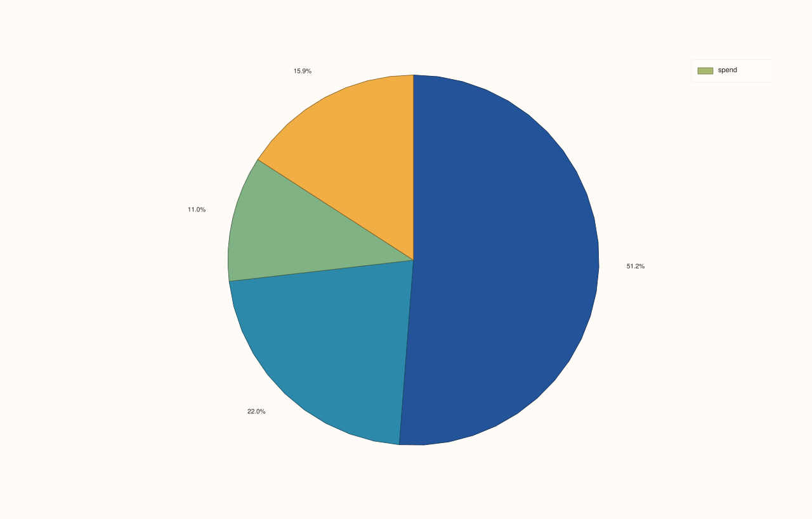

<!-- pluss-hand-authored -->
<!-- pluss-signature-hash: 02f899243fbb -->

# DataFramePlotAccessor::pie

[Back to DataFramePlotAccessor API Reference](../../dataframe_plot_api_reference)

## Signatures

```cpp
DataFramePlotAccessor::pie(std::string_view value_feature,
                            std::optional<std::string_view> label_feature = std::nullopt) const -> pluss::pl::Studio

DataFramePlotAccessor::pie(std::string_view value_feature,
                            std::optional<std::string_view> label_feature,
                            const PiePlotOptions& options) const -> pluss::pl::Studio
```

## What It Does

Draws a pie chart from one numeric `value_feature`, with slice labels coming either from an
explicit `label_feature` or (if omitted) from the frame's own row labels.

```{important} Non-positive and non-finite values are silently dropped, not zero-sized slices
Before drawing, every row is filtered: only rows where `value_feature` is both **finite**
and **strictly greater than zero** are kept. A row with a zero, negative, `NaN`, or
infinite value doesn't appear as a zero-width sliver — it's removed from the chart
entirely, and its label never appears (including in the legend). If every row gets
filtered out, the call throws `"DataFrame::plot().pie: feature '<name>' has no positive
finite values"`. This matters for percentage calculations too: the percentage shown for
each slice is computed against the total of the **surviving** (positive, finite) values
only, not the original column's total.
```

## Parameters

**value_feature** (`std::string_view`)
    The numeric feature whose values become slice sizes. Only finite, strictly positive
    values are plotted — see the important callout above.

**label_feature** (`std::optional<std::string_view>`, default `std::nullopt`)
    The feature whose values label each slice. When omitted, the frame's own row labels are
    used instead (the axis/slice label falls back the same conceptual way
    [`line()`](line.md)'s x-axis does when no `x_feature` is given, though `pie()` has no
    `default_x_feature`-style shortcut of its own — it's just "explicit label_feature, or
    the row labels").

**options** (`PiePlotOptions`)
    ```cpp
    struct PiePlotOptions {
      bool show_label{true};
      bool show_percent{true};
      bool show_value{false};
      int precision{1};
      std::string separator{" | "};
    };
    ```
    Each `show_*` flag independently controls whether that piece of text appears on a
    slice; when more than one is enabled, the pieces are joined with `separator` in the
    order label, then percent, then value. `precision` (clamped to `0..12`) controls decimal
    places for both the percentage and the raw value text. If all three `show_*` flags are
    `false`, no per-slice text is rendered at all (slices are still drawn and colored, just
    unlabeled).

## Returns

`pluss::pl::Studio`
    A figure with one pane containing a single pie trace.

## Examples

Example 1. Default options: explicit label feature, showing label and percentage.

```cpp
using namespace pluss::table;

auto budget = DataFrame({
    {"category", Slate(pluss::make_note({"Engineering", "Sales", "Support", "Marketing"}))},
    {"spend",    Slate(pluss::make_series({420.0, 180.0, 90.0, 130.0}))},
});

auto chart = budget.plot().pie("spend", "category");
chart.show();
```

Each slice is labeled with its category name and its percentage of the total `spend`
(e.g. `"Engineering | 51.2%"`, computed to `precision = 1` decimal place by default).


Example 2. No `label_feature`: falls back to the frame's own row labels.

```cpp
auto by_case = DataFrame({
    {"spend", Slate(pluss::make_series({420.0, 180.0, 90.0, 130.0}))},
}, Slate(pluss::make_note({"eng", "sales", "support", "marketing"})));

auto chart = by_case.plot().pie("spend");
chart.show();
```

Since `label_feature` is omitted, each slice is labeled with `by_case`'s own row labels
(`"eng"`, `"sales"`, `"support"`, `"marketing"`) instead of a separate feature column.


Example 3. Non-positive and non-finite values are dropped — and the remaining slices'
percentages are computed against the smaller, filtered total.

```cpp
auto mixed = DataFrame({
    {"category", Slate(pluss::make_note({"A", "B", "C", "D"}))},
    {"spend",    Slate(pluss::make_series({100.0, -50.0, 0.0, 300.0}))},
});

auto chart = mixed.plot().pie("spend", "category");
chart.save_pdf("mixed_pie.pdf");
```

Only `"A"` (100.0) and `"D"` (300.0) survive the filter; `"B"` (negative) and `"C"` (zero)
are dropped entirely — they never appear as slices or in the legend. The percentages shown
are `25.0%` and `75.0%` — computed against `100 + 300 = 400`, not the original four-row
total.



Example 4. `show_value = true` alongside the defaults, and a custom `separator`.

```cpp
PiePlotOptions options;
options.show_value = true;
options.separator = " — ";
options.precision = 0;

auto chart = budget.plot().pie("spend", "category", options);
chart.show();
```

Each slice now shows all three pieces joined by `" — "`: label, percentage, and raw value,
e.g. `"Engineering — 51% — 420"` (rounded to `precision = 0` decimal places).


Example 5. All label text disabled — slices are drawn and colored, but unlabeled.

```cpp
PiePlotOptions bare_options;
bare_options.show_label = false;
bare_options.show_percent = false;

auto chart = budget.plot().pie("spend", "category", bare_options);
```



Example 6. Every row filtered out throws.

```cpp
auto empty_after_filter = DataFrame({
    {"spend", Slate(pluss::make_series({0.0, -5.0, -10.0}))},
});

try {
  auto bad = empty_after_filter.plot().pie("spend");
} catch (const std::exception& e) {
  std::cout << e.what();
}
```

### Output

```text
DataFrame::plot().pie: feature 'spend' has no positive finite values
```

## Notes

- Only finite, strictly positive values are plotted; everything else is silently dropped,
  and percentages are computed against the filtered total — see the important callout
  above.
- `label_feature` omitted falls back to the frame's own row labels.
- `precision` is shared between the percentage and value text, clamped to `0..12`.
- An entirely-filtered-out feature throws rather than producing an empty chart.
- Returns a `pluss::pl::Studio` — see [`line()`](line.md)'s important callout for how to
  view or save the result.

## See Also

- [`DataFramePlotAccessor::bar`](bar.md): a composition-friendly alternative when exact
  comparison between category sizes matters more than "share of a whole."
- [`DataFramePlotAccessor::heatmap`](heatmap.md): another way to summarize categorical
  breakdowns, for two grouping dimensions at once instead of one.

<div class="pluss-inline-prev-next">
  <a class="prev-link" href="parallel.html">
    <span class="label">Previous</span>
    <span class="title">parallel</span>
  </a>
  <a class="next-link" href="radviz.html">
    <span class="label">Next</span>
    <span class="title">radviz</span>
  </a>
</div>
