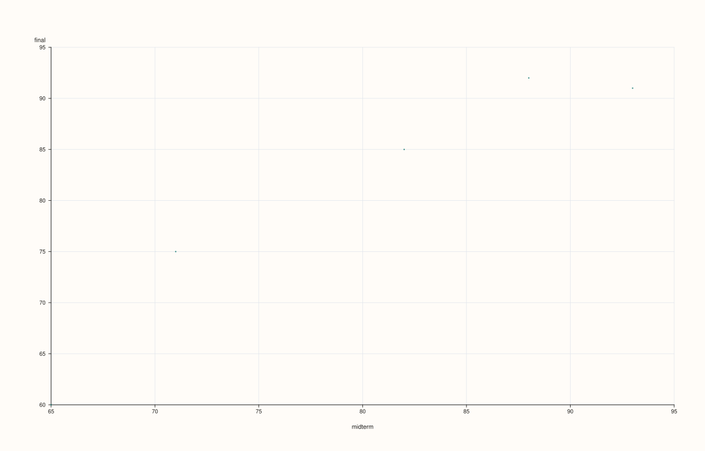
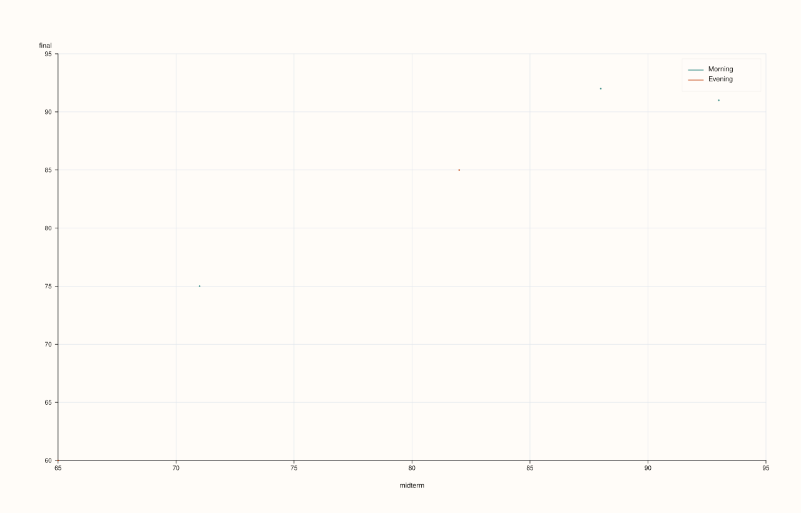
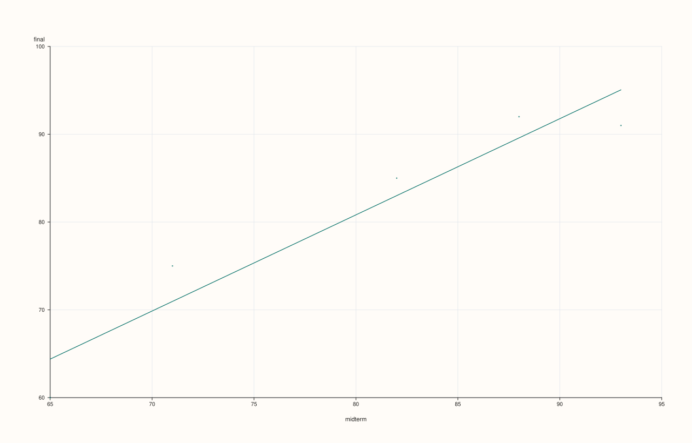
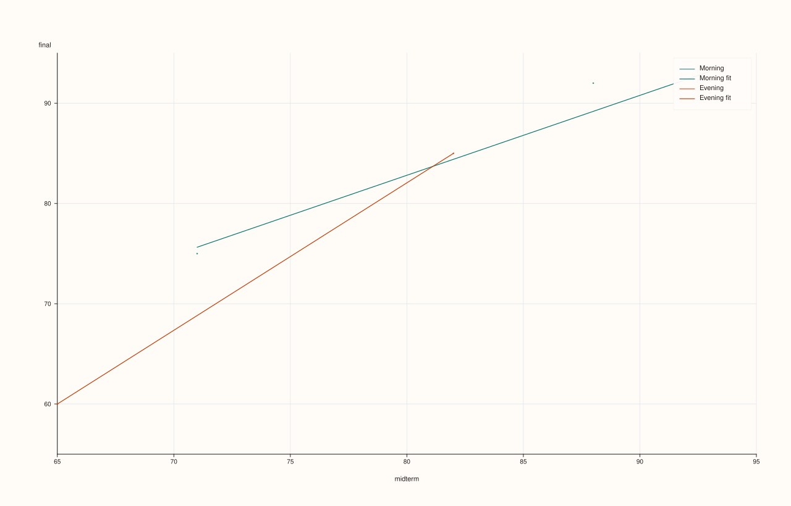
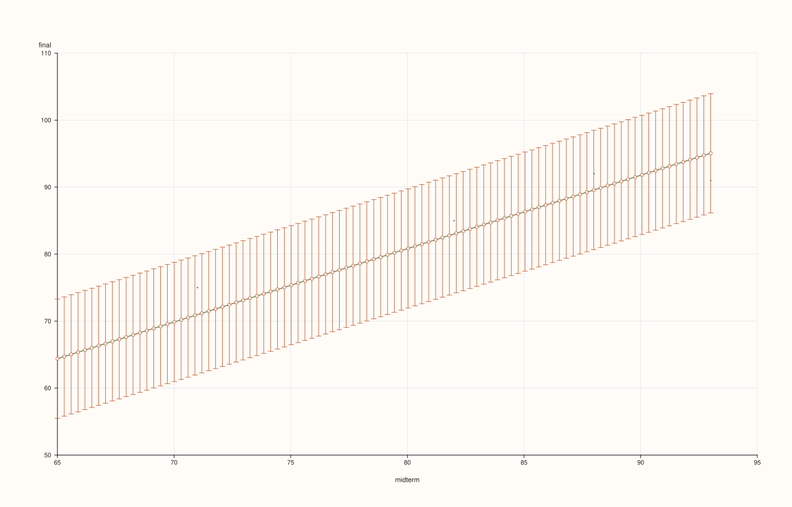
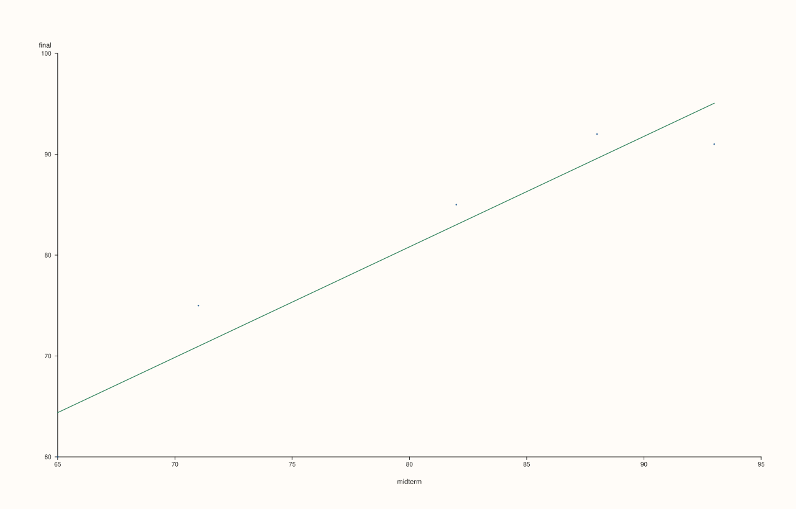

<!-- pluss-hand-authored -->
<!-- pluss-signature-hash: 844b5a3502c8 -->

# DataFramePlotAccessor::scatter

[Back to DataFramePlotAccessor API Reference](../../dataframe_plot_api_reference)

## Signatures

```cpp
DataFramePlotAccessor::scatter(std::string_view x_feature,
                                std::string_view y_feature,
                                std::optional<std::string_view> hue_feature = std::nullopt) const -> pluss::pl::Studio

DataFramePlotAccessor::scatter(std::string_view x_feature,
                                std::string_view y_feature,
                                std::optional<std::string_view> hue_feature,
                                const ScatterPlotOptions& options) const -> pluss::pl::Studio
```

## What It Does

Draws one point per row at `(x_feature, y_feature)`, optionally split into separate,
distinctly colored/labeled point groups by a categorical `hue_feature`. Unlike
[`line()`](line.md)/[`step()`](step.md)/[`area()`](area.md)/[`bar()`](bar.md), `scatter()`
takes **both x and y as required, plain (non-optional) arguments** — there is no "fall back
to the frame's row labels" behavior here, since a scatter plot needs two independent
numeric axes, not one axis plus a case index.

See [`line()`](line.md) for the `Studio`-return / no-`cout` mechanics shared by this whole
accessor.

```{important} hue_feature has its own default-resolution and a stricter type requirement
`hue_feature` resolves the same way `x_feature` does elsewhere on this accessor: an
explicit argument wins, otherwise `options.default_hue_feature` (set via
`df.plot(options)`) is used if present, otherwise there's no hue at all and every point is
drawn as one plain trace. Unlike `andrews_curves()`/`parallel()`/`radviz()`'s
`class_feature` (which accepts any feature and converts it to text), a resolved
`hue_feature` here **must** already be Note-, Timeline-, or TimeIndex-kind — a plain
numeric `Series` hue feature throws `"DataFrame::plot().scatter: hue feature '<name>' must
be note-like or time-like"`. If you want to color by a numeric value, bucket or cast it to
text first (e.g. with `bucketize()` or `note()`-family conversions).
```

## Parameters

**x_feature** (`std::string_view`, required)
    The feature for the horizontal axis. Always numeric-plotted (see `require_plot_size`
    validation) — not resolved from `default_x_feature` the way other chart methods'
    optional `x_feature` is.

**y_feature** (`std::string_view`, required)
    The feature for the vertical axis.

**hue_feature** (`std::optional<std::string_view>`, default `std::nullopt`)
    Optional categorical feature to split points into separate colored/labeled groups. See
    the important callout above for its resolution and type requirements.

**options** (`ScatterPlotOptions`)

### `ScatterPlotOptions` fields

| Field | Type | Default |
|---|---|---|
| `alpha` | `double` | `0.92` |
| `line_width` | `double` | `1.1` |
| `fit_line` | `bool` | `false` |
| `fit_order` | `std::int64_t` | `1` |
| `fit_ci` | `bool` | `false` |
| `fit_confidence_level` | `double` | `0.95` |

`line_width` here affects marker outline stroke width rather than a connecting line,
since scatter points aren't connected. `fit_line = true` overlays a line of best fit
on top of the point cloud (or, with `hue_feature`, one color-matched fit line per hue
group) — see the important callout below and Examples 6–8. `fit_order` sets the
polynomial degree of that fit (`1` for a straight line, the default; higher values fit
a curve). `fit_ci = true` additionally draws a shaded confidence band around the fit,
sized by `fit_confidence_level`. All four `fit_*` fields are ignored when `fit_line`
is `false`.

## Returns

`pluss::pl::Studio`
    A figure with one pane: a single point trace with no hue, or one point trace per
    distinct hue value (each its own color, with a legend) when `hue_feature` resolves to
    something.

## Examples

Example 1. Plain scatter, no hue.

```cpp
using namespace pluss::table;

auto students = DataFrame({
    {"midterm", Slate(pluss::make_series({71.0, 82.0, 93.0, 65.0, 88.0}))},
    {"final",   Slate(pluss::make_series({75.0, 85.0, 91.0, 60.0, 92.0}))},
    {"cohort",  Slate(pluss::make_note({"Morning", "Evening", "Morning", "Evening", "Morning"}))},
});

auto chart = students.plot().scatter("midterm", "final");
chart.show();
```

Every row becomes one point at `(midterm, final)`; no legend is shown since there's no hue.



Example 2. With a categorical hue feature: points split into one trace per distinct cohort
value, each its own color.

```cpp
auto chart = students.plot().scatter("midterm", "final", "cohort");
chart.show();
```

Two traces are drawn — `"Morning"` and `"Evening"` — in the order those values first appear
in the data (row 0 is `"Morning"`, so it becomes the first group; row 1 introduces
`"Evening"` as the second), **not** sorted alphabetically. A legend labeled with each
cohort value is shown automatically.


Example 3. A shared `default_hue_feature`, set once on the accessor and reused across
calls, mirroring [`line()`](line.md)'s `default_x_feature` pattern.

```cpp
DataFramePlotOptions options;
options.default_hue_feature = "cohort";

auto plot = students.plot(options);
auto chart1 = plot.scatter("midterm", "final");                 // hue defaults to "cohort"
auto chart2 = plot.scatter("midterm", "final", std::nullopt);   // std::nullopt explicitly suppresses hue
```

`chart1` picks up `"cohort"` from the accessor-level default without repeating it.
`chart2` demonstrates that passing `std::nullopt` explicitly, rather than simply omitting
the argument, also resolves through `default_hue_feature` resolution the same way — to
truly force "no hue regardless of the accessor default," a caller would need to build a
separate accessor without `default_hue_feature` set.

`chart1` (hue defaults to `"cohort"`):



`chart2` (`std::nullopt` explicitly, still resolves to `"cohort"`):


Example 4. The type-requirement throw: a purely numeric hue feature is rejected.

```cpp
try {
  auto bad = students.plot().scatter("midterm", "final", "final");
} catch (const std::exception& e) {
  std::cout << e.what();
}
```

### Output

```text
DataFrame::plot().scatter: hue feature 'final' must be note-like or time-like
```

`"final"` is a plain numeric `Series`, not Note/Timeline/TimeIndex-kind, so it fails the
hue type check even though it's a perfectly valid `x_feature`/`y_feature`.

Example 5. An explicit `ScatterPlotOptions`.

```cpp
ScatterPlotOptions scatter_options;
scatter_options.alpha = 0.6;
scatter_options.line_width = 1.5;

auto chart = students.plot().scatter("midterm", "final", "cohort", scatter_options);
chart.show();
```


```{important} fit_line overlays a line of best fit — one per hue group, if hue is set
`ScatterPlotOptions::fit_line = true` fits and draws a line of best fit (linear by
default; see `fit_order`) directly on top of the point cloud, without leaving this
accessor. With no `hue_feature`, one fit line is drawn through every point. With a
`hue_feature`, one **separate** fit line is drawn per hue group, each colored to match its
own group's points — computed independently per group, not one shared fit across all
points regardless of hue. `fit_ci = true` additionally shades a confidence band around
each fit line, sized by `fit_confidence_level`. See Examples 6–8.
```

Example 6. `fit_line = true`, no hue: a single line of best fit through every point.

```cpp
ScatterPlotOptions fit_options;
fit_options.fit_line = true;

auto chart = students.plot().scatter("midterm", "final", std::nullopt, fit_options);
chart.show();
```



Example 7. `fit_line = true` together with `hue_feature`: one fit line per hue group,
each color-matched to its own group's points.

```cpp
ScatterPlotOptions fit_options;
fit_options.fit_line = true;

auto chart = students.plot().scatter("midterm", "final", "cohort", fit_options);
chart.show();
```



The `"Morning"` group's points and its fit line share one color; `"Evening"`'s points and
fit line share the other. Each fit is computed only from that group's own points, not from
the combined data.

Example 8. `fit_ci = true`: a shaded confidence band around the fit.

```cpp
ScatterPlotOptions fit_options;
fit_options.fit_line = true;
fit_options.fit_ci = true;

auto chart = students.plot().scatter("midterm", "final", std::nullopt, fit_options);
chart.show();
```



```{note} Need more than fit_line offers? PlussPl's flash::regplot has robust and LOWESS fits too
`fit_line` covers the common case — a polynomial least-squares fit, optionally with an
analytic confidence band. For robust regression, LOWESS smoothing, or a bootstrap
(rather than analytic) confidence interval, `ScatterPlotOptions` has no field for it —
reach for `PlussPl`'s `pluss::pl::flash::regplot(pane, x, y, options)` directly on a pane
you build yourself, passing each column's values as a `pluss::Series` (obtained via
`frame.features(name).value()`, then assigned to an explicit `pluss::Series` variable, not
`auto`, since a `Slate::value()`'s `SlateValue` converts implicitly to several payload
types and `auto` would leave the conversion target ambiguous). See Example 9.
```

Example 9. Reaching past `fit_line` for `PlussPl`'s `flash::regplot` directly, when a
fit shape `ScatterPlotOptions` doesn't expose is needed.

```cpp
#include "pluss/pl/flash/flash.h"

pluss::Series midterm_series = students.features("midterm").value();
pluss::Series final_series = students.features("final").value();

auto fig = pluss::pl::studio("scores_fit");
auto& pane = fig.pane2();
pane.x_label("midterm").y_label("final");
pluss::pl::flash::regplot(pane, midterm_series, final_series);
fig.show();
```



`regplot` draws the scatter cloud itself (equivalent to `scatter()`'s points) and then a
linear fit (`RegPlotOptions::order = 1` by default) through them on the same pane, as two
separate traces — this is exactly what `fit_line = true` does internally (see Example 6).
The difference is `RegPlotOptions`'s extra fields `fit_line` doesn't expose: `robust`,
`lowess`, and bootstrap-based `show_ci` (via `n_boot`) — see `PlussPl`'s own reference for
the full struct. `flash::lmplot(studio, x, y, options, title)` is the equivalent one-liner
when you don't need to touch the pane yourself first.

## Notes

- `x_feature`/`y_feature` are required, non-optional arguments — there is no row-label
  fallback the way `line()`/`bar()`/etc. have for a single axis.
- `hue_feature` resolves through `options.default_hue_feature` the same way `x_feature`
  resolves through `default_x_feature` elsewhere, but a resolved hue feature must be
  Note-, Timeline-, or TimeIndex-kind or the call throws — see the important callout above.
- Hue groups are ordered by first appearance in the data, not sorted.
- `fit_line = true` fits and draws a line of best fit directly on top of the point cloud —
  one per hue group when `hue_feature` is set, each color-matched to its own group. For
  fit shapes beyond a polynomial least-squares fit (robust regression, LOWESS, a
  bootstrap confidence interval), see the note above and Example 9 for `PlussPl`'s
  `flash::regplot`/`flash::lmplot` instead.
- Returns a `pluss::pl::Studio` — see [`line()`](line.md)'s important callout for how to
  view or save the result.

## See Also

- [`DataFramePlotAccessor::line`](line.md): the canonical explanation of this accessor's
  shared mechanics.
- [`DataFramePlotAccessor::scatter_matrix`](scatter_matrix.md): every pairwise combination
  of several numeric features at once, instead of one chosen x/y pair — its
  `ScatterMatrixPlotOptions::pair.kind = pluss::pl::flash::PairPlotKind::Reg` uses the same
  `flash::regplot` machinery this method's own `fit_line` option is built on, to overlay
  fitted lines on every off-diagonal cell at once.
- [`DataFramePlotAccessor::bar`](bar.md): a single numeric feature against a shared axis,
  drawn as bars rather than points.

<div class="pluss-inline-prev-next">
  <a class="prev-link" href="radviz.html">
    <span class="label">Previous</span>
    <span class="title">radviz</span>
  </a>
  <a class="next-link" href="scatter_matrix.html">
    <span class="label">Next</span>
    <span class="title">scatter_matrix</span>
  </a>
</div>
