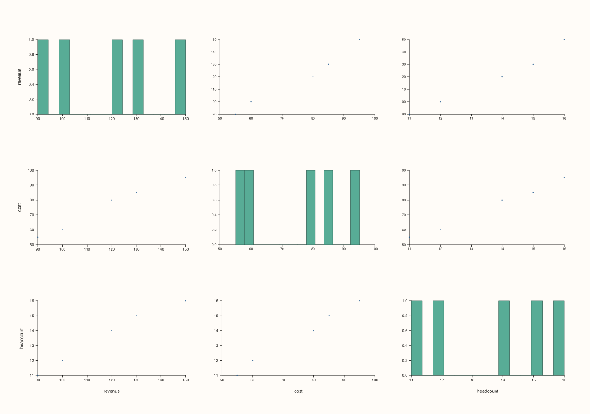
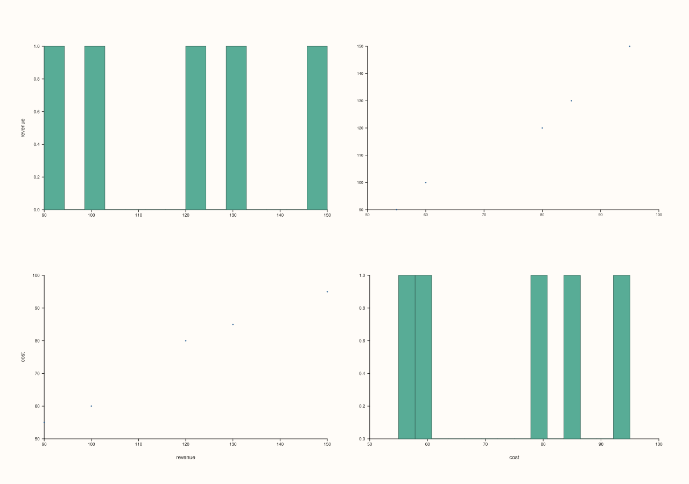
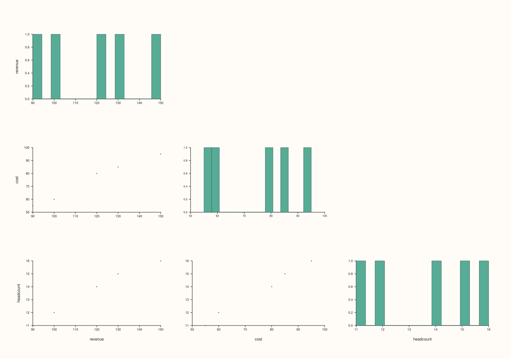
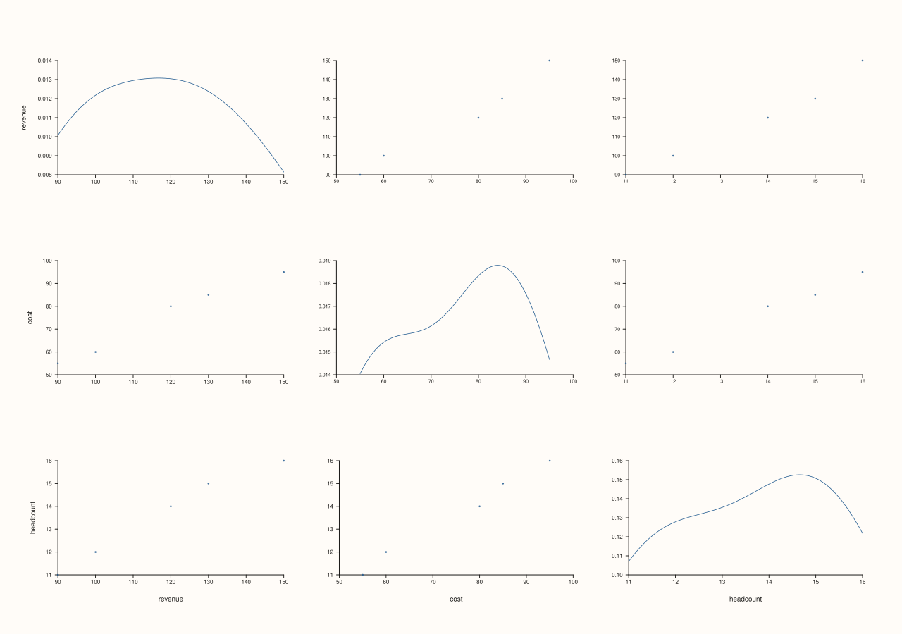

<!-- pluss-hand-authored -->
<!-- pluss-signature-hash: 3a6950602f1e -->

# DataFramePlotAccessor::scatter_matrix

[Back to DataFramePlotAccessor API Reference](../../dataframe_plot_api_reference)

## Signatures

```cpp
DataFramePlotAccessor::scatter_matrix(pluss::msharp::RangeView::Of<std::string_view> features = {}) const -> pluss::pl::Studio

DataFramePlotAccessor::scatter_matrix(pluss::msharp::RangeView::Of<std::string_view> features,
                                       ScatterMatrixTriangle triangle) const -> pluss::pl::Studio

DataFramePlotAccessor::scatter_matrix(pluss::msharp::RangeView::Of<std::string_view> features,
                                       const ScatterMatrixPlotOptions& options) const -> pluss::pl::Studio
```

## What It Does

Builds a grid of every pairwise scatter plot among the selected numeric features — an
`N`×`N` grid of small panes, where off-diagonal cell `(i, j)` is a scatter of feature `i`
against feature `j`, and diagonal cells show each feature's own distribution (a histogram
by default). This is the classic "pairs plot" for eyeballing every two-way relationship in
a small-to-medium numeric feature set at once.

```{important} At least two numeric features are required
Unlike `box()`/`hist()`/etc.'s "any nonzero count of numeric features is fine," a scatter
matrix is inherently pairwise — fewer than two numeric features throws
`"DataFrame::plot().scatter_matrix: need at least two numeric features"`.
```

```{note} Explicit feature lists are validated
If you pass `features`, every requested name must resolve to a numeric `Series`; a missing
or non-numeric feature throws, matching the rest of the plotting accessor. If you leave
`features` empty, `scatter_matrix()` uses the frame's numeric features as-is.
```

## Parameters

**features** (`RangeView<std::string_view>`, default `{}`)
    Numeric features to include in the matrix. Empty (the default) means "take the frame's
    numeric features automatically." Wide analytical tables therefore stay fully visible by
    default instead of being silently truncated.

**triangle** (`ScatterMatrixTriangle`, two-argument overload)
    `Full` (the default elsewhere too), `Lower`, or `Upper` — restricts the grid to only the
    lower or upper triangle (plus the diagonal) instead of drawing every cell twice
    (`(i, j)` and `(j, i)` are mirror images of the same pairwise relationship).

**options** (`ScatterMatrixPlotOptions`)
    ```cpp
    struct ScatterMatrixPlotOptions {
      bool corner{false};
      pluss::pl::flash::PairPlotOptions pair{};
    };
    ```
    `corner = true` is a shorthand: if `pair.triangle` is still at its default (`Full`), it
    gets switched to `Lower` automatically — a "corner-style" pairs plot with the diagonal
    at the top-left and only the lower triangle filled in. `pair` is the full underlying
    `PlussPl` `PairPlotOptions` struct (triangle, diagonal kind, point vs. regression cells,
    grid sizing, point limits, and more); only the fields most relevant here are called out
    on this page — the rest are documented in `PlussPl`'s own reference.

## Returns

`pluss::pl::Studio`
    A figure containing the full grid of pairwise panes.

## Examples

Example 1. No explicit features: every numeric feature in the frame is included.

```cpp
using namespace pluss::table;

auto metrics = DataFrame({
    {"revenue",   Slate(pluss::make_series({100.0, 120.0, 90.0, 150.0, 130.0}))},
    {"cost",      Slate(pluss::make_series({60.0, 80.0, 55.0, 95.0, 85.0}))},
    {"headcount", Slate(pluss::make_series({12.0, 14.0, 11.0, 16.0, 15.0}))},
});

auto chart = metrics.plot().scatter_matrix();
chart.show();
```

A 3×3 grid: six off-diagonal scatter cells (`revenue`×`cost`, `revenue`×`headcount`,
`cost`×`headcount`, each appearing twice, mirrored) plus three diagonal histogram cells.



Example 2. An explicit feature subset via `RangeView`.

```cpp
std::vector<std::string_view> names{"revenue", "cost"};
auto chart = metrics.plot().scatter_matrix(pluss::msharp::RangeView::Of<std::string_view>(names));
chart.show();
```

A 2×2 grid: two off-diagonal scatter cells (mirror images of the same `revenue` vs `cost`
relationship) plus two diagonal histograms.



Example 3. `triangle = Lower`: only the lower triangle and diagonal are drawn.

```cpp
auto chart = metrics.plot().scatter_matrix({}, pluss::table::ScatterMatrixTriangle::Lower);
chart.save_pdf("metrics_lower.pdf");
```

Each pairwise relationship now appears exactly once instead of twice.



Example 4. An explicit `ScatterMatrixPlotOptions`, using the `corner` shorthand instead of
setting `pair.triangle` directly.

```cpp
ScatterMatrixPlotOptions options;
options.corner = true;

auto chart = metrics.plot().scatter_matrix({}, options);
chart.show();
```

Since `options.pair.triangle` was left at its default `Full`, `corner = true` switches it to
`Lower` automatically — equivalent to Example 3, but expressed through the `corner` flag.


Example 5. Reaching into the underlying `PairPlotOptions` for a field this accessor doesn't
wrap directly — here, switching the diagonal cells from histograms to density curves.

```cpp
ScatterMatrixPlotOptions density_diag;
density_diag.pair.diag_kind = pluss::pl::flash::PairPlotDiagKind::Density;

auto chart = metrics.plot().scatter_matrix({}, density_diag);
```



Example 6. Fewer than two numeric features throws.

```cpp
auto single = DataFrame({
    {"revenue", Slate(pluss::make_series({100.0, 120.0, 90.0}))},
});

try {
  auto bad = single.plot().scatter_matrix();
} catch (const std::exception& e) {
  std::cout << e.what();
}
```

### Output

```text
DataFrame::plot().scatter_matrix: need at least two numeric features
```

## Notes

- At least two numeric features are required after validation/selection.
- An explicit `features` list is strict: unknown or non-numeric names throw instead of being
  silently dropped.
- The no-argument form uses the full numeric feature set. If you want a smaller inspection
  grid, pass an explicit subset through `features`.
- Wide scatter matrices no longer rely on silent feature caps or grid-wide point throttling.
  The plotting stack now reuses normalized numeric columns during rendering so repeated
  pairwise panes do not keep rematerializing the same point vectors.
- `corner = true` only overrides `pair.triangle` if it's still at its default `Full`; an
  explicitly set `pair.triangle` is left alone.
- Returns a `pluss::pl::Studio` — see [`line()`](line.md)'s important callout for how to
  view or save the result.

## See Also

- [`DataFramePlotAccessor::corr_heatmap`](corr_heatmap.md): a single correlation
  coefficient per pair instead of a full scatter cell.
- [`DataFramePlotAccessor::scatter`](scatter.md): one chosen x/y pair, with an optional hue
  feature this method doesn't support.
- [`DataFramePlotAccessor::parallel`](parallel.md) / [`radviz`](radviz.md): other
  multivariate-relationship views for more than two features at once.

<div class="pluss-inline-prev-next">
  <a class="prev-link" href="scatter.html">
    <span class="label">Previous</span>
    <span class="title">scatter</span>
  </a>
  <a class="next-link" href="step.html">
    <span class="label">Next</span>
    <span class="title">step</span>
  </a>
</div>
