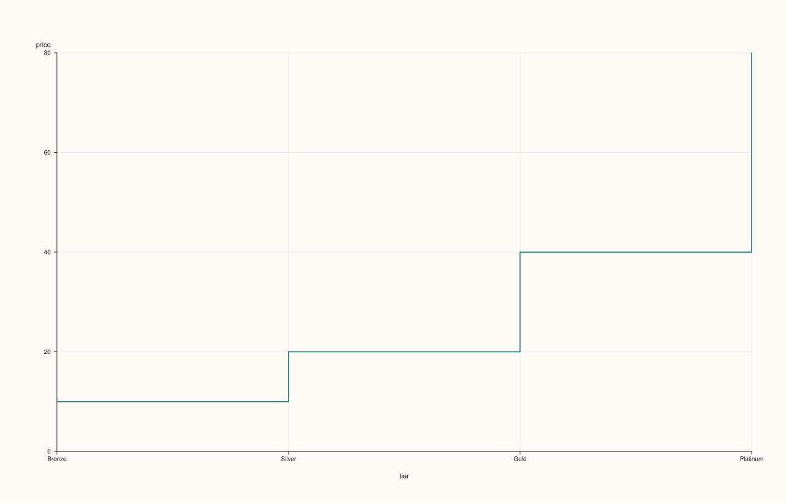
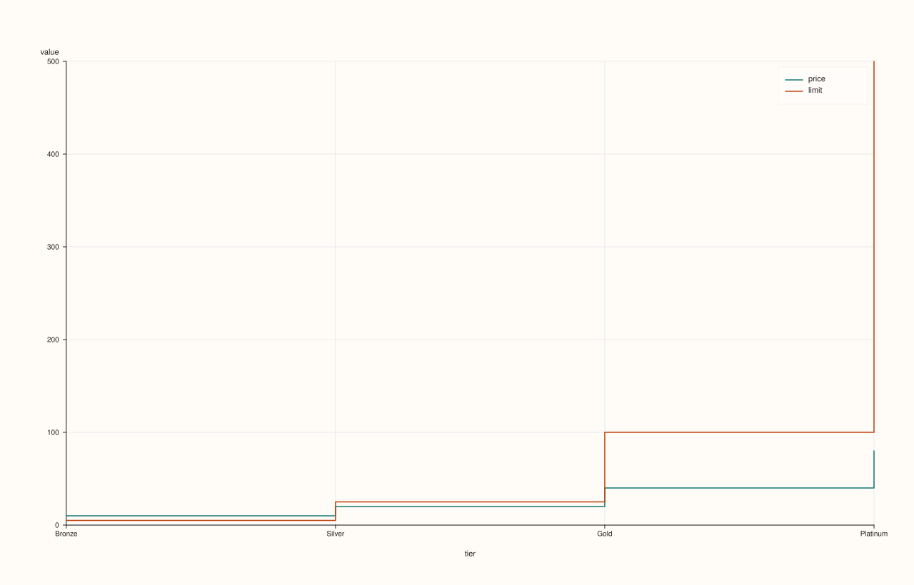
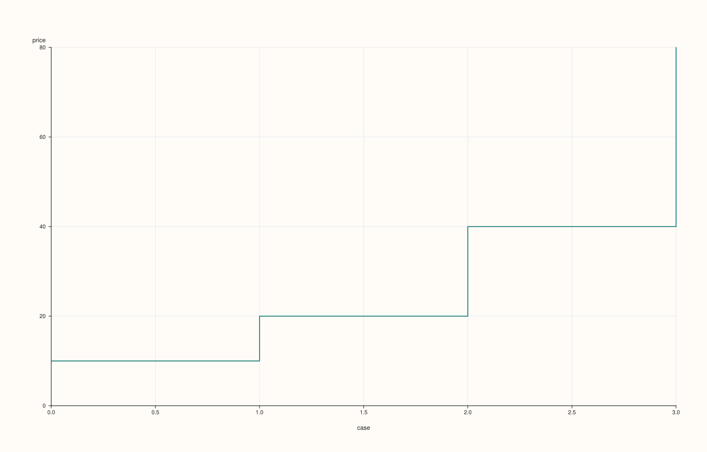
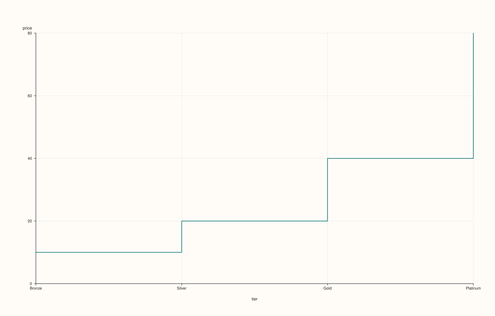
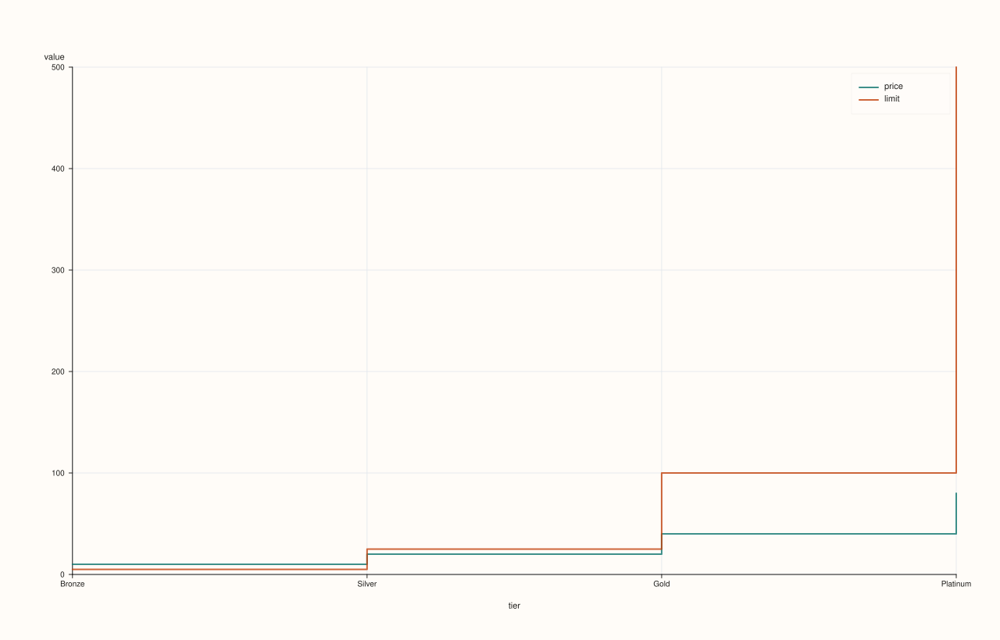

<!-- pluss-hand-authored -->

# DataFramePlotAccessor::step

[Back to DataFramePlotAccessor API Reference](../../dataframe_plot_api_reference)

## Signatures

```cpp
DataFramePlotAccessor::step(std::string_view y_feature,
                             std::optional<std::string_view> x_feature = std::nullopt) const -> pluss::pl::Studio

DataFramePlotAccessor::step(std::string_view y_feature,
                             std::optional<std::string_view> x_feature,
                             const StepPlotOptions& options) const -> pluss::pl::Studio

DataFramePlotAccessor::step(pluss::msharp::RangeView::Of<std::string_view> y_features,
                             std::optional<std::string_view> x_feature = std::nullopt) const -> pluss::pl::Studio

DataFramePlotAccessor::step(pluss::msharp::RangeView::Of<std::string_view> y_features,
                             std::optional<std::string_view> x_feature,
                             const StepPlotOptions& options) const -> pluss::pl::Studio

DataFramePlotAccessor::step(std::initializer_list<std::string_view> y_features,
                             std::optional<std::string_view> x_feature = std::nullopt) const -> pluss::pl::Studio

DataFramePlotAccessor::step(std::initializer_list<std::string_view> y_features,
                             std::optional<std::string_view> x_feature,
                             const StepPlotOptions& options) const -> pluss::pl::Studio
```

## What It Does

Identical in shape to [`line()`](line.md) — one trace per y-feature over a shared x-axis,
same three overload families (single feature, `RangeView`, `initializer_list`), same
x-axis-resolution rules (explicit argument, then `options.default_x_feature`, then the
frame's own row labels titled `"case"`) — but each trace is drawn as a **step function**
(horizontal-then-vertical jumps between points) instead of straight line segments between
consecutive points. This is the natural chart for a value that stays constant between
discrete changes (a price that only updates at known events, a rate that steps between
tiers) rather than one that continuously interpolates.

See [`line()`](line.md) for the full explanation of the shared mechanics (the
`Studio`-return / no-`cout` behavior, and the three-step x-axis resolution) — this page
only covers what's specific to `step()`.

## Parameters

**y_feature** / **y_features** (`std::string_view` / `RangeView<std::string_view>` /
`std::initializer_list<std::string_view>`)
    Same as [`line()`](line.md): one or more numeric features, each drawn as its own step
    trace. At least one is required — an empty list throws `"DataFrame::plot().step: at
    least one y feature is required"`.

**x_feature** (`std::optional<std::string_view>`, default `std::nullopt`)
    Same three-step resolution as [`line()`](line.md).

**options** (`StepPlotOptions`)
    ```cpp
    struct StepPlotOptions {
      double alpha{1.0};
      double line_width{1.5};
      XYAlignOptions align{};
    };
    ```
    Only opacity, stroke width, and `align` — unlike [`LinePlotOptions`](line.md), there is
    no `y_limit_method` field on `StepPlotOptions`; the y-axis always uses the figure's
    default auto-fit behavior for step charts. `align` is present but inert here — see
    [`line()`](line.md)'s note on the field.

## Returns

`pluss::pl::Studio`
    A figure with one pane containing one step trace per requested y-feature.

## Examples

Example 1. A single feature, explicit x-axis.

```cpp
using namespace pluss::table;

auto rates = DataFrame({
    {"tier",   Thread(pluss::make_note({"Bronze", "Silver", "Gold", "Platinum"}))},
    {"price",  Thread(pluss::make_series({9.99, 19.99, 39.99, 79.99}))},
    {"limit",  Thread(pluss::make_series({5.0, 25.0, 100.0, 500.0}))},
});

auto chart = rates.plot().step("price", "tier");
chart.show();
```

`price` is drawn as a step function against the categorical `tier` axis — visually
emphasizing that the price is constant within a tier and jumps at tier boundaries, rather
than implying a continuous interpolation between tiers.



Example 2. Multiple y-features via `initializer_list`, sharing one x-axis.

```cpp
auto chart = rates.plot().step({"price", "limit"}, "tier");
chart.show();
```

Two step traces (`price` and `limit`) share the `tier` x-axis on one pane; a legend appears
automatically since more than one y-feature was requested.


Example 3. The same multi-feature call via a reusable `RangeView`.

```cpp
std::vector<std::string_view> y_names{"price", "limit"};
auto chart = rates.plot().step(pluss::msharp::RangeView::Of<std::string_view>(y_names), "tier");
chart.save_pdf("tiers.pdf");
```



Example 4. No `x_feature`: falls back to the frame's row labels, exactly as
[`line()`](line.md)'s Example 3 demonstrates.

```cpp
auto chart = rates.plot().step("price");
chart.show();
```

With no `x_feature` and no `default_x_feature` configured on the accessor, the x-axis
becomes `rates`' own row labels (the default `0`, `1`, `2`, `3` case index here, since
`rates` was constructed without explicit row labels), titled `"case"`.



Example 5. An explicit `StepPlotOptions`.

```cpp
StepPlotOptions step_options;
step_options.alpha = 0.8;
step_options.line_width = 2.0;

auto chart = rates.plot().step("price", "tier", step_options);
chart.show();
```



Example 6. Multiple y-features with an explicit options object.

```cpp
auto chart = rates.plot().step({"price", "limit"}, "tier", step_options);
```



## Notes

- Shares every mechanic described on [`line()`](line.md)'s page except the step-vs-line
  trace shape and the smaller `StepPlotOptions` struct (no `y_limit_method`).
- At least one y-feature is required.
- Returns a `pluss::pl::Studio` — nothing is printed; see [`line()`](line.md)'s important
  callout for how to view or save the result.

## See Also

- [`DataFramePlotAccessor::line`](line.md): the straight-line-segment counterpart, and the
  canonical explanation of this accessor's shared x-axis and `Studio`-return mechanics.
- [`DataFramePlotAccessor::area`](area.md): a filled variant of the same shape.

<div class="pluss-inline-prev-next">
  <a class="prev-link" href="scatter_matrix.html">
    <span class="label">Previous</span>
    <span class="title">scatter_matrix</span>
  </a>
  <a class="next-link" href="violin.html">
    <span class="label">Next</span>
    <span class="title">violin</span>
  </a>
</div>
