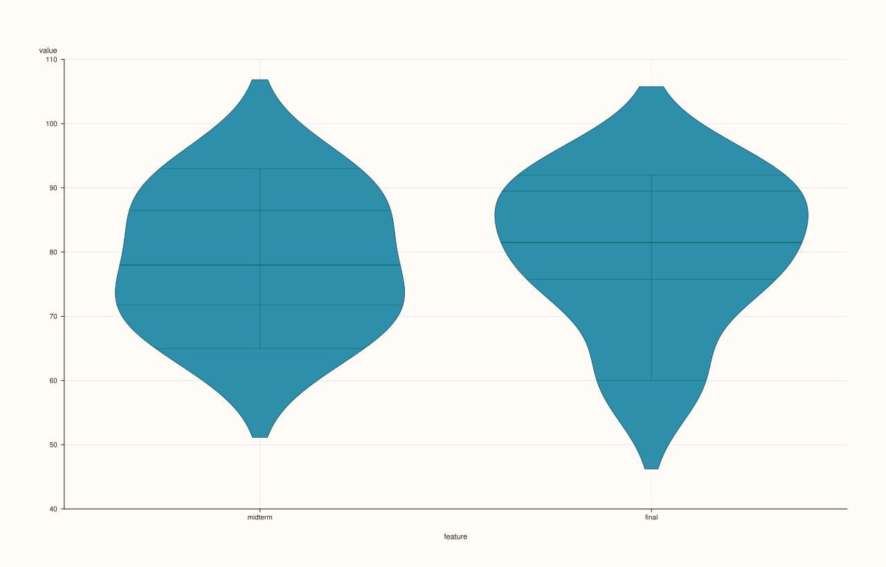
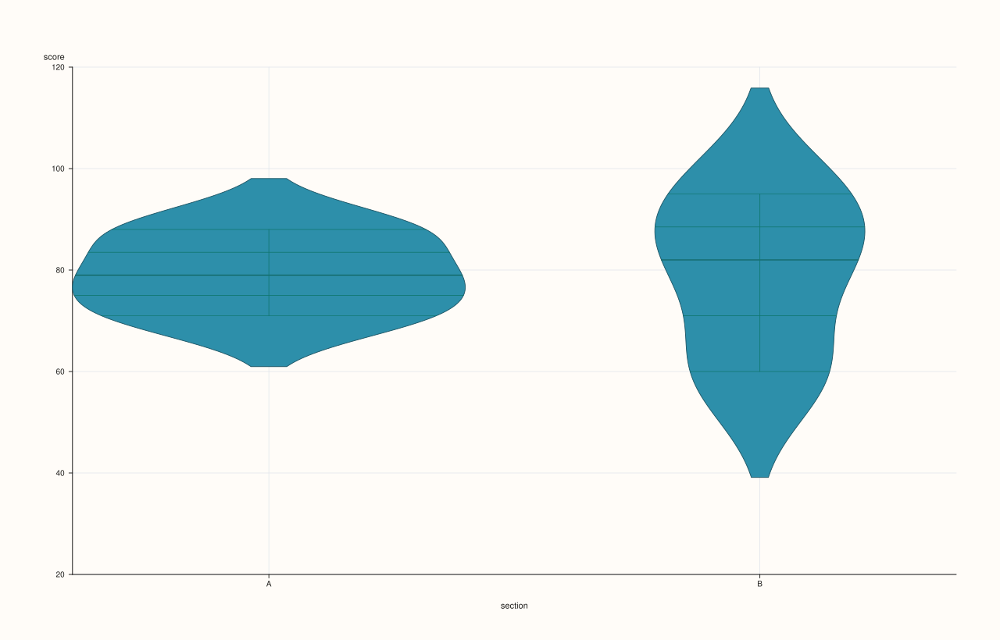
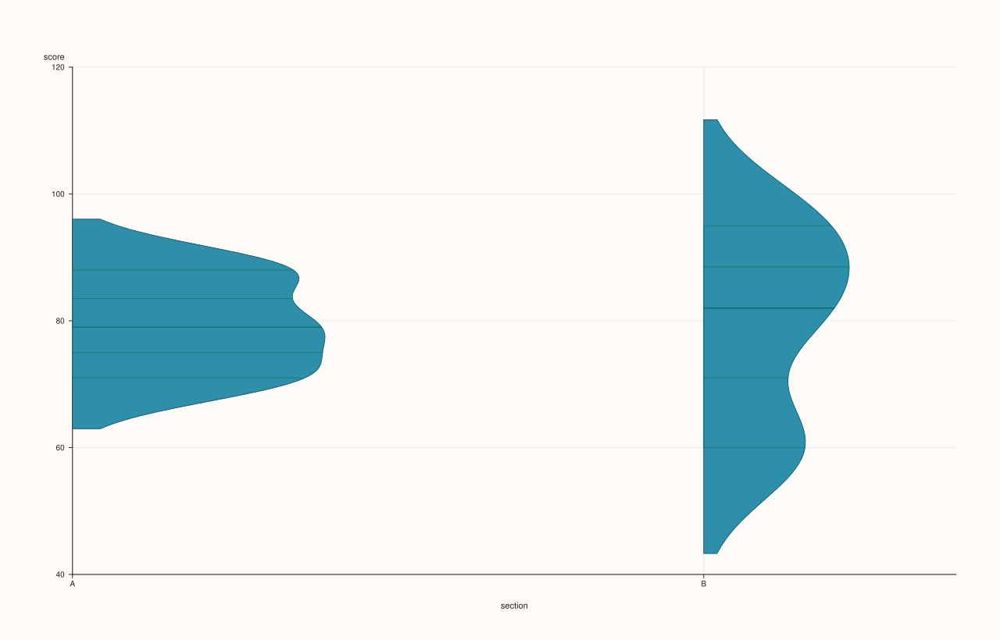

<!-- pluss-hand-authored -->

# DataFramePlotAccessor::violin

[Back to DataFramePlotAccessor API Reference](../../dataframe_plot_api_reference)

## Signatures

```cpp
DataFramePlotAccessor::violin(pluss::msharp::RangeView::Of<std::string_view> features = {}) const -> pluss::pl::Studio

DataFramePlotAccessor::violin(pluss::msharp::RangeView::Of<std::string_view> features,
                               const ViolinPlotOptions& options) const -> pluss::pl::Studio

DataFramePlotAccessor::violin(std::initializer_list<std::string_view> features) const -> pluss::pl::Studio

DataFramePlotAccessor::violin(std::initializer_list<std::string_view> features,
                               const ViolinPlotOptions& options) const -> pluss::pl::Studio

DataFramePlotAccessor::violin(std::string_view value_feature,
                               std::string_view group_feature) const -> pluss::pl::Studio

DataFramePlotAccessor::violin(std::string_view value_feature,
                               std::string_view group_feature,
                               const ViolinPlotOptions& options) const -> pluss::pl::Studio
```

## What It Does

Draws a kernel-density-shaped violin (full distribution shape, not just quartiles) for each
requested numeric feature or group. There are genuinely **two different modes**, chosen by
which overload is called:

- **Feature-list mode** (`violin(features[, options])`): exactly like [`box()`](box.md) —
  one violin per requested numeric feature, all sharing one pane, feature names as x-axis
  labels. An empty (default) `features` list infers every numeric feature in the frame,
  under the same rules described on [`box()`](box.md)'s page.
- **Value/group mode** (`violin(value_feature, group_feature[, options])`): a single numeric
  `value_feature`, split into one violin per distinct value of `group_feature` — the
  "distribution of `value_feature`, broken down by `group_feature`" view.

```{important} Value/group mode accepts a numeric group_feature too — unlike scatter()'s hue
`group_feature` in the two-argument form is **not** restricted to Note/Timeline/TimeIndex
the way [`scatter()`](scatter.md)'s `hue_feature` is. If `group_feature` is text-like
(Note, Timeline, or TimeIndex), its distinct text values become the violin groups. If it's
a plain numeric `Series` instead, `violin()` doesn't reject it — it uses the raw numeric
values directly as violin group positions along the axis, so each **distinct numeric
value** present in `group_feature` gets its own violin at that value's own x position (not
converted to text labels). This is a genuinely more permissive design than `scatter()`'s
hue check; a numeric `group_feature` with mostly-unique values (rather than a handful of
repeated category codes) will produce one near-empty violin per row, which is rarely what's
wanted — reserve a numeric `group_feature` for columns that really are small-cardinality
codes.
```

## Parameters

**features** (`RangeView<std::string_view>` or `std::initializer_list<std::string_view>`,
default `{}`, feature-list mode)
    Numeric features to summarize, each as its own violin. Empty means "every numeric
    feature" — see [`box()`](box.md)'s important callout for the exact rule and throw text.

**value_feature** (`std::string_view`, value/group mode)
    The numeric feature whose distribution is drawn.

**group_feature** (`std::string_view`, value/group mode)
    The feature defining violin groups — text-like or numeric, see the important callout
    above.

**options** (`ViolinPlotOptions`)
    ```cpp
    struct ViolinPlotOptions {
      double alpha{0.92};
      double line_width{1.1};
      double width{0.8};
      double bw_adjust{1.0};
      double cut{2.0};
      pluss::pl::ViolinScale scale{pluss::pl::ViolinScale::Area};
      pluss::pl::ViolinInner inner{pluss::pl::ViolinInner::Box};
      pluss::pl::ViolinSide side{pluss::pl::ViolinSide::Full};
    };
    ```
    `width` is the maximum horizontal extent of each violin. `bw_adjust` scales the kernel
    density bandwidth (above `1.0` smooths the shape further, below `1.0` shows more
    fine-grained detail). `cut` controls how far the drawn shape extends past the observed
    data's min/max, in bandwidth units. `scale` picks how multiple violins are normalized
    against each other: `Area` (equal area under each violin regardless of sample count),
    `Count` (area proportional to each group's sample count), or `Width` (equal max width
    regardless of shape). `inner` chooses what's drawn inside the violin body: `None`,
    `Box` (a mini box plot), `Quartile` (quartile lines), `Stick` (individual observation
    ticks), or `Point` (individual observation dots). `side` can restrict each violin to a
    half-shape (`Left`/`Right`) instead of the default symmetric `Full` shape.

## Returns

`pluss::pl::Studio`
    A figure with one pane containing one violin per requested feature (feature-list mode)
    or one violin per distinct group value (value/group mode).

## Examples

Example 1. Feature-list mode with no explicit list: every numeric feature in the frame.

```cpp
using namespace pluss::table;

auto scores = DataFrame({
    {"midterm", Thread(pluss::make_series({71.0, 82.0, 93.0, 65.0, 88.0, 74.0}))},
    {"final",   Thread(pluss::make_series({75.0, 85.0, 91.0, 60.0, 92.0, 78.0}))},
});

auto chart = scores.plot().violin();
chart.show();
```



Example 2. Feature-list mode, explicit subset via `initializer_list`, with options.

```cpp
ViolinPlotOptions violin_options;
violin_options.inner = pluss::pl::ViolinInner::Quartile;
violin_options.scale = pluss::pl::ViolinScale::Count;

auto chart = scores.plot().violin({"midterm", "final"}, violin_options);
chart.show();
```


Example 3. Value/group mode with a text-like group feature: one violin per distinct
category.

```cpp
auto grouped = DataFrame({
    {"section", Thread(pluss::make_note({"A", "A", "A", "B", "B", "B"}))},
    {"score",   Thread(pluss::make_series({71.0, 88.0, 79.0, 95.0, 60.0, 82.0}))},
});

auto chart = grouped.plot().violin("score", "section");
chart.save_pdf("score_by_section.pdf");
```

Two violins are drawn — one for section `"A"`'s three scores, one for section `"B"`'s three
scores — with `section`'s own distinct text values as the x-axis labels.



Example 4. Value/group mode with a numeric group feature — see the important callout above
for why this is rarely what's actually wanted unless the numeric column really is a
small-cardinality code.

```cpp
auto coded = DataFrame({
    {"tier_code", Thread(pluss::make_series({1.0, 1.0, 1.0, 2.0, 2.0, 2.0}))},
    {"score",     Thread(pluss::make_series({71.0, 88.0, 79.0, 95.0, 60.0, 82.0}))},
});

auto chart = coded.plot().violin("score", "tier_code");
chart.show();
```

`tier_code` is a plain numeric `Series`, not text-like — `violin()` still accepts it
(unlike `scatter()`'s hue, which would throw), using its two distinct values (`1.0`, `2.0`)
directly as the two violin positions.


Example 5. Value/group mode with an explicit `ViolinPlotOptions`, including a half-sided
violin.

```cpp
ViolinPlotOptions half_options;
half_options.side = pluss::pl::ViolinSide::Right;
half_options.bw_adjust = 0.8;

auto chart = grouped.plot().violin("score", "section", half_options);
chart.show();
```



## Notes

- Two distinct modes selected by overload: feature-list (like [`box()`](box.md)) versus
  value/group (splits one feature's values by another feature).
- Feature-list mode's empty-list default and non-finite-value handling follow the same
  rules as [`box()`](box.md).
- Value/group mode accepts a numeric `group_feature`, unlike [`scatter()`](scatter.md)'s
  stricter `hue_feature` — see the important callout above.
- Returns a `pluss::pl::Studio` — see [`line()`](line.md)'s important callout for how to
  view or save the result.

## See Also

- [`DataFramePlotAccessor::box`](box.md): quartiles-and-whiskers only, the simpler sibling
  in feature-list mode.
- [`DataFramePlotAccessor::hist`](hist.md) / [`density`](density.md): other
  distribution-shape views.
- [`DataFramePlotAccessor::scatter`](scatter.md): its stricter `hue_feature` type
  requirement, contrasted with this method's more permissive `group_feature`.

<div class="pluss-inline-prev-next">
  <a class="prev-link" href="step.html">
    <span class="label">Previous</span>
    <span class="title">step</span>
  </a>
</div>
