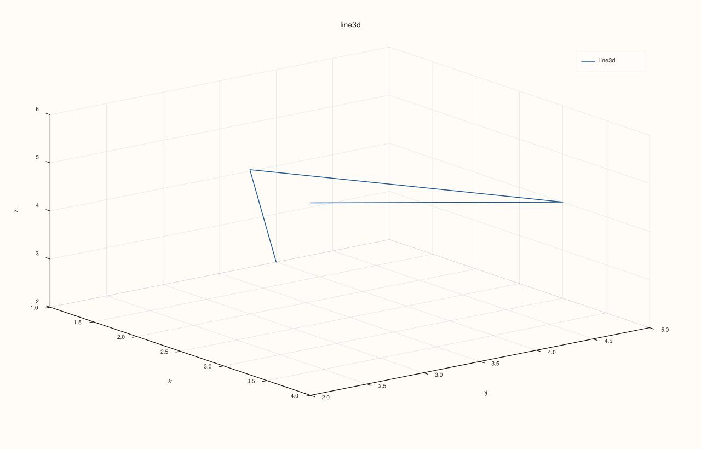
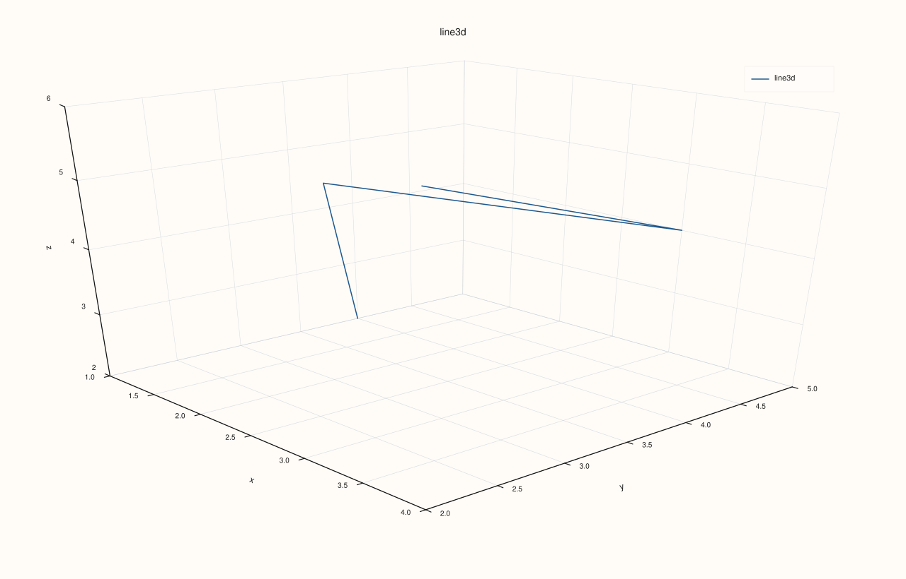
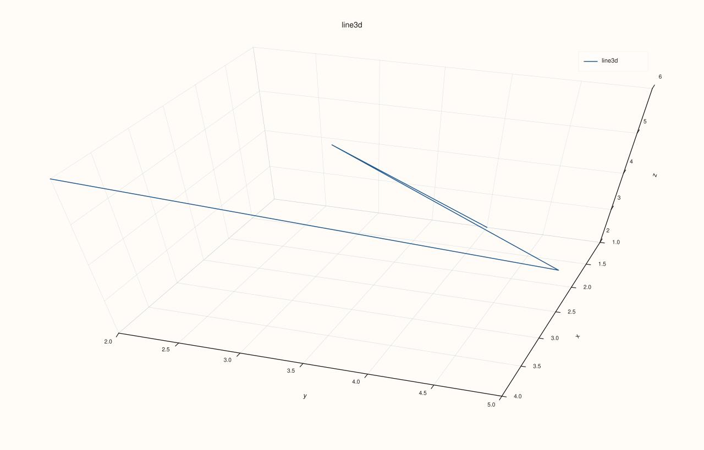
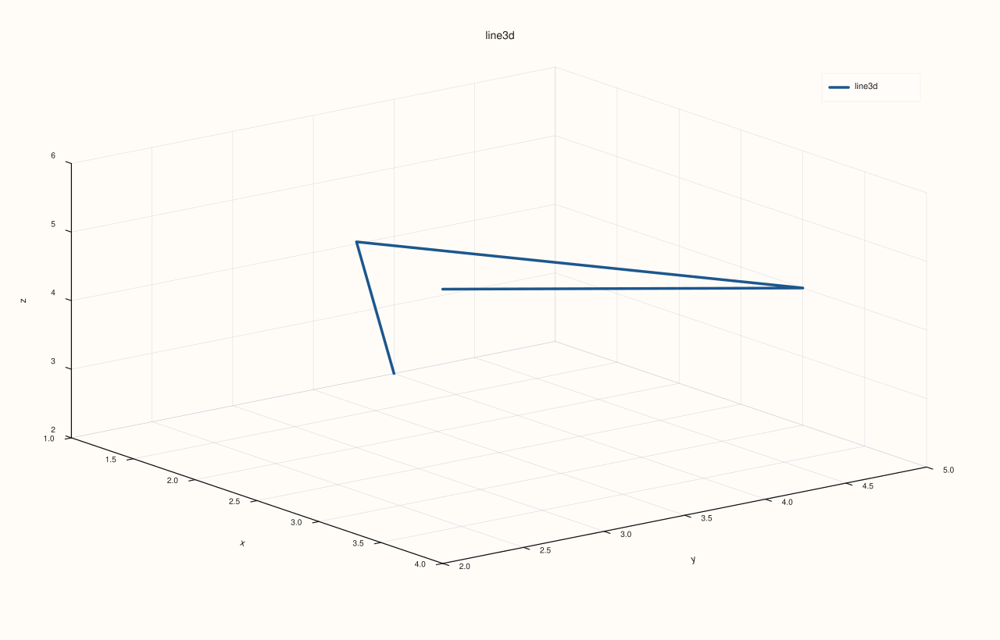
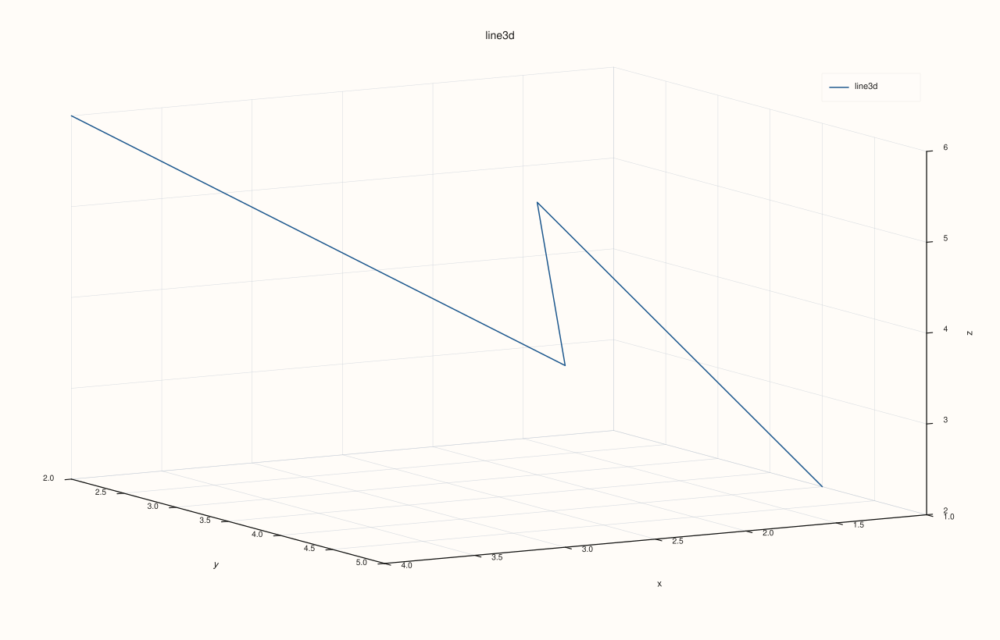
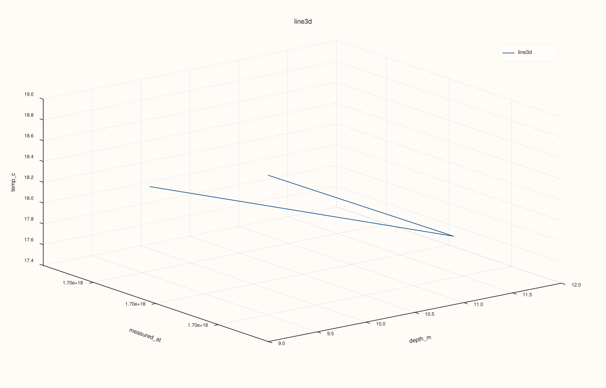

<!-- pluss-hand-authored -->
<!-- pluss-signature-hash: caec046f4baa -->

# DataFramePlot3DAccessor::line

[Back to DataFramePlot3DAccessor API Reference](../../dataframe_plot3d_accessor_api_reference)

## Signature

```cpp
DataFramePlot3DAccessor::line(
    std::string_view x_feature,
    std::string_view y_feature,
    std::string_view z_feature,
    const Line3DPlotOptions& options = {}) const -> pluss::pl::Studio
```

## What It Does

Draws a single connected 3D path: row `i`'s `(x, y, z)` triple becomes point `i` on the
line, and consecutive rows are joined in **frame row order** — there is no sorting by any
axis first. This is the 3D counterpart of [`DataFramePlotAccessor::line`](../dataframe-plot/line.md),
but every axis here is an explicit, required feature; there is no x-axis-resolution fallback
to row labels the way the 2D accessor has.

This page also establishes mechanics shared by every method on
`DataFramePlot3DAccessor` — [`scatter()`](scatter.md), [`hist()`](hist.md),
[`surface()`](surface.md), and [`wireframe()`](wireframe.md) all work the same way with
respect to `Studio`, feature-to-axis conversion, and the two 3D options structs described
below.

```{important} Every method returns a Studio, same as the 2D accessor
Nothing is drawn to the console. Every method on `DataFramePlot3DAccessor` builds and
returns a `pluss::pl::Studio`, exactly like every method on the 2D
[`DataFramePlotAccessor`](../dataframe-plot/line.md) — `Studio` has no `operator<<`, so
`std::cout << chart` does not compile. Call `.show()`, `.save_svg(path)`,
`.save_png(path)`, `.save_pdf(path)`, `.to_svg()`, or `.to_pdf()` to actually view or
persist the figure. Every example on this page ends with one of these calls instead of a
`std::cout` block.
```

```{note} How a feature becomes a numeric axis value
Every 3D method resolves each named feature to a plain `double` per row before plotting:
a `Series`-kind feature is used as-is; a `Timeline`- or `TimeIndex`-kind feature is
converted to **epoch nanoseconds** (so a genuine timestamp feature can be used directly as
an `x`/`y`/`z` axis, plotted on a raw nanosecond scale); a `Note`-kind feature is cast to
`Series` (a text-to-number parse, which produces `NaN` for text that doesn't parse as a
number rather than throwing outright). Any other `Thread` kind throws `"DataFrame::plot:
unsupported Thread kind for numeric plotting"`. A resolved axis whose length doesn't match
the frame's row count throws `"DataFrame::plot: feature '<name>' length mismatch with
cases"` — note this shared low-level check's message always says `"DataFrame::plot"`, even
when it fires from a `plot3d()` call.
```

## Parameters

**x_feature**, **y_feature**, **z_feature** (`std::string_view`, all required)
    The three features providing each row's `x`, `y`, and `z` coordinate — see the note
    above for how each is converted to a numeric value. Unlike the 2D accessor's `x_feature`
    arguments, none of these are optional and there is no frame-row-label fallback.

**options** (`Line3DPlotOptions`)
    ```cpp
    struct Line3DPlotOptions {
      Plot3DSceneOptions scene{};
      Plot3DTraceOptions trace{};
      XYAlignOptions align{XYAlignMode::Inner, XYAlignBy::Auto, 0.0};
    };
    ```
    `scene` controls the 3D pane's camera, lighting, theme, and grid style; `trace`
    controls the drawn line's shading, lighting response, material, stroke width, and
    transparency. Both are described in full below, since every method on this accessor
    shares the exact same two structs. `align` is present for the same
    struct-reuse-with-`Catalog::plot3d()` reason as
    [`scatter()`](scatter.md)'s — inert on `DataFramePlot3DAccessor::line()` itself.

    ```cpp
    enum class ScenePreset3D { Survey, Presentation, Studio, Topology };
    enum class ThemePreset3D { Paper, Ocean, Slate, Mist };
    enum class CameraPreset3D { Spatial, TopDown, Front, Side, Isometric };
    enum class ProjectionKind { Perspective, Orthographic };

    struct Camera3DOptions {
      double azimuth_deg{-37.5};
      double elevation_deg{30.0};
      double view_angle_deg{30.0};
      ProjectionKind projection{ProjectionKind::Orthographic};
    };

    struct Lighting3DOptions {
      bool clear_first{true};
      bool headlight{true};
      bool lamp_left{false};
      bool lamp_right{false};
      bool sun_key{false};
    };

    struct Plot3DSceneOptions {
      std::optional<ScenePreset3D> preset{std::nullopt};
      std::optional<ThemePreset3D> theme{std::nullopt};
      std::optional<CameraPreset3D> camera_preset{std::nullopt};
      std::optional<Camera3DOptions> camera{std::nullopt};
      std::optional<Lighting3DOptions> lighting{std::nullopt};
      std::optional<pluss::pl::GridStyle> grid_style{std::nullopt};
    };
    ```

    Every field in `Plot3DSceneOptions` is a `std::optional` that defaults to
    `std::nullopt`, meaning "leave the pane's built-in default alone." When several
    fields *are* set, they're applied in a fixed order, each one layering on top of
    (and able to override) whatever came before: **`preset`** first (a scribble that sets
    a theme, grid style, camera angle, and a lighting rig all at once — see the preset
    table below), then **`theme`** (overrides just the color theme), then
    **`grid_style`** (`None`, `Major`, or `MajorMinor`), then **`camera_preset`**
    (overrides just the camera angle), then **`camera`** (an explicit
    `Camera3DOptions`, overriding any preset's angle with exact numbers), then
    **`lighting`** (an explicit `Lighting3DOptions`, overriding any preset's lights).
    Setting both `camera_preset` and `camera` is legal — `camera` applies last and wins.

    | `ScenePreset3D` | Theme | Camera | Lighting |
    |---|---|---|---|
    | `Survey` | Ocean | Isometric | headlight + left lamp |
    | `Presentation` | Paper | perspective, low/wide angle | headlight + right lamp + sun key |
    | `Studio` | Slate | Spatial (the library-wide default angle) | headlight + both lamps |
    | `Topology` | Mist | TopDown | headlight only |

    ```cpp
    enum class TracePreset3D { Path, Cloud, Surface, Wireframe, Spire, Volume };
    enum class ShadeMode { Faceted, Flat, Smooth };
    enum class LightingMode { None, Flat, Gouraud };
    enum class MaterialProfile { Default, Dull, Shiny, Metal };

    struct Plot3DTraceOptions {
      std::optional<TracePreset3D> preset{std::nullopt};
      std::optional<ShadeMode> shade{std::nullopt};
      std::optional<LightingMode> lighting{std::nullopt};
      std::optional<MaterialProfile> material{std::nullopt};
      std::optional<float> line_width{std::nullopt};
      std::optional<bool> transparent{std::nullopt};
    };
    ```

    Same layering rule as `Plot3DSceneOptions`: **`preset`** applies first (a scribble of
    shade/lighting/material/width/transparency tuned for one trace shape — `Path` is
    tuned for line traces, `Cloud` for scatter, `Surface` for filled meshes,
    `Wireframe` for mesh edges, `Spire` for 3D-bar histograms, `Volume` for
    translucent solids), then any explicitly-set `shade`, `lighting`, `material`,
    `line_width`, or `transparent` fields override just that one aspect of the preset.
    None of `line()`'s example calls below set a `preset`, so the pane/trace defaults
    (not any preset's values) are what's actually drawn unless noted otherwise.

## Returns

`pluss::pl::Studio`
    A figure with one 3D pane containing a single connected line trace through the `n`
    `(x, y, z)` points, in row order.

## Examples

Example 1. Default options: a simple 3D path.

```cpp
using namespace pluss::table;

auto points = DataFrame({
    {"x", Thread(pluss::make_series({1.0, 2.0, 3.0, 4.0}))},
    {"y", Thread(pluss::make_series({4.0, 3.0, 5.0, 2.0}))},
    {"z", Thread(pluss::make_series({2.0, 5.0, 4.0, 6.0}))},
});

auto chart = points.plot3d().line("x", "y", "z");
chart.save_svg("path3d.svg");
```

Four points are connected in row order: `(1,4,2) → (2,3,5) → (3,5,4) → (4,2,6)` — not
sorted by `x` or any other axis first.



Example 2. A `Line3DPlotOptions` with a scene preset for a presentation-style camera and
theme.

```cpp
Line3DPlotOptions options;
options.scene.preset = pluss::pl::flash::ScenePreset3D::Presentation;

auto chart = points.plot3d().line("x", "y", "z", options);
chart.show();
```



Example 3. Overriding just the camera angle with an explicit `Camera3DOptions`, leaving
the theme and lighting at their pane defaults.

```cpp
Line3DPlotOptions options;
options.scene.camera = pluss::pl::flash::Camera3DOptions{
    .azimuth_deg = 20.0,
    .elevation_deg = 45.0,
    .view_angle_deg = 25.0,
    .projection = pluss::pl::ProjectionKind::Perspective,
};

auto chart = points.plot3d().line("x", "y", "z", options);
chart.show();
```



Example 4. A trace preset (`Path`, tuned for line traces) combined with an explicit
`line_width` override — the preset sets shading/lighting/material/width, and the explicit
`line_width` then overrides just that one field.

```cpp
Line3DPlotOptions options;
options.trace.preset = pluss::pl::flash::TracePreset3D::Path;
options.trace.line_width = 3.5F;

auto chart = points.plot3d().line("x", "y", "z", options);
chart.save_pdf("path3d_styled.pdf");
```



Example 5. Both a `camera_preset` and an explicit `camera` set together — the explicit
`camera` applies last and wins, since it's later in the fixed layering order.

```cpp
Line3DPlotOptions options;
options.scene.camera_preset = pluss::pl::flash::CameraPreset3D::TopDown;
options.scene.camera = pluss::pl::flash::Camera3DOptions{.azimuth_deg = 60.0, .elevation_deg = 15.0};

auto chart = points.plot3d().line("x", "y", "z", options);
```

The final camera angle is `(azimuth = 60.0, elevation = 15.0)` from the explicit `camera`
field — the `TopDown` preset's `(0.0, 90.0)` angle is set first, then immediately
overridden.



Example 6. A `Timeline` feature used directly as an axis — converted to epoch
nanoseconds, per the note above.

```cpp
auto readings = DataFrame({
    {"measured_at", Thread(pluss::make_timeline({"2024-01-01T00:00:00Z", "2024-01-02T00:00:00Z", "2024-01-03T00:00:00Z"}))},
    {"depth_m",     Thread(pluss::make_series({10.0, 12.0, 9.0}))},
    {"temp_c",      Thread(pluss::make_series({18.0, 17.5, 19.0}))},
});

auto chart = readings.plot3d().line("measured_at", "depth_m", "temp_c");
```

`measured_at`'s `x` coordinates are its epoch-nanosecond values — a very large numeric
range compared to `depth_m`/`temp_c`, so the pane's own auto-scaling handles the disparity;
this call does not reformat the x-axis into calendar tick labels the way the 2D accessor's
Timeline-aware axis labeling does.



## Notes

- Every axis argument is required — there is no optional-argument or row-label fallback
  here, unlike [`DataFramePlotAccessor::line`](../dataframe-plot/line.md)'s `x_feature`.
- Points are connected strictly in frame row order, never sorted by any axis.
- `Plot3DSceneOptions` and `Plot3DTraceOptions` both apply their fields in a fixed
  preset-then-explicit-override order — see the callouts above; this same layering rule
  applies to every method on this accessor.
- A `Timeline`/`TimeIndex` feature used as an axis is converted to epoch nanoseconds, not
  calendar-aware tick labels.
- Returns a `pluss::pl::Studio` — see the important callout above for how to view or save
  the result.

## See Also

- [`DataFramePlotAccessor::line`](../dataframe-plot/line.md): the 2D counterpart, with
  optional x-axis resolution and row-label fallback this method doesn't have.
- [`DataFramePlot3DAccessor::scatter`](scatter.md): unconnected 3D points instead of a
  connected path, with optional size/color encoding.
- [`DataFrame::plot3d`](../dataframe/plot3d.md): how to enter this accessor.

<div class="pluss-inline-prev-next">
  <a class="prev-link" href="hist.html">
    <span class="label">Previous</span>
    <span class="title">hist</span>
  </a>
  <a class="next-link" href="scatter.html">
    <span class="label">Next</span>
    <span class="title">scatter</span>
  </a>
</div>
