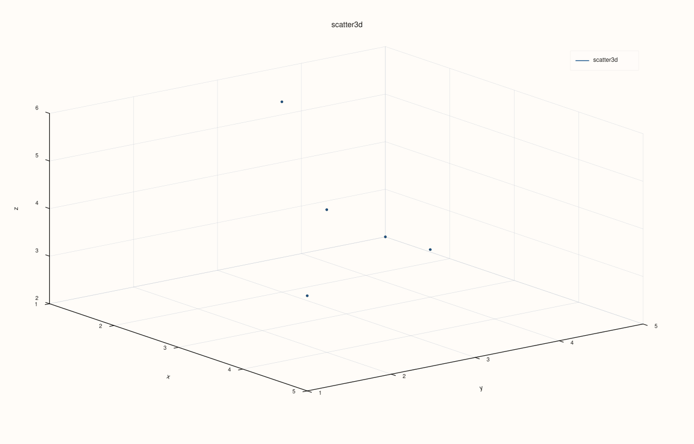

<!-- pluss-hand-authored -->
<!-- pluss-signature-hash: 35e488e6e472 -->

# DataFramePlot3DAccessor::scatter

[Back to DataFramePlot3DAccessor API Reference](../../dataframe_plot3d_accessor_api_reference)

## Signature

```cpp
DataFramePlot3DAccessor::scatter(
    std::string_view x_feature,
    std::string_view y_feature,
    std::string_view z_feature,
    std::optional<std::string_view> size_feature = std::nullopt,
    std::optional<std::string_view> color_feature = std::nullopt,
    const Scatter3DPlotOptions& options = {}) const -> pluss::pl::Studio
```

## What It Does

Draws an unconnected 3D point cloud: row `i`'s `(x, y, z)` triple becomes one point, with
two optional per-point encodings layered on top — `size_feature` scales each point's marker
size, and `color_feature` maps each point's numeric value onto the trace's color scale. This
is the 3D counterpart of [`DataFramePlotAccessor::scatter`](../dataframe-plot/scatter.md),
though the two differ meaningfully: the 2D `scatter()` accepts a categorical `hue_feature`
that splits points into separate colored/labeled traces, while this method's
`color_feature` is a single continuous numeric gradient across one trace, closer in spirit
to a heatmap's color scale than to the 2D accessor's hue grouping.

See [`line()`](line.md) for the shared `Studio`-return / no-`cout` mechanics, feature-to-
axis conversion rules, and the full `Plot3DSceneOptions`/`Plot3DTraceOptions` layering
explanation — this page only covers what's specific to `scatter()`.

```{note} size_feature and color_feature combine independently
There are effectively four call shapes, chosen entirely by which of `size_feature` and
`color_feature` are present: neither present draws uniform points at the pane's default
marker size; `size_feature` alone scales marker size per point; `color_feature` alone
colors every point by its value while marker size stays fixed at
`options.default_marker_size`; both present scale size *and* color together. There is no
overload that lets you set a per-point color without also implicitly sizing every point
uniformly at `default_marker_size` when `size_feature` is omitted — the size argument
passed to the underlying trace call is always populated, just filled with a constant when
`size_feature` isn't given.
```

## Parameters

**x_feature**, **y_feature**, **z_feature** (`std::string_view`, all required)
    The three features providing each point's `x`, `y`, and `z` coordinate — see
    [`line()`](line.md)'s note on feature-to-axis conversion.

**size_feature** (`std::optional<std::string_view>`, default `std::nullopt`)
    Optional numeric feature controlling each point's marker size. Omitted means every
    point uses `options.default_marker_size` uniformly.

**color_feature** (`std::optional<std::string_view>`, default `std::nullopt`)
    Optional numeric feature mapped onto the trace's color scale, one continuous gradient
    across all points (not a categorical split into separate traces — contrast the 2D
    accessor's `hue_feature`).

**options** (`Scatter3DPlotOptions`)
    ```cpp
    struct Scatter3DPlotOptions {
      Plot3DSceneOptions scene{};
      Plot3DTraceOptions trace{};
      double default_marker_size{12.0};
      XYAlignOptions align{XYAlignMode::Inner, XYAlignBy::Auto, 0.0};
    };
    ```
    `default_marker_size` is only consulted when `size_feature` is omitted; `scene`/`trace`
    are the same shared structs documented in full on [`line()`](line.md). `align` exists so
    `Catalog::plot3d().scatter()` can reuse this struct type for its own multi-key
    reconciliation (see
    [`CatalogPlot3DAccessor::scatter`](../catalog-plot3d/scatter.md)) — `DataFramePlot3DAccessor::scatter()`
    itself never reads it: every feature named here is already a column of the same,
    already-constructed `DataFrame`, so there is no length mismatch for `align` to resolve.

## Returns

`pluss::pl::Studio`
    A figure with one 3D pane containing a single point-cloud trace of the `n` `(x, y, z)`
    points.

## Examples

Example 1. Default options: uniform points, no size or color encoding.

```cpp
using namespace pluss::table;

auto points = DataFrame({
    {"x", Slate(pluss::make_series({1.0, 2.0, 3.0, 4.0, 5.0}))},
    {"y", Slate(pluss::make_series({5.0, 3.0, 4.0, 2.0, 1.0}))},
    {"z", Slate(pluss::make_series({2.0, 6.0, 3.0, 5.0, 4.0}))},
    {"mass",  Slate(pluss::make_series({10.0, 40.0, 15.0, 55.0, 25.0}))},
    {"speed", Slate(pluss::make_series({1.2, 3.4, 0.8, 4.1, 2.0}))},
});

auto chart = points.plot3d().scatter("x", "y", "z");
chart.save_svg("points3d.svg");
```


Example 2. `size_feature` only: marker size scales with `mass`, color stays uniform.

```cpp
auto chart = points.plot3d().scatter("x", "y", "z", "mass");
chart.show();
```


Example 3. `color_feature` only: every point stays `default_marker_size` (12.0), but
color now maps to `speed`.

```cpp
auto chart = points.plot3d().scatter("x", "y", "z", std::nullopt, "speed");
chart.save_pdf("points3d_colored.pdf");
```

Passing `std::nullopt` explicitly for `size_feature` here is required syntax — there is no
overload that skips straight to `color_feature` while omitting `size_feature` entirely.


Example 4. Both `size_feature` and `color_feature`: marker size scales with `mass`, color
maps to `speed`.

```cpp
auto chart = points.plot3d().scatter("x", "y", "z", "mass", "speed");
chart.show();
```


Example 5. An explicit `Scatter3DPlotOptions`, raising `default_marker_size` (which only
takes effect because `size_feature` is omitted here) and applying a `Cloud` trace preset.

```cpp
Scatter3DPlotOptions options;
options.default_marker_size = 30.0;
options.trace.preset = pluss::pl::flash::TracePreset3D::Cloud;

auto chart = points.plot3d().scatter("x", "y", "z", std::nullopt, std::nullopt, options);
```



Example 6. A mismatched-length `size_feature` (fewer rows than the frame) throws, same as
every axis feature.

```cpp
auto mismatched = DataFrame({
    {"x", Slate(pluss::make_series({1.0, 2.0, 3.0}))},
    {"y", Slate(pluss::make_series({1.0, 2.0, 3.0}))},
    {"z", Slate(pluss::make_series({1.0, 2.0, 3.0}))},
});
mismatched = mismatched.features({"x", "y", "z"});

try {
  // A contrived example: size_feature named here doesn't exist on the frame.
  auto bad = mismatched.plot3d().scatter("x", "y", "z", "missing");
} catch (const std::exception& e) {
  std::cout << e.what();
}
```

## Notes

- `size_feature` and `color_feature` are independent optional encodings — see the note
  above for exactly how the four combinations behave.
- `default_marker_size` only applies when `size_feature` is omitted.
- Unlike the 2D accessor's `hue_feature`, `color_feature` is a single continuous gradient
  across one trace, not a split into separate colored/labeled traces.
- Returns a `pluss::pl::Studio` — see [`line()`](line.md)'s important callout for how to
  view or save the result.

## See Also

- [`DataFramePlotAccessor::scatter`](../dataframe-plot/scatter.md): the 2D counterpart,
  with a categorical `hue_feature` instead of a continuous `color_feature`.
- [`DataFramePlot3DAccessor::line`](line.md): connected points in row order, instead of an
  unconnected cloud.

<div class="pluss-inline-prev-next">
  <a class="prev-link" href="line.html">
    <span class="label">Previous</span>
    <span class="title">line</span>
  </a>
  <a class="next-link" href="surface.html">
    <span class="label">Next</span>
    <span class="title">surface</span>
  </a>
</div>
