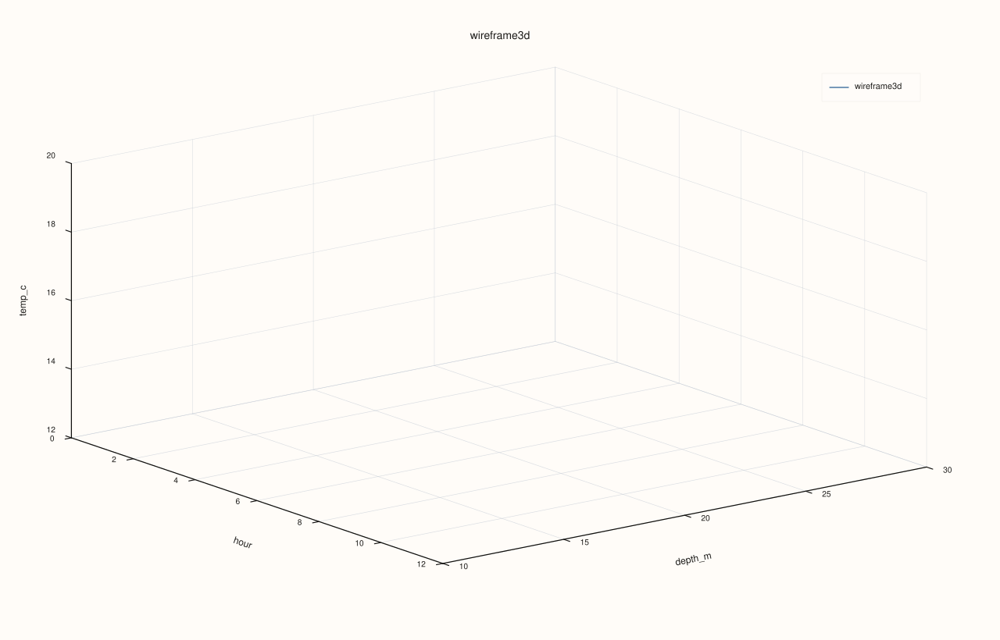
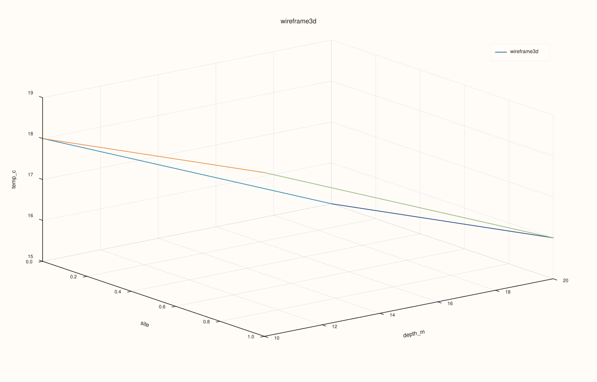

<!-- pluss-hand-authored -->
<!-- pluss-signature-hash: ed81fb36d786 -->

# DataFramePlot3DAccessor::wireframe

[Back to DataFramePlot3DAccessor API Reference](../../dataframe_plot3d_accessor_api_reference)

## Signature

```cpp
DataFramePlot3DAccessor::wireframe(
    std::string_view x_feature,
    std::string_view y_feature,
    std::string_view z_feature,
    DataFrame::GroupOp op = DataFrame::GroupOp::Mean,
    const Wireframe3DPlotOptions& options = {}) const -> pluss::pl::Studio
```

## What It Does

Draws the same aggregated 3D grid as [`surface()`](surface.md) — `y_feature`'s distinct
values as rows, `x_feature`'s distinct values as columns, each cell aggregating
`z_feature` via `op` — but rendered as a **wireframe mesh** (grid edges only) instead of a
filled, continuous surface. Every construction detail (the `pivot_table()` call, the
grid-coordinate resolution, the restricted set of supported `op` values, the dropped-row
and zero-fill behavior) is identical to `surface()`; only the final trace call differs
(`flash::lattice(...)` here instead of `flash::sheet(...)`).

See [`surface()`](surface.md) for the full explanation of how the grid is built, and
[`line()`](line.md) for the shared `Studio`-return / no-`cout` mechanics and the full
`Plot3DSceneOptions`/`Plot3DTraceOptions` layering explanation.

```{important} Same numeric-grid constraint as surface()
`wireframe()` now inherits the broadened `pivot_table()` aggregations too, including
`Std`, `Var`, and `Mode`. The real restriction is the same one `surface()` has: once the
table is pivoted, the z-grid still has to be numeric so it can be rendered in 3D. See
[`surface()`](surface.md)'s important callout for the full explanation.
```

## Parameters

**x_feature** (`std::string_view`)
Feature whose distinct values become the grid's columns (x-axis) — see
[`surface()`](surface.md)'s note on grid-coordinate resolution.

**y_feature** (`std::string_view`)
Feature whose distinct values become the grid's rows (y-axis).

**z_feature** (`std::string_view`)
Feature aggregated into each grid cell's height.

**op** (`DataFrame::GroupOp`, default `Mean`)
The aggregation applied per cell — see [`surface()`](surface.md)'s important callout
for which values are actually supported.

**options** (`Wireframe3DPlotOptions`)

| Option | Default | Purpose |
|---|---|---|
| `scene` | Pane defaults | Camera, theme, lighting, and grid settings. |
| `trace` | Trace defaults | Mesh-edge shading and material settings. |

The same shared structs documented in full on [`line()`](line.md); `wireframe()` has no
fields of its own beyond these two. A `Wireframe` trace preset (tuned lighting/shading
for mesh edges) is available via `options.trace.preset`.

## Returns

`pluss::pl::Studio`
    A figure with one 3D pane containing a single wireframe-mesh trace over the aggregated
    grid.

## Examples

Example 1. Default `op` (`Mean`): the same numeric grid `surface()`'s Example 1 draws,
rendered as edges instead of a filled mesh.

```cpp
using namespace pluss::table;

auto readings = DataFrame({
    {"depth_m", Slate(pluss::make_series({10.0, 10.0, 20.0, 20.0, 30.0, 30.0}))},
    {"hour",    Slate(pluss::make_series({0.0, 12.0, 0.0, 12.0, 0.0, 12.0}))},
    {"temp_c",  Slate(pluss::make_series({18.0, 20.0, 15.0, 16.5, 12.0, 12.5}))},
});

auto chart = readings.plot3d().wireframe("hour", "depth_m", "temp_c");
chart.save_svg("temp_wireframe.svg");
```


Example 2. A different aggregation (`Min`).

```cpp
auto chart = readings.plot3d().wireframe("hour", "depth_m", "temp_c", DataFrame::GroupOp::Min);
chart.show();
```


Example 3. The `Wireframe` trace preset, tuned for mesh-edge rendering.

```cpp
Wireframe3DPlotOptions options;
options.trace.preset = pluss::pl::flash::TracePreset3D::Wireframe;

auto chart = readings.plot3d().wireframe("hour", "depth_m", "temp_c", DataFrame::GroupOp::Mean, options);
chart.save_pdf("temp_wireframe_styled.pdf");
```



Example 4. A categorical `x_feature`, falling back to positional x-coordinates exactly
like [`surface()`](surface.md)'s Example 3.

```cpp
auto tagged = DataFrame({
    {"site",   Slate(pluss::make_note({"north", "north", "south", "south"}))},
    {"depth_m", Slate(pluss::make_series({10.0, 20.0, 10.0, 20.0}))},
    {"temp_c",  Slate(pluss::make_series({18.0, 15.0, 19.0, 16.0}))},
});

auto chart = tagged.plot3d().wireframe("site", "depth_m", "temp_c");
chart.show();
```



Example 5. `Var` is now supported, producing a sample-variance mesh.

```cpp
auto repeated = DataFrame({
    {"depth_m", Slate(pluss::make_series({10.0, 10.0, 10.0, 10.0}))},
    {"hour",    Slate(pluss::make_series({0.0, 0.0, 12.0, 12.0}))},
    {"temp_c",  Slate(pluss::make_series({18.0, 20.0, 15.0, 19.0}))},
});

auto chart = repeated.plot3d().wireframe("hour", "depth_m", "temp_c", DataFrame::GroupOp::Var);
chart.show();
```

## Notes

- Every construction detail is shared with [`surface()`](surface.md) — only the final
  trace shape differs (mesh edges vs. a filled surface).
- The pivot step supports the broader grouped op set now too; the remaining practical
  constraint is still numeric convertibility of the rendered z-grid.
- Returns a `pluss::pl::Studio` — see [`line()`](line.md)'s important callout for how to
  view or save the result.

## See Also

- [`DataFramePlot3DAccessor::surface`](surface.md): the identical grid, rendered as a
  filled continuous mesh instead of edges.
- [`DataFramePlot3DAccessor::hist`](hist.md): a binned-count grid instead of an
  aggregated-value grid, with `as_wireframe = true` producing a visually similar mesh.

<div class="pluss-inline-prev-next">
  <a class="prev-link" href="surface.html">
    <span class="label">Previous</span>
    <span class="title">surface</span>
  </a>
</div>
