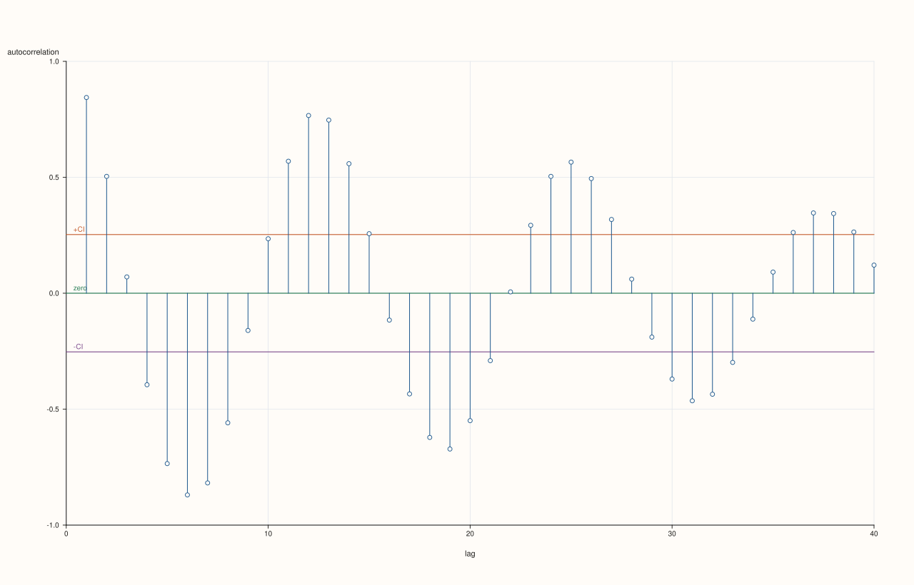
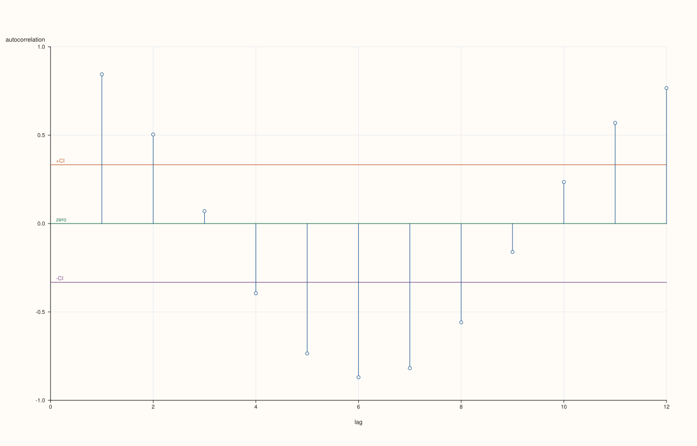

<!-- pluss-hand-authored -->
<!-- pluss-signature-hash: 6b7b63e8db79 -->

# SlatePlotAccessor::act

[Back to SlatePlotAccessor API Reference](../../slate_plot_api_reference)

## Signature

```cpp
pluss::pl::Studio SlatePlotAccessor::act(const ActPlotOptions& options = {}) const
```

## What It Does

Draws an autocorrelation plot for the bound slate's values — the single-series
specialization of [`DataFramePlotAccessor::act`](../../api/dataframe-plot/act.md), which on
the 2D accessor requires naming a feature; here the bound slate is always the one and only
feature autocorrelated.

```{note} At least three data points are required
Same as the 2D accessor: a slate with fewer than three rows throws
`"flash::acfplot requires at least three points"`.
```

## Parameters

**options** (`ActPlotOptions`)
    The identical struct documented on
    [`DataFramePlotAccessor::act`](../../api/dataframe-plot/act.md) (`max_lag`,
    `show_confidence_band`, `confidence_level`, `trace_width`).

## Returns

`pluss::pl::Studio`
    A figure with one pane containing one autocorrelation spike per lag, a zero reference
    line, and (when enabled) two confidence-band reference lines.

## Examples

Example 1. Default options.

```cpp
using namespace pluss::table;

std::vector<double> wave;
for (int i = 0; i < 60; ++i) {
  wave.push_back(std::sin(static_cast<double>(i) * 0.5) + 0.1 * (i % 3));
}

auto signal = Slate(pluss::make_series(wave));
signal = signal.name("signal");

auto chart = signal.plot().act();
chart.show();
```



Example 2. An explicit `ActPlotOptions`, narrowing `max_lag` and using a stricter
`confidence_level`.

```cpp
ActPlotOptions options;
options.max_lag = 12;
options.confidence_level = 0.99;

auto chart = signal.plot().act(options);
chart.show();
```



## Notes

- The bound slate is always the single autocorrelated feature — there is no feature-name
  argument the way the 2D accessor's `act()` has.
- Lag `0` is never shown; spikes start at lag `1`.
- `max_lag` is clamped to `[1, n - 1]`, never throwing for an over-large request.
- Returns a `pluss::pl::Studio` — see [`line()`](line.md) for how to view or save the
  result.

## See Also

- [`DataFramePlotAccessor::act`](../../api/dataframe-plot/act.md): the method this
  delegates to.
- [`SlatePlotAccessor::lag`](lag.md): a single lag's scatter plot, rather than every lag's
  correlation.
- [`SlatePlotAccessor::bootstrap`](bootstrap.md): another single-feature diagnostic, based
  on resampling rather than lags.

<div class="pluss-inline-prev-next">
  <a class="next-link" href="area.html">
    <span class="label">Next</span>
    <span class="title">area</span>
  </a>
</div>
