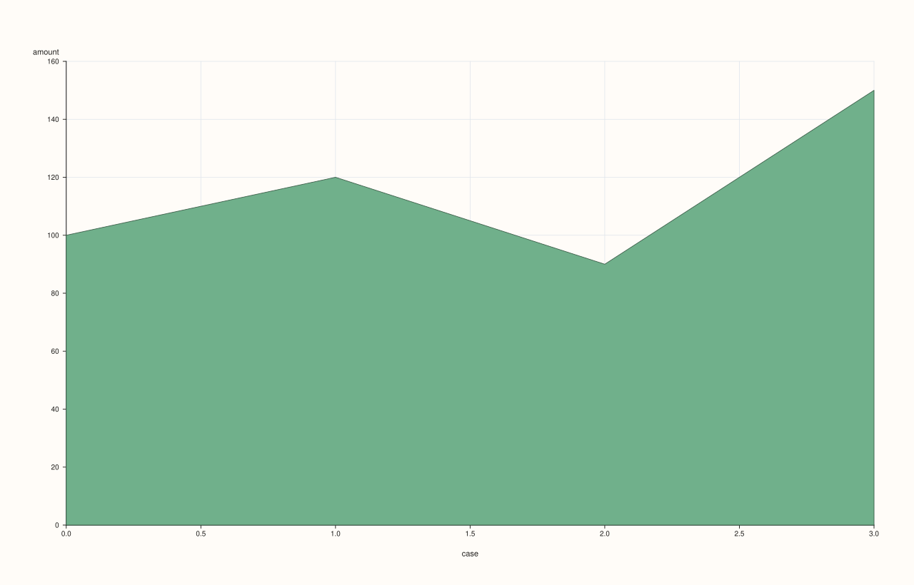

<!-- pluss-hand-authored -->
<!-- pluss-signature-hash: 651f971654ee -->

# SlatePlotAccessor::area

[Back to SlatePlotAccessor API Reference](../../slate_plot_api_reference)

## Signatures

```cpp
SlatePlotAccessor::area() const -> pluss::pl::Studio
SlatePlotAccessor::area(const Slate& x) const -> pluss::pl::Studio
SlatePlotAccessor::area(const AreaPlotOptions& options) const -> pluss::pl::Studio
SlatePlotAccessor::area(const Slate& x, const AreaPlotOptions& options) const -> pluss::pl::Studio
```

## What It Does

Identical in shape to [`line()`](line.md), but the trace is filled down to the baseline
instead of drawn as a bare line — the single-series specialization of
[`DataFramePlotAccessor::area`](../../api/dataframe-plot/area.md). See [`line()`](line.md)
for the full naming and row-label inheritance rules shared by every method on this
accessor.

## Parameters

**x** (`const Slate&`, optional)
    Same as [`line()`](line.md)'s `x`.

**options** (`AreaPlotOptions`)
    The identical struct documented on
    [`DataFramePlotAccessor::area`](../../api/dataframe-plot/area.md) (`alpha`,
    `line_width`, `align`) — note `alpha` defaults lower here (`0.88`) than `line()`'s
    `1.0`. `align` is inert here, same as [`line()`](line.md).

## Returns

`pluss::pl::Studio`
    A figure with one pane containing a single filled area trace of the bound slate's
    values.

## Examples

Example 1. No companion slate: falls back to a plain case index.

```cpp
using namespace pluss::table;

auto amount = Slate(pluss::make_series({100.0, 120.0, 90.0, 150.0}));
amount = amount.name("amount");

auto chart = amount.plot().area();
chart.show();
```



Example 2. An explicit companion slate as the x-axis.

```cpp
auto month = Slate(pluss::make_note({"Jan", "Feb", "Mar", "Apr"}));
month = month.name("month");

auto chart = amount.plot().area(month);
chart.show();
```


Example 3. An explicit `AreaPlotOptions`, raising opacity toward fully opaque.

```cpp
AreaPlotOptions options;
options.alpha = 1.0;
options.line_width = 2.0;

auto chart = amount.plot().area(month, options);
chart.show();
```


## Notes

- Shares every mechanic described on [`line()`](line.md)'s page except the filled trace
  shape and `AreaPlotOptions`'s lower default `alpha`.
- Returns a `pluss::pl::Studio` — see [`line()`](line.md) for how to view or save the
  result.

## See Also

- [`SlatePlotAccessor::line`](line.md): the unfilled counterpart, and the canonical
  explanation of this accessor's naming and row-label mechanics.
- [`DataFramePlotAccessor::area`](../../api/dataframe-plot/area.md): the method this
  delegates to.

<div class="pluss-inline-prev-next">
  <a class="prev-link" href="act.html">
    <span class="label">Previous</span>
    <span class="title">act</span>
  </a>
  <a class="next-link" href="auto_plot.html">
    <span class="label">Next</span>
    <span class="title">auto_plot</span>
  </a>
</div>
