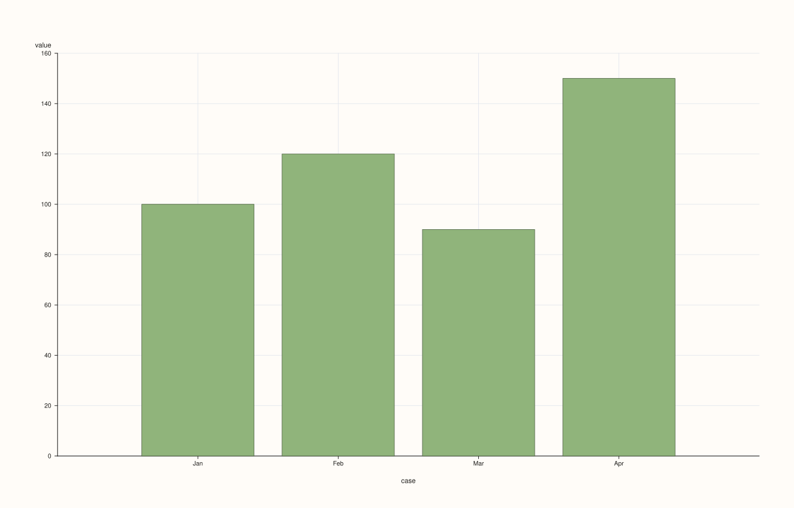
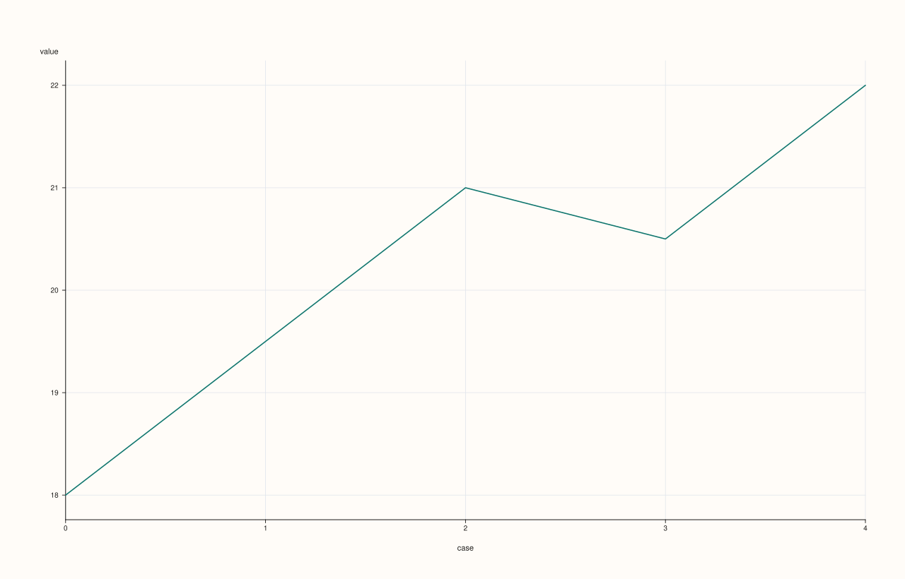

<!-- pluss-hand-authored -->
<!-- pluss-signature-hash: 9187e6061a4f -->

# SlatePlotAccessor::auto_plot

[Back to SlatePlotAccessor API Reference](../../slate_plot_api_reference)

## Signatures

```cpp
pluss::pl::Studio SlatePlotAccessor::auto_plot() const
pluss::pl::Studio SlatePlotAccessor::auto_plot(const AutoPlotOptions& options) const
```

## What It Does

Picks a chart type automatically for the bound slate and delegates to the corresponding
method on this same accessor — a much smaller decision tree than
[`DataFramePlotAccessor::auto_plot`](../../api/dataframe-plot/auto_plot.md)'s, since a
single `Slate` has none of the multi-feature routing questions (feature count, hue
candidates, non-negativity) the 2D accessor's tree branches on.

```{important} The full decision tree — just two rules
1. **The bound slate has explicit row labels, and 16 or fewer rows.** Routes to
   [`bar()`](bar.md).
2. **Everything else** (no explicit row labels, or more than 16 rows). Routes to
   [`line()`](line.md).

Both routed-to calls use their own zero-argument overload — no companion `x` slate is
ever passed through, even when one exists conceptually.
```

The two-argument overload's `AutoPlotOptions` is the same currently-empty struct
documented on the 2D accessor's page; it has no effect on routing or rendering today.

## Parameters

**options** (`AutoPlotOptions`)
    Currently empty; reserved for future routing controls.

## Returns

`pluss::pl::Studio`
    Whatever the routed-to method returns — either [`bar()`](bar.md)'s or
    [`line()`](line.md)'s figure shape, depending on which rule fired.

## Examples

Example 1. Explicit row labels, few rows: routes to `bar()`.

```cpp
using namespace pluss::table;

auto revenue = Slate(pluss::make_series({100.0, 120.0, 90.0, 150.0}))
                   .label().set(Slate(pluss::make_note({"Jan", "Feb", "Mar", "Apr"})));

auto chart = revenue.plot().auto_plot();
chart.show();
```

`revenue` has explicit (Note-kind) row labels and only 4 rows (`≤ 16`), so this is
equivalent to `revenue.plot().bar()`.



Example 2. No explicit row labels: routes to `line()`.

```cpp
auto temperature = Slate(pluss::make_series({18.0, 19.5, 21.0, 20.5, 22.0}));

auto chart = temperature.plot().auto_plot();
chart.show();
```

`temperature` has no explicit row labels, so this is equivalent to
`temperature.plot().line()`, regardless of row count.



## Notes

- Only two routing rules exist — see the important callout above; contrast the much larger
  decision tree on
  [`DataFramePlotAccessor::auto_plot`](../../api/dataframe-plot/auto_plot.md).
- Every branch delegates to another zero-argument method on this same accessor —
  `auto_plot()` performs no rendering of its own.
- `AutoPlotOptions` is currently empty and has no effect.
- Returns a `pluss::pl::Studio` — see [`line()`](line.md) for how to view or save the
  result.

## See Also

- [`DataFramePlotAccessor::auto_plot`](../../api/dataframe-plot/auto_plot.md): the
  multi-feature counterpart with a much larger routing decision tree.
- [`SlatePlotAccessor::brief`](brief.md): a fixed textual summary instead of an
  automatically chosen chart type.
- [`SlatePlotAccessor::bar`](bar.md) / [`line`](line.md): the two methods `auto_plot()`
  can route to.

<div class="pluss-inline-prev-next">
  <a class="prev-link" href="area.html">
    <span class="label">Previous</span>
    <span class="title">area</span>
  </a>
  <a class="next-link" href="bar.html">
    <span class="label">Next</span>
    <span class="title">bar</span>
  </a>
</div>
