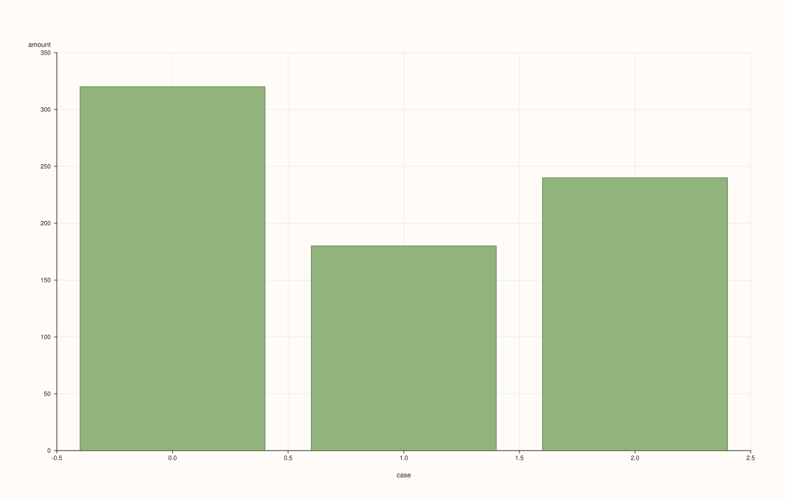
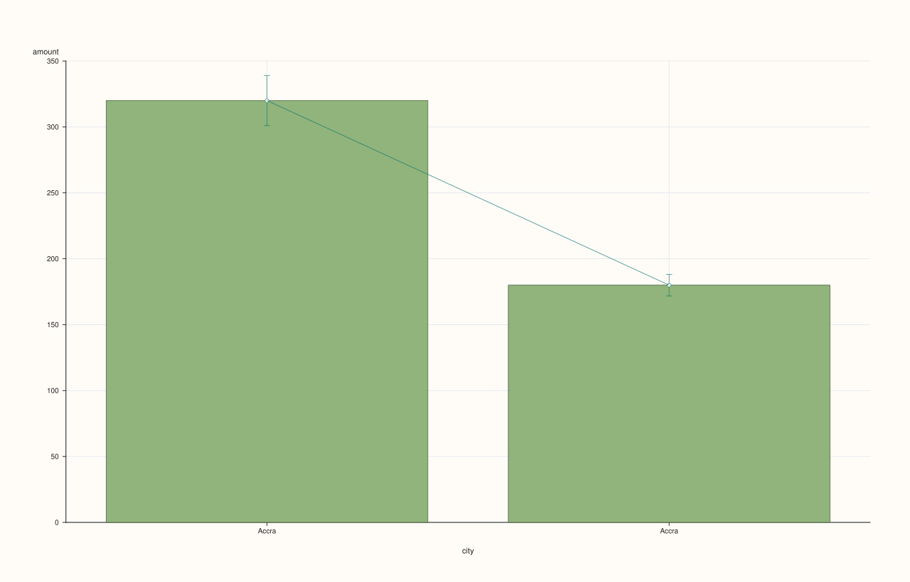

<!-- pluss-hand-authored -->
<!-- pluss-signature-hash: cc1985804f03 -->

# SlatePlotAccessor::bar

[Back to SlatePlotAccessor API Reference](../../slate_plot_api_reference)

## Signatures

```cpp
SlatePlotAccessor::bar() const -> pluss::pl::Studio
SlatePlotAccessor::bar(const Slate& x) const -> pluss::pl::Studio
SlatePlotAccessor::bar(const BarPlotOptions& options) const -> pluss::pl::Studio
SlatePlotAccessor::bar(const Slate& x, const BarPlotOptions& options) const -> pluss::pl::Studio
```

## What It Does

Draws one bar per row for the bound slate's values, against an optional companion `x`
slate — the single-series specialization of
[`DataFramePlotAccessor::bar`](../../api/dataframe-plot/bar.md). Same shape and naming
rules as [`line()`](line.md).

## Parameters

**x** (`const Slate&`, optional)
    Same as [`line()`](line.md)'s `x`.

**options** (`BarPlotOptions`)
    The identical struct documented on
    [`DataFramePlotAccessor::bar`](../../api/dataframe-plot/bar.md)
    (`ci_enabled`, `ci_level`, `horizontal`, `align`). `ci_enabled = true` still aggregates
    rows sharing the same `x` position into a mean-plus-confidence-interval bar, exactly as
    on the 2D accessor — useful when `x` has repeated values. `align` is inert here, same
    as [`line()`](line.md).

## Returns

`pluss::pl::Studio`
    A figure with one pane containing a single bar trace of the bound slate's values.

## Examples

Example 1. No companion slate: falls back to a plain case index.

```cpp
using namespace pluss::table;

auto amount = Slate(pluss::make_series({320.0, 180.0, 240.0}));
amount = amount.name("amount");

auto chart = amount.plot().bar();
chart.show();
```



Example 2. An explicit companion slate as the category axis.

```cpp
auto city = Slate(pluss::make_note({"Accra", "Tema", "Kumasi"}));
city = city.name("city");

auto chart = amount.plot().bar(city);
chart.show();
```


Example 3. `ci_enabled = true` — rows sharing the same `x` value aggregate into a mean bar
with a confidence-interval whisker.

```cpp
auto repeated_amount = Slate(pluss::make_series({300.0, 320.0, 340.0, 175.0, 185.0}));
repeated_amount = repeated_amount.name("amount");

auto repeated_city = Slate(pluss::make_note({"Accra", "Accra", "Accra", "Tema", "Tema"}));
repeated_city = repeated_city.name("city");

BarPlotOptions options;
options.ci_enabled = true;
options.ci_level = 0.90;

auto chart = repeated_amount.plot().bar(repeated_city, options);
chart.show();
```

`"Accra"`'s three rows aggregate into one bar at the mean of `300, 320, 340 = 320`, with a
90% confidence-interval whisker.



## Notes

- Shares every mechanic described on [`line()`](line.md)'s page.
- `ci_enabled = true` behaves identically to
  [`DataFramePlotAccessor::bar`](../../api/dataframe-plot/bar.md)'s — see that page for
  the full aggregation rule.
- Returns a `pluss::pl::Studio` — see [`line()`](line.md) for how to view or save the
  result.

## See Also

- [`DataFramePlotAccessor::bar`](../../api/dataframe-plot/bar.md): the method this
  delegates to.
- [`SlatePlotAccessor::box`](box.md) / [`violin`](violin.md): distribution-shape
  summaries, an alternative to `ci_enabled`'s mean-and-interval view.

<div class="pluss-inline-prev-next">
  <a class="prev-link" href="auto_plot.html">
    <span class="label">Previous</span>
    <span class="title">auto_plot</span>
  </a>
  <a class="next-link" href="bootstrap.html">
    <span class="label">Next</span>
    <span class="title">bootstrap</span>
  </a>
</div>
