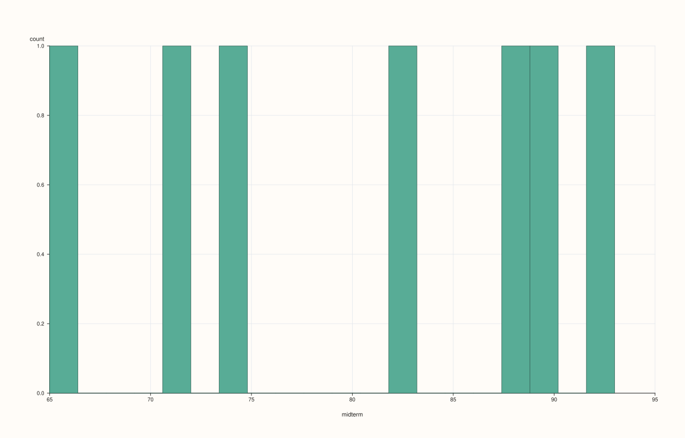
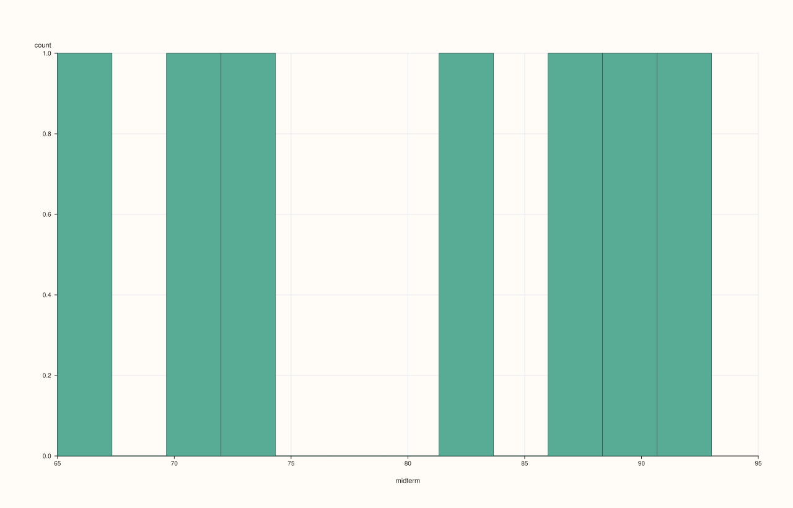
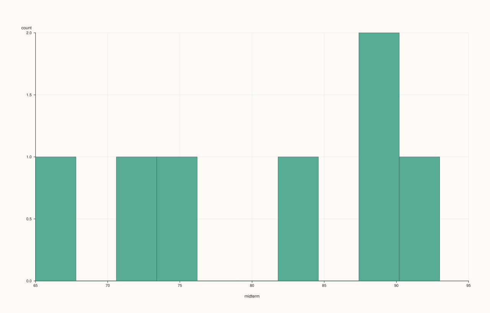

<!-- pluss-hand-authored -->
<!-- pluss-signature-hash: c3b1458073c3 -->

# SlatePlotAccessor::hist

[Back to SlatePlotAccessor API Reference](../../slate_plot_api_reference)

## Signatures

```cpp
pluss::pl::Studio SlatePlotAccessor::hist(std::int64_t bins = 20) const
pluss::pl::Studio SlatePlotAccessor::hist(const HistPlotOptions& options) const
```

## What It Does

Bins the bound slate's values into a single frequency-count histogram — the
single-series specialization of
[`DataFramePlotAccessor::hist`](../../api/dataframe-plot/hist.md)'s single-feature path.
Unlike the 2D accessor's `hist()`, which lays out a mosaic grid of panes for several
features, this overload always draws exactly one pane, since a `Slate` is always one
series.

```{note} The same bins == 20 ambiguity as the 2D accessor
`bins` (or `options.bins`) still passes through `resolve_bins()`, so the same "is `20` the
caller's explicit choice, or just the untouched default" ambiguity applies here whenever
`DataFramePlotOptions::default_bins` has been customized via `Slate::plot(options)` — see
[`DataFramePlotAccessor::hist`](../../api/dataframe-plot/hist.md)'s danger box for the full
explanation.
```

## Parameters

**bins** (`std::int64_t`, default `20`)
    Requested bin count — subject to the `resolve_bins()` ambiguity above. Values `<= 0`
    fall back to `options_.default_bins`.

**options** (`HistPlotOptions`)
    The identical struct documented on
    [`DataFramePlotAccessor::hist`](../../api/dataframe-plot/hist.md) (`bins`,
    `alpha`, `line_width`).

## Returns

`pluss::pl::Studio`
    A single-pane figure containing one histogram of the bound slate's values.

## Examples

Example 1. Default bin count.

```cpp
using namespace pluss::table;

auto midterm = Slate(pluss::make_series({71.0, 82.0, 93.0, 65.0, 88.0, 74.0, 90.0}));
midterm = midterm.name("midterm");

auto chart = midterm.plot().hist();
chart.show();
```



Example 2. An explicit bin count.

```cpp
auto chart = midterm.plot().hist(12);
chart.show();
```



Example 3. An explicit `HistPlotOptions`, tuning opacity and stroke in addition to bins.

```cpp
HistPlotOptions options;
options.bins = 10;
options.alpha = 0.8;
options.line_width = 1.4;

auto chart = midterm.plot().hist(options);
chart.show();
```



## Notes

- Always draws exactly one pane — there is no mosaic-grid form the way the 2D accessor's
  multi-feature `hist()` has.
- `bins == 20` is ambiguous with "left at the default" whenever `default_bins` has been
  customized — see the note above.
- Returns a `pluss::pl::Studio` — see [`line()`](line.md) for how to view or save the
  result.

## See Also

- [`DataFramePlotAccessor::hist`](../../api/dataframe-plot/hist.md): the method this
  delegates to.
- [`SlatePlotAccessor::density`](density.md): kernel-density curve instead of binned bars.
- [`SlatePlotAccessor::box`](box.md) / [`violin`](violin.md): other distribution-shape
  summaries.

<div class="pluss-inline-prev-next">
  <a class="prev-link" href="density.html">
    <span class="label">Previous</span>
    <span class="title">density</span>
  </a>
  <a class="next-link" href="lag.html">
    <span class="label">Next</span>
    <span class="title">lag</span>
  </a>
</div>
