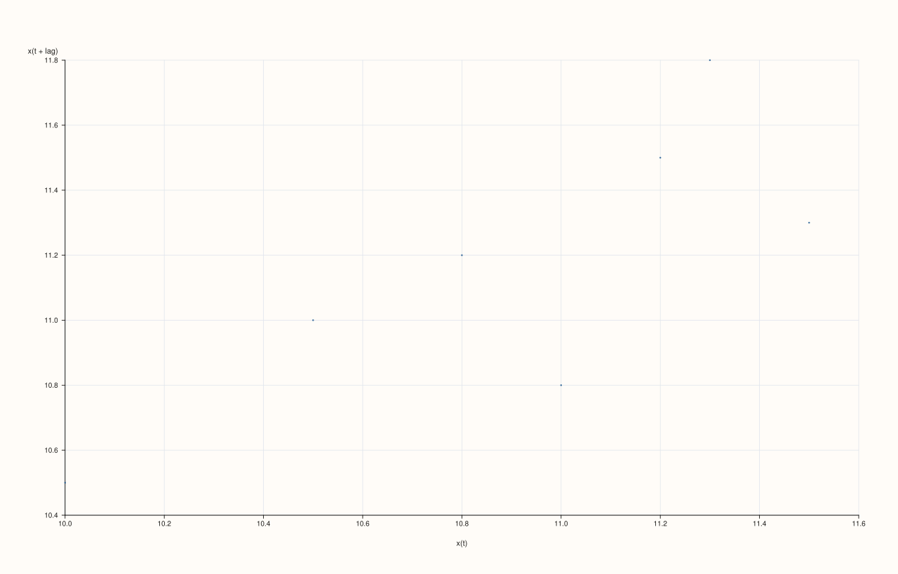
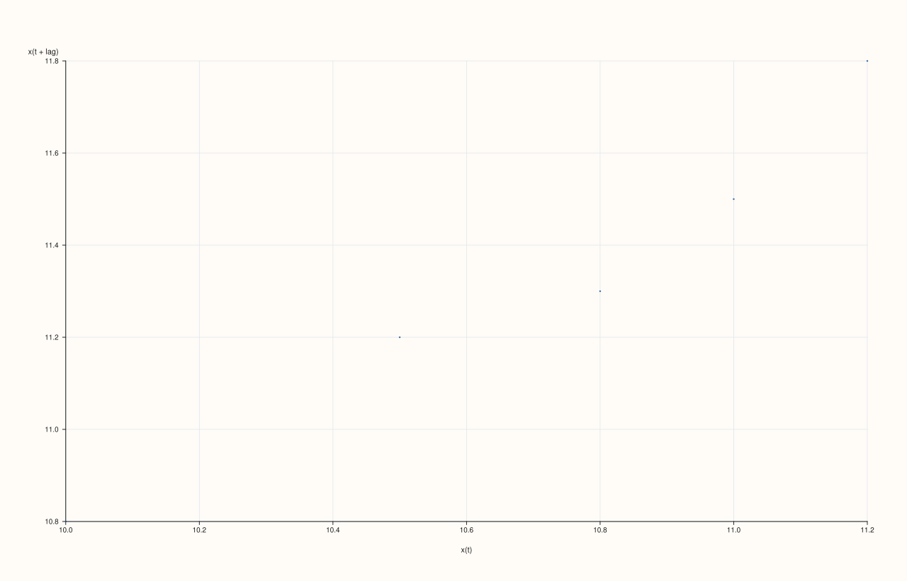

<!-- pluss-hand-authored -->
<!-- pluss-signature-hash: 9fb0e5edfda2 -->

# SlatePlotAccessor::lag

[Back to SlatePlotAccessor API Reference](../../slate_plot_api_reference)

## Signature

```cpp
pluss::pl::Studio SlatePlotAccessor::lag(const LagPlotOptions& options = {}) const
```

## What It Does

Draws a lag plot for the bound slate's values: a scatter of `x(t)` against
`x(t + lag)` — the single-series specialization of
[`DataFramePlotAccessor::lag`](../../api/dataframe-plot/lag.md), which on the 2D accessor
requires naming a feature; here the bound slate is always the one and only feature
lagged.

```{note} At least two data points are required
Same as the 2D accessor: a slate with fewer than two rows throws
`"flash::lagplot requires at least two points"`.
```

## Parameters

**options** (`LagPlotOptions`)
    The identical struct documented on
    [`DataFramePlotAccessor::lag`](../../api/dataframe-plot/lag.md) (`lag`,
    `max_points`, `marker_area`, `trace_width`).

## Returns

`pluss::pl::Studio`
    A figure with one pane containing a single scatter ("cloud") trace of `x(t)` vs.
    `x(t + lag)`.

## Examples

Example 1. Default options (`lag = 1`).

```cpp
using namespace pluss::table;

auto level = Slate(pluss::make_series({10.0, 10.5, 11.0, 10.8, 11.2, 11.5, 11.3, 11.8}));
level = level.name("level");

auto chart = level.plot().lag();
chart.show();
```



Example 2. An explicit `LagPlotOptions` with a larger lag.

```cpp
LagPlotOptions options;
options.lag = 3;

auto chart = level.plot().lag(options);
chart.show();
```



## Notes

- The bound slate is always the single lagged feature — there is no feature-name argument
  the way the 2D accessor's `lag()` has.
- `lag` is clamped to `[1, n - 1]`, never throwing for an out-of-range request.
- A slate with fewer than two rows throws before any point is drawn.
- Returns a `pluss::pl::Studio` — see [`line()`](line.md) for how to view or save the
  result.

## See Also

- [`DataFramePlotAccessor::lag`](../../api/dataframe-plot/lag.md): the method this
  delegates to.
- [`SlatePlotAccessor::act`](act.md): every lag's correlation coefficient at once, instead
  of one lag's raw scatter.

<div class="pluss-inline-prev-next">
  <a class="prev-link" href="hist.html">
    <span class="label">Previous</span>
    <span class="title">hist</span>
  </a>
  <a class="next-link" href="line.html">
    <span class="label">Next</span>
    <span class="title">line</span>
  </a>
</div>
