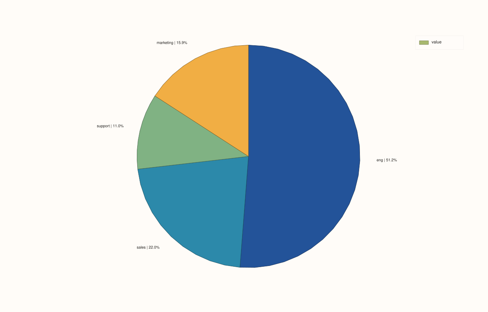

<!-- pluss-hand-authored -->
<!-- pluss-signature-hash: 01b435c2f121 -->

# SlatePlotAccessor::pie

[Back to SlatePlotAccessor API Reference](../../slate_plot_api_reference)

## Signatures

```cpp
pluss::pl::Studio SlatePlotAccessor::pie() const
pluss::pl::Studio SlatePlotAccessor::pie(const PiePlotOptions& options) const
pluss::pl::Studio SlatePlotAccessor::pie(const Slate& labels) const
pluss::pl::Studio SlatePlotAccessor::pie(const Slate& labels, const PiePlotOptions& options) const
```

## What It Does

Draws a pie chart from the bound slate's values, with slice labels coming either from an
explicit companion `labels` slate or (if omitted) from the wrapped frame's own row
labels — the single-series specialization of
[`DataFramePlotAccessor::pie`](../../api/dataframe-plot/pie.md).

```{important} Non-positive and non-finite values are silently dropped, not zero-sized slices
Exactly like [`DataFramePlotAccessor::pie`](../../api/dataframe-plot/pie.md), only rows
where the bound slate's value is both finite and strictly greater than zero survive. A
slate with no positive finite values throws `"DataFrame::plot().pie: feature 'value' has
no positive finite values"` — see that page's important callout for the full rule,
including how percentages are computed against the filtered total.
```

## Parameters

**labels** (`const Slate&`, optional)
    A companion slate whose values label each slice. Must match the bound slate's size,
    or the call throws `"Slate::plot: slate size mismatch"`. Omitted falls back to the
    wrapped frame's own row labels — see [`line()`](line.md)'s row-label inheritance rule.

**options** (`PiePlotOptions`)
    The identical struct documented on
    [`DataFramePlotAccessor::pie`](../../api/dataframe-plot/pie.md)
    (`show_label`, `show_percent`, `show_value`, `precision`, `separator`).

## Returns

`pluss::pl::Studio`
    A figure with one pane containing a single pie trace.

## Examples

Example 1. An explicit `labels` slate.

```cpp
using namespace pluss::table;

auto spend = Slate(pluss::make_series({420.0, 180.0, 90.0, 130.0}));
spend = spend.name("spend");

auto category = Slate(pluss::make_note({"Engineering", "Sales", "Support", "Marketing"}));
category = category.name("category");

auto chart = spend.plot().pie(category);
chart.show();
```


Example 2. No `labels`: falls back to the bound slate's own row labels.

```cpp
auto labeled_spend = Slate(pluss::make_series({420.0, 180.0, 90.0, 130.0}))
                          .label().set(Slate(pluss::make_note({"eng", "sales", "support", "marketing"})));

auto chart = labeled_spend.plot().pie();
chart.show();
```



Example 3. An explicit `PiePlotOptions`.

```cpp
PiePlotOptions options;
options.show_value = true;
options.separator = " — ";
options.precision = 0;

auto chart = spend.plot().pie(category, options);
chart.show();
```


## Notes

- Only finite, strictly positive values are plotted; everything else is silently dropped —
  see the important callout above.
- `labels` omitted falls back to the wrapped frame's own row labels — see
  [`line()`](line.md)'s row-label inheritance rule.
- An entirely-filtered-out slate throws rather than producing an empty chart.
- Returns a `pluss::pl::Studio` — see [`line()`](line.md) for how to view or save the
  result.

## See Also

- [`DataFramePlotAccessor::pie`](../../api/dataframe-plot/pie.md): the method this
  delegates to.
- [`SlatePlotAccessor::bar`](bar.md): a composition-friendly alternative when exact
  comparison between category sizes matters more than "share of a whole."

<div class="pluss-inline-prev-next">
  <a class="prev-link" href="line.html">
    <span class="label">Previous</span>
    <span class="title">line</span>
  </a>
  <a class="next-link" href="scatter.html">
    <span class="label">Next</span>
    <span class="title">scatter</span>
  </a>
</div>
