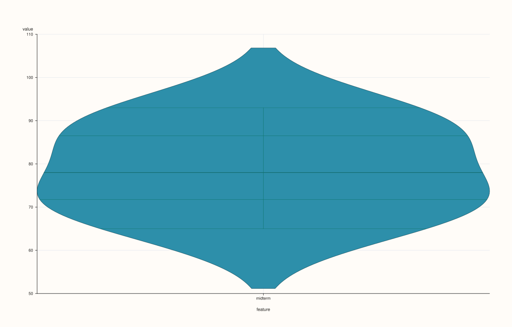
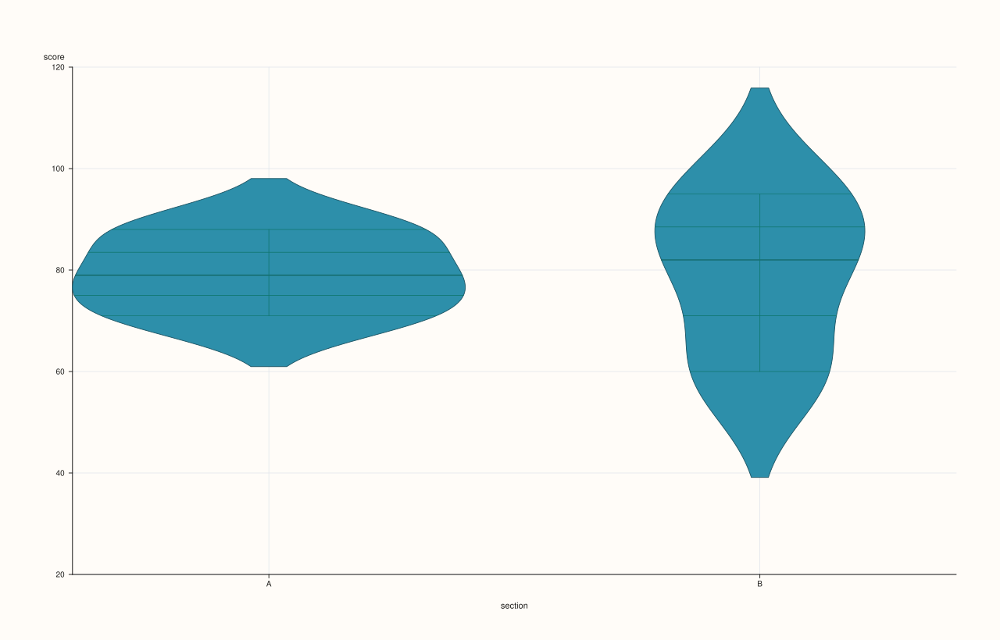
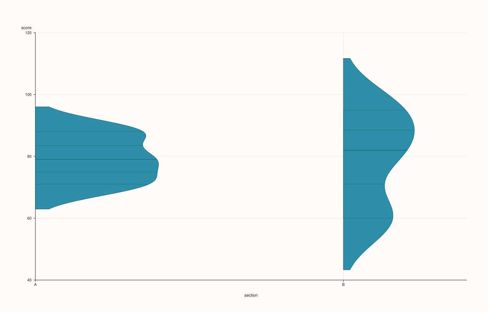

<!-- pluss-hand-authored -->
<!-- pluss-signature-hash: 70b3cd8a14bb -->

# SlatePlotAccessor::violin

[Back to SlatePlotAccessor API Reference](../../slate_plot_api_reference)

## Signatures

```cpp
pluss::pl::Studio SlatePlotAccessor::violin(const ViolinPlotOptions& options = {}) const
pluss::pl::Studio SlatePlotAccessor::violin(const Slate& group) const
pluss::pl::Studio SlatePlotAccessor::violin(const Slate& group, const ViolinPlotOptions& options) const
```

## What It Does

Two modes, chosen by which overload is called:

- **Single-violin mode** (`violin(options)`): draws one violin for the bound slate's own
  distribution — the single-series specialization of
  [`DataFramePlotAccessor::violin`](../../api/dataframe-plot/violin.md)'s feature-list
  mode, always with exactly one feature (there is no multi-feature form here, since a
  `Slate` is always one series).
- **Value/group mode** (`violin(group[, options])`): splits the bound slate's values into
  one violin per distinct value of a companion `group` slate — the single-series
  specialization of the 2D accessor's `violin(value_feature, group_feature[, options])`
  overload.

```{important} group accepts a numeric Slate too, unlike scatter()'s hue
Exactly like [`DataFramePlotAccessor::violin`](../../api/dataframe-plot/violin.md)'s
value/group mode, a numeric `group` slate isn't rejected — its raw distinct values become
violin group positions directly, rather than being cast to text. See that page's important
callout for why this is rarely what's wanted unless the numeric column really is a
small-cardinality code.
```

## Parameters

**group** (`const Slate&`, value/group mode)
    The companion slate defining violin groups — text-like or numeric, see the important
    callout above. Must match the bound slate's size, or the call throws
    `"Slate::plot: slate size mismatch"`.

**options** (`ViolinPlotOptions`)
    The identical struct documented on
    [`DataFramePlotAccessor::violin`](../../api/dataframe-plot/violin.md)
    (`alpha`, `line_width`, `width`, `bw_adjust`, `cut`, `scale`, `inner`, `side`).

## Returns

`pluss::pl::Studio`
    A figure with one pane containing a single violin (single-violin mode) or one violin
    per distinct group value (value/group mode).

## Examples

Example 1. Single-violin mode, default options.

```cpp
using namespace pluss::table;

auto midterm = Slate(pluss::make_series({71.0, 82.0, 93.0, 65.0, 88.0, 74.0}));
midterm = midterm.name("midterm");

auto chart = midterm.plot().violin();
chart.show();
```



Example 2. Value/group mode with a text-like group slate.

```cpp
auto score = Slate(pluss::make_series({71.0, 88.0, 79.0, 95.0, 60.0, 82.0}));
score = score.name("score");

auto section = Slate(pluss::make_note({"A", "A", "A", "B", "B", "B"}));
section = section.name("section");

auto chart = score.plot().violin(section);
chart.show();
```

Two violins are drawn — one for section `"A"`'s three scores, one for section `"B"`'s
three scores.



Example 3. An explicit `ViolinPlotOptions`, including a half-sided violin.

```cpp
ViolinPlotOptions options;
options.side = pluss::pl::ViolinSide::Right;
options.bw_adjust = 0.8;

auto chart = score.plot().violin(section, options);
chart.show();
```



## Notes

- Single-violin mode always draws exactly one violin — there is no multi-feature form the
  way the 2D accessor's feature-list mode has.
- Value/group mode accepts a numeric `group` slate, unlike
  [`SlatePlotAccessor::scatter`](scatter.md)'s stricter `hue` — see the important callout
  above.
- Returns a `pluss::pl::Studio` — see [`line()`](line.md) for how to view or save the
  result.

## See Also

- [`DataFramePlotAccessor::violin`](../../api/dataframe-plot/violin.md): the method both
  overloads delegate to.
- [`SlatePlotAccessor::box`](box.md): quartiles-and-whiskers only, the simpler sibling,
  with no value/group mode of its own.

<div class="pluss-inline-prev-next">
  <a class="prev-link" href="step.html">
    <span class="label">Previous</span>
    <span class="title">step</span>
  </a>
</div>
