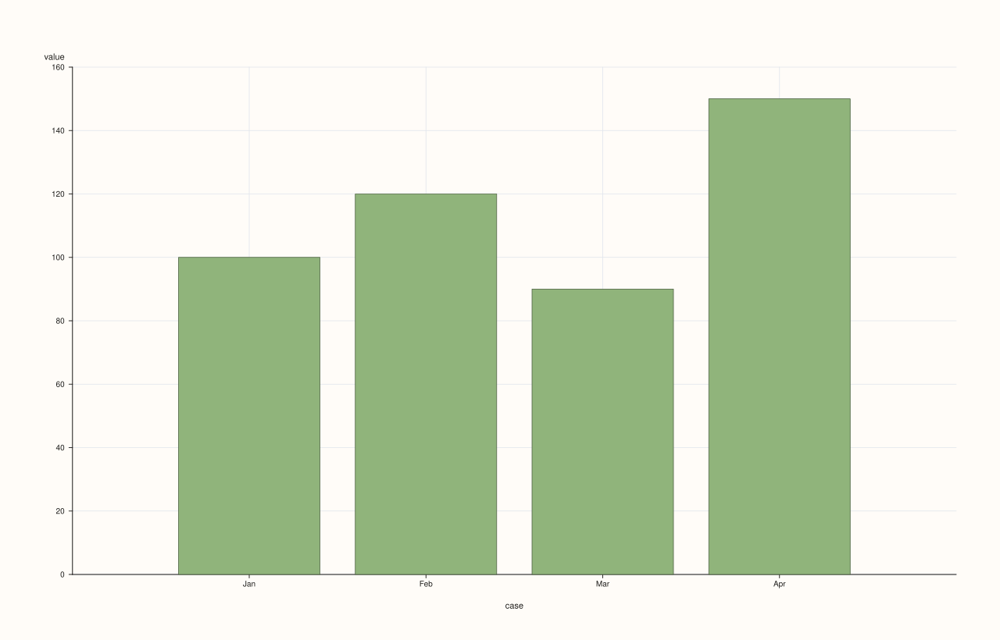
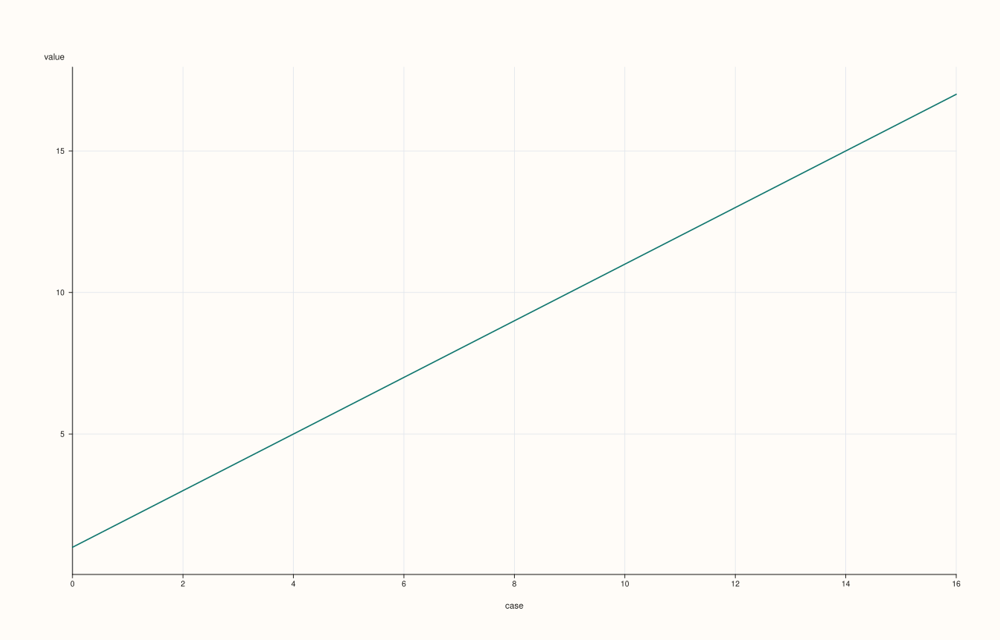

<!-- pluss-hand-authored -->
<!-- pluss-signature-hash: 6fbe1aeea9e3 -->

# StreamPlotAccessor::auto_plot

[Back to StreamPlotAccessor API Reference](../../stream_plot_accessor_api_reference)

## Signatures

```cpp
StreamPlotAccessor::auto_plot() const -> pluss::pl::Studio
StreamPlotAccessor::auto_plot(const AutoPlotOptions& options) const -> pluss::pl::Studio
```

## What It Does

Picks a chart automatically for the bound stream, with no selection required from the
caller. Both overloads forward straight to
[`ThreadPlotAccessor::auto_plot`](../thread-plot/auto_plot.md) after `Stream::to_thread()`
— the routing decision, and everything else about this method, is entirely
`ThreadPlotAccessor`'s, not reimplemented at the `Stream` layer.

```{important} The full decision tree — inherited as-is from ThreadPlotAccessor
1. **The bound stream has its own label (`Stream::with_label()`), and 16 or fewer rows.**
   Routes to [`bar()`](bar.md).
2. **Everything else** (no label, or more than 16 rows). Routes to [`line()`](line.md).

Both routed-to calls use their own zero-argument overload — no companion `x` stream is
ever passed through. Since `Stream::to_thread()` copies the stream's own label onto the
resulting `Thread`'s row labels (see [`line()`](line.md)'s important callout), "has its own
label" here means exactly `Stream::has_label()`.
```

The two-argument overload's `AutoPlotOptions` is the same currently-empty struct documented
on [`CatalogPlotAccessor::auto_plot`](../catalog-plot/auto_plot.md); it has no effect on
routing or rendering today.

## Parameters

**options** (`const AutoPlotOptions&`, optional)
    Currently empty; reserved for future routing controls.

## Returns

`pluss::pl::Studio`
    Whatever the routed-to method returns — either [`bar()`](bar.md)'s or
    [`line()`](line.md)'s figure shape, depending on which rule fired.

## Examples

Example 1. A labeled stream with few rows: routes to `bar()`.

```cpp
using namespace pluss::kindle;

auto revenue = Stream(pluss::make_series({100.0, 120.0, 90.0, 150.0}))
    .with_label(pluss::table::Thread(pluss::make_note({"Jan", "Feb", "Mar", "Apr"})));

auto chart = revenue.plot().auto_plot();
chart.show();
```

`revenue` has its own label and only 4 rows (`<= 16`), so `auto_plot()` calls `bar()` with
no arguments — the same chart `revenue.plot().bar()` would produce.



Example 2. An unlabeled stream with many rows: routes to `line()`.

```cpp
using namespace pluss::kindle;

auto long_series = Stream(pluss::make_series(
    {1.0, 2.0, 3.0, 4.0, 5.0, 6.0, 7.0, 8.0, 9.0, 10.0, 11.0, 12.0, 13.0, 14.0, 15.0, 16.0, 17.0}));

auto chart = long_series.plot().auto_plot();
chart.show();
```

`long_series` has 17 rows (`> 16`) and no label, so `auto_plot()` calls `line()` instead —
the same chart `long_series.plot().line()` would produce.



Example 3. The explicit-options overload: routing is identical, since `AutoPlotOptions` is
currently empty.

```cpp
using namespace pluss::kindle;

auto revenue = Stream(pluss::make_series({100.0, 120.0, 90.0, 150.0}))
    .with_label(pluss::table::Thread(pluss::make_note({"Jan", "Feb", "Mar", "Apr"})));

auto chart = revenue.plot().auto_plot(pluss::table::AutoPlotOptions{});
chart.show();
```

Same routing as Example 1 — `revenue` still has a label and `<= 16` rows, so this still
calls `bar()`.


## Notes

- Only two routing rules, both inherited from `ThreadPlotAccessor::auto_plot` unchanged —
  see the important callout above. There is no `Stream`-specific routing logic.
- `options` is accepted but has no effect — `AutoPlotOptions` is an empty struct.
- Both routed-to calls always use their zero-argument form, never passing a companion `x`.

## See Also

- [`ThreadPlotAccessor::auto_plot`](../thread-plot/auto_plot.md): the method this delegates
  to, and the canonical explanation of the routing rules.
- [`StreamPlotAccessor::bar`](bar.md) / [`line`](line.md): the two charts this can route to.
- [`Stream::plot`](../stream/plot.md): how to enter this accessor in the first place.

<div class="pluss-inline-prev-next">
  <a class="next-link" href="bar.html">
    <span class="label">Next</span>
    <span class="title">bar</span>
  </a>
</div>
