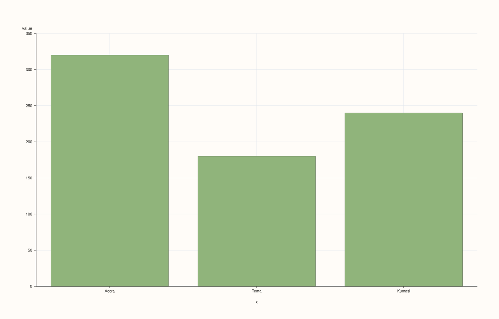
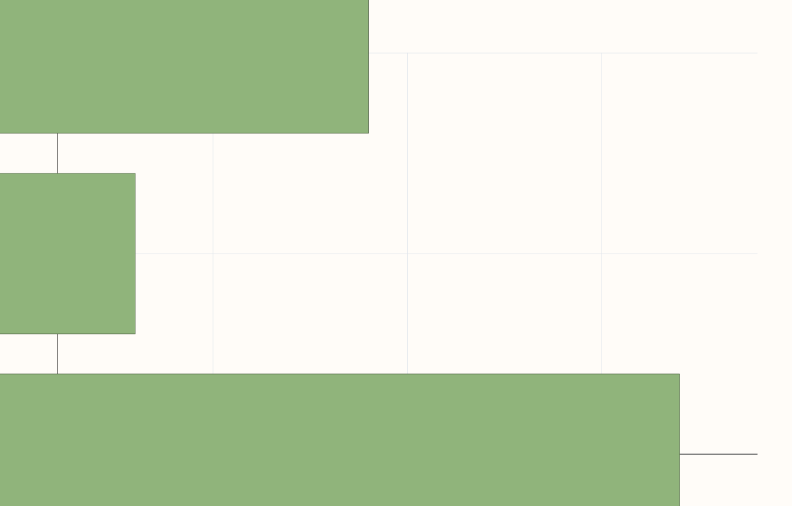

<!-- pluss-hand-authored -->
<!-- pluss-signature-hash: 3be6e7c59a82 -->

# StreamPlotAccessor::bar

[Back to StreamPlotAccessor API Reference](../../stream_plot_accessor_api_reference)

## Signatures

```cpp
StreamPlotAccessor::bar() const -> pluss::pl::Studio
StreamPlotAccessor::bar(const Stream& x) const -> pluss::pl::Studio
StreamPlotAccessor::bar(const BarPlotOptions& options) const -> pluss::pl::Studio
StreamPlotAccessor::bar(const Stream& x, const BarPlotOptions& options) const -> pluss::pl::Studio
```

## What It Does

Draws one bar per row for the bound stream's values, against an optional companion `x`
stream — the same shape and naming rules as [`line()`](line.md), drawn as bars instead of a
connected line. Every overload forwards to
[`SlatePlotAccessor::bar`](../slate-plot/bar.md) after `Stream::to_slate()`.

## Parameters

**x** (`const Stream&`, optional)
    Same as [`line()`](line.md)'s `x` — a mismatched size throws
    `"Slate::plot: slate size mismatch"`.

**options** (`BarPlotOptions`)
    The identical struct documented on
    [`CatalogPlotAccessor::bar`](../catalog-plot/bar.md) (`ci_enabled`, `ci_level`,
    `horizontal`, `align`). `ci_enabled = true` aggregates rows sharing the same `x`
    position into a mean-plus-confidence-interval bar — useful when `x` has repeated
    values, which a plain case index (no `x` given) never does.

## Returns

`pluss::pl::Studio`
    A figure with one pane containing a single bar trace of the bound stream's values.

## Examples

Example 1. No companion stream: falls back to a plain case index.

```cpp
using namespace pluss::kindle;

auto amount = Stream(pluss::make_series({320.0, 180.0, 240.0}));

auto chart = amount.plot().bar();
chart.show();
```


Example 2. An explicit companion stream as the category axis.

```cpp
using namespace pluss::kindle;

auto amount = Stream(pluss::make_series({320.0, 180.0, 240.0}));
auto city = Stream(pluss::make_note({"Accra", "Tema", "Kumasi"}));

auto chart = amount.plot().bar(city);
chart.show();
```



Example 3. An explicit `BarPlotOptions`, drawing horizontal bars, with no companion stream.

```cpp
using namespace pluss::kindle;

auto amount = Stream(pluss::make_series({320.0, 180.0, 240.0}));

pluss::table::BarPlotOptions options;
options.horizontal = true;

auto chart = amount.plot().bar(options);
chart.show();
```


Example 4. A companion stream together with explicit options.

```cpp
using namespace pluss::kindle;

auto amount = Stream(pluss::make_series({320.0, 180.0, 240.0}));
auto city = Stream(pluss::make_note({"Accra", "Tema", "Kumasi"}));

pluss::table::BarPlotOptions options;
options.horizontal = true;

auto chart = amount.plot().bar(city, options);
chart.show();
```



Example 5. A mismatched-size companion stream throws.

```cpp
using namespace pluss::kindle;

auto amount = Stream(pluss::make_series({320.0, 180.0, 240.0}));
auto short_city = Stream(pluss::make_note({"Accra", "Tema"}));

try {
  auto bad = amount.plot().bar(short_city);
} catch (const std::exception& e) {
  std::cout << e.what();
}
```

### Output

```text
Slate::plot: slate size mismatch
```

## Notes

- Every mechanic besides the bar-vs-line geometry is shared with [`line()`](line.md) — see
  that page for the naming/row-label callouts.
- Returns a `pluss::pl::Studio` — see [`line()`](line.md)'s important callouts for how to
  view or save the result.

## See Also

- [`SlatePlotAccessor::bar`](../slate-plot/bar.md): the method this delegates to.
- [`StreamPlotAccessor::line`](line.md): the canonical explanation of this accessor's
  shared naming/row-label mechanics.
- [`StreamPlotAccessor::hist`](hist.md): bars over binned value ranges instead of one bar
  per record.

<div class="pluss-inline-prev-next">
  <a class="prev-link" href="auto_plot.html">
    <span class="label">Previous</span>
    <span class="title">auto_plot</span>
  </a>
  <a class="next-link" href="density.html">
    <span class="label">Next</span>
    <span class="title">density</span>
  </a>
</div>
