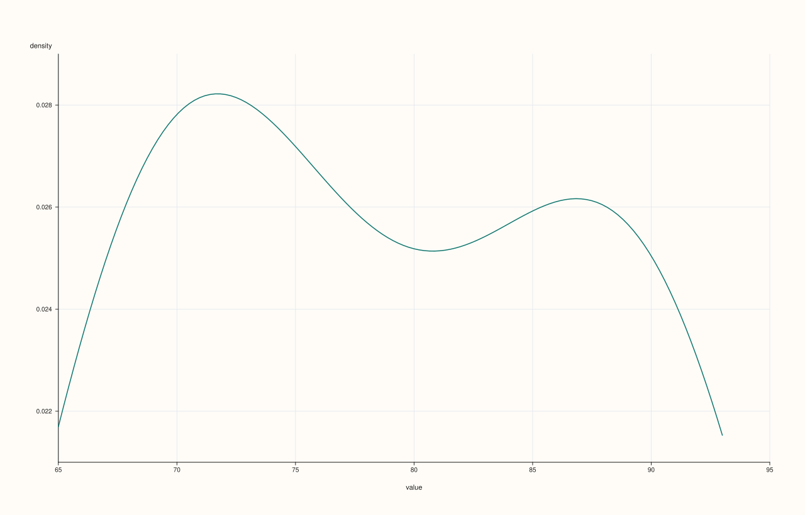
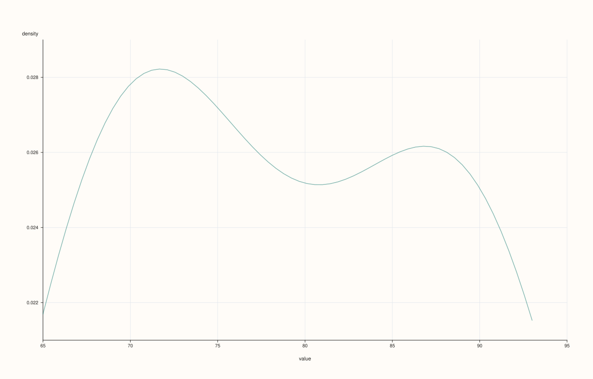

<!-- pluss-hand-authored -->
<!-- pluss-signature-hash: 18797689e372 -->

# StreamPlotAccessor::density

[Back to StreamPlotAccessor API Reference](../../stream_plot_accessor_api_reference)

## Signatures

```cpp
StreamPlotAccessor::density(std::int64_t points = 128) const -> pluss::pl::Studio
StreamPlotAccessor::density(const DensityPlotOptions& options) const -> pluss::pl::Studio
```

## What It Does

Draws a kernel-density estimate for the bound stream's values — always exactly one curve,
since a `Stream` is always one series. Both overloads forward to
[`ThreadPlotAccessor::density`](../thread-plot/density.md) after `Stream::to_thread()`.

## Parameters

**points** (`std::int64_t`, default `128`)
    The number of evaluation points used to draw the curve. Internally clamped to a
    minimum of `16`.

**options** (`DensityPlotOptions`)
    The identical struct documented on
    [`CatalogPlotAccessor::density`](../catalog-plot/density.md) (`points`, `alpha`,
    `line_width`).

## Returns

`pluss::pl::Studio`
    A figure with one pane containing a single kernel-density curve, axes labeled
    `"value"`/`"density"`.

## Examples

Example 1. Default point count.

```cpp
using namespace pluss::kindle;

auto midterm = Stream(pluss::make_series({71.0, 82.0, 93.0, 65.0, 88.0, 74.0, 90.0, 69.0}));

auto chart = midterm.plot().density();
chart.show();
```



Example 2. An explicit, finer point count.

```cpp
using namespace pluss::kindle;

auto midterm = Stream(pluss::make_series({71.0, 82.0, 93.0, 65.0, 88.0, 74.0, 90.0, 69.0}));

auto chart = midterm.plot().density(256);
chart.show();
```


Example 3. An explicit `DensityPlotOptions`, tuning point count and opacity.

```cpp
using namespace pluss::kindle;

auto midterm = Stream(pluss::make_series({71.0, 82.0, 93.0, 65.0, 88.0, 74.0, 90.0, 69.0}));

pluss::table::DensityPlotOptions options;
options.points = 64;
options.alpha = 0.5;

auto chart = midterm.plot().density(options);
chart.show();
```



## Notes

- Both axes are always the generic fallback labels `"value"`/`"density"` — `Stream` has no
  `name()` to contribute a custom label.
- `points` is clamped to a minimum of `16` internally, regardless of the value passed.
- Returns a `pluss::pl::Studio` — see [`line()`](line.md)'s important callouts for how to
  view or save the result.

## See Also

- [`ThreadPlotAccessor::density`](../thread-plot/density.md): the method this delegates to.
- [`StreamPlotAccessor::hist`](hist.md): the same per-stream distribution idea, as binned
  counts instead of a smoothed curve.

<div class="pluss-inline-prev-next">
  <a class="prev-link" href="bar.html">
    <span class="label">Previous</span>
    <span class="title">bar</span>
  </a>
  <a class="next-link" href="hist.html">
    <span class="label">Next</span>
    <span class="title">hist</span>
  </a>
</div>
