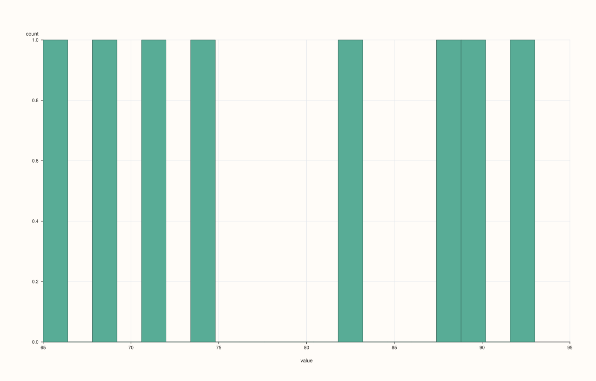
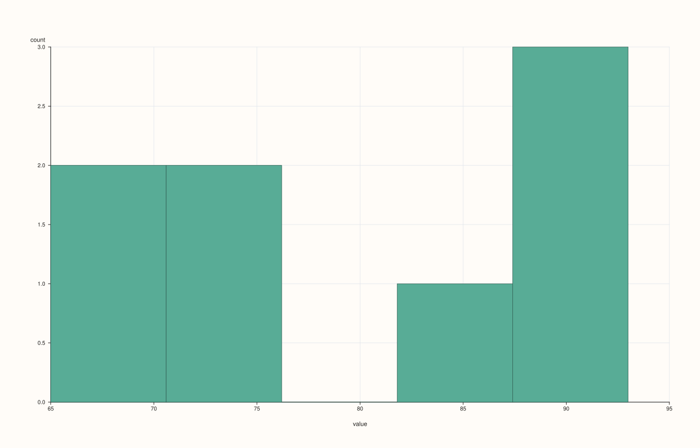
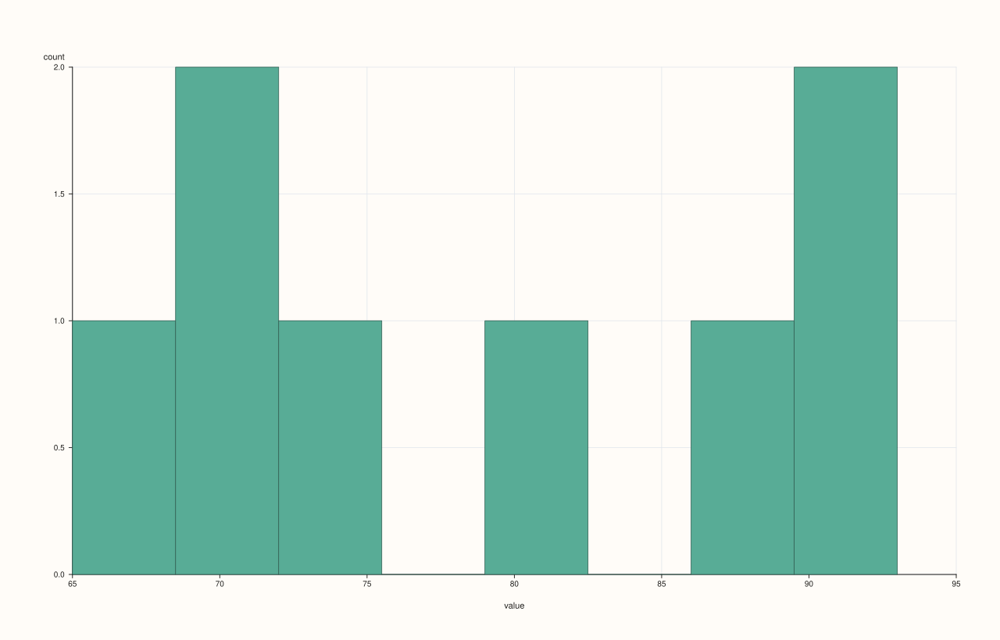

<!-- pluss-hand-authored -->
<!-- pluss-signature-hash: 370c87ed79d3 -->

# StreamPlotAccessor::hist

[Back to StreamPlotAccessor API Reference](../../stream_plot_accessor_api_reference)

## Signatures

```cpp
StreamPlotAccessor::hist(std::int64_t bins = 20) const -> pluss::pl::Studio
StreamPlotAccessor::hist(const HistPlotOptions& options) const -> pluss::pl::Studio
```

## What It Does

Bins the bound stream's values into a single frequency-count histogram — always exactly
one pane, since a `Stream` is always one series. Both overloads forward to
[`ThreadPlotAccessor::hist`](../thread-plot/hist.md) after `Stream::to_thread()`.

```{note} The same bins == 20 ambiguity as the 2D/Thread accessors
`bins` still passes through `resolve_bins()`, so the same "is `20` the caller's explicit
choice, or just the untouched default" ambiguity documented on
[`DataFramePlotAccessor::hist`](../dataframe-plot/hist.md) applies here too, whenever
`DataFramePlotOptions::default_bins` has been customized via `Stream::plot(options)`.
```

## Parameters

**bins** (`std::int64_t`, default `20`)
    Requested bin count, subject to the ambiguity above. Values `<= 0` fall back to
    `options_.default_bins`.

**options** (`HistPlotOptions`)
    The identical struct documented on
    [`CatalogPlotAccessor::hist`](../catalog-plot/hist.md) (`bins`, `alpha`, `line_width`).

## Returns

`pluss::pl::Studio`
    A single-pane figure containing one histogram of the bound stream's values.

## Examples

Example 1. Default bin count.

```cpp
using namespace pluss::kindle;

auto midterm = Stream(pluss::make_series({71.0, 82.0, 93.0, 65.0, 88.0, 74.0, 90.0, 69.0}));

auto chart = midterm.plot().hist();
chart.show();
```



Example 2. An explicit, smaller bin count.

```cpp
using namespace pluss::kindle;

auto midterm = Stream(pluss::make_series({71.0, 82.0, 93.0, 65.0, 88.0, 74.0, 90.0, 69.0}));

auto chart = midterm.plot().hist(5);
chart.show();
```



Example 3. An explicit `HistPlotOptions`, tuning bin count and opacity.

```cpp
using namespace pluss::kindle;

auto midterm = Stream(pluss::make_series({71.0, 82.0, 93.0, 65.0, 88.0, 74.0, 90.0, 69.0}));

pluss::table::HistPlotOptions options;
options.bins = 8;
options.alpha = 0.7;

auto chart = midterm.plot().hist(options);
chart.show();
```



## Notes

- The x-axis is always titled `"value"`, the generic fallback name — `Stream` has no
  `name()` to contribute a custom label.
- Same `bins == 20` ambiguity as the 2D accessor — see the note above.
- Returns a `pluss::pl::Studio` — see [`line()`](line.md)'s important callouts for how to
  view or save the result.

## See Also

- [`ThreadPlotAccessor::hist`](../thread-plot/hist.md): the method this delegates to.
- [`StreamPlotAccessor::density`](density.md): the same per-stream distribution idea, as a
  smoothed density curve instead of binned counts.

<div class="pluss-inline-prev-next">
  <a class="prev-link" href="density.html">
    <span class="label">Previous</span>
    <span class="title">density</span>
  </a>
  <a class="next-link" href="line.html">
    <span class="label">Next</span>
    <span class="title">line</span>
  </a>
</div>
