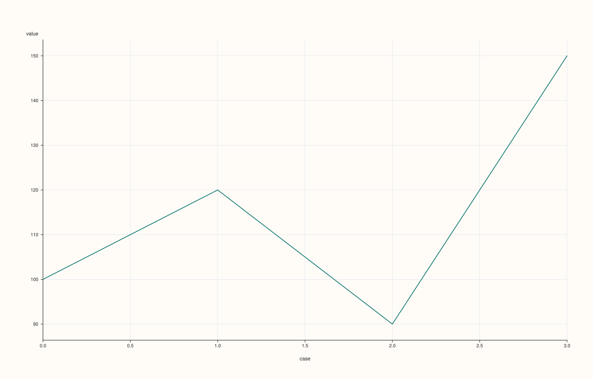
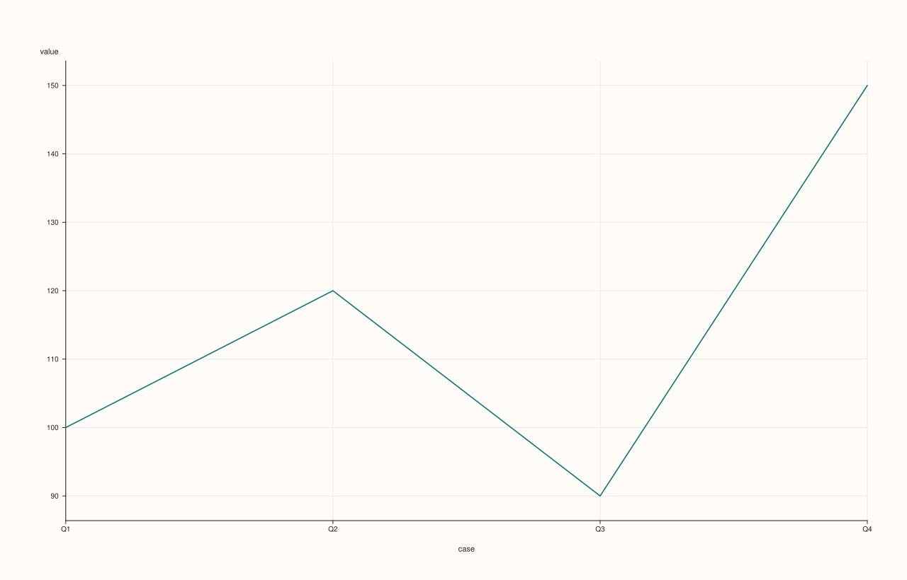
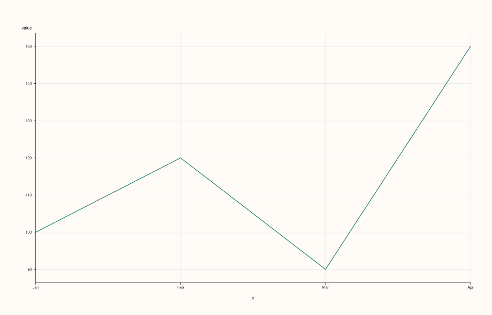
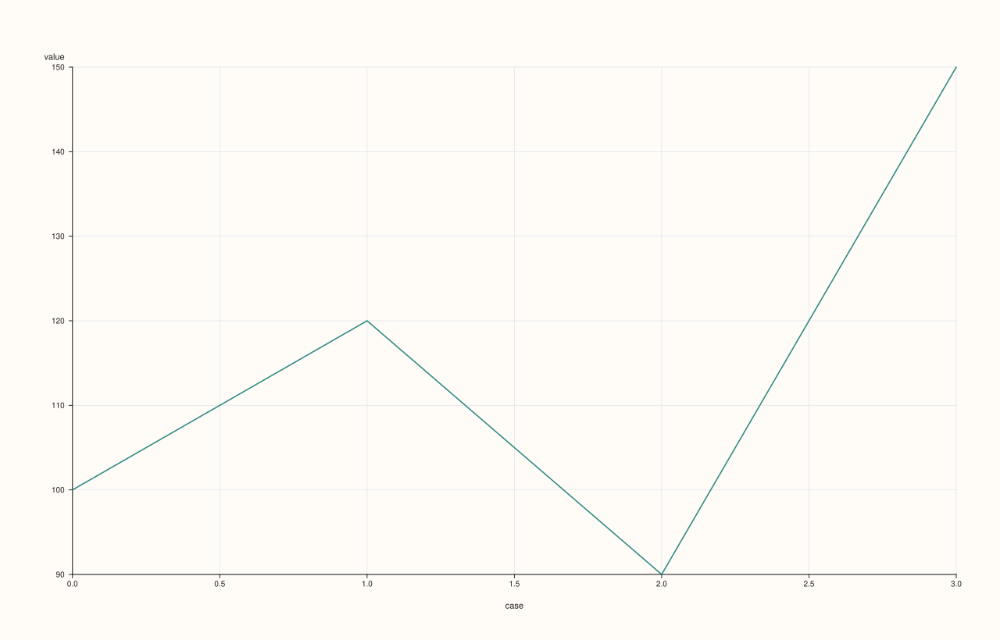
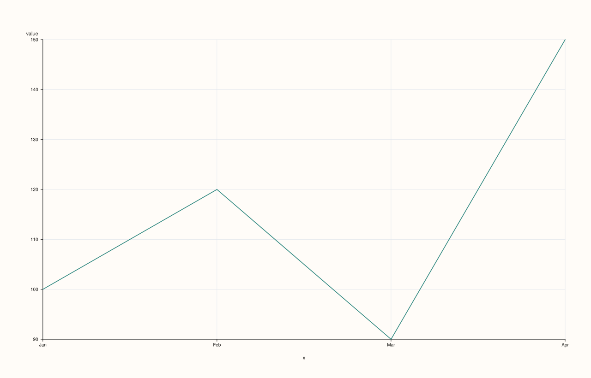

<!-- pluss-hand-authored -->
<!-- pluss-signature-hash: 75b3eba1c308 -->

# StreamPlotAccessor::line

[Back to StreamPlotAccessor API Reference](../../stream_plot_accessor_api_reference)

## Signatures

```cpp
StreamPlotAccessor::line() const -> pluss::pl::Studio
StreamPlotAccessor::line(const Stream& x) const -> pluss::pl::Studio
StreamPlotAccessor::line(const LinePlotOptions& options) const -> pluss::pl::Studio
StreamPlotAccessor::line(const Stream& x, const LinePlotOptions& options) const -> pluss::pl::Studio
```

## What It Does

Draws a single line trace of the bound stream's own values, against either a plain case
index (no `x` given) or an explicit companion `Stream` used as the x-axis. Every overload
is a one-line forward — `base_.to_slate().plot(options_).line(...)` — into
[`SlatePlotAccessor::line`](../slate-plot/line.md), converting the bound stream (and, if
given, `x`) to `Slate` first via `Stream::to_slate()`. See that page for the full
mechanics; this page covers what's specific to the `Stream` layer.

```{important} Stream has no name() — every chart is column-named "value"/"x"/"hue"
`SlatePlotAccessor::line`'s naming rule names the wrapped column after the source
`Slate`'s own `name()` if it has one, falling back to `"value"` (the bound slate) or
`"x"` (a companion slate) otherwise. `Stream::to_slate()` never sets a name on the
`Slate` it produces — `Stream` has no `name()`/`named()` concept at all — so every
`StreamPlotAccessor` chart's axis labels are **always** the generic fallback names: `"value"`
for the bound stream, `"x"` for a companion stream (other methods on this accessor use
`"hue"` for their own second-stream argument). There is no way to get a custom column name
out of a `Stream`-sourced chart the way a named `Slate` or a `DataFrame` feature can.
```

```{important} Row (case) labels are still inherited, via with_label()
Unlike naming, **row labels do carry through**: `Stream::to_slate()` copies the bound
stream's own label (attached via [`Stream::with_label`](../stream/with_label.md)) onto the
resulting `Slate`'s row labels. `SlatePlotAccessor::line`'s own inheritance rule then
applies — the bound stream's label wins if present, otherwise a companion `x` stream's
label, otherwise a plain case index. See Examples 1 and 2.
```

## Parameters

**x** (`const Stream&`, optional)
    A companion stream used as the x-axis. Must be the same size as the bound stream — a
    mismatched size throws `"Slate::plot: slate size mismatch"` (the message still refers
    to `Slate`, since that's where the size check actually runs after both streams
    convert). Omitted means the x-axis falls back to the bound stream's own label, or a
    plain case index if it has none — see the important callout above.

**options** (`LinePlotOptions`)
    The identical struct documented on
    [`CatalogPlotAccessor::line`](../catalog-plot/line.md) (`alpha`, `line_width`,
    `y_limit_method`, `align`) — see that page for each field's meaning. `align` is
    accepted for shape-compatibility but has no observable effect here: `Stream::line()`
    only ever wraps at most two operands (the bound stream and `x`) into a `Slate`-level
    call, which has no multi-key alignment step to configure.

## Returns

`pluss::pl::Studio`
    A figure with one pane containing a single, unlabeled (no-legend) line trace of the
    bound stream's values.

## Examples

Example 1. No companion stream, and the bound stream has no label of its own: falls back
to a plain case index.

```cpp
using namespace pluss::kindle;

auto revenue = Stream(pluss::make_series({100.0, 120.0, 90.0, 150.0}));

auto chart = revenue.plot().line();
chart.show();
```

`revenue` has no label, so the x-axis falls back to a plain `0..3` case index; the y-axis
is labeled `"value"` — never `"revenue"`, since `Stream` has no name to draw from.



Example 2. No companion stream, but the bound stream carries its own label — that label
becomes the x-axis instead of a bare case index.

```cpp
using namespace pluss::kindle;

auto labeled_revenue = Stream(pluss::make_series({100.0, 120.0, 90.0, 150.0}))
    .with_label(pluss::table::Slate(pluss::make_note({"Q1", "Q2", "Q3", "Q4"})));

auto chart = labeled_revenue.plot().line();
chart.show();
```



Example 3. An explicit companion stream as the x-axis.

```cpp
using namespace pluss::kindle;

auto revenue = Stream(pluss::make_series({100.0, 120.0, 90.0, 150.0}));
auto month = Stream(pluss::make_note({"Jan", "Feb", "Mar", "Apr"}));

auto chart = revenue.plot().line(month);
chart.show();
```

The line is drawn against `month`'s four categorical positions instead of a case index; the
x-axis is titled `"x"` (`month` has no name to contribute either).



Example 4. An explicit `LinePlotOptions`, tuning opacity and the y-axis fit, with no
companion stream.

```cpp
using namespace pluss::kindle;

auto revenue = Stream(pluss::make_series({100.0, 120.0, 90.0, 150.0}));

pluss::table::LinePlotOptions options;
options.alpha = 0.85;
options.y_limit_method = pluss::pl::LimitMethod::Tight;

auto chart = revenue.plot().line(options);
chart.show();
```



Example 5. A companion stream together with explicit options — the four-argument-equivalent
overload.

```cpp
using namespace pluss::kindle;

auto revenue = Stream(pluss::make_series({100.0, 120.0, 90.0, 150.0}));
auto month = Stream(pluss::make_note({"Jan", "Feb", "Mar", "Apr"}));

pluss::table::LinePlotOptions options;
options.alpha = 0.85;
options.y_limit_method = pluss::pl::LimitMethod::Tight;

auto chart = revenue.plot().line(month, options);
chart.show();
```



Example 6. A mismatched-size companion stream throws.

```cpp
using namespace pluss::kindle;

auto revenue = Stream(pluss::make_series({100.0, 120.0, 90.0, 150.0}));
auto short_month = Stream(pluss::make_note({"Jan", "Feb", "Mar"}));

try {
  auto bad = revenue.plot().line(short_month);
} catch (const std::exception& e) {
  std::cout << e.what();
}
```

### Output

```text
Slate::plot: slate size mismatch
```

## Notes

- Delegates straight to [`SlatePlotAccessor::line`](../slate-plot/line.md) after
  `Stream::to_slate()` — see that page (and, beneath it,
  [`DataFramePlotAccessor::line`](../dataframe-plot/line.md)) for the full mechanics.
- Column naming is always the generic fallback (`"value"`/`"x"`) — `Stream` has no
  `name()`/`named()` the way `Slate` does. See the important callout above.
- Row labels **do** carry through, via `Stream::with_label()` → `Stream::to_slate()`.
- A mismatched-size companion `x` throws — see Example 6.
- Returns a `pluss::pl::Studio` — see
  [`CatalogPlotAccessor::line`](../catalog-plot/line.md)'s important callout for how to view
  or save the result.

## See Also

- [`SlatePlotAccessor::line`](../slate-plot/line.md): the method this delegates to.
- [`StreamPlotAccessor::bar`](bar.md): the same shape, drawn as bars instead of a connected
  line.
- [`StreamPlotAccessor::scatter`](scatter.md): points against a required companion stream,
  instead of a connected line against an optional one.
- [`Stream::plot`](../stream/plot.md): how to enter this accessor in the first place.

<div class="pluss-inline-prev-next">
  <a class="prev-link" href="hist.html">
    <span class="label">Previous</span>
    <span class="title">hist</span>
  </a>
  <a class="next-link" href="scatter.html">
    <span class="label">Next</span>
    <span class="title">scatter</span>
  </a>
</div>
