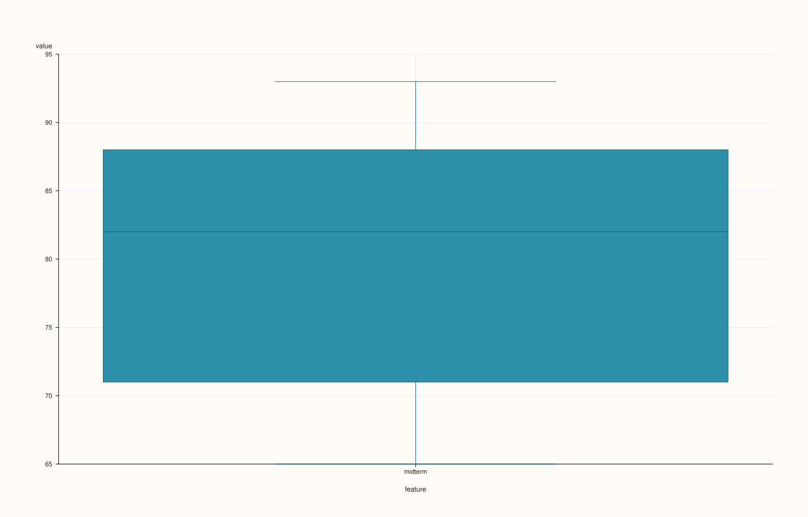

<!-- pluss-hand-authored -->
<!-- pluss-signature-hash: 1d4c43c2e648 -->

# ThreadPlotAccessor::box

[Back to ThreadPlotAccessor API Reference](../../thread_plot_api_reference)

## Signature

```cpp
ThreadPlotAccessor::box(const BoxPlotOptions& options = {}) const -> pluss::pl::Studio
```

## What It Does

Draws a single box-and-whisker distribution summary for the bound thread's values — the
single-series specialization of
[`DataFramePlotAccessor::box`](../../api/dataframe-plot/box.md). Unlike the 2D accessor's
`box()`, which can summarize several features side by side in one pane, this overload
always draws exactly one box, since a `Thread` is always exactly one series; there is no
`features` parameter and no "infer every numeric feature" rule to speak of here.

## Parameters

**options** (`BoxPlotOptions`)
    The identical struct documented on
    [`DataFramePlotAccessor::box`](../../api/dataframe-plot/box.md) (`alpha`,
    `line_width`).

## Returns

`pluss::pl::Studio`
    A figure with one pane containing a single box, x-axis tick labeled with the bound
    thread's `name()` (or the fallback `"value"`).

## Examples

Example 1. Default options.

```cpp
using namespace pluss::table;

auto midterm = Thread(pluss::make_series({71.0, 82.0, 93.0, 65.0, 88.0}));
midterm = midterm.name("midterm");

auto chart = midterm.plot().box();
chart.show();
```



Example 2. An explicit `BoxPlotOptions`.

```cpp
BoxPlotOptions options;
options.alpha = 0.8;
options.line_width = 1.6;

auto chart = midterm.plot().box(options);
chart.show();
```


## Notes

- Always draws exactly one box — there is no multi-feature form the way the 2D accessor's
  `box()` has.
- Non-finite values are dropped before the box statistics are computed, same as
  [`DataFramePlotAccessor::box`](../../api/dataframe-plot/box.md).
- Returns a `pluss::pl::Studio` — see [`line()`](line.md) for how to view or save the
  result.

## See Also

- [`DataFramePlotAccessor::box`](../../api/dataframe-plot/box.md): the multi-feature
  method this delegates to (with a single feature bound in).
- [`ThreadPlotAccessor::violin`](violin.md): full distribution shape instead of just
  quartiles and whiskers, including a value-vs-group overload this method doesn't have.

<div class="pluss-inline-prev-next">
  <a class="prev-link" href="bootstrap.html">
    <span class="label">Previous</span>
    <span class="title">bootstrap</span>
  </a>
  <a class="next-link" href="brief.html">
    <span class="label">Next</span>
    <span class="title">brief</span>
  </a>
</div>
