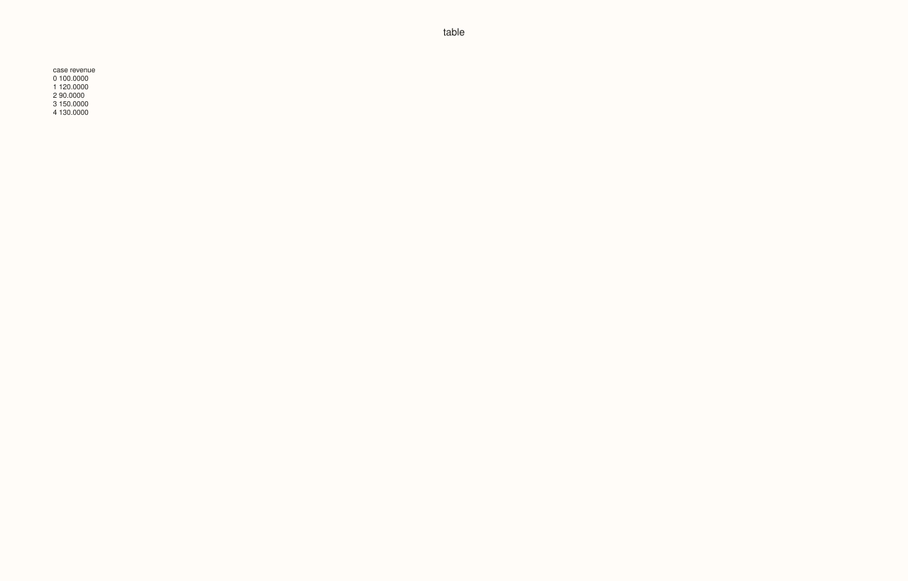
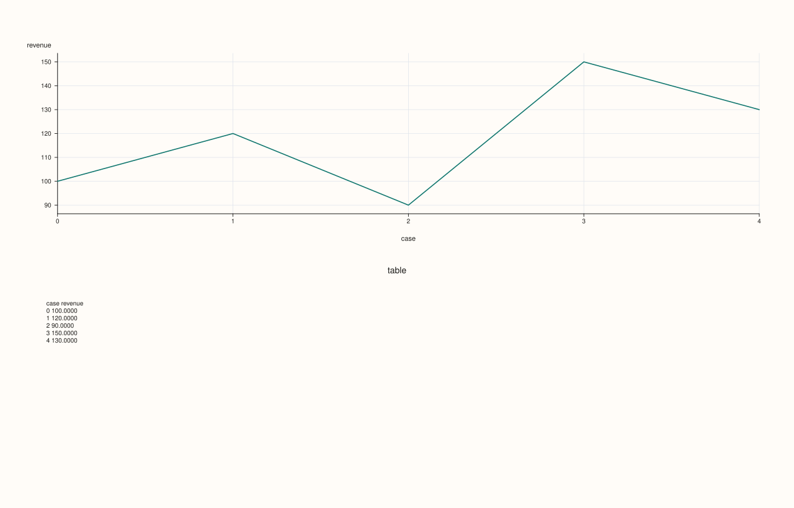
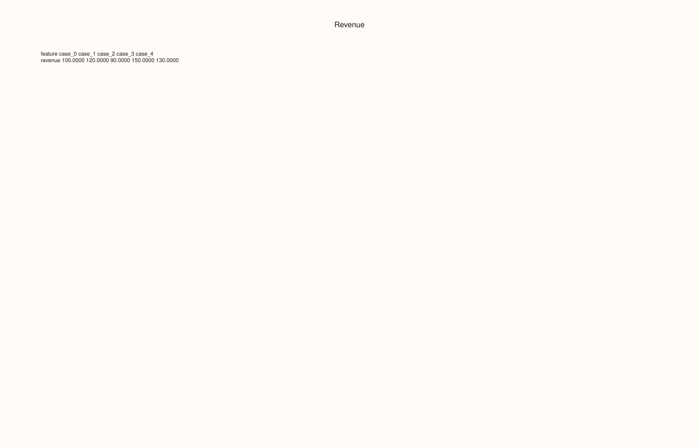

<!-- pluss-hand-authored -->
<!-- pluss-signature-hash: 91c3263ec097 -->

# ThreadPlotAccessor::brief

[Back to ThreadPlotAccessor API Reference](../../thread_plot_api_reference)

## Signatures

```cpp
ThreadPlotAccessor::brief(const BriefPlotOptions& options = {}) const -> pluss::pl::Studio

pluss::pl::Studio& ThreadPlotAccessor::brief(
    pluss::pl::Studio& figure,
    const BriefPlotOptions& options = {}) const
```

## What It Does

Renders a fixed-width, monospace-formatted text table of the bound thread's raw values as
a pane in a `Studio` — the single-series specialization of
[`DataFramePlotAccessor::brief`](../../api/dataframe-plot/brief.md). Like the 2D accessor's
`brief()`, this has two distinct overloads: the first creates a brand-new `Studio` and
returns it; the second takes an existing `Studio&` by reference, appends the table pane
into it in place, and returns that same reference — see the 2D accessor's important callout
for the full explanation of this in-place composition pattern.

## Parameters

**figure** (`pluss::pl::Studio&`, in-place overload only)
    An existing figure to append the table pane into.

**options** (`BriefPlotOptions`)
    The identical struct documented on
    [`DataFramePlotAccessor::brief`](../../api/dataframe-plot/brief.md)
    (`title`, `precision`, `include_header`, `max_cases`, `transpose`,
    `include_case_index`, `features_per_table`, `tables_per_row`, `table_gap_spaces`).
    `features_per_table`/`tables_per_row` have no visible effect here since there is always
    exactly one feature (the bound thread) to lay out.

## Returns

For the first overload: `pluss::pl::Studio`, a fresh figure with one pane containing the
formatted table.

For the second overload: `pluss::pl::Studio&`, the same reference passed in, with the table
pane appended.

## Examples

Example 1. Default options: a fresh `Studio` with the bound thread's values as a table.

```cpp
using namespace pluss::table;

auto revenue = Thread(pluss::make_series({100.0, 120.0, 90.0, 150.0, 130.0}));
revenue = revenue.name("revenue");

auto chart = revenue.plot().brief();
chart.show();
```



Example 2. The in-place overload: appending a `brief()` table into a `Studio` that already
has a real chart.

```cpp
auto chart = revenue.plot().line();
revenue.plot().brief(chart);
chart.show();
```

`chart` starts as the line plot's figure (one pane); the second call appends a second pane
containing the `brief()` table directly into the same `Studio`.



Example 3. An explicit `BriefPlotOptions`, transposing the layout.

```cpp
BriefPlotOptions options;
options.title = "Revenue";
options.transpose = true;

auto chart = revenue.plot().brief(options);
chart.show();
```



## Notes

- The two-argument-figure overload composes in place into an existing `Studio&`; the other
  overload always creates a fresh one — see
  [`DataFramePlotAccessor::brief`](../../api/dataframe-plot/brief.md)'s important callout.
- `features_per_table`/`tables_per_row` have no visible effect, since there is always
  exactly one feature to lay out.
- Returns a `pluss::pl::Studio` (or `Studio&` for the in-place overload) — see
  [`line()`](line.md) for how to view or save the result.

## See Also

- [`DataFramePlotAccessor::brief`](../../api/dataframe-plot/brief.md): the method both
  overloads delegate to.
- [`ThreadPlotAccessor::auto_plot`](auto_plot.md): picks a real chart type automatically,
  in contrast to `brief()`'s fixed textual summary.

<div class="pluss-inline-prev-next">
  <a class="prev-link" href="box.html">
    <span class="label">Previous</span>
    <span class="title">box</span>
  </a>
  <a class="next-link" href="density.html">
    <span class="label">Next</span>
    <span class="title">density</span>
  </a>
</div>
