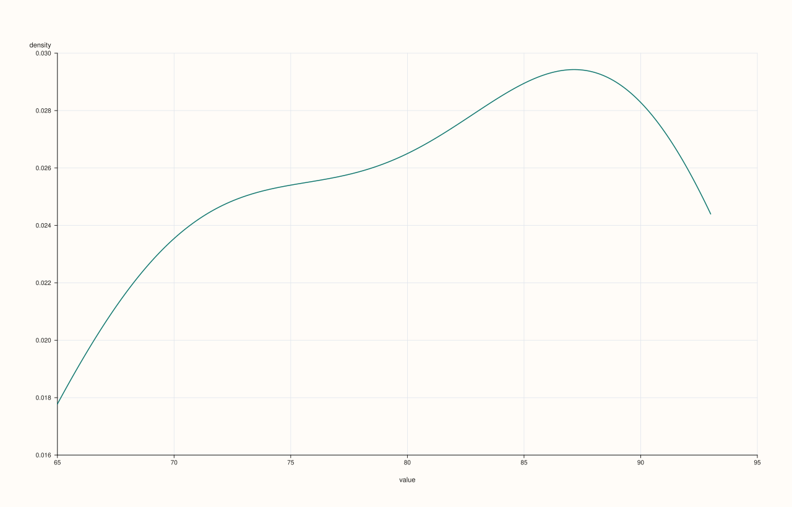
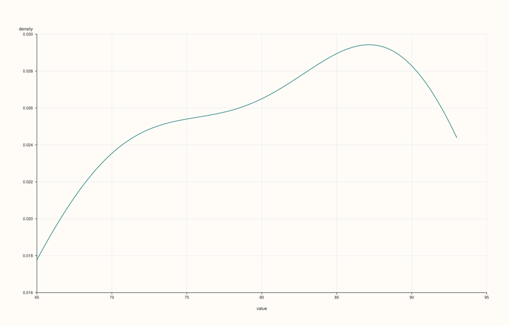

<!-- pluss-hand-authored -->
<!-- pluss-signature-hash: d24d49e8012a -->

# ThreadPlotAccessor::density

[Back to ThreadPlotAccessor API Reference](../../thread_plot_api_reference)

## Signatures

```cpp
ThreadPlotAccessor::density(std::int64_t points = 128) const -> pluss::pl::Studio
ThreadPlotAccessor::density(const DensityPlotOptions& options) const -> pluss::pl::Studio
```

## What It Does

Draws a kernel-density estimate for the bound thread's values — the single-series
specialization of
[`DataFramePlotAccessor::density`](../../api/dataframe-plot/density.md)'s single-feature
path. Always draws exactly one curve, since a `Thread` is always one series; there is no
multi-feature overlay form here.

## Parameters

**points** (`std::int64_t`, default `128`)
    The number of evaluation points used to draw the curve. Internally clamped to a
    minimum of `16`, same as the 2D accessor.

**options** (`DensityPlotOptions`)
    The identical struct documented on
    [`DataFramePlotAccessor::density`](../../api/dataframe-plot/density.md)
    (`points`, `alpha`, `line_width`).

## Returns

`pluss::pl::Studio`
    A figure with one pane containing a single kernel-density curve, x-axis labeled
    `"value"`, y-axis labeled `"density"`.

## Examples

Example 1. Default point count.

```cpp
using namespace pluss::table;

auto midterm = Thread(pluss::make_series({71.0, 82.0, 93.0, 65.0, 88.0, 74.0, 90.0}));
midterm = midterm.name("midterm");

auto chart = midterm.plot().density();
chart.show();
```


Example 2. An explicit point count.

```cpp
auto chart = midterm.plot().density(256);
chart.show();
```



Example 3. An explicit `DensityPlotOptions`.

```cpp
DensityPlotOptions options;
options.points = 200;
options.alpha = 0.7;
options.line_width = 2.0;

auto chart = midterm.plot().density(options);
chart.show();
```



## Notes

- Always draws exactly one curve — there is no multi-feature overlay form the way the 2D
  accessor's `density()` has.
- `points` is clamped to a minimum of `16` regardless of what's requested.
- Returns a `pluss::pl::Studio` — see [`line()`](line.md) for how to view or save the
  result.

## See Also

- [`DataFramePlotAccessor::density`](../../api/dataframe-plot/density.md): the method this
  delegates to.
- [`ThreadPlotAccessor::hist`](hist.md): binned frequency counts instead of a smoothed
  curve.

<div class="pluss-inline-prev-next">
  <a class="prev-link" href="brief.html">
    <span class="label">Previous</span>
    <span class="title">brief</span>
  </a>
  <a class="next-link" href="hist.html">
    <span class="label">Next</span>
    <span class="title">hist</span>
  </a>
</div>
