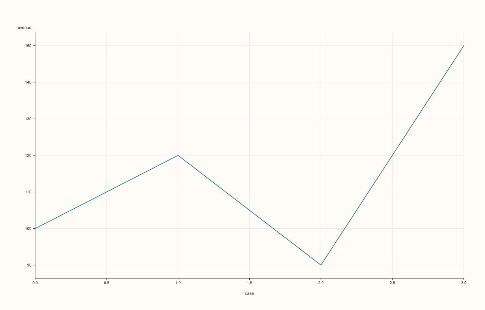
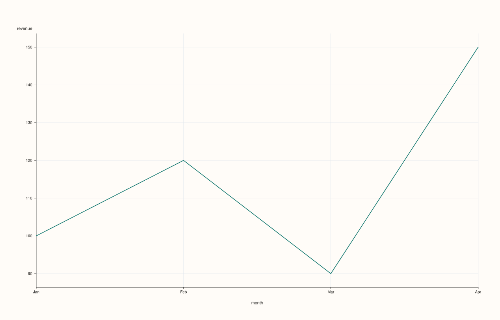
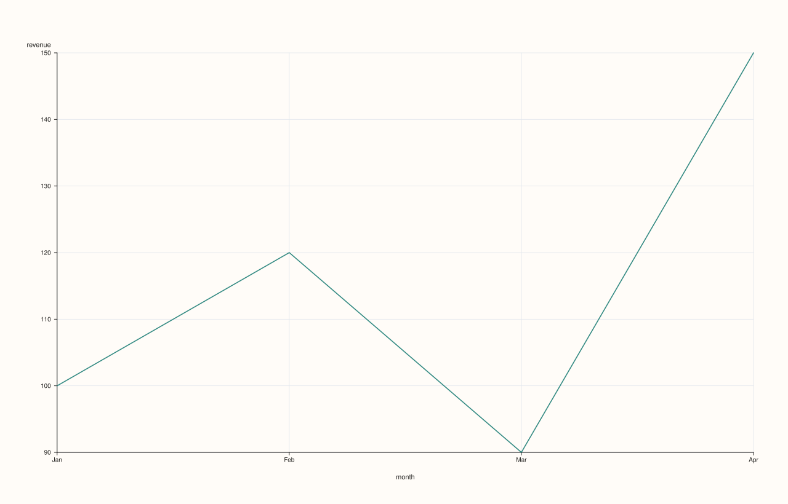
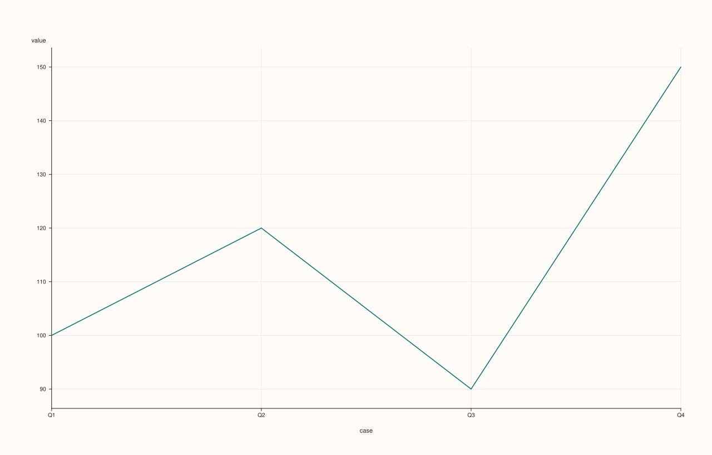

<!-- pluss-hand-authored -->
<!-- pluss-signature-hash: 2ed1afb4aef7 -->

# ThreadPlotAccessor::line

[Back to ThreadPlotAccessor API Reference](../../thread_plot_api_reference)

## Signatures

```cpp
ThreadPlotAccessor::line() const -> pluss::pl::Studio
ThreadPlotAccessor::line(const Thread& x) const -> pluss::pl::Studio
ThreadPlotAccessor::line(const LinePlotOptions& options) const -> pluss::pl::Studio
ThreadPlotAccessor::line(const Thread& x, const LinePlotOptions& options) const -> pluss::pl::Studio
```

## What It Does

Draws a single line trace of the bound thread's own values, against either a plain case
index (no `x` given) or an explicit companion `Thread` used as the x-axis. This is the
single-series specialization of
[`DataFramePlotAccessor::line`](../../api/dataframe-plot/line.md): internally, `line()`
wraps the bound thread (and, if given, `x`) into a one- or two-column `DataFrame` and calls
straight into that method — every field of `LinePlotOptions` behaves identically to its 2D
counterpart, and this page's callouts on naming and row-label handling apply to every other
method on this accessor too, not just `line()`.

```{important} How a wrapped Thread becomes a named column and inherits row labels
Every method on this accessor that takes one or more `Thread` arguments builds a small
internal `DataFrame` before delegating. Each thread becomes one column, named after that
thread's own `name()` if it has one (set via `name(...)`, checked via `named()`); otherwise a
generic fallback name is used — `"value"` for the bound thread itself, `"x"` for a
companion x-axis thread (other methods on this accessor use `"hue"`, `"label"`, or
`"group"` for their own second-thread arguments, documented on their own pages). Row
(case) labels for the resulting frame come from whichever thread involved actually has
them: the bound value thread is checked first, then the companion thread — the first one
found wins, and if neither has row labels the frame falls back to a plain numeric case
index, exactly like a `DataFrame` built without explicit row labels.
```

## Parameters

**x** (`const Thread&`, optional)
    A companion thread used as the x-axis. Must be the same size as the bound thread — a
    mismatched size throws `"Thread::plot: thread size mismatch"`. Omitted means the
    x-axis falls back to the resulting frame's own row labels (or a plain case index — see
    the important callout above), exactly like
    [`DataFramePlotAccessor::line`](../../api/dataframe-plot/line.md) with no `x_feature`
    and no `default_x_feature` set.

**options** (`LinePlotOptions`)
    The identical struct documented on
    [`DataFramePlotAccessor::line`](../../api/dataframe-plot/line.md)
    (`alpha`, `line_width`, `y_limit_method`) — see that page for each field's meaning.

## Returns

`pluss::pl::Studio`
    A figure with one pane containing a single, unlabeled (no-legend) line trace of the
    bound thread's values.

## Examples

Example 1. No companion thread: the x-axis falls back to a plain case index.

```cpp
using namespace pluss::table;

auto revenue = Thread(pluss::make_series({100.0, 120.0, 90.0, 150.0}));
revenue = revenue.name("revenue");

auto chart = revenue.plot().line();
chart.show();
```

`revenue` has no row labels of its own, so the wrapped one-column frame falls back to a
plain `0..3` case index; the y-axis is labeled `"revenue"`, taken from the thread's own
`name()`.



Example 2. An explicit companion thread as the x-axis.

```cpp
auto month = Thread(pluss::make_note({"Jan", "Feb", "Mar", "Apr"}));
month = month.name("month");

auto chart = revenue.plot().line(month);
chart.show();
```

The wrapped frame now has two columns, `"month"` and `"revenue"` (each named from its own
thread's `name()`), and the line is drawn against `month`'s four categorical
positions instead of a numeric case index.



Example 3. An explicit `LinePlotOptions`, tuning opacity and the y-axis fit.

```cpp
LinePlotOptions options;
options.alpha = 0.85;
options.y_limit_method = pluss::pl::LimitMethod::Tight;

auto chart = revenue.plot().line(month, options);
chart.show();
```



Example 4. Row labels are inherited from whichever operand actually has them — here, from
`month` since the bound `revenue` thread itself has none.

```cpp
auto labeled_revenue = Thread(pluss::make_series({100.0, 120.0, 90.0, 150.0}))
                            .label().set(Thread(pluss::make_note({"Q1", "Q2", "Q3", "Q4"})));

auto chart = labeled_revenue.plot().line();
chart.show();
```

`labeled_revenue` carries its own row labels (`"Q1"`..`"Q4"`), so the wrapped frame's case
axis uses those directly, even with no companion `x` thread supplied.



## Notes

- Wraps the bound thread (and any companion thread) into a small internal `DataFrame` and
  delegates to [`DataFramePlotAccessor::line`](../../api/dataframe-plot/line.md) — see the
  important callout above for exactly how naming and row-label inheritance work.
- A companion `x` thread must match the bound thread's size, or the call throws.
- `LinePlotOptions` behaves identically to its 2D counterpart.
- Returns a `pluss::pl::Studio`, never printed as text — see
  [`DataFramePlotAccessor::line`](../../api/dataframe-plot/line.md)'s important callout for
  how to view or save the result.

## See Also

- [`DataFramePlotAccessor::line`](../../api/dataframe-plot/line.md): the method this
  delegates to, and the canonical explanation of `Studio`'s view/save mechanics.
- [`ThreadPlotAccessor::step`](step.md) / [`area`](area.md): the same shape, drawn as a
  step function or a filled area instead of a straight line.
- [`ThreadPlotAccessor::scatter`](scatter.md): unconnected points against a required
  companion thread, instead of a connected line against an optional one.
- [`Thread::plot`](../thread/plot.md): how to enter this accessor in the first place.

<div class="pluss-inline-prev-next">
  <a class="prev-link" href="lag.html">
    <span class="label">Previous</span>
    <span class="title">lag</span>
  </a>
  <a class="next-link" href="pie.html">
    <span class="label">Next</span>
    <span class="title">pie</span>
  </a>
</div>
