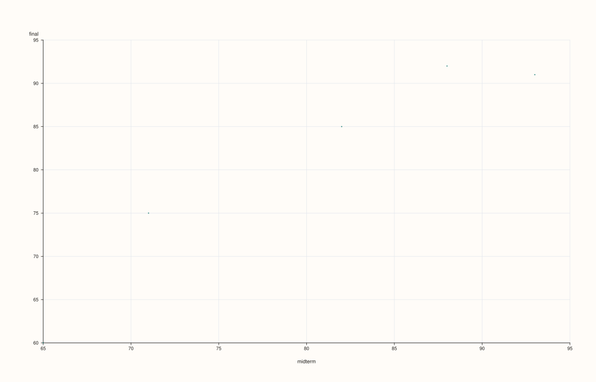
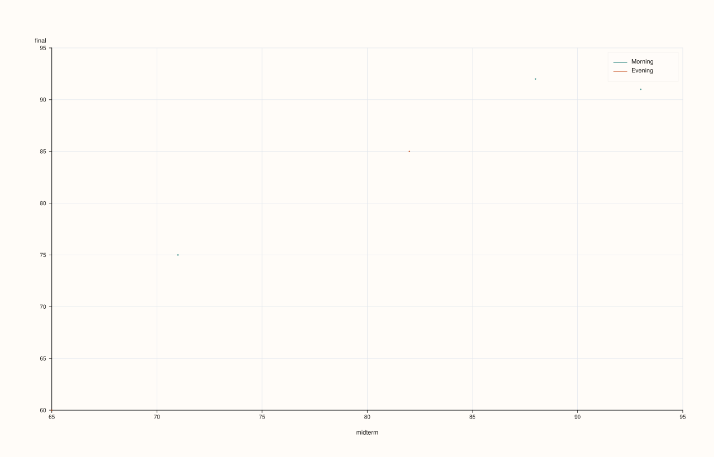
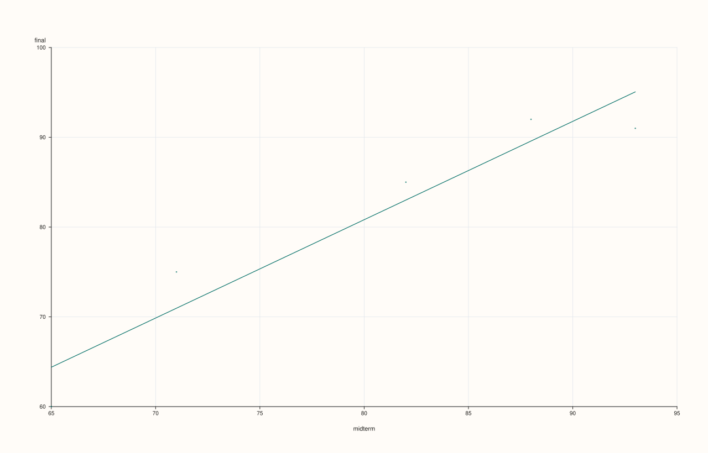
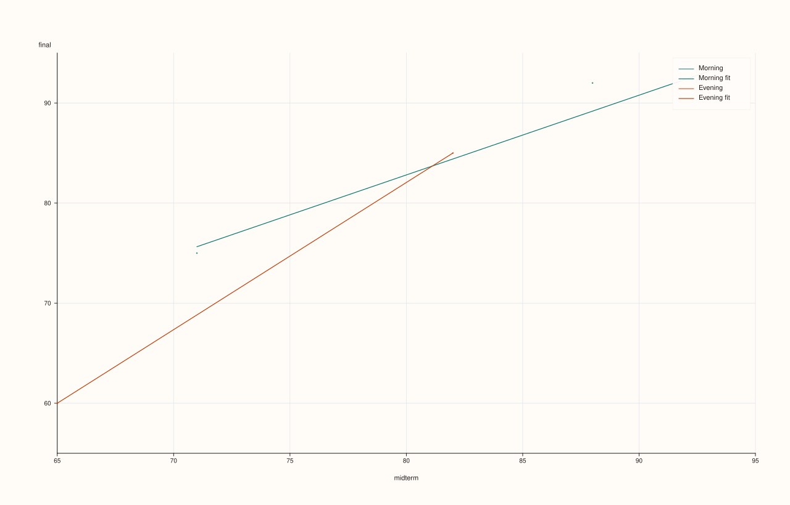
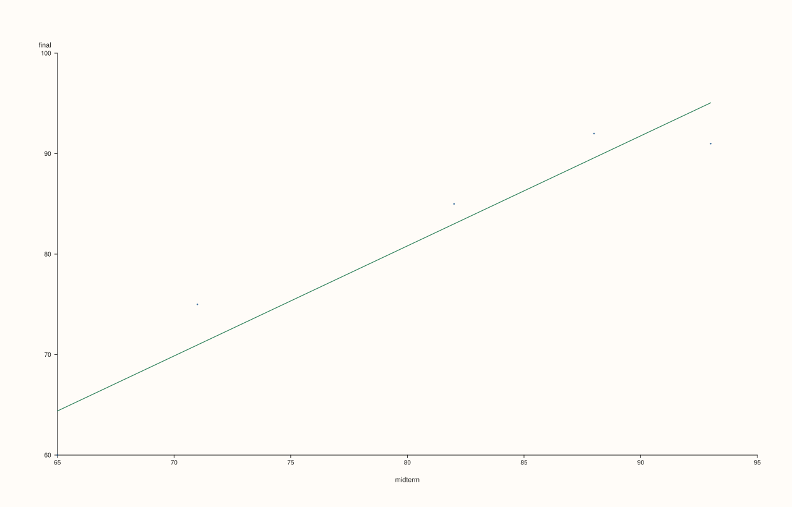

<!-- pluss-hand-authored -->
<!-- pluss-signature-hash: ea10d472e881 -->

# ThreadPlotAccessor::scatter

[Back to ThreadPlotAccessor API Reference](../../thread_plot_api_reference)

## Signatures

```cpp
ThreadPlotAccessor::scatter(const Thread& x) const -> pluss::pl::Studio
ThreadPlotAccessor::scatter(const Thread& x, const ScatterPlotOptions& options) const -> pluss::pl::Studio
ThreadPlotAccessor::scatter(const Thread& x, const Thread& hue) const -> pluss::pl::Studio
ThreadPlotAccessor::scatter(const Thread& x, const Thread& hue, const ScatterPlotOptions& options) const -> pluss::pl::Studio
```

## What It Does

Draws one point per row at `(x, value)`, where `value` is the bound thread, optionally
split into separate, distinctly colored/labeled point groups by a companion `hue` thread.
The single-series specialization of
[`DataFramePlotAccessor::scatter`](../../api/dataframe-plot/scatter.md).

Unlike every other method on this accessor, `scatter()` has **no zero-argument overload**
— `x` is always required, since a scatter plot needs two independent axes, not one axis
plus a case index the way [`line()`](line.md)/[`step()`](step.md)/[`area()`](area.md) fall
back to row labels.

See [`line()`](line.md)'s important callout for the shared naming and row-label
inheritance rules — here, `x` wraps to a column named `"x"` (or its own `name()`)
and `hue` wraps to a column named `"hue"` (or its own `name()`), following the
exact same fallback-naming pattern.

```{important} hue must be Note-, Timeline-, or TimeIndex-kind, same as the 2D accessor
Because `scatter()` always delegates to
[`DataFramePlotAccessor::scatter`](../../api/dataframe-plot/scatter.md)'s explicit
`hue_feature` argument (never through `default_hue_feature`), a `hue` thread that resolves
to a plain numeric `Series` throws `"DataFrame::plot().scatter: hue feature 'hue' must be
note-like or time-like"` — see that page's important callout for the full rule. If you want
to color by a numeric value, bucket or cast it to text first.
```

## Parameters

**x** (`const Thread&`, required)
    The companion thread for the horizontal axis. Must match the bound thread's size, or
    the call throws `"Thread::plot: thread size mismatch"`.

**hue** (`const Thread&`, optional)
    Optional companion thread splitting points into separate colored/labeled groups. Must
    be Note-, Timeline-, or TimeIndex-kind — see the important callout above.

**options** (`ScatterPlotOptions`)
    The identical struct documented on
    [`DataFramePlotAccessor::scatter`](../../api/dataframe-plot/scatter.md)
    (`alpha`, `line_width`, `fit_line`, `fit_order`, `fit_ci`, `fit_confidence_level`).

## Returns

`pluss::pl::Studio`
    A figure with one pane: a single point trace with no hue, or one point trace per
    distinct hue value when `hue` is given.

## Examples

Example 1. Plain scatter, no hue.

```cpp
using namespace pluss::table;

auto midterm = Thread(pluss::make_series({71.0, 82.0, 93.0, 65.0, 88.0}));
midterm = midterm.name("midterm");

auto final_ = Thread(pluss::make_series({75.0, 85.0, 91.0, 60.0, 92.0}));
final_ = final_.name("final");

auto chart = final_.plot().scatter(midterm);
chart.show();
```

Every row becomes one point at `(midterm, final)`; no legend is shown since there's no hue.



Example 2. With a categorical hue thread.

```cpp
auto cohort = Thread(pluss::make_note({"Morning", "Evening", "Morning", "Evening", "Morning"}));
cohort = cohort.name("cohort");

auto chart = final_.plot().scatter(midterm, cohort);
chart.show();
```

Two traces are drawn — `"Morning"` and `"Evening"` — each its own color, with a legend
shown automatically.



Example 3. An explicit `ScatterPlotOptions`.

```cpp
ScatterPlotOptions options;
options.alpha = 0.6;
options.line_width = 1.5;

auto chart = final_.plot().scatter(midterm, cohort, options);
chart.show();
```


```{important} fit_line overlays a line of best fit — one per hue group, if hue is set
Same as [`DataFramePlotAccessor::scatter`](../../api/dataframe-plot/scatter.md):
`ScatterPlotOptions::fit_line = true` fits and draws a line of best fit directly on top of
the point cloud, without leaving this accessor — linear by default (`fit_order = 1`), one
shared fit with no `hue`, or one separate, color-matched fit per hue group when `hue` is
given. `fit_ci = true` additionally shades a confidence band around each fit. See
Examples 4–5.
```

Example 4. `fit_line = true`, no hue.

```cpp
ScatterPlotOptions options;
options.fit_line = true;

auto chart = final_.plot().scatter(midterm, options);
chart.show();
```



Example 5. `fit_line = true` together with a `hue` thread: one fit line per hue group,
color-matched to its own group's points.

```cpp
ScatterPlotOptions options;
options.fit_line = true;

auto chart = final_.plot().scatter(midterm, cohort, options);
chart.show();
```



```{note} Need more than fit_line offers? PlussPl's flash::regplot has robust and LOWESS fits too
For fit shapes beyond a polynomial least-squares fit (robust regression, LOWESS, a
bootstrap confidence interval), `ScatterPlotOptions` has no field for it — reach for
`PlussPl`'s `pluss::pl::flash::regplot(pane, x, y, options)` directly on a pane you create
yourself, passing each thread's values as a `pluss::Series` (via `thread.value()`, assigned
to an explicit `pluss::Series` variable rather than `auto` — see Example 6).
```

Example 6. Reaching past `fit_line` for `PlussPl`'s `flash::regplot` directly.

```cpp
#include "pluss/pl/flash/flash.h"

pluss::Series midterm_series = midterm.value();
pluss::Series final_series = final_.value();

auto fig = pluss::pl::studio("scores_fit");
auto& pane = fig.pane2();
pane.x_label("midterm").y_label("final");
pluss::pl::flash::regplot(pane, midterm_series, final_series);
fig.show();
```



`regplot` draws the scatter cloud and a linear fit through it as two separate traces on
the same pane — exactly what `fit_line = true` does internally (Example 4). The
difference is `RegPlotOptions`'s extra fields `fit_line` doesn't expose (`robust`,
`lowess`, bootstrap `show_ci`) — see
[`DataFramePlotAccessor::scatter`](../../api/dataframe-plot/scatter.md)'s Example 9 for
the full `RegPlotOptions` field list.

## Notes

- No zero-argument overload — `x` is always required, unlike every other chart method on
  this accessor.
- `hue` must resolve to a Note-, Timeline-, or TimeIndex-kind thread, or the call throws.
- A mismatched-size `x` or `hue` throws `"Thread::plot: thread size mismatch"`.
- `fit_line = true` overlays a line of best fit — one per hue group when `hue` is given.
  For fit shapes beyond a polynomial least-squares fit, see the note above and Example 6
  for `PlussPl`'s `flash::regplot`/`flash::lmplot` instead.
- Returns a `pluss::pl::Studio` — see [`line()`](line.md) for how to view or save the
  result.

## See Also

- [`DataFramePlotAccessor::scatter`](../../api/dataframe-plot/scatter.md): the method this
  delegates to, including the full `hue_feature` type-requirement explanation and the
  fuller `flash::regplot` writeup in its Example 9.
- [`ThreadPlotAccessor::line`](line.md): connected points against an optional companion
  thread, instead of an unconnected cloud against a required one.

<div class="pluss-inline-prev-next">
  <a class="prev-link" href="pie.html">
    <span class="label">Previous</span>
    <span class="title">pie</span>
  </a>
  <a class="next-link" href="step.html">
    <span class="label">Next</span>
    <span class="title">step</span>
  </a>
</div>
