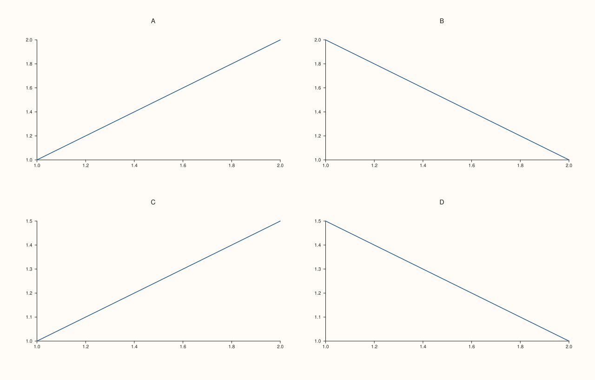

<!-- pluss-hand-authored -->

# flash::FacetGrid

[Back to flash API Reference](../../flash_api_reference)

## Signature

```cpp
Studio& flash::FacetGrid(Studio& studio, std::int64_t rows, std::int64_t cols,
                          double gx = 18.0, double gy = 18.0)
```

## What It Does

A thin, familiar-naming wrapper around [`Studio::mosaic`](../studio/mosaic.md) — literally
`studio.mosaic(rows, cols, gx, gy)`, nothing more. `FacetGrid` only sets up the grid
*layout*; it does not create any panes itself. Every pane you subsequently add via
[`Studio::pane2`](../studio/pane2.md)/[`pane3`](../studio/pane3.md) must still be
explicitly positioned with [`Pane::place`](../pane/place.md) to land in a particular cell.

```{important} Byte-identical to calling Studio::mosaic directly
FacetGrid(studio, rows, cols) and FacetGrid(studio, rows, cols, gx, gy) produce
exactly the same figure state as studio.mosaic(rows, cols) /
studio.mosaic(rows, cols, gx, gy) -- directly verified via SVG comparison.
FacetGrid's only purpose is a more familiar name and matching default
gap values (18.0/18.0, identical to Studio::mosaic's own defaults).
```

`flash::relgridplot`, `flash::catgridplot`, and `flash::disgridplot` (and
`flash::facet_map_plot`) all call `FacetGrid` internally to lay out their own panels — you
only need to call it directly when building a custom grid by hand, pane by pane, as shown
below.

## Parameters

**studio** (`Studio&`)
    The figure to lay out.

**rows**, **cols** (`std::int64_t`)
    The grid's row and column counts. No validation is performed here — `Studio::mosaic`
    itself is the source of any bounds-checking behavior.

**gx**, **gy** (`double`, default `18.0` each)
    The horizontal/vertical gutter between cells, forwarded straight to `Studio::mosaic`.

## Returns

`Studio&`
    A reference to the same figure, for chaining — whatever `Studio::mosaic` itself
    returns.

## Examples

Example 1. A `2×2` grid, with four panes explicitly placed into its cells.

```cpp
using namespace pluss::pl;

auto fig = studio("flash_facetgrid_default");
flash::FacetGrid(fig, 2, 2);
auto& p1 = fig.pane2("A"); p1.place(0, 0); p1.trend(std::vector<double>{1.0, 2.0}, std::vector<double>{1.0, 2.0});
auto& p2 = fig.pane2("B"); p2.place(0, 1); p2.trend(std::vector<double>{1.0, 2.0}, std::vector<double>{2.0, 1.0});
auto& p3 = fig.pane2("C"); p3.place(1, 0); p3.trend(std::vector<double>{1.0, 2.0}, std::vector<double>{1.0, 1.5});
auto& p4 = fig.pane2("D"); p4.place(1, 1); p4.trend(std::vector<double>{1.0, 2.0}, std::vector<double>{1.5, 1.0});
fig.show();
```



Example 2 (verification, not a distinct rendering). `FacetGrid(studio, rows, cols)`
produces byte-identical output to `studio.mosaic(rows, cols)`.

```cpp
using namespace pluss::pl;

auto fig1 = studio("flash_facetgrid_eq_a");
flash::FacetGrid(fig1, 2, 3);

auto fig2 = studio("flash_facetgrid_eq_b");
fig2.mosaic(2, 3);

std::cout << "FacetGrid(studio,2,3) == studio.mosaic(2,3): " << (fig1.to_svg() == fig2.to_svg()) << "\n";
```

Output:

```text
FacetGrid(studio,2,3) == studio.mosaic(2,3): 1
```

## Notes

- Not `noexcept`.
- Never creates panes — only sets the grid's row/column shape and gutter, exactly like
  `Studio::mosaic`.
- [`flash::relgridplot`](relgridplot.md), [`flash::catgridplot`](catgridplot.md),
  [`flash::disgridplot`](disgridplot.md), and [`flash::facet_map_plot`](facet_map_plot.md)
  all call this internally — reach for `FacetGrid` directly only when hand-building a grid
  pane by pane.

## See Also

- [`Studio::mosaic`](../studio/mosaic.md): the underlying method, and the exact source of
  `FacetGrid`'s layout behavior.
- [`Pane::place`](../pane/place.md): how a pane is positioned into one of `FacetGrid`'s
  cells after creation.
- [`flash::PairGrid`](PairGrid.md), [`flash::JointGrid`](JointGrid.md): sibling grid
  constructors with different default shapes/gaps.

<div class="pluss-inline-prev-next">
  <a class="prev-link" href="clustermap.html">
    <span class="label">Previous</span>
    <span class="title">clustermap</span>
  </a>
  <a class="next-link" href="PairGrid.html">
    <span class="label">Next</span>
    <span class="title">PairGrid</span>
  </a>
</div>
