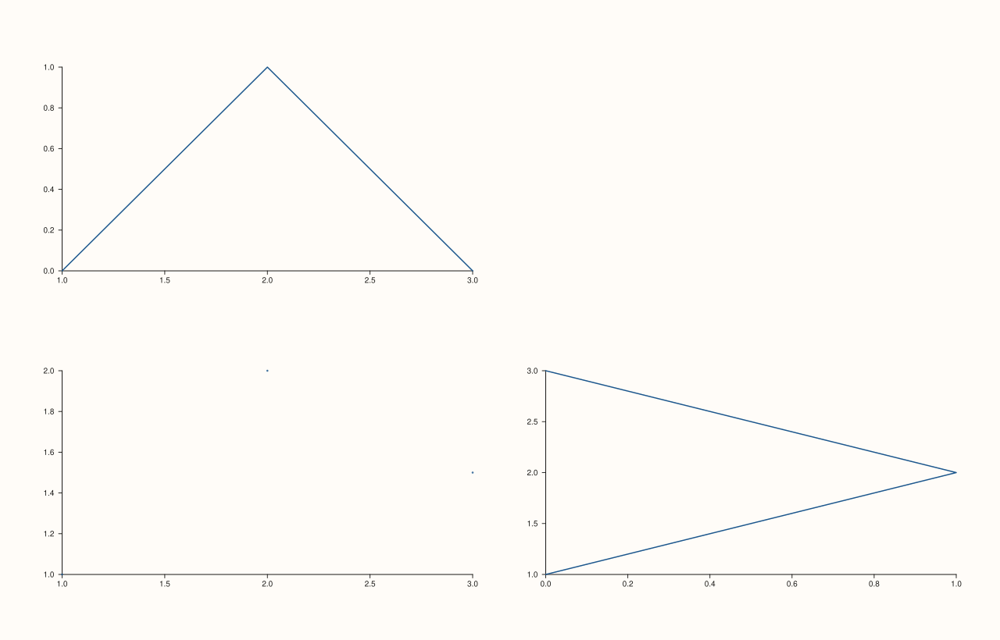

<!-- pluss-hand-authored -->

# flash::JointGrid

[Back to flash API Reference](../../flash_api_reference)

## Signature

```cpp
Studio& flash::JointGrid(Studio& studio, double gx = 14.0, double gy = 14.0)
```

## What It Does

A thin wrapper around [`Studio::mosaic`](../studio/mosaic.md), fixed to the `2×2` shape a
joint-plus-marginals view needs —
`JointGrid(studio, gx, gy)` is exactly `studio.mosaic(2, 2, gx, gy)`. It only lays out the
grid; it creates no panes of its own, and it does not know anything about the
top-marginal/joint/right-marginal/hidden-corner *meaning* those four cells conventionally
carry — that convention lives in [`flash::jointgrid_map_plot`](jointgrid_map_plot.md),
not here.

## Parameters

**studio** (`Studio&`)
    The figure to lay out.

**gx**, **gy** (`double`, default `14.0` each)
    The horizontal/vertical gutter between cells, forwarded straight to `Studio::mosaic`
    — the same tighter default `PairGrid` uses, not `FacetGrid`'s wider `18.0`.

## Returns

`Studio&`
    A reference to the same figure, for chaining.

## Examples

Example 1. The conventional joint-plot layout, built by hand: a top marginal (row 0, col
0), the joint plot (row 1, col 0), a right marginal (row 1, col 1), and the unused corner
cell (row 0, col 1) explicitly hidden.

```cpp
using namespace pluss::pl;

auto fig = studio("flash_jointgrid_default");
flash::JointGrid(fig);
auto& top = fig.pane2(); top.place(0, 0); top.trend(std::vector<double>{1.0, 2.0, 3.0}, std::vector<double>{0.0, 1.0, 0.0});
auto& joint = fig.pane2(); joint.place(1, 0); joint.cloud(std::vector<double>{1.0, 2.0, 3.0}, std::vector<double>{1.0, 2.0, 1.5});
auto& right = fig.pane2(); right.place(1, 1); right.trend(std::vector<double>{0.0, 1.0, 0.0}, std::vector<double>{1.0, 2.0, 3.0});
fig.pane2().place(0, 1).hide();
fig.show();
```



## Notes

- Not `noexcept`.
- Never creates panes — only sets the `2×2` grid shape and gutter.
- [`flash::jointgrid_map_plot`](jointgrid_map_plot.md) calls this internally and *does*
  build the top/joint/right/hidden-corner layout automatically from two callbacks —
  prefer it over hand-building this layout yourself, as shown above.

## See Also

- [`Studio::mosaic`](../studio/mosaic.md): the underlying method.
- [`flash::jointgrid_map_plot`](jointgrid_map_plot.md): the callback-driven builder that
  uses `JointGrid` for layout and automatically places/hides the four conventional cells.
- [`Pane::hide`](../pane/visible.md): what hides the unused corner cell.
- [`flash::FacetGrid`](FacetGrid.md), [`flash::PairGrid`](PairGrid.md): sibling grid
  constructors with different default shapes/gaps.

<div class="pluss-inline-prev-next">
  <a class="prev-link" href="PairGrid.html">
    <span class="label">Previous</span>
    <span class="title">PairGrid</span>
  </a>
  <a class="next-link" href="relgridplot.html">
    <span class="label">Next</span>
    <span class="title">relgridplot</span>
  </a>
</div>
