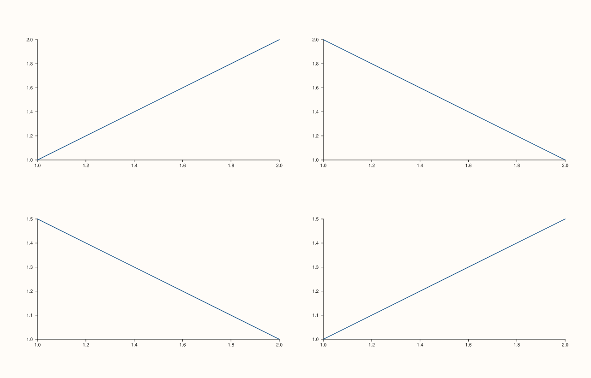

<!-- pluss-hand-authored -->

# flash::PairGrid

[Back to flash API Reference](../../flash_api_reference)

## Signature

```cpp
Studio& flash::PairGrid(Studio& studio, std::int64_t dimensions,
                         double gx = 14.0, double gy = 14.0)
```

## What It Does

A thin wrapper around [`Studio::mosaic`](../studio/mosaic.md), specialized for the square
`dimensions × dimensions` grid a pairwise-comparison view needs —
`PairGrid(studio, dimensions, gx, gy)` is exactly `studio.mosaic(dimensions, dimensions,
gx, gy)`. Like [`FacetGrid`](FacetGrid.md), it only lays out the grid; it creates no
panes of its own.

```{important} Different default gutter than FacetGrid/Studio::mosaic
PairGrid's gx/gy default to 14.0, not the 18.0 that FacetGrid and
Studio::mosaic itself default to -- a deliberately tighter gutter, suited to
a same-size square grid of many small comparison panels. Directly verified
with actual pane content in every cell: a PairGrid(studio, 2) figure and a
FacetGrid(studio, 2, 2) figure -- otherwise built identically -- render with
visibly different spacing. (Comparing two EMPTY grids with no panes added
shows no difference at all, since there is no pane geometry for the gutter to
affect -- always populate cells before comparing gap behavior.)
```

`flash::pairgrid_map_plot` calls `PairGrid` internally to lay out its own panels — reach
for `PairGrid` directly only when hand-building a pairwise grid pane by pane, as shown
below.

## Parameters

**studio** (`Studio&`)
    The figure to lay out.

**dimensions** (`std::int64_t`)
    Both the row and column count of the resulting square grid.

**gx**, **gy** (`double`, default `14.0` each)
    The horizontal/vertical gutter between cells, forwarded straight to `Studio::mosaic`.

## Returns

`Studio&`
    A reference to the same figure, for chaining.

## Examples

Example 1. A `2×2` pairwise grid — the diagonal panels and off-diagonal panels are all
just plain panes here; [`flash::pairgrid_map_plot`](pairgrid_map_plot.md) is the function
that actually knows which cells are diagonal.

```cpp
using namespace pluss::pl;

auto fig = studio("flash_pairgrid_default");
flash::PairGrid(fig, 2);
auto& p1 = fig.pane2(); p1.place(0, 0); p1.trend(std::vector<double>{1.0, 2.0}, std::vector<double>{1.0, 2.0});
auto& p2 = fig.pane2(); p2.place(0, 1); p2.trend(std::vector<double>{1.0, 2.0}, std::vector<double>{2.0, 1.0});
auto& p3 = fig.pane2(); p3.place(1, 0); p3.trend(std::vector<double>{1.0, 2.0}, std::vector<double>{1.5, 1.0});
auto& p4 = fig.pane2(); p4.place(1, 1); p4.trend(std::vector<double>{1.0, 2.0}, std::vector<double>{1.0, 1.5});
fig.show();
```



Example 2 (verification, not a distinct rendering). `PairGrid`'s tighter default gutter
genuinely renders differently from `FacetGrid`'s, once panes are actually placed in every
cell.

```cpp
using namespace pluss::pl;

auto fill = [](Studio& fig, int n) {
  for (int r = 0; r < n; ++r) {
    for (int c = 0; c < n; ++c) {
      auto& p = fig.pane2();
      p.place(r, c);
      p.trend(std::vector<double>{1.0, 2.0}, std::vector<double>{1.0, 2.0});
    }
  }
};

auto fig1 = studio("pairgrid_gap");
flash::PairGrid(fig1, 2);
fill(fig1, 2);

auto fig2 = studio("facetgrid_gap");
flash::FacetGrid(fig2, 2, 2);
fill(fig2, 2);

std::cout << "PairGrid(2) [gx=14] vs FacetGrid(2,2) [gx=18] with panes, differ: "
          << (fig1.to_svg() != fig2.to_svg()) << "\n";
```

Output:

```text
PairGrid(2) [gx=14] vs FacetGrid(2,2) [gx=18] with panes, differ: 1
```

## Notes

- Not `noexcept`.
- Never creates panes — only sets the grid's square shape and gutter.
- [`flash::pairgrid_map_plot`](pairgrid_map_plot.md) calls this internally, additionally
  telling your callback which cells lie on the diagonal (`row == col`).

## See Also

- [`Studio::mosaic`](../studio/mosaic.md): the underlying method.
- [`flash::pairgrid_map_plot`](pairgrid_map_plot.md): the callback-driven builder that
  uses `PairGrid` for layout and tells you which panel is on the diagonal.
- [`flash::FacetGrid`](FacetGrid.md), [`flash::JointGrid`](JointGrid.md): sibling grid
  constructors with different default shapes/gaps.

<div class="pluss-inline-prev-next">
  <a class="prev-link" href="FacetGrid.html">
    <span class="label">Previous</span>
    <span class="title">FacetGrid</span>
  </a>
  <a class="next-link" href="JointGrid.html">
    <span class="label">Next</span>
    <span class="title">JointGrid</span>
  </a>
</div>
