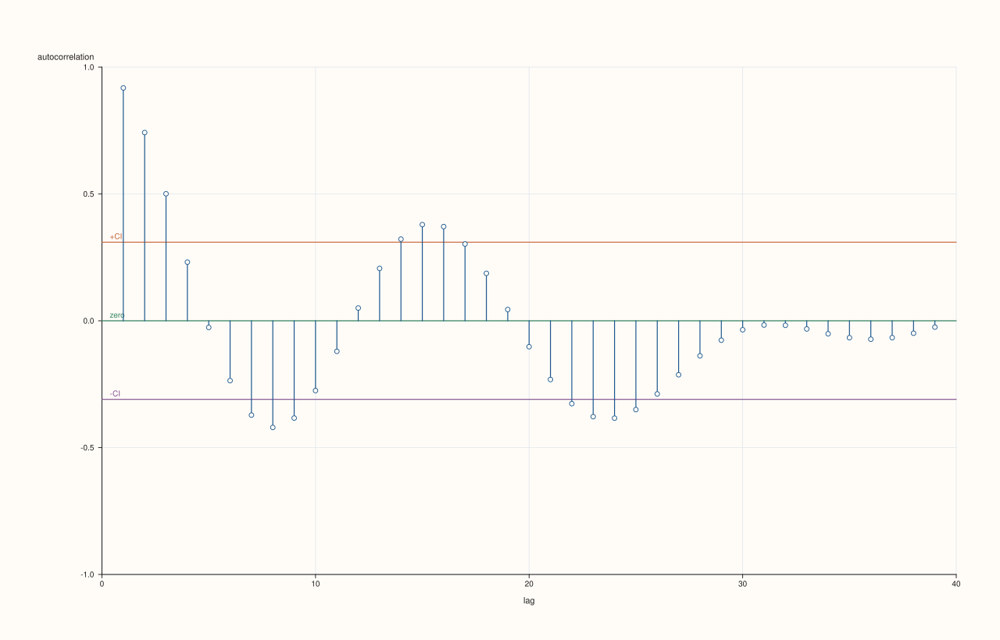
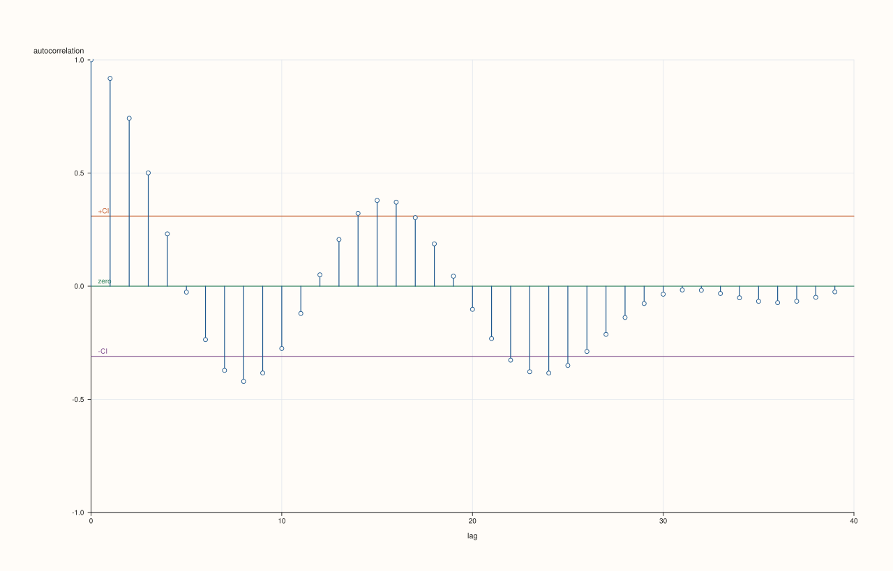
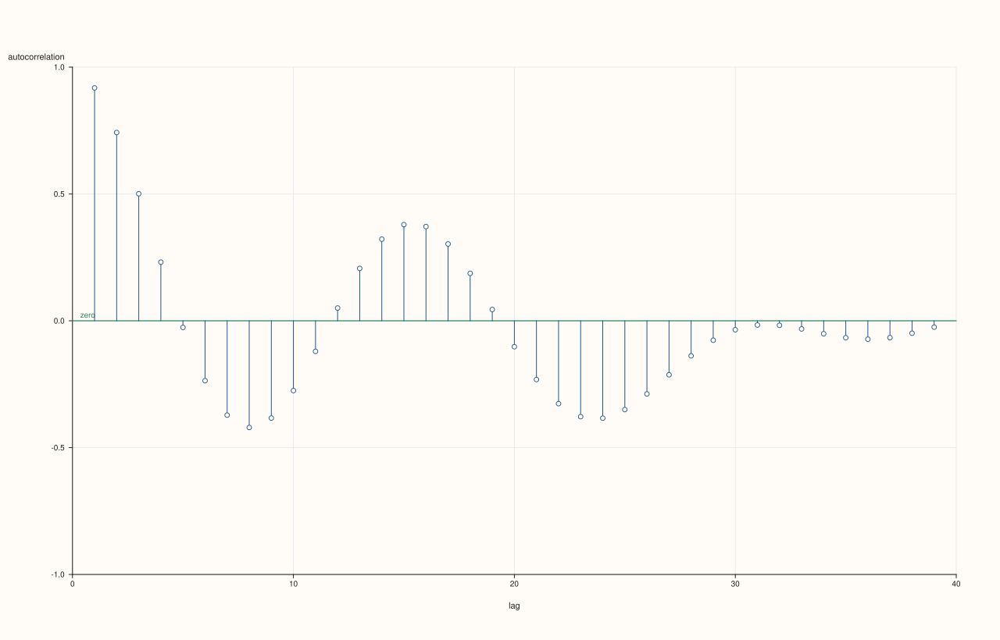

<!-- pluss-hand-authored -->

# flash::acfplot

[Back to flash API Reference](../../flash_api_reference)

## Signature

```cpp
Studio& flash::acfplot(Studio& studio, Series values, const AcfPlotOptions& options = {})
```

## What It Does

Draws an autocorrelation-function (ACF) correlogram: the Pearson correlation of a series
against itself, shifted by every lag from `1` (or `0`, see `include_zero_lag`) up to
`max_lag`, one [`Pane::spike`](../pane/spike.md) per lag against a zero baseline —
the standard time-series diagnostic for detecting periodicity and dependence structure.
Optionally overlaid with a symmetric confidence band (two horizontal
[`Pane::rule_y`](../pane/rule_y.md) lines) approximating the threshold beyond which a
spike is unlikely to be pure noise.

```{important} The confidence band is a simple normal-approximation, not a per-lag Bartlett formula
The +/-CI band is computed once as z / sqrt(n) (z from confidence_level, n = the
series length) and drawn as a single pair of flat horizontal lines across every lag --
it does NOT use the more precise, lag-growing Bartlett approximation some statistics
packages use (where the band widens at higher lags to account for the variance of
earlier sample autocorrelations already having been "used up"). Treat it as a rough,
constant-width visual guide, not a rigorous per-lag hypothesis test bound.
```

## Parameters

**studio** (`Studio&`)
    The figure to populate — a single new [`Studio::pane2`](../studio/pane2.md), y-axis
    fixed to `[-1.0, 1.0]`.

**values** (series-convertible)
    The sequence to autocorrelate. Must contain at least three points, or `acfplot`
    throws `pluss::Error("flash::acfplot requires at least three points")`.

**options** (`const AcfPlotOptions&`, optional)
    See the field table below.

## `AcfPlotOptions` fields

| Field | Type and default | Description |
|---|---|---|
| `max_lag` | `std::int64_t`, default `40` | The largest lag computed and shown. At least `1` (fewer throws `pluss::Error`); a value above `n - 1` is reduced to `n - 1`, since a series has no longer lags. |
| `include_zero_lag` | `bool`, default `false` | Whether lag `0` (always exactly `1.0`, a series correlated with itself) is included as its own spike. `false` starts the plot at lag `1`. |
| `show_confidence_band` | `bool`, default `true` | Whether the `+CI`/`-CI` horizontal reference lines are drawn. See the important callout above for exactly how they're computed. |
| `confidence_level` | `double`, default `0.95` | The coverage of the confidence band, strictly between 0 and 1 (anything else throws `pluss::Error`). The band is drawn at `±z/sqrt(n)`, where `z` is the exact two-sided normal quantile of the level, so every level has its own band: 0.90 gives 1.645, 0.925 gives about 1.78, 0.95 gives 1.96. |
| `trace_width` | `float`, default `1.2F` | Stroke width for the correlogram's spikes. |
| `marker_area` | `double`, default `14.0` | Declared, but never read anywhere in `acfplot`'s implementation — directly verified by reading the function body. `acfplot` draws only [`Pane::spike`](../pane/spike.md) traces, which take no marker-area argument; this field is inert. |

## Returns

`Studio&`
    A reference to the same figure, for chaining.

## Examples

Example 1. Default overload — lags `1` through `40` (or `n - 1`, whichever is smaller),
with a confidence band.

```cpp
using namespace pluss::pl;

auto fig = studio("flash_acfplot_default");
std::vector<double> values;
for (int i = 0; i < 40; ++i) {
  values.push_back(std::sin(static_cast<double>(i) * 0.4) * 5.0 + static_cast<double>(i) * 0.2);
}
flash::acfplot(fig, values);
fig.show();
```



Example 2. `include_zero_lag = true` — an extra spike at lag `0`, always height `1.0`.

```cpp
using namespace pluss::pl;

auto fig = studio("flash_acfplot_zero_lag");
std::vector<double> values;
for (int i = 0; i < 40; ++i) {
  values.push_back(std::sin(static_cast<double>(i) * 0.4) * 5.0 + static_cast<double>(i) * 0.2);
}
flash::AcfPlotOptions opts;
opts.include_zero_lag = true;
flash::acfplot(fig, values, opts);
fig.show();
```



Example 3 (a comparison, not a new picture). `show_confidence_band = false`
renders differently.

```cpp
using namespace pluss::pl;

std::vector<double> values;
for (int i = 0; i < 40; ++i) {
  values.push_back(std::sin(static_cast<double>(i) * 0.4) * 5.0 + static_cast<double>(i) * 0.2);
}

auto fig1 = studio("flash_acfplot_band_on");
flash::acfplot(fig1, values);

auto fig2 = studio("flash_acfplot_band_off");
flash::AcfPlotOptions opts;
opts.show_confidence_band = false;
flash::acfplot(fig2, values, opts);

std::cout << "acfplot band on vs off differ: " << (fig1.to_svg() != fig2.to_svg()) << "\n";
fig2.show();
```

Output:

```text
acfplot band on vs off differ: 1
```



Example 4 (edge case). Fewer than three points throws.

```cpp
using namespace pluss::pl;

auto fig = studio("flash_acfplot_too_few");
std::vector<double> two{1.0, 2.0};
try {
  flash::acfplot(fig, two);
} catch (const pluss::Error& e) {
  std::cout << "acfplot(2 points) threw: " << e.message() << "\n";
}
```

Output:

```text
acfplot(2 points) threw: flash::acfplot requires at least three points
```

## Notes

- Not `noexcept`.
- Every correlation value is clamped to `[-1.0, 1.0]` before plotting, even in the
  degenerate zero-variance case (which falls back to `0.0` for every non-zero lag rather
  than propagating `NaN`/`Inf`).
- [`flash::actplot`](actplot.md) is a thin wrapper around this exact function — directly
  identical to `acfplot(values)` (default options), since
  `AutocorrelationPlotOptions` lacks `include_zero_lag`/`marker_area` and hard-codes
  `include_zero_lag = false` when translating to an internal `AcfPlotOptions`.
- [`flash::resid_acfplot`](resid_acfplot.md) runs this same ACF computation over
  regression *residuals* instead of a raw series.

## See Also

- [`flash::pacfplot`](pacfplot.md): the partial-autocorrelation sibling.
- [`flash::ccfplot`](ccfplot.md): the two-series cross-correlation sibling.
- [`flash::actplot`](actplot.md): a simplified-options wrapper around this exact
  function.
- [`flash::resid_acfplot`](resid_acfplot.md): runs this computation on regression
  residuals.
- [`Pane::spike`](../pane/spike.md), [`Pane::rule_y`](../pane/rule_y.md): the native
  drawing methods used for the correlogram spikes and confidence band.

<div class="pluss-inline-prev-next">
  <a class="prev-link" href="lagplot.html">
    <span class="label">Previous</span>
    <span class="title">lagplot</span>
  </a>
  <a class="next-link" href="pacfplot.html">
    <span class="label">Next</span>
    <span class="title">pacfplot</span>
  </a>
</div>
