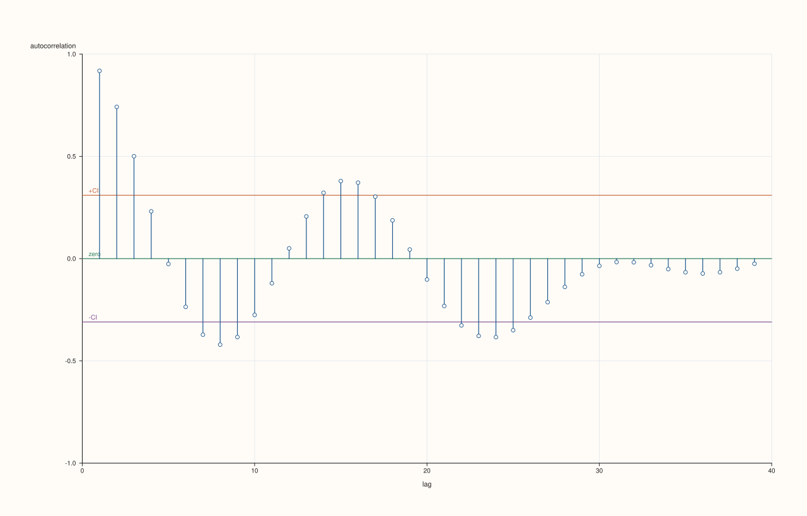

<!-- pluss-hand-authored -->

# flash::actplot

[Back to flash API Reference](../../flash_api_reference)

## Signature

```cpp
Studio& flash::actplot(Studio& studio, Series values, const AutocorrelationPlotOptions& options = {})
```

## What It Does

A simplified-options convenience wrapper around [`flash::acfplot`](acfplot.md): builds an
`AcfPlotOptions` from `AutocorrelationPlotOptions` (copying `max_lag`,
`show_confidence_band`, `confidence_level`, `trace_width`, and hard-coding
`include_zero_lag = false`), then calls `acfplot` with it.

```{important} Byte-identical to flash::acfplot(values) with default options
actplot(studio, values) and acfplot(studio, values) produce exactly the same figure
state. AutocorrelationPlotOptions is a strict
subset of AcfPlotOptions' fields (missing include_zero_lag and marker_area, the latter
of which is inert on acfplot anyway -- see that page's Notes), and actplot always
passes include_zero_lag = false, matching AcfPlotOptions' own default. actplot exists
purely as a smaller-surface, more conventionally-named entry point ("act" for
"autocorrelation") for callers who never need include_zero_lag at all.
```

## Parameters

**studio** (`Studio&`)
    The figure to populate — a single new [`Studio::pane2`](../studio/pane2.md), y-axis
    fixed to `[-1.0, 1.0]`.

**values** (series-convertible)
    The sequence to autocorrelate. Must contain at least three points, or `actplot`
    throws (via [`flash::acfplot`](acfplot.md)) `pluss::Error("flash::acfplot
    requires at least three points")` — note the error message names `acfplot`, not
    `actplot`, since it's thrown by the delegated-to function.

**options** (`const AutocorrelationPlotOptions&`, optional)
    See the field table below.

## `AutocorrelationPlotOptions` fields

| Field | Type and default | Description |
|---|---|---|
| `max_lag` | `std::int64_t`, default `40` | Forwarded to [`AcfPlotOptions::max_lag`](acfplot.md). |
| `show_confidence_band` | `bool`, default `true` | Forwarded to [`AcfPlotOptions::show_confidence_band`](acfplot.md). |
| `confidence_level` | `double`, default `0.95` | Forwarded to [`AcfPlotOptions::confidence_level`](acfplot.md): strictly between 0 and 1, with the band at the exact normal quantile of the level. |
| `trace_width` | `float`, default `1.2F` | Forwarded to [`AcfPlotOptions::trace_width`](acfplot.md). |

## Returns

`Studio&`
    A reference to the same figure, for chaining.

## Examples

Example 1. Default overload.

```cpp
using namespace pluss::pl;

auto fig = studio("flash_actplot_default");
std::vector<double> values;
for (int i = 0; i < 40; ++i) {
  values.push_back(std::sin(static_cast<double>(i) * 0.4) * 5.0 + static_cast<double>(i) * 0.2);
}
flash::actplot(fig, values);
fig.show();
```



Example 2 (a comparison, not a new picture). `actplot(values)` renders
identical to `acfplot(values)` with default options, confirming the important
callout above.

```cpp
using namespace pluss::pl;

std::vector<double> values;
for (int i = 0; i < 40; ++i) {
  values.push_back(std::sin(static_cast<double>(i) * 0.4) * 5.0 + static_cast<double>(i) * 0.2);
}

auto fig1 = studio("flash_actplot_cmp");
flash::actplot(fig1, values);

auto fig2 = studio("flash_acfplot_cmp");
flash::acfplot(fig2, values);

std::cout << "actplot(default) == acfplot(default, include_zero_lag=false): " << (fig1.to_svg() == fig2.to_svg()) << "\n";
```

Output:

```text
actplot(default) == acfplot(default, include_zero_lag=false): 1
```

## Notes

- Not `noexcept`.
- See the important callout above: this is a genuine, verified pass-through, not an
  independent implementation.

## See Also

- [`flash::acfplot`](acfplot.md): the underlying function this page delegates to
  entirely, and the full `AcfPlotOptions` field reference this page's options are a
  subset of.

<div class="pluss-inline-prev-next">
  <a class="prev-link" href="ccfplot.html">
    <span class="label">Previous</span>
    <span class="title">ccfplot</span>
  </a>
  <a class="next-link" href="resid_acfplot.html">
    <span class="label">Next</span>
    <span class="title">resid_acfplot</span>
  </a>
</div>
