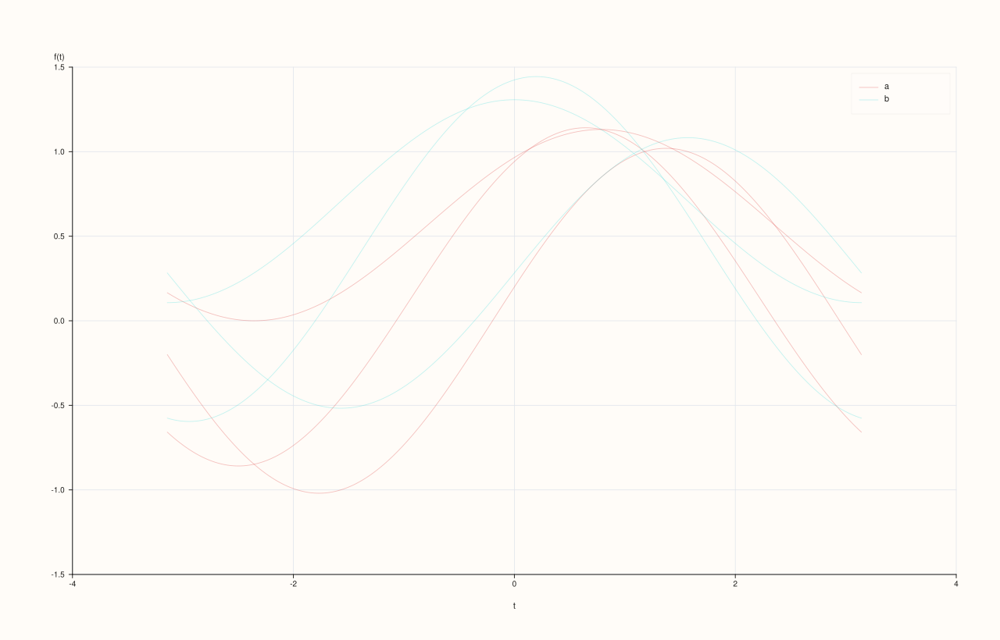
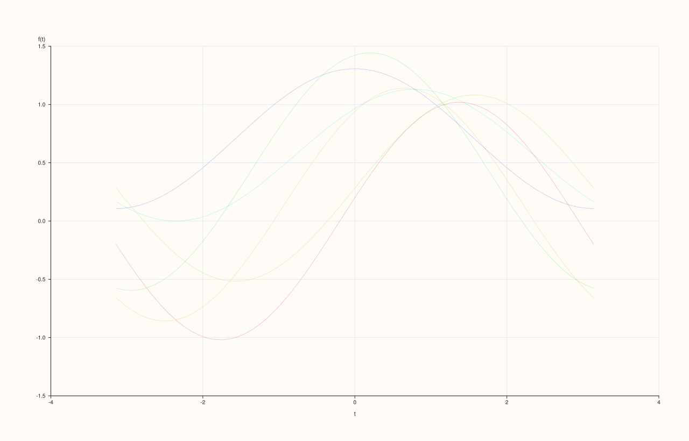

<!-- pluss-hand-authored -->

# flash::andrews_curves

[Back to flash API Reference](../../flash_api_reference)

## Signatures

```cpp
Studio& flash::andrews_curves(Studio& studio, pluss::msharp::RangeView::Series columns,
                               const AndrewsCurvesOptions& options = {})

Studio& flash::andrews_curves(Studio& studio, pluss::msharp::RangeView::Series columns,
                               const Note& class_labels,
                               const AndrewsCurvesOptions& options = {})

Studio& flash::andrews_curves(Studio& studio, const Dataset& data,
                               const AndrewsCurvesOptions& options = {})

Studio& flash::andrews_curves(Studio& studio, const Series& matrix,
                               const MatrixFrameOptions& frame_options,
                               const AndrewsCurvesOptions& options = {})

Studio& flash::andrews_curves(Studio& studio, const Series& matrix,
                               pluss::msharp::RangeView::Of<std::string_view> feature_names,
                               Axis feature_axis, const AndrewsCurvesOptions& options = {})

Studio& flash::andrews_curves(Studio& studio, const Series& matrix,
                               const std::vector<std::string>& feature_names,
                               Axis feature_axis, const AndrewsCurvesOptions& options = {})

Studio& flash::andrews_curves(Studio& studio, const Series& matrix,
                               std::initializer_list<std::string_view> feature_names,
                               Axis feature_axis, const AndrewsCurvesOptions& options = {})

Studio& flash::andrews_curves(Studio& studio, const Series& matrix,
                               const AndrewsCurvesOptions& options = {})
```

## What It Does

Draws an Andrews-curves plot: each row/observation across `n` features becomes one
continuous curve `f(t)` over `t ∈ [-π, π]`, computed as a truncated Fourier-series
projection of that row's (optionally normalized) feature values — rows with similar
feature profiles trace visually similar curves, making cluster structure and outliers
easier to spot than in a raw scatter of many features. Internally, this is a single
matrix multiply: every row's feature vector is projected through a fixed `t`-by-`feature`
Fourier basis matrix (`detail::andrews_basis`) to produce its curve's `y` values at each
sampled `t`, then each curve is drawn as one [`Pane::trend`](../pane/trend.md) trace.

Eight overloads mirror [`flash::parallelplot`](parallelplot.md)'s exactly: a plain
`columns` form, a `columns` + `class_labels` form, a `Dataset` form, and five matrix
forms.

```{important} normalize defaults to true, same rule as flash::parallelplot
Like flash::parallelplot, normalize = true (the default) independently min-max scales
every feature to [0, 1] before computing the Fourier projection -- necessary since the
curve shape is directly driven by each feature's magnitude. A feature with no variance
normalizes to a flat 0.0 rather than dividing by zero.
```

## `AndrewsCurvesOptions` fields

| Field | Type and default | Description |
|---|---|---|
| `labels` | `std::vector<std::string>`, default empty | Per-feature labels. Unlike [`flash::parallelplot`](parallelplot.md), these never appear as visible axis tick labels (Andrews curves have no per-feature x-axis) — they only participate in the `Dataset`/matrix-overload fallback-naming plumbing, with no visible effect on the plain overloads' rendered output. |
| `normalize` | `bool`, default `true` | See the important callout above. |
| `points` | `std::int64_t`, default `220` | How many `t` samples span `[-π, π]` for every curve. Clamped to at least `64`. Directly verified: a curve sampled at `64` points renders visibly coarser/differently than the `220`-point default. |
| `max_curves` | `std::int64_t`, default `600` | Row-count cap — rows beyond this are deterministically downsampled to an evenly-strided subset, identical mechanism to [`flash::parallelplot`](parallelplot.md)'s `max_points` (just named for curves instead of points here). |
| `alpha` | `double`, default `0.28` | Per-curve opacity, clamped to `[0.05, 1.0]`. |
| `trace_width` | `float`, default `0.9F` | Stroke width for every curve. |
| `show_grid` | `bool`, default `true` | Whether the pane gets `GridStyle::Major` gridlines (`true`) or `GridStyle::None` (`false`). |
| `show_legend` | `bool`, default `true` | Whether a legend is drawn — only visibly matters for the `class_labels` overload, same as [`flash::parallelplot`](parallelplot.md)'s `show_legend`. |

## Parameters

**studio** (`Studio&`)
    The figure to populate — a single new [`Studio::pane2`](../studio/pane2.md).

**columns** (`pluss::msharp::RangeView::Series`)
    One entry per feature. Must contain at least two features
    (`std::invalid_argument("flash::andrews_curves requires at least two columns")`), and
    every column must be the same length.

**class_labels** (`const Note&`, class-labels overload only)
    One label per row. Its length must exactly match the row count, or
    `andrews_curves` throws `std::invalid_argument("flash::andrews_curves: class label
    length must match rows")`.

**data** (`const Dataset&`, Dataset overload only)
    See `flash::make_dataset` on the [`flash::pairplot`](pairplot.md) page.

**matrix**, **frame_options**, **feature_names**, **feature_axis** (matrix overloads)
    Identical shape and behavior to [`flash::pairplot`](pairplot.md)'s matrix overloads.

**options** (`const AndrewsCurvesOptions&`, optional)
    See the field table above.

## Returns

`Studio&`
    A reference to the same figure, for chaining.

## Examples

Example 1. Default overload — three features, six rows, each a uniformly-colored curve.

```cpp
using namespace pluss::pl;

auto fig = studio("flash_andrews_default");
std::vector<pluss::Series> cols{
    pluss::make_series(std::vector<double>{1.0, 2.0, 3.0, 4.0, 5.0, 6.0}, {6}),
    pluss::make_series(std::vector<double>{6.0, 4.0, 5.0, 2.0, 3.0, 1.0}, {6}),
    pluss::make_series(std::vector<double>{2.0, 5.0, 1.0, 6.0, 3.0, 4.0}, {6})};
flash::andrews_curves(fig, pluss::msharp::RangeView::Series(cols));
fig.show();
```


Example 2. `class_labels` overload — curves colored and legended by class.

```cpp
using namespace pluss::pl;

auto fig = studio("flash_andrews_classes");
std::vector<pluss::Series> cols{
    pluss::make_series(std::vector<double>{1.0, 2.0, 3.0, 4.0, 5.0, 6.0}, {6}),
    pluss::make_series(std::vector<double>{6.0, 4.0, 5.0, 2.0, 3.0, 1.0}, {6}),
    pluss::make_series(std::vector<double>{2.0, 5.0, 1.0, 6.0, 3.0, 4.0}, {6})};
auto classes = pluss::note::make({"a", "a", "b", "b", "a", "b"});
flash::andrews_curves(fig, pluss::msharp::RangeView::Series(cols), classes);
fig.show();
```



Example 3 (verification, not a distinct rendering). `points = 64` renders genuinely
differently (visibly coarser) than the `220`-point default.

```cpp
using namespace pluss::pl;

std::vector<pluss::Series> cols1{
    pluss::make_series(std::vector<double>{1.0, 2.0, 3.0, 4.0, 5.0, 6.0}, {6}),
    pluss::make_series(std::vector<double>{6.0, 4.0, 5.0, 2.0, 3.0, 1.0}, {6}),
    pluss::make_series(std::vector<double>{2.0, 5.0, 1.0, 6.0, 3.0, 4.0}, {6})};
auto fig1 = studio("flash_andrews_points_default");
flash::andrews_curves(fig1, pluss::msharp::RangeView::Series(cols1));

std::vector<pluss::Series> cols2{
    pluss::make_series(std::vector<double>{1.0, 2.0, 3.0, 4.0, 5.0, 6.0}, {6}),
    pluss::make_series(std::vector<double>{6.0, 4.0, 5.0, 2.0, 3.0, 1.0}, {6}),
    pluss::make_series(std::vector<double>{2.0, 5.0, 1.0, 6.0, 3.0, 4.0}, {6})};
auto fig2 = studio("flash_andrews_points_low");
flash::AndrewsCurvesOptions opts;
opts.points = 64;
flash::andrews_curves(fig2, pluss::msharp::RangeView::Series(cols2), opts);

std::cout << "andrews_curves points=64 vs default(220) differ: " << (fig1.to_svg() != fig2.to_svg()) << "\n";
fig2.show();
```

Output:

```text
andrews_curves points=64 vs default(220) differ: 1
```



Example 4. `Dataset` overload, via `flash::make_dataset`.

```cpp
using namespace pluss::pl;

auto fig = studio("flash_andrews_dataset");
auto data = flash::make_dataset(
    {pluss::make_series(std::vector<double>{1.0, 2.0, 3.0, 4.0, 5.0, 6.0}, {6}),
     pluss::make_series(std::vector<double>{6.0, 4.0, 5.0, 2.0, 3.0, 1.0}, {6}),
     pluss::make_series(std::vector<double>{2.0, 5.0, 1.0, 6.0, 3.0, 4.0}, {6})},
    {"alpha", "beta", "gamma"});
flash::andrews_curves(fig, data);
fig.show();
```


Example 5. Matrix + feature-names + `Axis` overload.

```cpp
using namespace pluss::pl;

std::vector<double> a{1.0, 2.0, 3.0, 4.0, 5.0, 6.0};
std::vector<double> b{6.0, 4.0, 5.0, 2.0, 3.0, 1.0};
std::vector<double> c{2.0, 5.0, 1.0, 6.0, 3.0, 4.0};
std::vector<double> flat;
for (std::size_t i = 0; i < a.size(); ++i) { flat.push_back(a[i]); flat.push_back(b[i]); flat.push_back(c[i]); }
auto matrix = pluss::make_series(flat, {6, 3});

auto fig = studio("flash_andrews_matrix");
flash::andrews_curves(fig, matrix, {"alpha", "beta", "gamma"}, flash::Axis::Cols);
fig.show();
```


Example 6 (edge case). Fewer than two columns throws.

```cpp
using namespace pluss::pl;

auto fig = studio("flash_andrews_too_few");
std::vector<pluss::Series> cols{pluss::make_series(std::vector<double>{1.0, 2.0, 3.0, 4.0, 5.0, 6.0}, {6})};
try {
  flash::andrews_curves(fig, pluss::msharp::RangeView::Series(cols));
} catch (const std::invalid_argument& e) {
  std::cout << "andrews_curves(1 col) threw: " << e.what() << "\n";
}
```

Output:

```text
andrews_curves(1 col) threw: flash::andrews_curves requires at least two columns
```

## Notes

- Not `noexcept`.
- The Fourier basis is fixed by `t` and feature count alone (`detail::andrews_basis`) —
  it doesn't depend on the data values themselves, only on how many features there are and
  how many `t` samples are requested.
- Every curve is one continuous [`Pane::trend`](../pane/trend.md) trace, plotted `t` on
  the x-axis and `f(t)` on the y-axis — there's no per-feature x-axis structure at all,
  unlike [`flash::parallelplot`](parallelplot.md).
- Shares `max_curves`/`normalize`/`Dataset`/matrix-overload plumbing with
  [`flash::parallelplot`](parallelplot.md) and [`flash::radviz`](radviz.md).

## See Also

- [`flash::parallelplot`](parallelplot.md), [`flash::radviz`](radviz.md): sibling
  multivariate views over the same per-row, per-feature input shape.
- [`Pane::trend`](../pane/trend.md): the native method drawing each curve.

<div class="pluss-inline-prev-next">
  <a class="prev-link" href="parallelplot.html">
    <span class="label">Previous</span>
    <span class="title">parallelplot</span>
  </a>
  <a class="next-link" href="radviz.html">
    <span class="label">Next</span>
    <span class="title">radviz</span>
  </a>
</div>
