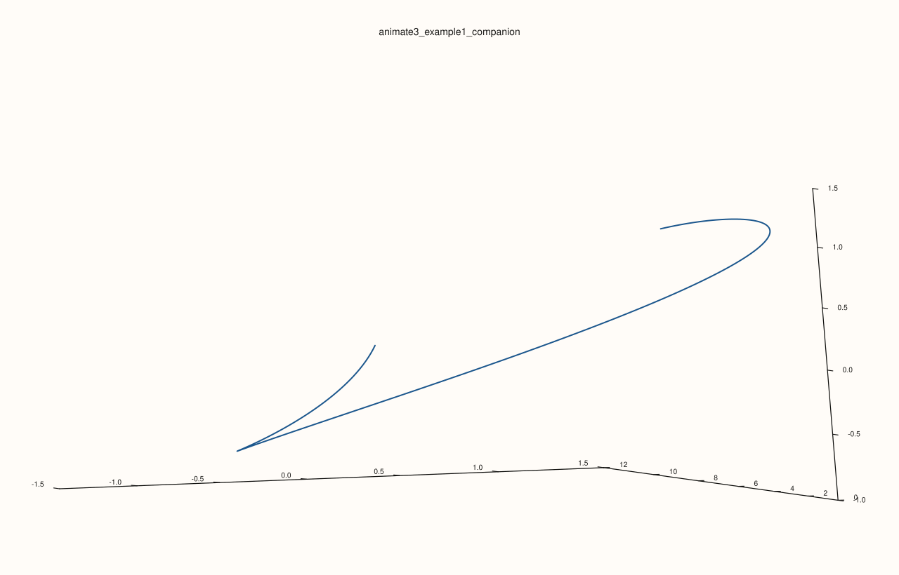
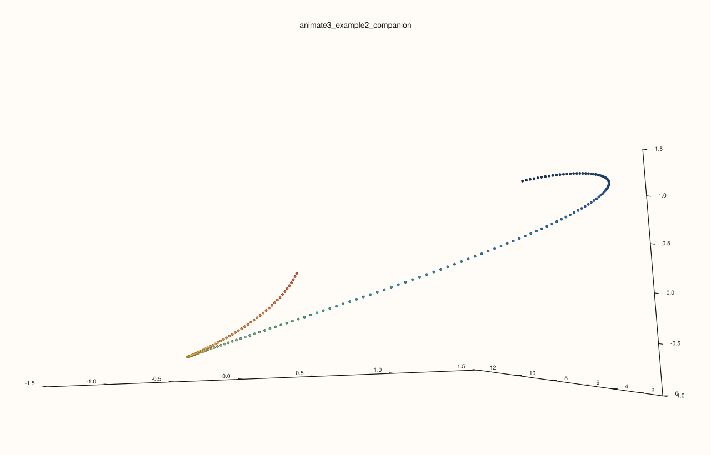

<!-- pluss-hand-authored -->

# flash::animate3

[Back to flash API Reference](../../flash_api_reference)

## Signature

```cpp
bool flash::animate3(Series x, Series y, Series z, const Animation3Options& options = {})
```

```{important} Opens a window: the examples that launch it are not run when the documentation is built
`animate3` builds a self-contained, JavaScript-driven HTML animation page (rotating point and path rendering, play and pause, speed control, PNG snapshot export, all drawn client-side) and hands it to `pluss::view::show_html_window`, which opens a native window on the machine that runs it. Because a documentation build runs unattended, the examples that call it are shown with the value they return and are not executed there; the companion block after each of them draws the same geometry and camera to a file, and that file is the figure shown. The options are checked before any window is opened: an invalid value throws `pluss::Error` at once, as the edge-case example shows.
```

## What It Does

Builds and displays an interactive, browser-rendered 3D scatter/path animation: `x`,
`y`, `z` are first jointly rescaled to fit within `[-1, 1]` on every axis (centered on
their combined bounding box, uniformly scaled by the largest axis span — see
`detail::normalize_xyz`), then handed to a self-contained HTML page with an embedded
`<canvas>` animation loop that continuously rotates the point set (sweeping one of `xy`,
`xz`, or `yz` around a fixed base rotation), optionally revealing points progressively
over time and optionally connecting them into a path, with play/pause and a speed
slider. That HTML is opened in a real window via `pluss::view::show_html_window`.

## Parameters

**x**, **y**, **z** (series-convertible, must each be rank ≤ 3 and identical lengths)
    The 3D point/path data. Unequal lengths throw `pluss::Error("flash::animate3:
    x, y, z must have identical lengths")`.

**options** (`const Animation3Options&`, optional)
    See the field table below.

## `Animation3Options` fields

| Field | Type and default | Description |
|---|---|---|
| `title` | `std::string`, default `"PlussPl 3D Animation"` | The HTML page's `<title>` and on-page heading, and the window title passed to `pluss::view::HtmlWindowOptions`. |
| `width`, `height` | `std::int64_t`, default `1280`, `820` | The window/canvas size. Both must be at least `640`×`420`, or `animate3` throws `pluss::Error("flash::animate3: window size too small")` — verified below. |
| `sweep_plane` | `Anim3SweepPlane`, default `YZ` | Which of the three rotation planes is continuously swept over time by the animation loop: `XY`, `XZ`, or `YZ`. |
| `base_rot_xy_deg`, `base_rot_xz_deg`, `base_rot_yz_deg` | `double`, default `0.0`, `12.0`, `24.0` | Fixed starting rotation offsets in each plane, applied before the `sweep_plane`'s continuous sweep animates on top. |
| `sweep_speed_deg_per_sec` | `double`, default `18.0` | Base angular sweep speed (degrees per second), before the in-page speed slider's multiplier (`0.2×`–`3.0×`) is applied. |
| `camera_distance`, `camera_yaw_deg`, `camera_pitch_deg` | `double`, default `5.4`, `30.0`, `-14.0` | The fixed 3D→2D projection camera used to render the rotated points onto the canvas. `camera_distance` must be positive, or `animate3` throws `pluss::Error("flash::animate3: camera_distance must be positive")`. |
| `min_perspective_denom` | `double`, default `0.15` | A floor on the perspective-divide denominator, preventing points very close to the camera from scaling toward infinity. Must be positive, or `animate3` throws `pluss::Error("flash::animate3: min_perspective_denom must be positive")`. |
| `plot_padding_fraction` | `double`, default `0.08` | Fraction of the canvas reserved as border padding. Must be in `[0.0, 0.45)`, or `animate3` throws `pluss::Error("flash::animate3: invalid plot_padding_fraction")`. |
| `progressive_reveal` | `bool`, default `true` | Whether points appear gradually over time (`true`, paced by `reveal_points_per_sec`) or are all visible from the first frame (`false`). |
| `reveal_points_per_sec` | `double`, default `96.0` | How many points become visible per second when `progressive_reveal` is `true`. Must be positive, or `animate3` throws `pluss::Error("flash::animate3: reveal_points_per_sec must be positive")`. |
| `connect_path` | `bool`, default `true` | Whether currently-visible points are joined by a line (`true`) or shown as unconnected markers (`false`). |
| `line_width` | `double`, default `1.5` | Stroke width for the connecting line when `connect_path` is `true`. Must be positive, or `animate3` throws `pluss::Error("flash::animate3: line_width must be positive")`. |
| `point_radius` | `double`, default `2.4` | Base marker radius (in canvas pixels), scaled per-point by projected depth. Must be positive, or `animate3` throws `pluss::Error("flash::animate3: point_radius must be positive")`. |
| `enable_snapshot` | `bool`, default `true` | Whether a "Save PNG" button (and the `S` keyboard shortcut) is included in the page, letting the viewer export the current canvas frame as a PNG download. |
| `snapshot_prefix` | `std::string`, default `"plusspl_3d_frame"` | Filename prefix used for exported PNG snapshots (`{prefix}_{timestamp}.png`). |

## Returns

`bool`
    Per `pluss::view::show_html_window`'s own contract: `true` if the window was
    successfully launched, `false` otherwise. Not independently verified on this page —
    see the important callout above.

## Examples

Example 1. Launch the default path-style animation. This is the direct `animate3(...)`
usage shape when you want progressive reveal plus a connected path in the browser
window.

```cpp
using namespace pluss::pl;

auto x = pluss::series::linspace(0.0, 12.0, 180, pluss::ScalarType::Float64);
auto y = x.mul(0.6).sin().add(x.mul(0.22).cos().mul(0.5));
auto z = x.mul(0.35).cos().add(0.3);

flash::Animation3Options opts;
opts.title = "3D path animation";
opts.connect_path = true;
opts.progressive_reveal = true;
opts.sweep_plane = flash::Anim3SweepPlane::YZ;
opts.enable_snapshot = true;

const bool opened = flash::animate3(x, y, z, opts);
std::cout << "animate3 opened=" << opened << "\n";
```

Output:

```text
animate3 opened=<window-launch result>
```

Verified companion render for Example 1. The browser window above was not launched
during docs capture, so the code below gives a one-to-one, file-producing visual
counterpart using the same geometry and camera family. The embedded SVG under it is the
exact output of this block.

```cpp
using namespace pluss::pl;

auto x = pluss::series::linspace(0.0, 12.0, 180, pluss::ScalarType::Float64);
auto y = x.mul(0.6).sin().add(x.mul(0.22).cos().mul(0.5));
auto z = x.mul(0.35).cos().add(0.3);

Studio fig("animate3_example1_companion", Theme::paper());
auto& pane = fig.pane3("animate3_example1_companion");
flash::camera3d(
    pane,
    flash::Camera3DOptions{
        .azimuth_deg = 30.0,
        .elevation_deg = -14.0,
        .view_angle_deg = 30.0,
        .projection = flash::ProjectionKind::Perspective,
    });
auto& tr = flash::path3(pane, x, y, z).label("animate3_example1_companion");
flash::trace_preset3d(tr, flash::TracePreset3D::Path);
fig.save_svg("/tmp/animate3_example1_companion.svg");
std::cout << "saved /tmp/animate3_example1_companion.svg\n";
```

Output:

```text
saved /tmp/animate3_example1_companion.svg
```



Example 2. Launch the point-only animation by turning `connect_path` off. This is the
usage shape when you want a moving cloud rather than a connected trajectory.

```cpp
using namespace pluss::pl;

auto x = pluss::series::linspace(0.0, 12.0, 180, pluss::ScalarType::Float64);
auto y = x.mul(0.6).sin().add(x.mul(0.22).cos().mul(0.5));
auto z = x.mul(0.35).cos().add(0.3);

flash::Animation3Options opts;
opts.title = "3D point animation";
opts.connect_path = false;
opts.progressive_reveal = false;
opts.point_radius = 3.0;
opts.sweep_plane = flash::Anim3SweepPlane::XY;

const bool opened = flash::animate3(x, y, z, opts);
std::cout << "animate3 point-only opened=" << opened << "\n";
```

Output:

```text
animate3 point-only opened=<window-launch result>
```

Verified companion render for Example 2. As above, the live window itself was not
captured during docs generation; the block below is the exact static render that
produced the embedded SVG.

```cpp
using namespace pluss::pl;

auto x = pluss::series::linspace(0.0, 12.0, 180, pluss::ScalarType::Float64);
auto y = x.mul(0.6).sin().add(x.mul(0.22).cos().mul(0.5));
auto z = x.mul(0.35).cos().add(0.3);

Studio fig("animate3_example2_companion", Theme::paper());
auto& pane = fig.pane3("animate3_example2_companion");
flash::camera3d(
    pane,
    flash::Camera3DOptions{
        .azimuth_deg = 30.0,
        .elevation_deg = -14.0,
        .view_angle_deg = 30.0,
        .projection = flash::ProjectionKind::Perspective,
    });
auto sizes = pluss::Series::full({x.numel()}, 7.0, pluss::ScalarType::Float64);
auto colors = pluss::series::linspace(0.15, 0.95, x.numel(), pluss::ScalarType::Float64);
auto& tr = flash::cloud3(pane, x, y, z, sizes, colors).label("animate3_example2_companion");
flash::trace_preset3d(tr, flash::TracePreset3D::Cloud);
fig.save_svg("/tmp/animate3_example2_companion.svg");
std::cout << "saved /tmp/animate3_example2_companion.svg\n";
```

Output:

```text
saved /tmp/animate3_example2_companion.svg
```



Example 3 (edge case). `width` below the `640` minimum throws before any window-launch
logic runs — the one behavior of this function directly, safely verified on this page.

```cpp
using namespace pluss::pl;

std::vector<double> x{1.0, 2.0};
std::vector<double> y{1.0, 2.0};
std::vector<double> z{1.0, 2.0};
flash::Animation3Options opts;
opts.width = 100;
try {
  flash::animate3(x, y, z, opts);
} catch (const pluss::Error& e) {
  std::string msg(e.message());
  std::cout << "animate3(width too small) threw: " << msg.substr(0, msg.find('\n')) << "\n";
}
```

Output:

```text
animate3(width too small) threw: flash::animate3: window size too small
```

## Notes

- Not `noexcept`.
- See the important callout above for the boundary of what this page actually verified.
- `x`/`y`/`z` are rescaled (`detail::normalize_xyz`) before rendering — the original,
  un-normalized coordinate values never reach the browser page directly.
- [`flash::animate4`](animate4.md) is the 4D analogue, sharing the same
  window-launching approach and the same unverified-window-launch caveat.

## See Also

- [`flash::path4`](path4.md)/[`flash::cloud4`](cloud4.md): the static (non-animated) 4D
  equivalents, fully verified since they render into an ordinary, inspectable SVG.
- [`flash::animate4`](animate4.md): the 4D sibling of this function.
- [`Studio::show`](../studio/show.md): the more general-purpose interactive-window
  method this function's underlying mechanism (`pluss::view::show_html_window`) is
  conceptually related to.

<div class="pluss-inline-prev-next">
  <a class="prev-link" href="hyper_animation_sequence.html">
    <span class="label">Previous</span>
    <span class="title">hyper_animation_sequence</span>
  </a>
  <a class="next-link" href="animate4.html">
    <span class="label">Next</span>
    <span class="title">animate4</span>
  </a>
</div>
