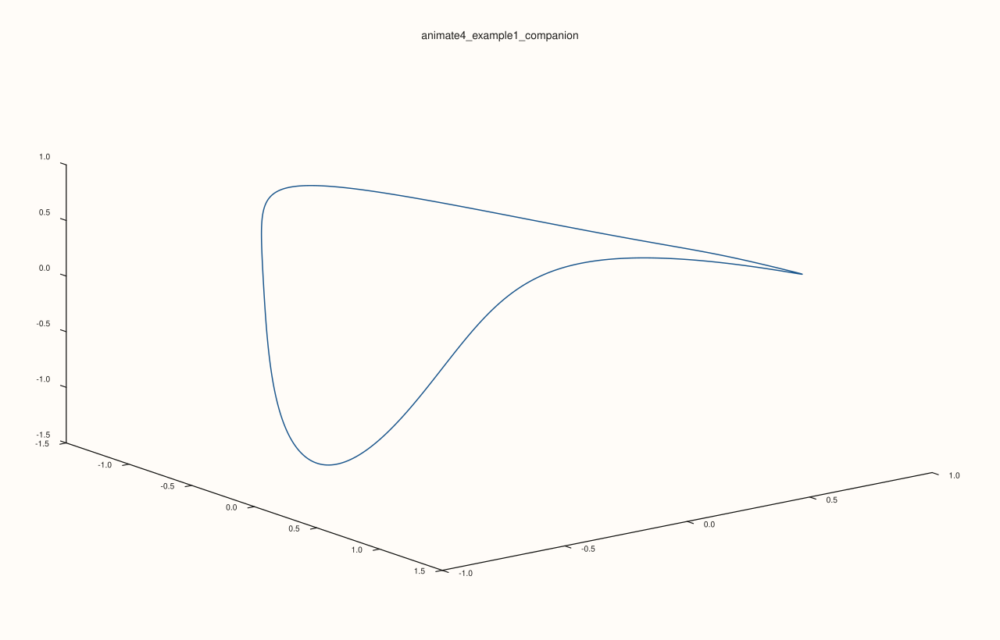
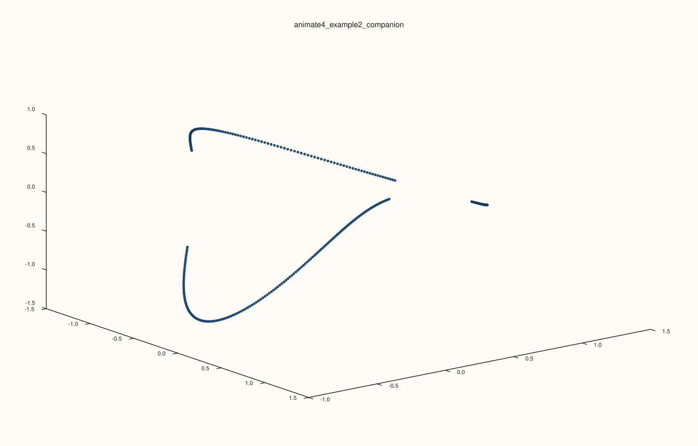

<!-- pluss-hand-authored -->

# flash::animate4

[Back to flash API Reference](../../flash_api_reference)

## Signature

```cpp
bool flash::animate4(Series x, Series y, Series z, Series w, const HyperAnimationOptions& options = {})
```

```{important} Opens a window: the examples that launch it are not run when the documentation is built
Like [`flash::animate3`](animate3.md), `animate4` hands a self-contained, JavaScript-driven HTML page to `pluss::view::show_html_window`, which opens a native window on the machine that runs it. The examples that call it are shown with the value they return and are not executed when the documentation is built; the companion block after each draws the same scene to a file. The options are checked before any window is opened: an invalid value throws `pluss::Error` at once.
```

## What It Does

The 4D analogue of [`flash::animate3`](animate3.md): builds an interactive,
browser-rendered animation of a 4D `(x, y, z, w)` point cloud — continuously sweeping
one of the six 4D rotation planes (`xy`, `xz`, `xw`, `yz`, `yw`, `zw`) around a fixed base
rotation, projecting `w` down to 3D live in JavaScript (via the same
orthographic/perspective-`w` logic [`flash::path4`](path4.md)/[`flash::cloud4`](cloud4.md)
compute once, statically, in C++), then further projecting that 3D result onto the
canvas with a fixed camera. Includes an in-page `w`-slice range slider (letting the
viewer interactively narrow which `w`-band of points is shown) and a speed slider,
mirroring [`flash::animate3`](animate3.md)'s play/pause/speed/PNG-snapshot controls.

## Parameters

**x**, **y**, **z**, **w** (series-convertible, must each be rank ≤ 3 and identical
lengths)
    The 4D point data. Unequal lengths throw `pluss::Error("flash::animate4:
    x, y, z, w must have identical lengths")`.

**options** (`const HyperAnimationOptions&`, optional)
    See the field table below.

## `HyperAnimationOptions` fields

| Field | Type and default | Description |
|---|---|---|
| `title` | `std::string`, default `"PlussPl 4D Simulation"` | The HTML page's title/heading and window title. |
| `width`, `height` | `std::int64_t`, default `1280`, `860` | The window/canvas size. Both must be at least `640`×`420`, or `animate4` throws `pluss::Error("flash::animate4: window size too small")` — verified below. |
| `projection` | `HyperProjection`, default `PerspectiveW` | `Orthographic` or `PerspectiveW` — same meaning as [`HyperPlotOptions::projection`](path4.md), applied live in JavaScript each frame. Note the default here is `PerspectiveW`, the opposite of `HyperPlotOptions`' own `Orthographic` default. |
| `sweep_plane` | `HyperAnimateSweepPlane`, default `XW` | Which of the six rotation planes is continuously animated. |
| `base_rot_xy_deg`, `base_rot_xz_deg`, `base_rot_xw_deg`, `base_rot_yz_deg`, `base_rot_yw_deg`, `base_rot_zw_deg` | `double`, default `8.0`, `0.0`, `0.0`, `15.0`, `0.0`, `24.0` | Fixed starting rotation offsets in each plane, before `sweep_plane`'s continuous sweep animates on top. |
| `sweep_speed_deg_per_sec` | `double`, default `22.0` | Base angular sweep speed, before the in-page speed slider's multiplier. |
| `w_perspective_distance` | `double`, default `3.6` | The `w`-axis camera distance for `PerspectiveW` projection. Must be positive, or `animate4` throws `pluss::Error("flash::animate4: w_perspective_distance must be positive")`. |
| `slice_min`, `slice_max`, `slice_default` | `double`, default `0.35`, `1.0`, `0.82` | The in-page `w`-slice slider's range and starting value — points with `\|projected w\|` beyond the current slider value are hidden live, without re-fetching data. Must satisfy `slice_min > 0`, `slice_max >= slice_min`, and `slice_min <= slice_default <= slice_max`, or `animate4` throws `pluss::Error("flash::animate4: invalid slice range/default")`. |
| `camera_distance`, `camera_yaw_deg`, `camera_pitch_deg` | `double`, default `5.6`, `28.0`, `-16.0` | The fixed 3D→2D projection camera. `camera_distance` must be positive, or `animate4` throws `pluss::Error("flash::animate4: camera_distance must be positive")`. |
| `min_perspective_denom` | `double`, default `0.15` | A floor on the perspective-divide denominator. Must be positive, or `animate4` throws `pluss::Error("flash::animate4: min_perspective_denom must be positive")`. |
| `plot_padding_fraction` | `double`, default `0.08` | Canvas border padding fraction. Must be in `[0.0, 0.45)`, or `animate4` throws `pluss::Error("flash::animate4: invalid plot_padding_fraction")`. |
| `point_radius_base`, `point_radius_min`, `point_radius_max` | `double`, default `2.1`, `1.0`, `5.0` | Base marker radius (scaled per-point by projected depth) and the clamp range it's kept within. Must satisfy `point_radius_min > 0` and `point_radius_max >= point_radius_min`, or `animate4` throws `pluss::Error("flash::animate4: invalid point radius range")`. |
| `enable_snapshot` | `bool`, default `true` | Whether a "Save PNG" button/`S` shortcut is included. |
| `snapshot_prefix` | `std::string`, default `"plusspl_4d_frame"` | Filename prefix for exported PNG snapshots. |

## Returns

`bool`
    Per `pluss::view::show_html_window`'s own contract. Not independently verified on
    this page — see the important callout above.

## Examples

Example 1. Launch the default 4D animation with perspective-`w` projection. This is the
direct `animate4(...)` usage shape when you want the browser window, live sweep, and the
interactive `w`-slice control.

```cpp
using namespace pluss::pl;

auto t = pluss::series::linspace(0.0, 2.0 * 3.14159265358979323846, 480, pluss::ScalarType::Float64);
auto hx = t.cos();
auto hy = t.sin();
auto hz = t.mul(2.0).cos().mul(0.72);
auto hw = t.mul(3.0).sin().mul(0.58);

flash::HyperAnimationOptions opts;
opts.title = "4D curve animation";
opts.projection = flash::HyperProjection::PerspectiveW;
opts.sweep_plane = flash::HyperAnimateSweepPlane::XW;
opts.enable_snapshot = true;
opts.slice_default = 0.82;

const bool opened = flash::animate4(hx, hy, hz, hw, opts);
std::cout << "animate4 opened=" << opened << "\n";
```

Output:

```text
animate4 opened=<window-launch result>
```

Verified companion render for Example 1. The animation window above was not launched
during docs capture, so the block below gives the exact static render that produced the
embedded SVG using the same 4D curve family and projection settings.

```cpp
using namespace pluss::pl;

auto t = pluss::series::linspace(0.0, 2.0 * 3.14159265358979323846, 480, pluss::ScalarType::Float64);
auto hx = t.cos();
auto hy = t.sin();
auto hz = t.mul(2.0).cos().mul(0.72);
auto hw = t.mul(3.0).sin().mul(0.58);

Studio fig("animate4_example1_companion", Theme::paper());
auto& pane = fig.pane3("animate4_example1_companion");
flash::HyperPlotOptions opts;
opts.projection = flash::HyperProjection::PerspectiveW;
opts.rot_xy_deg = 8.0;
opts.rot_yz_deg = 15.0;
opts.rot_zw_deg = 24.0;
opts.w_perspective_distance = 3.6;
flash::path4(pane, hx, hy, hz, hw, opts).label("animate4_example1_companion");
fig.save_svg("/tmp/animate4_example1_companion.svg");
std::cout << "saved /tmp/animate4_example1_companion.svg\n";
```

Output:

```text
saved /tmp/animate4_example1_companion.svg
```



Example 2. Launch a point-cloud-oriented 4D animation setup with a narrower initial
slice band. This is the usage shape when you want the browser control to start from a
tighter visible `w` region.

```cpp
using namespace pluss::pl;

auto t = pluss::series::linspace(0.0, 2.0 * 3.14159265358979323846, 480, pluss::ScalarType::Float64);
auto hx = t.cos();
auto hy = t.sin();
auto hz = t.mul(2.0).cos().mul(0.72);
auto hw = t.mul(3.0).sin().mul(0.58);

flash::HyperAnimationOptions opts;
opts.title = "4D sliced-cloud animation";
opts.projection = flash::HyperProjection::PerspectiveW;
opts.sweep_plane = flash::HyperAnimateSweepPlane::YW;
opts.base_rot_xy_deg = 8.0;
opts.base_rot_xw_deg = 20.0;
opts.base_rot_yz_deg = 15.0;
opts.base_rot_zw_deg = 24.0;
opts.w_perspective_distance = 3.6;
opts.slice_min = 0.20;
opts.slice_max = 0.90;
opts.slice_default = 0.42;
opts.point_radius_base = 2.6;

const bool opened = flash::animate4(hx, hy, hz, hw, opts);
std::cout << "animate4 sliced-cloud opened=" << opened << "\n";
```

Output:

```text
animate4 sliced-cloud opened=<window-launch result>
```

Verified companion render for Example 2. This block is the exact static cloud render
that produced the embedded SVG, using the same narrower slice family documented above.

```cpp
using namespace pluss::pl;

auto t = pluss::series::linspace(0.0, 2.0 * 3.14159265358979323846, 480, pluss::ScalarType::Float64);
auto hx = t.cos();
auto hy = t.sin();
auto hz = t.mul(2.0).cos().mul(0.72);
auto hw = t.mul(3.0).sin().mul(0.58);

Studio fig("animate4_example2_companion", Theme::paper());
auto& pane = fig.pane3("animate4_example2_companion");
flash::HyperPlotOptions opts;
opts.projection = flash::HyperProjection::PerspectiveW;
opts.rot_xy_deg = 8.0;
opts.rot_xw_deg = 20.0;
opts.rot_yz_deg = 15.0;
opts.rot_zw_deg = 24.0;
opts.w_perspective_distance = 3.6;
opts.w_slice = pluss::Range1d{-0.42, 0.42};
opts.point_size = 10.0;
flash::cloud4(pane, hx, hy, hz, hw, opts).label("animate4_example2_companion");
fig.save_svg("/tmp/animate4_example2_companion.svg");
std::cout << "saved /tmp/animate4_example2_companion.svg\n";
```

Output:

```text
saved /tmp/animate4_example2_companion.svg
```



Example 3 (edge case). `width` below the `640` minimum throws before any window-launch
logic runs — the one behavior of this function directly, safely verified on this page.

```cpp
using namespace pluss::pl;

std::vector<double> x{1.0, 2.0};
std::vector<double> y{1.0, 2.0};
std::vector<double> z{1.0, 2.0};
std::vector<double> w{1.0, 2.0};
flash::HyperAnimationOptions opts;
opts.width = 100;
try {
  flash::animate4(x, y, z, w, opts);
} catch (const pluss::Error& e) {
  std::string msg(e.message());
  std::cout << "animate4(width too small) threw: " << msg.substr(0, msg.find('\n')) << "\n";
}
```

Output:

```text
animate4(width too small) threw: flash::animate4: window size too small
```

## Notes

- Not `noexcept`.
- See the important callout above for the boundary of what this page actually verified.
- All rotation/projection math for the live animation runs in the generated page's own
  JavaScript, not in C++ — this function's C++ side only validates inputs, serializes
  `x`/`y`/`z`/`w` and `options` into that JavaScript, and hands the resulting HTML to
  `pluss::view::show_html_window`.
- Seven independent `PLUSS_CHECK` guards run, in the order listed in the field table
  above, before any window-launch logic is reached.

## See Also

- [`flash::path4`](path4.md), [`flash::cloud4`](cloud4.md): the static, fully-verified
  4D equivalents — the same rotation/projection math, computed once in C++ rather than
  live in JavaScript.
- [`flash::animate3`](animate3.md): the 3D analogue of this function.
- [`flash::export4_frames`](export4_frames.md): renders a *sequence* of static
  `path4`/`cloud4` frames to disk instead of an interactive live animation — a
  file-writing, non-window alternative that this page's own docs *were* able to verify
  by actually running it.

<div class="pluss-inline-prev-next">
  <a class="prev-link" href="animate3.html">
    <span class="label">Previous</span>
    <span class="title">animate3</span>
  </a>
  <a class="next-link" href="export4_frames.html">
    <span class="label">Next</span>
    <span class="title">export4_frames</span>
  </a>
</div>
