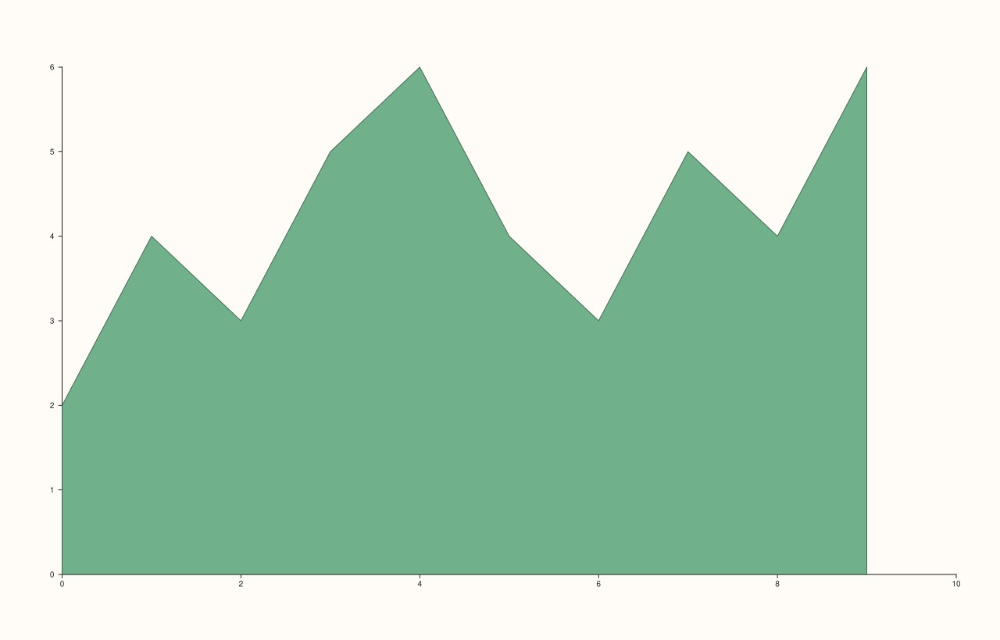
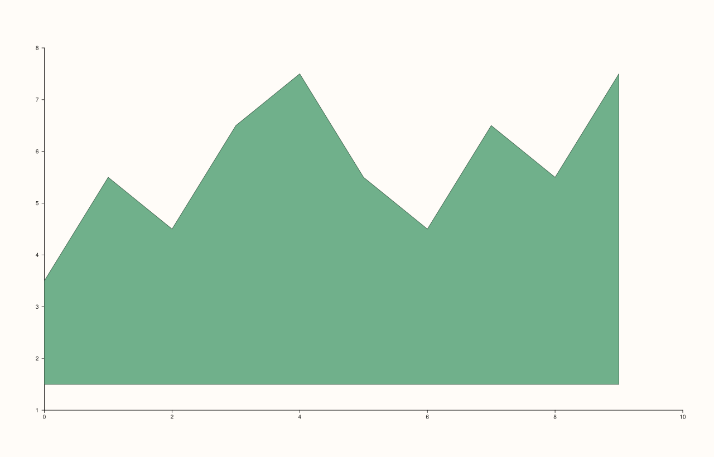

<!-- pluss-hand-authored -->

# flash::areaplot

[Back to flash API Reference](../../flash_api_reference)

## Signatures

```cpp
Trace& flash::areaplot(Pane& pane, Series x, Series y, double base = 0.0)
```

## What It Does

A direct, same-parameter-shape wrapper around [`Pane::ribbon`](../pane/ribbon.md) —
`areaplot(pane, x, y, base)` is exactly `pane.ribbon(x, y, base)`, filling the region
between `base` and each `y[i]` at position `x[i]`. There is only one overload; it adds no
behavior beyond the raw `Pane` method, only a shorter, more familiar name for a
baseline-filled region plot.

## Parameters

**pane** (`Pane&`)
    The target pane. Must be `Planar` (2D).

**x**, **y** (series-convertible)
    The point coordinates — `y[i]` is the filled region's upper edge at `x[i]`.

**base** (`double`, default `0.0`)
    The baseline the filled region runs from. See [`Pane::ribbon`](../pane/ribbon.md) for
    the exact semantics (it shifts the bottom edge, not the top — `y` values are drawn
    exactly where given).

## Returns

`Trace&`
    A reference to the newly created trace.

## Examples

Example 1. The default `base = 0.0`.

```cpp
using namespace pluss::pl;

auto fig = studio("flash_areaplot_default_base");
auto& pane = fig.pane2();
flash::areaplot(pane, pluss::series::linspace(0.0, 9.0, 10, pluss::ScalarType::Float64),
                 std::vector<double>{2.0, 4.0, 3.0, 5.0, 6.0, 4.0, 3.0, 5.0, 4.0, 6.0});
fig.show();
```



Example 2. An explicit, non-zero `base`. Renders
different (a visibly shifted bottom edge) from Example 1.

```cpp
using namespace pluss::pl;

auto fig = studio("flash_areaplot_custom_base");
auto& pane = fig.pane2();
flash::areaplot(pane, pluss::series::linspace(0.0, 9.0, 10, pluss::ScalarType::Float64),
                 std::vector<double>{2.0, 4.0, 3.0, 5.0, 6.0, 4.0, 3.0, 5.0, 4.0, 6.0}, 1.5);
fig.show();
```



## Notes

- Not `noexcept`.
- No auto-indexed-`x` shorthand exists here, unlike [`Pane::ribbon`](../pane/ribbon.md)'s
  own one-argument-plus-`base` overload — `areaplot()` always requires an explicit `x`.

## See Also

- [`Pane::ribbon`](../pane/ribbon.md): the method this wraps directly, including its
  auto-indexed-`x` overload that `areaplot()` doesn't expose.
- [`Pane::spike`](../pane/spike.md): `ribbon()`'s discrete-stem sibling, reachable via no
  dedicated `flash::` wrapper in this family.

<div class="pluss-inline-prev-next">
  <a class="prev-link" href="ecdfplot.html">
    <span class="label">Previous</span>
    <span class="title">ecdfplot</span>
  </a>
  <a class="next-link" href="rugplot.html">
    <span class="label">Next</span>
    <span class="title">rugplot</span>
  </a>
</div>
