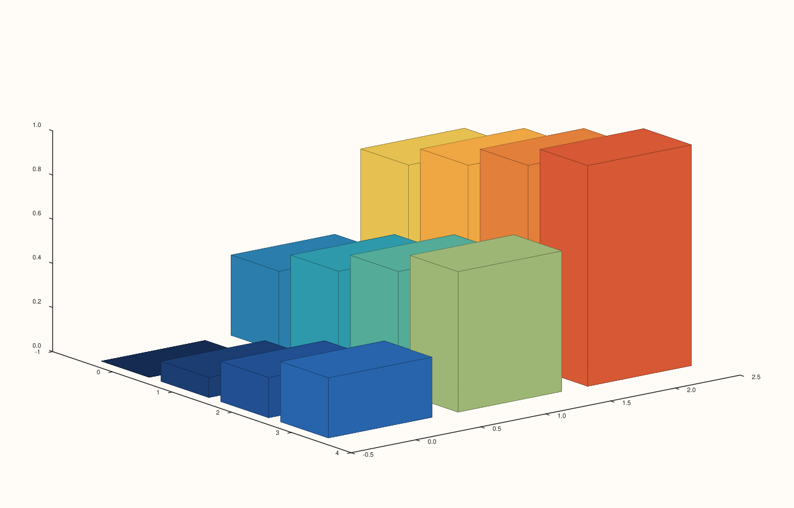

<!-- pluss-hand-authored -->

# flash::bar3d

[Back to flash API Reference](../../flash_api_reference)

## Signature

```cpp
template <class X, class Y, class Z>
Trace& flash::bar3d(Pane& pane, X&& x, Y&& y, Z&& z)
```

## What It Does

A pure, one-line rename of [`flash::spire3`](spire3.md)'s three-argument `(x, y, z)`
overload — `bar3d(pane, x, y, z)` is exactly `spire3(pane, x, y, z)`, nothing more.
Exists purely to offer a shorter, more familiar name some callers already expect.
Directly verified byte-identical. Note only the three-argument overload is aliased —
[`flash::spire3`](spire3.md)'s `(z)`-only, `(y, z)`, and `(x, y, z, c)` overloads have no
`bar3d` equivalent.

## Parameters

**pane** (`Pane&`)
    The target pane. Must be `Volumetric`.

**x**, **y**, **z** (series-convertible, must each be rank ≤ 3, and `z` rank-2 to satisfy
[`Pane::spire3`](../pane/spire3.md)'s own deeper requirement)
    The bar-forest grid — identical requirements to [`flash::spire3`](spire3.md)'s
    three-argument overload.

## Returns

`Trace&`
    A reference to the newly created trace, for chaining.

## Examples

Example 1. Same data as [`flash::spire3`](spire3.md)'s own third example.

```cpp
using namespace pluss::pl;

auto fig = studio("flash_bar3d");
auto& pane = fig.pane3();
std::vector<double> x{0.0, 1.0, 2.0, 3.0};
std::vector<double> y{0.0, 1.0, 2.0};
auto z = pluss::series::linspace(0.0, 1.0, 12, pluss::ScalarType::Float64).reshape({3, 4});
flash::bar3d(pane, x, y, z);
fig.show();
```



Example 2 (verification, not a distinct rendering). `flash::bar3d` renders
byte-identical to `flash::spire3`'s three-argument overload given the same arguments.

```cpp
using namespace pluss::pl;

std::vector<double> x{0.0, 1.0, 2.0, 3.0};
std::vector<double> y{0.0, 1.0, 2.0};
auto z = pluss::series::linspace(0.0, 1.0, 12, pluss::ScalarType::Float64).reshape({3, 4});

auto fig1 = studio("flash_bar3d_cmp1");
auto& pane1 = fig1.pane3();
flash::bar3d(pane1, x, y, z);

auto fig2 = studio("flash_bar3d_cmp2");
auto& pane2 = fig2.pane3();
flash::spire3(pane2, x, y, z);

std::cout << "bar3d == spire3: " << (fig1.to_svg() == fig2.to_svg()) << "\n";
```

Output:

```text
bar3d == spire3: 1
```

## Notes

- Not `noexcept`.
- No auto-indexed-axis or color-matrix equivalent overloads — use
  [`flash::spire3`](spire3.md) directly for those.
- [`flash::hist3d`](hist3d.md) is the histogram-specific sibling in this family — it
  bins raw `(x, y)` observations into a grid before rendering, defaulting to this same
  bar-forest glyph.

## See Also

- [`flash::spire3`](spire3.md): the function this is a pure rename of (three-argument
  overload only).
- [`flash::hist3d`](hist3d.md): a genuinely new function in this family (not a rename),
  built on binned histogram data.
- [`flash::plot3D`](plot3D.md), [`flash::scatter3D`](scatter3D.md),
  [`flash::plot_surface`](plot_surface.md), [`flash::plot_wireframe`](plot_wireframe.md),
  [`flash::contour3D`](contour3D.md): the other familiar-naming aliases in this
  family.

<div class="pluss-inline-prev-next">
  <a class="prev-link" href="contour3D.html">
    <span class="label">Previous</span>
    <span class="title">contour3D</span>
  </a>
  <a class="next-link" href="hist3d.html">
    <span class="label">Next</span>
    <span class="title">hist3d</span>
  </a>
</div>
