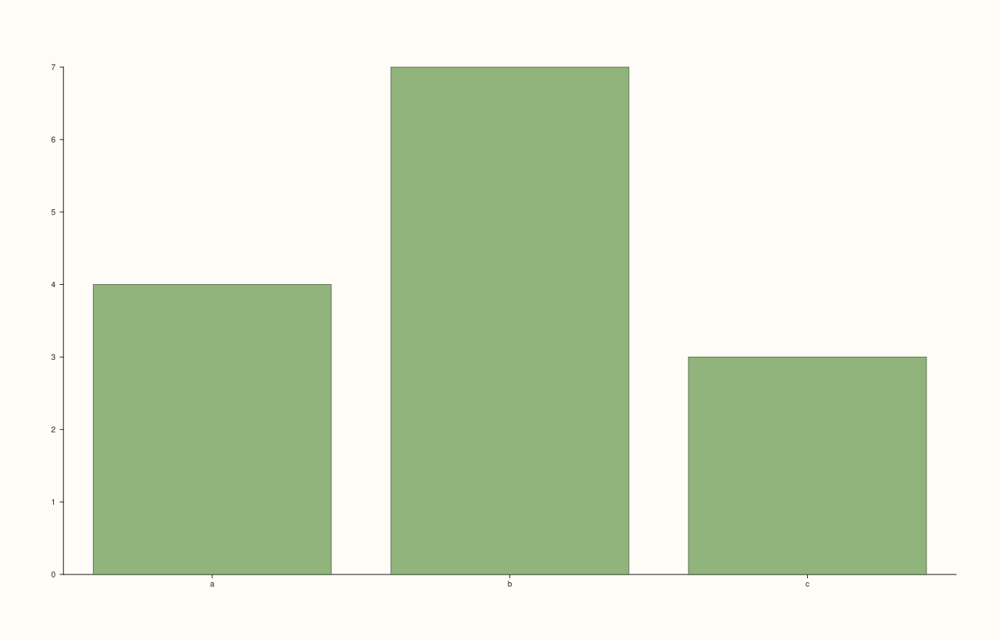
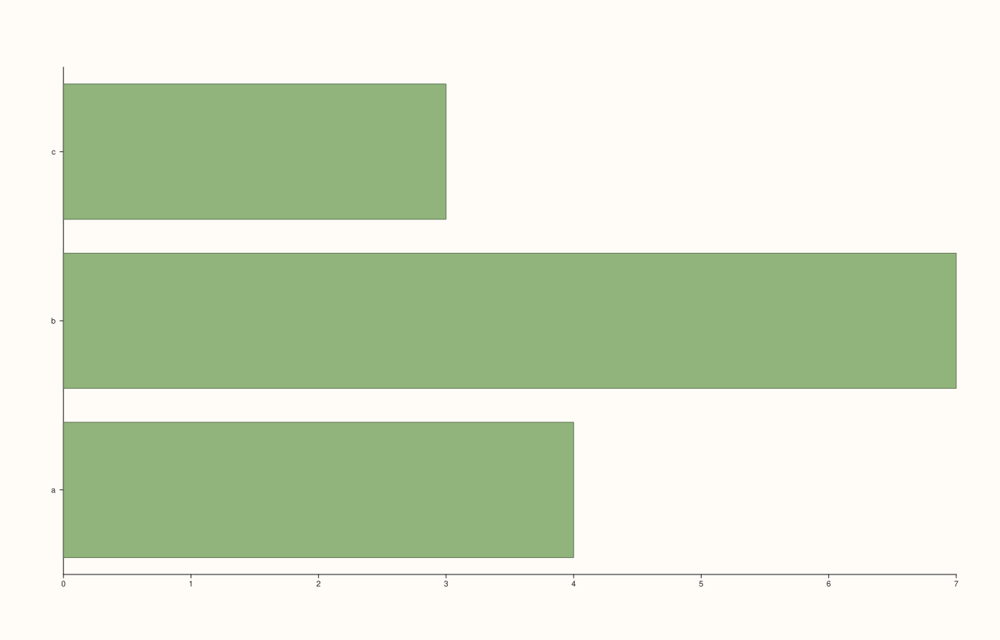
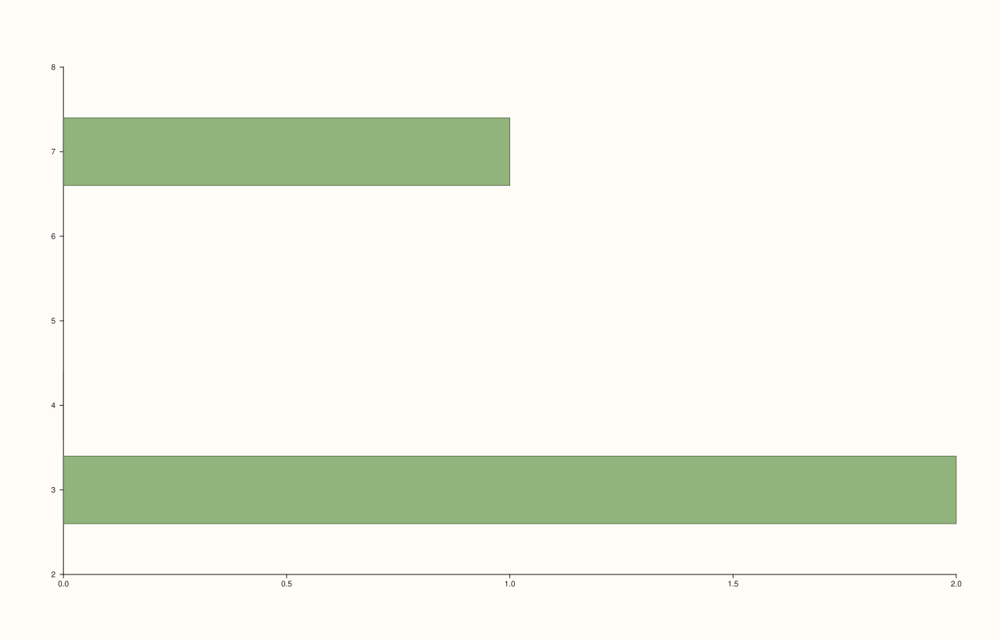

<!-- pluss-hand-authored -->

# flash::barplot

[Back to flash API Reference](../../flash_api_reference)

## Signatures

```cpp
Trace& flash::barplot(Pane& pane, Series x, Series y, const BarPlotOptions& options = {})

Trace& flash::barplot(Pane& pane, const Note& categories, const Series& values,
                       const BarPlotOptions& options = {})
```

## What It Does

Draws a bar/column chart via [`Pane::columns`](../pane/columns.md) (vertical) or
[`Pane::columns_h`](../pane/columns_h.md) (horizontal, when `options.horizontal` is
`true`). Two overloads:

- **`barplot(pane, x, y[, options])`** — bars at raw numeric `x` positions with `y`
  heights. No category-label setup — the x-axis (or y-axis, if horizontal) shows raw
  numeric tick values.
- **`barplot(pane, categories, values[, options])`** where `categories` is a
  [`Note`](../pane/x_categories.md) — one bar per distinct category label, **with real
  text tick labels set**. When `options.horizontal` is `false` (the default), labels go on
  the x-axis via `Pane::x_categories`; when `true`, labels go on the **y**-axis via
  `Pane::y_categories`, matching which axis actually carries the category dimension once
  the bars are flipped.

```{important} Same Note-vs-numeric category-labeling split as stripplot()/boxplot()
Only the Note overload sets real text tick labels; the generic numeric (X, Y)
overload does not, regardless of options.horizontal. A
horizontal Note-based call sets 3 labels on the y-axis and 0 on the x-axis --
the axis that receives the labels tracks options.horizontal, it
is not hardcoded to always be the x-axis.
```

## `BarPlotOptions` fields

| Field | Type and default | Description |
|---|---|---|
| `horizontal` | `bool`, default `false` | When `true`, draws horizontal bars via [`Pane::columns_h`](../pane/columns_h.md) instead of vertical bars via [`Pane::columns`](../pane/columns.md). Also determines which axis the `Note` overload's category labels land on — see the important callout above. This is `BarPlotOptions`' only field; there is no bar-width, gap, or color control exposed here — style the returned `Trace&` directly for that (`.width(...)`, `.stroke(...)`, `.palette(...)`). |

```{note}
Horizontal bar autorange now includes the shared bar base as part of the x-domain, not
just the observed bar lengths. In practical terms: if the bars grow from `base = 0`,
the visible x-range is computed from `min(base, value)` to `max(base, value)` for each
bar, so the vertical axis is not pushed into the filled rectangles when every bar value
is positive (or negative).
```

## Parameters

**pane** (`Pane&`)
    The target pane. Must be `Planar` (2D).

**x** (series-convertible, first overload only)
    Numeric bar positions.

**categories** (`const Note&`, second overload only)
    The categorical grouping variable. Distinct labels become tick text, in first-seen
    order (via `encode_categories`) — see the note below on `countplot()`'s different
    ordering.

**y** / **values** (series-convertible, or `const Series&` for the `Note` overload)
    The bar heights.

**options** (`const BarPlotOptions&`, optional, both overloads)
    See the field table above.

## Returns

`Trace&`
    A reference to the newly created (columns) trace.

## Examples

Example 1. Numeric `x`, default (vertical) orientation — no category-label setup.

```cpp
using namespace pluss::pl;

auto fig = studio("flash_barplot_numeric");
auto& pane = fig.pane2();
std::vector<double> x{0.0, 1.0, 2.0};
std::vector<double> y{4.0, 7.0, 3.0};
flash::barplot(pane, x, y);
fig.show();
```


Example 2. `Note`-based categories, default (vertical) orientation — real text labels on
the x-axis.

```cpp
using namespace pluss::pl;

auto fig = studio("flash_barplot_note_vertical");
auto& pane = fig.pane2();
auto cats = pluss::note::make({"a", "b", "c"});
std::vector<double> values{4.0, 7.0, 3.0};
flash::barplot(pane, cats, pluss::make_series(values, {3}));
fig.show();
```



Example 3. `Note`-based categories, `horizontal = true` — real text labels move to the
y-axis, verified directly against the pane's own tick state.

```cpp
using namespace pluss::pl;

auto fig = studio("flash_barplot_note_horizontal");
auto& pane = fig.pane2();
auto cats = pluss::note::make({"a", "b", "c"});
std::vector<double> values{4.0, 7.0, 3.0};
flash::BarPlotOptions opts;
opts.horizontal = true;
flash::barplot(pane, cats, pluss::make_series(values, {3}), opts);
const auto& yticks = pane.y_axis().ticks;
const auto& xticks = pane.x_axis().ticks;
std::cout << "barplot(horizontal) y_categories count: " << (yticks.has_value() ? yticks->labels.size() : 0) << "\n";
std::cout << "barplot(horizontal) x_categories count: " << (xticks.has_value() ? xticks->labels.size() : 0) << "\n";
fig.show();
```

Output:

```text
barplot(horizontal) y_categories count: 3
barplot(horizontal) x_categories count: 0
```



Example 4. `horizontal = true` on the **numeric** overload — no category labels involved
at all, confirming `options.horizontal` governs the numeric overload's own
orientation too, not just the `Note` overload's label placement.

```cpp
using namespace pluss::pl;

auto fig = studio("flash_barplot_numeric_horizontal");
auto& pane = fig.pane2();
std::vector<double> x{0.0, 1.0, 2.0};
std::vector<double> y{4.0, 7.0, 3.0};
flash::BarPlotOptions opts;
opts.horizontal = true;
flash::barplot(pane, x, y, opts);
fig.show();
```



## Notes

- Not `noexcept`.
- [`flash::countplot`](countplot.md)'s `Note` overload also produces one bar per category,
  but orders labels **alphabetically**, not in `barplot()`'s first-seen order — a real
  cross-function ordering divergence within this same family, verified directly.

## See Also

- [`Pane::columns`](../pane/columns.md), [`Pane::columns_h`](../pane/columns_h.md): the
  underlying methods, selected by `options.horizontal`.
- [`Pane::x_categories`](../pane/x_categories.md), [`Pane::y_categories`](../pane/y_categories.md):
  what the `Note` overload calls internally, depending on orientation.
- [`flash::countplot`](countplot.md): a related bar-per-category view with a different
  (alphabetical) label-ordering rule.
- [`flash::stripplot`](stripplot.md), [`flash::boxplot`](boxplot.md): other categorical
  functions sharing the same `Note`-vs-numeric category-labeling split.

<div class="pluss-inline-prev-next">
  <a class="prev-link" href="whiskplot.html">
    <span class="label">Previous</span>
    <span class="title">whiskplot</span>
  </a>
  <a class="next-link" href="countplot.html">
    <span class="label">Next</span>
    <span class="title">countplot</span>
  </a>
</div>
