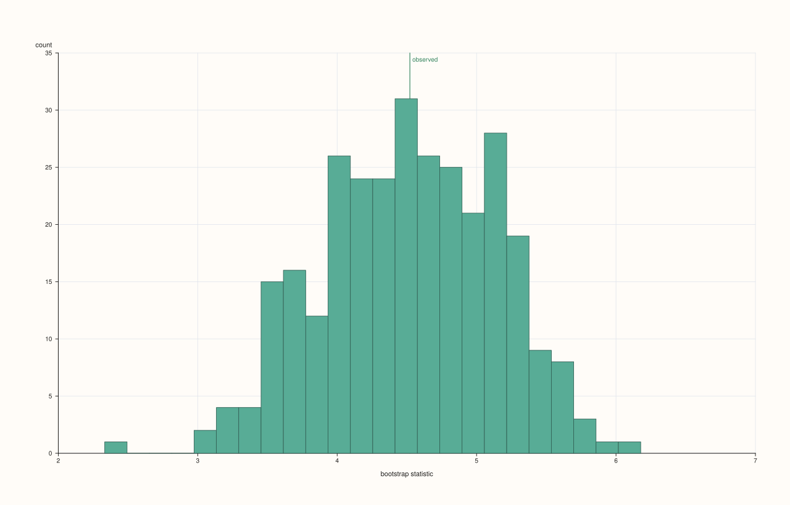
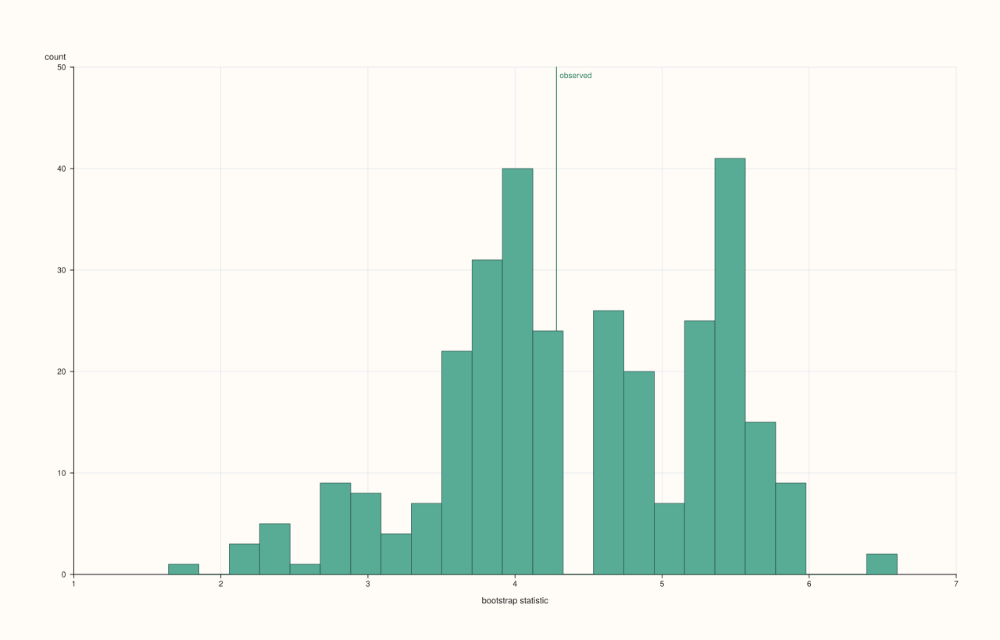
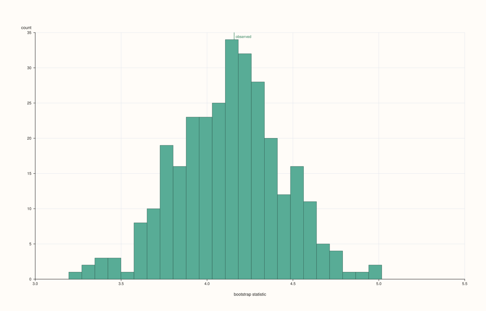

<!-- pluss-hand-authored -->

# flash::bootstrapplot

[Back to flash API Reference](../../flash_api_reference)

## Signature

```cpp
enum class BootstrapStatistic : std::uint8_t { Mean, Median, Std };

struct BootstrapPlotOptions {
  std::int64_t samples{300};
  std::int64_t sample_size{0};
  std::uint64_t seed{7};
  int bins{24};
  BootstrapStatistic statistic{BootstrapStatistic::Mean};
  float trace_width{0.85F};
};

template <class Values>
Studio& flash::bootstrapplot(Studio& studio, Values&& values, const BootstrapPlotOptions& options = {})
```

## What It Does

Draws a bootstrap sampling-distribution plot: repeatedly resamples `values` **with
replacement** (`options.samples` times), computes a chosen statistic (`statistic`) on each
resample, histograms the resulting distribution of statistics via
[`Pane::bucket`](../pane/bucket.md), and marks the *actual, unresampled* statistic with a
vertical [`Pane::rule_x`](../pane/rule_x.md) reference line labeled `"observed"` — the
standard way to visualize how much a summary statistic would plausibly vary across
different samples from the same underlying distribution.

## Parameters

**studio** (`Studio&`)
    The figure to populate — a single new [`Studio::pane2`](../studio/pane2.md).

**values** (series-convertible)
    The base sample to bootstrap from. Must contain at least two points, or
    `bootstrapplot` throws `std::invalid_argument("flash::bootstrapplot requires at least
    two points")`.

**options** (`const BootstrapPlotOptions&`, optional)
    See the field table below.

## `BootstrapPlotOptions` fields

**samples** (`std::int64_t`, default `300`)
    How many bootstrap resamples are drawn. Clamped to at least `8`.

**sample_size** (`std::int64_t`, default `0`)
    How many points each individual resample draws (with replacement). `0` or negative
    falls back to `values`' own length — the conventional bootstrap setup (each resample
    is the same size as the original sample). Set explicitly to bootstrap at a different
    resample size.

**seed** (`std::uint64_t`, default `7`)
    Base RNG seed. Each of the `samples` resamples uses `seed + (i + 1)` as its own draw
    seed (`i` from `0`), so the entire sequence of resamples — and therefore the rendered
    histogram — is fully deterministic and reproducible for a given `seed`. Directly
    verified: two calls with the same `seed` render byte-identical output; a different
    `seed` renders differently.

**bins** (`int`, default `24`)
    Histogram bin count for the resampled-statistic distribution. Clamped to at least
    `4`.

**statistic** (`BootstrapStatistic`, default `Mean`)
    Which statistic is computed per resample (and for the "observed" reference line):
    `Mean`, `Median`, or `Std` (population standard deviation, `ddof = 0`).

**trace_width** (`float`, default `0.85F`)
    Stroke width for the histogram.

## Returns

`Studio&`
    A reference to the same figure, for chaining.

## Examples

Example 1. Default overload — bootstrap distribution of the sample mean.

```cpp
using namespace pluss::pl;

auto fig = studio("flash_bootstrapplot_default");
std::vector<double> values;
for (int i = 0; i < 40; ++i) {
  values.push_back(std::sin(static_cast<double>(i) * 0.4) * 5.0 + static_cast<double>(i) * 0.2);
}
flash::bootstrapplot(fig, values);
fig.show();
```



Example 2. `statistic = Median`.

```cpp
using namespace pluss::pl;

auto fig = studio("flash_bootstrapplot_median");
std::vector<double> values;
for (int i = 0; i < 40; ++i) {
  values.push_back(std::sin(static_cast<double>(i) * 0.4) * 5.0 + static_cast<double>(i) * 0.2);
}
flash::BootstrapPlotOptions opts;
opts.statistic = flash::BootstrapStatistic::Median;
flash::bootstrapplot(fig, values, opts);
fig.show();
```



Example 3. `statistic = Std`.

```cpp
using namespace pluss::pl;

auto fig = studio("flash_bootstrapplot_std");
std::vector<double> values;
for (int i = 0; i < 40; ++i) {
  values.push_back(std::sin(static_cast<double>(i) * 0.4) * 5.0 + static_cast<double>(i) * 0.2);
}
flash::BootstrapPlotOptions opts;
opts.statistic = flash::BootstrapStatistic::Std;
flash::bootstrapplot(fig, values, opts);
fig.show();
```



Example 4 (verification, not a distinct rendering). `seed` reproducibility: the same seed
renders byte-identical output across separate calls; a different seed renders
differently.

```cpp
using namespace pluss::pl;

std::vector<double> values;
for (int i = 0; i < 40; ++i) {
  values.push_back(std::sin(static_cast<double>(i) * 0.4) * 5.0 + static_cast<double>(i) * 0.2);
}

auto fig1 = studio("flash_bootstrapplot_seed_a");
flash::BootstrapPlotOptions opts1;
opts1.seed = 42;
flash::bootstrapplot(fig1, values, opts1);

auto fig2 = studio("flash_bootstrapplot_seed_b");
flash::BootstrapPlotOptions opts2;
opts2.seed = 42;
flash::bootstrapplot(fig2, values, opts2);
std::cout << "bootstrapplot same seed reproducible: " << (fig1.to_svg() == fig2.to_svg()) << "\n";

auto fig3 = studio("flash_bootstrapplot_seed_c");
flash::BootstrapPlotOptions opts3;
opts3.seed = 99;
flash::bootstrapplot(fig3, values, opts3);
std::cout << "bootstrapplot different seed differs: " << (fig1.to_svg() != fig3.to_svg()) << "\n";
```

Output:

```text
bootstrapplot same seed reproducible: 1
bootstrapplot different seed differs: 1
```

Example 5 (edge case). Fewer than two points throws.

```cpp
using namespace pluss::pl;

auto fig = studio("flash_bootstrapplot_too_few");
std::vector<double> one{1.0};
try {
  flash::bootstrapplot(fig, one);
} catch (const std::invalid_argument& e) {
  std::cout << "bootstrapplot(1 point) threw: " << e.what() << "\n";
}
```

Output:

```text
bootstrapplot(1 point) threw: flash::bootstrapplot requires at least two points
```

## Notes

- Not `noexcept`.
- Sampling is genuinely with replacement — a single resample can (and typically does)
  include the same original point more than once and omit others entirely.
- `Std` uses population standard deviation (`ddof = 0`, dividing by `n` not `n - 1`), not
  sample standard deviation.
- Unlike the correlogram family ([`flash::acfplot`](acfplot.md) and siblings),
  `bootstrapplot` has no confidence-band toggle — the "observed" reference line is the
  only annotation drawn beyond the histogram itself.

## See Also

- [`Pane::bucket`](../pane/bucket.md): the native method drawing the resampled-statistic
  histogram.
- [`Pane::rule_x`](../pane/rule_x.md): the native method drawing the "observed" reference
  line.

<div class="pluss-inline-prev-next">
  <a class="prev-link" href="resid_acfplot.html">
    <span class="label">Previous</span>
    <span class="title">resid_acfplot</span>
  </a>
  <a class="next-link" href="path3.html">
    <span class="label">Next</span>
    <span class="title">path3</span>
  </a>
</div>
