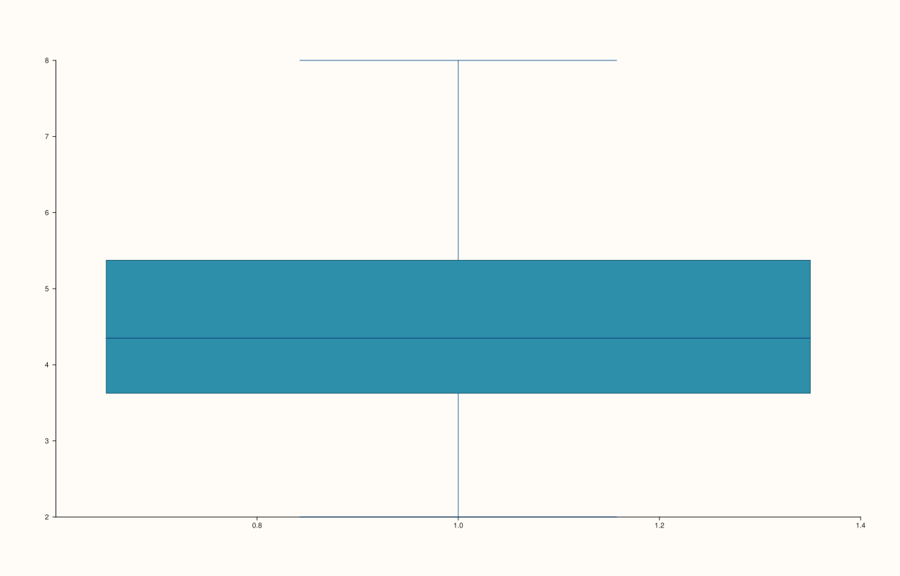

<!-- pluss-hand-authored -->

# flash::boxenplot

[Back to flash API Reference](../../flash_api_reference)

## Signatures

```cpp
Trace& flash::boxenplot(Pane& pane, Series values)
```

## What It Does

A pure alias for [`flash::boxplot`](boxplot.md)'s ungrouped overload — the implementation
is literally `boxplot(pane, values)`, nothing more. Identical arguments
to both functions produce **identical** SVG output.

```{important} Not a letter-value plot, despite the name
The name might suggest boxenplot() draws a "letter-value
plot" (Wickham et al.'s boxen chart -- nested boxes at successive quantile
levels, useful for large datasets where a classic box plot hides tail
structure). This function does not implement that algorithm at all -- it
draws a single ordinary box-and-whisker summary, identically to
flash::boxplot(pane, values). There is also no Note or numeric-group
overload reachable through boxenplot() -- only the single-series ungrouped
shape exists. For grouped boxes, call flash::boxplot() directly.
```

## Parameters

**pane** (`Pane&`)
    The target pane. Must be `Planar` (2D).

**values** (series-convertible)
    The observation values to summarize.

## Returns

`Trace&`
    A reference to the newly created (box) trace.

## Examples

Example 1. The only reachable call shape — a single ungrouped box.

```cpp
using namespace pluss::pl;

auto fig = studio("flash_boxenplot_default");
auto& pane = fig.pane2();
std::vector<double> values{2.0, 3.0, 3.5, 4.0, 4.2, 4.5, 5.0, 5.5, 6.0, 8.0};
flash::boxenplot(pane, values);
fig.show();
```



Example 2 (a comparison, not a new picture). `boxenplot(values)` and
`boxplot(values)` on identical data, produces **identical**
output.

```cpp
using namespace pluss::pl;

auto fig1 = studio("flash_alias_check_box");
auto& pane1 = fig1.pane2();
std::vector<double> values{2.0, 3.0, 3.5, 4.0, 4.2, 4.5, 5.0, 5.5, 6.0, 8.0};
flash::boxplot(pane1, values);

auto fig2 = studio("flash_alias_check_boxen");
auto& pane2 = fig2.pane2();
flash::boxenplot(pane2, values);
std::cout << "boxenplot(values) == boxplot(values): " << (fig1.to_svg() == fig2.to_svg()) << "\n";
```

Output:

```text
boxenplot(values) == boxplot(values): 1
```

## Notes

- Not `noexcept`.
- Unlike [`flash::swarmplot`](swarmplot.md) (which aliases *all* of `stripplot()`'s
  overloads), `boxenplot()` only aliases `boxplot()`'s single ungrouped overload — the
  `Note`/numeric-group overloads of `boxplot()` have no `boxenplot()` equivalent.

## See Also

- [`flash::boxplot`](boxplot.md): the function this is a byte-for-byte alias of, including
  its `Note`/numeric-group overloads that `boxenplot()` cannot reach.
- [`flash::violinplot`](violinplot.md): a KDE-density alternative distribution view sharing
  `boxplot()`'s three-overload grouping shape.

<div class="pluss-inline-prev-next">
  <a class="prev-link" href="violinplot.html">
    <span class="label">Previous</span>
    <span class="title">violinplot</span>
  </a>
  <a class="next-link" href="pointplot.html">
    <span class="label">Next</span>
    <span class="title">pointplot</span>
  </a>
</div>
