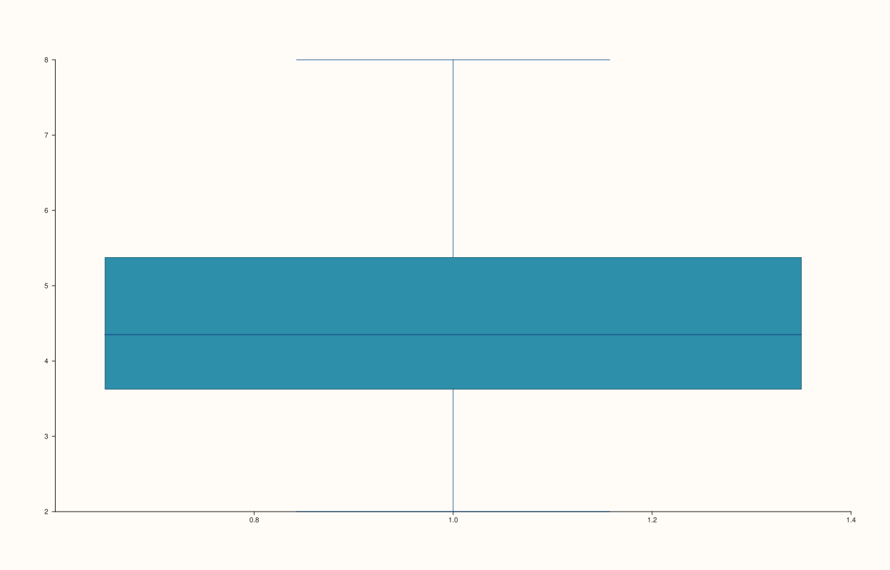
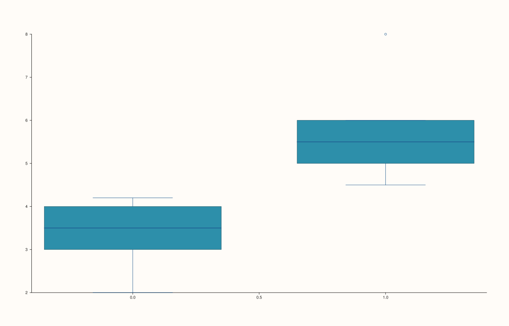

<!-- pluss-hand-authored -->

# flash::boxplot

[Back to flash API Reference](../../flash_api_reference)

## Signatures

```cpp
template <class Values>
Trace& flash::boxplot(Pane& pane, Values&& values)

Trace& flash::boxplot(Pane& pane, const Note& categories, const Series& values)

template <class Group, class Values>
Trace& flash::boxplot(Pane& pane, Group&& group, Values&& values)
```

## What It Does

Draws a classic box-and-whisker summary (quartiles, median, whiskers, outliers) via
[`Pane::quartet`](../pane/quartet.md). Three overloads:

- **`boxplot(pane, values)`** — a single ungrouped box, summarizing the entire `values`
  series as one distribution.
- **`boxplot(pane, categories, values)`** where `categories` is a
  [`Note`](../pane/x_categories.md) — one box per distinct category label, **with real
  text tick labels set on the x-axis** via `Pane::x_categories`.
- **`boxplot(pane, group, values)`** where `group` is any other series-convertible
  value — one box per distinct numeric `group` value, but **no category-label setup at
  all** — the same `Note`-vs-numeric-group split documented on
  [`flash::stripplot`](stripplot.md).

```{important} Same Note-vs-numeric-group category-labeling split as stripplot()
Only the Note overload calls Pane::x_categories() to set real text tick
labels. The numeric-group overload skips that step. Directly verified: with an
identical two-group structure (five observations in each group), the Note-based
call and the numeric-group-based call produce genuinely DIFFERENT rendered SVG
output -- not just different tick text, the boxes themselves render at
different x positions/labels. If you want readable category names on the
x-axis, pass a Note, not a numeric group vector.
```

## Parameters

**pane** (`Pane&`)
    The target pane. Must be `Planar` (2D) — this wraps `Pane::quartet`, which requires it.

**values** (series-convertible, or `const Series&` for the `Note` overload)
    The observation values to summarize.

**categories** (`const Note&`, second overload only)
    The categorical grouping variable. Distinct labels become x-axis category tick text,
    in first-seen order.

**group** (series-convertible, third overload only)
    A numeric grouping variable, paired with `values` by index. No category-label setup is
    performed.

## Returns

`Trace&`
    A reference to the newly created (box) trace.

## Examples

Example 1. Ungrouped — the whole series as one box.

```cpp
using namespace pluss::pl;

auto fig = studio("flash_boxplot_ungrouped");
auto& pane = fig.pane2();
std::vector<double> values{2.0, 3.0, 3.5, 4.0, 4.2, 4.5, 5.0, 5.5, 6.0, 8.0};
flash::boxplot(pane, values);
fig.show();
```



Example 2. Grouped by a [`Note`](../pane/x_categories.md) — real text category labels on
the x-axis, one box per label.

```cpp
using namespace pluss::pl;

auto fig = studio("flash_boxplot_note");
auto& pane = fig.pane2();
auto grp = pluss::note::make({"low", "low", "low", "low", "low", "high", "high", "high", "high", "high"});
std::vector<double> values{2.0, 3.0, 3.5, 4.0, 4.2, 4.5, 5.0, 5.5, 6.0, 8.0};
flash::boxplot(pane, grp, pluss::make_series(values, {10}));
fig.show();
```


Example 3. Grouped by a numeric variable — no category-label setup, verified to render
genuinely differently from the equivalent `Note`-based call.

```cpp
using namespace pluss::pl;

auto fig1 = studio("flash_boxplot_numeric_group");
auto& pane1 = fig1.pane2();
std::vector<double> group{0.0, 0.0, 0.0, 0.0, 0.0, 1.0, 1.0, 1.0, 1.0, 1.0};
std::vector<double> values{2.0, 3.0, 3.5, 4.0, 4.2, 4.5, 5.0, 5.5, 6.0, 8.0};
flash::boxplot(pane1, group, values);

// Same grouping structure (two groups of 5), Note-based vs numeric-based -- verify
// the category-axis labeling genuinely changes rendered output, not just tick text.
auto fig2 = studio("flash_boxplot_note_for_comparison");
auto& pane2 = fig2.pane2();
auto grp = pluss::note::make({"a", "a", "a", "a", "a", "b", "b", "b", "b", "b"});
flash::boxplot(pane2, grp, pluss::make_series(values, {10}));
std::cout << "boxplot(numeric group) != boxplot(Note, same grouping structure): "
          << (fig1.to_svg() != fig2.to_svg()) << "\n";
fig1.show();
```

Output:

```text
boxplot(numeric group) != boxplot(Note, same grouping structure): 1
```



## Notes

- Not `noexcept`.
- [`flash::boxenplot`](boxenplot.md) is a pure alias for the first (ungrouped) overload
  only — the `Note`/numeric-group overloads documented here are **not** reachable through
  `boxenplot()`.
- [`flash::violinplot`](violinplot.md) mirrors this exact three-overload shape (ungrouped,
  `Note`, numeric-group), for a KDE-based distribution view instead of quartile summaries.

## See Also

- [`Pane::quartet`](../pane/quartet.md): the underlying method all three overloads call.
- [`Pane::x_categories`](../pane/x_categories.md): what the `Note` overload calls
  internally to label the x-axis.
- [`flash::stripplot`](stripplot.md): the same `Note`-vs-numeric-group category-labeling
  split, for raw scatter points instead of quartile boxes.
- [`flash::violinplot`](violinplot.md): the same three-overload shape, for KDE-based
  distributions.
- [`flash::boxenplot`](boxenplot.md): a pure alias of this function's ungrouped overload
  only.

<div class="pluss-inline-prev-next">
  <a class="prev-link" href="swarmplot.html">
    <span class="label">Previous</span>
    <span class="title">swarmplot</span>
  </a>
  <a class="next-link" href="violinplot.html">
    <span class="label">Next</span>
    <span class="title">violinplot</span>
  </a>
</div>
