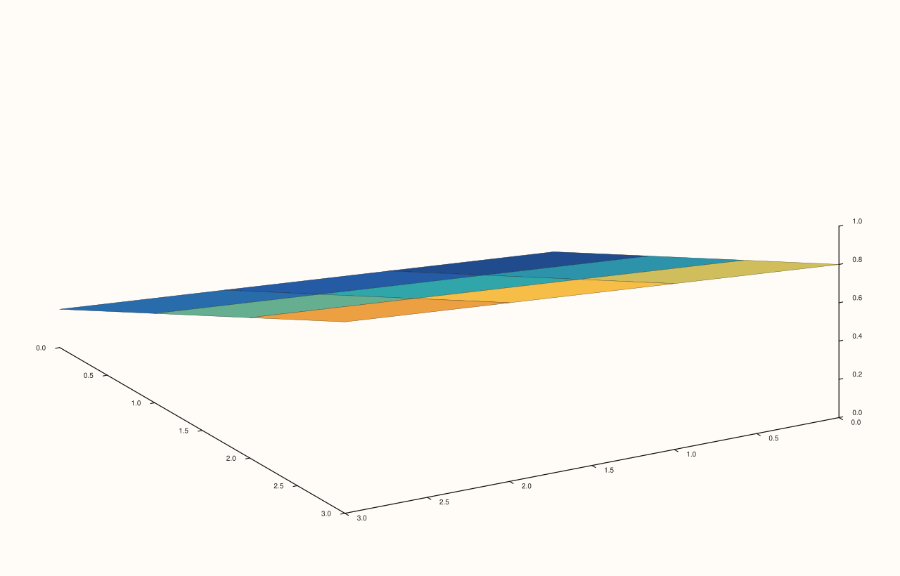
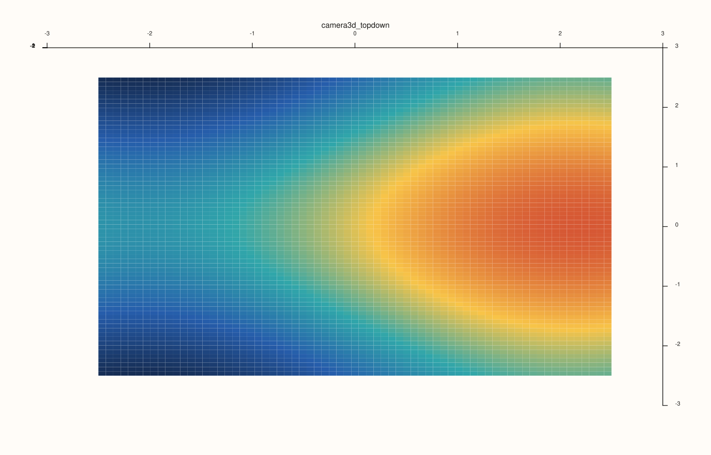

<!-- pluss-hand-authored -->

# flash::camera3d

[Back to flash API Reference](../../flash_api_reference)

## Signatures

```cpp
struct Camera3DOptions {
  double azimuth_deg{-37.5};
  double elevation_deg{30.0};
  double view_angle_deg{30.0};
  ProjectionKind projection{ProjectionKind::Orthographic};
};

Pane& flash::camera3d(Pane& pane, const Camera3DOptions& options)

Pane& flash::camera3d(Pane& pane, double azimuth_deg, double elevation_deg,
                       ProjectionKind projection = ProjectionKind::Orthographic,
                       double view_angle_deg = 30.0)
```

## What It Does

A convenience wrapper around [`Pane::lens`](../pane/lens.md): sets a pane's camera
azimuth/elevation via `lens().look(...)`, its projection style via `lens().project(...)`,
and its field-of-view via `lens().view_angle(...)`, all in one call instead of three
chained ones. Two overloads: a `Camera3DOptions` struct, or the same four values passed
positionally — directly verified byte-identical given equivalent values.

## Parameters

**pane** (`Pane&`)
    The target pane whose `Lens` is mutated.

**options** (`const Camera3DOptions&`, struct overload)
    See the field table below.

**azimuth_deg**, **elevation_deg** (`double`, positional overload)
    Forwarded to [`Lens::look`](../pane/lens.md).

**projection** (`ProjectionKind`, default `Orthographic`, positional overload)
    Forwarded to [`Lens::project`](../pane/lens.md).

**view_angle_deg** (`double`, default `30.0`, positional overload)
    Forwarded to [`Lens::view_angle`](../pane/lens.md).

## `Camera3DOptions` fields

**azimuth_deg** (`double`, default `-37.5`)
    Horizontal camera angle in degrees, matching [`Lens::planar`](../pane/lens.md)/
    [`Lens::spatial`](../pane/lens.md)'s own `spatial()` default.

**elevation_deg** (`double`, default `30.0`)
    Vertical camera angle in degrees, matching `Lens::spatial()`'s own default.

**view_angle_deg** (`double`, default `30.0`)
    Field-of-view angle in degrees, used under `Perspective` projection.

**projection** (`ProjectionKind`, default `Orthographic`)
    `Orthographic` or `Perspective` — forwarded to [`Lens::project`](../pane/lens.md).

## Returns

`Pane&`
    A reference to the same pane, for chaining.

## Examples

Example 1. `Camera3DOptions` overload — an explicit azimuth/elevation/projection/view
angle.

```cpp
using namespace pluss::pl;

auto fig = studio("flash_camera3d_options");
auto& pane = fig.pane3();
pane.sheet(std::vector<double>{0.0, 1.0, 2.0, 3.0}, std::vector<double>{0.0, 1.0, 2.0, 3.0}, pluss::series::linspace(0.0, 1.0, 16, pluss::ScalarType::Float64).reshape({4, 4}));
flash::camera3d(pane, flash::Camera3DOptions{.azimuth_deg = 60.0, .elevation_deg = 45.0, .view_angle_deg = 30.0, .projection = ProjectionKind::Orthographic});
fig.show();
```



Example 2 (verification, not a distinct rendering). The positional overload renders
byte-identical to the `Camera3DOptions` overload given equivalent values.

```cpp
using namespace pluss::pl;

auto fig1 = studio("flash_camera3d_options_cmp");
auto& pane1 = fig1.pane3();
pane1.sheet(std::vector<double>{0.0, 1.0, 2.0, 3.0}, std::vector<double>{0.0, 1.0, 2.0, 3.0}, pluss::series::linspace(0.0, 1.0, 16, pluss::ScalarType::Float64).reshape({4, 4}));
flash::camera3d(pane1, flash::Camera3DOptions{.azimuth_deg = 60.0, .elevation_deg = 45.0, .view_angle_deg = 30.0, .projection = ProjectionKind::Orthographic});

auto fig2 = studio("flash_camera3d_args");
auto& pane2 = fig2.pane3();
pane2.sheet(std::vector<double>{0.0, 1.0, 2.0, 3.0}, std::vector<double>{0.0, 1.0, 2.0, 3.0}, pluss::series::linspace(0.0, 1.0, 16, pluss::ScalarType::Float64).reshape({4, 4}));
flash::camera3d(pane2, 60.0, 45.0);

std::cout << "camera3d(options) == camera3d(azimuth,elevation): " << (fig1.to_svg() == fig2.to_svg()) << "\n";
```

Output:

```text
camera3d(options) == camera3d(azimuth,elevation): 1
```

Example 3. Positional overload, top-down orthographic view. This is the terser form to
use when you already know the exact angles and do not need a named options object.

```cpp
using namespace pluss::pl;

auto fig = studio("flash_camera3d_topdown");
auto& pane = fig.pane3();
auto gx = pluss::series::linspace(-2.5, 2.5, 24, pluss::ScalarType::Float64);
auto gy = pluss::series::linspace(-2.5, 2.5, 24, pluss::ScalarType::Float64);
auto gz = gx.reshape({1, 24}).tile({24, 1}).mul(0.6).sin()
            .add(gy.reshape({24, 1}).tile({1, 24}).mul(0.7).cos());

auto& trace = pane.sheet(gx, gy, gz);
flash::trace_preset3d(trace, flash::TracePreset3D::Surface);
flash::camera3d(pane, 0.0, 90.0, ProjectionKind::Orthographic, 30.0);
fig.show();
```



## Notes

- Not `noexcept` (`Lens::look`/`project`/`view_angle` are chainable, non-`noexcept`
  mutators).
- Mutates the pane's `Lens` in place — always overwrites `azimuth_deg`/`elevation_deg`/
  `projection`/`view_angle_deg`, never merges with the pane's current `Lens` state.

## See Also

- [`Pane::lens`](../pane/lens.md): the underlying accessor and the full `Lens` mutator
  reference.
- [`flash::camera_preset3d`](camera_preset3d.md): named shortcuts built on this
  function.
- [`flash::scene3d`](scene3d.md): composes this function alongside lighting/theme/grid
  settings.

<div class="pluss-inline-prev-next">
  <a class="prev-link" href="hist3d.html">
    <span class="label">Previous</span>
    <span class="title">hist3d</span>
  </a>
  <a class="next-link" href="camera_preset3d.html">
    <span class="label">Next</span>
    <span class="title">camera_preset3d</span>
  </a>
</div>
