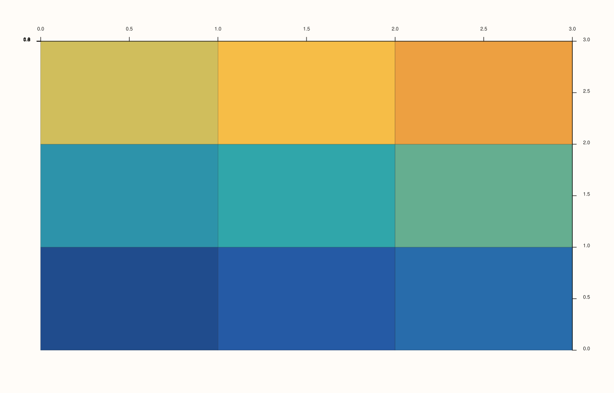
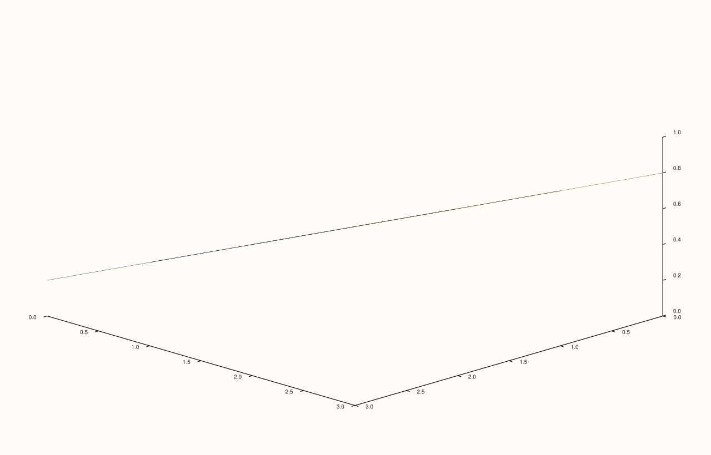

<!-- pluss-hand-authored -->

# flash::camera_preset3d

[Back to flash API Reference](../../flash_api_reference)

## Signature

```cpp
Pane& flash::camera_preset3d(Pane& pane, CameraPreset3D preset)
```

## What It Does

Applies one of five named camera angles via [`flash::camera3d`](camera3d.md), each a
fixed, hard-coded `(azimuth_deg, elevation_deg, projection, view_angle_deg)` tuple:

| Preset | azimuth_deg | elevation_deg | projection | view_angle_deg |
|---|---|---|---|---|
| `Spatial` (default/fallback) | `-37.5` | `30.0` | `Orthographic` | `30.0` |
| `TopDown` | `0.0` | `90.0` | `Orthographic` | `30.0` |
| `Front` | `0.0` | `0.0` | `Orthographic` | `30.0` |
| `Side` | `90.0` | `0.0` | `Orthographic` | `30.0` |
| `Isometric` | `45.0` | `35.2643897` | `Orthographic` | `30.0` |

`Spatial`'s values are identical to [`flash::camera3d`](camera3d.md)'s own defaults and
to [`Lens::spatial()`](../pane/lens.md)'s starting `Lens` — every preset here uses
`Orthographic` projection, none switch to `Perspective`.

## Parameters

**pane** (`Pane&`)
    The target pane whose `Lens` is mutated.

**preset** (`CameraPreset3D`)
    Which named angle to apply — see the table above. Any value outside the declared
    enumerators (or `Spatial` itself) falls through to the `Spatial` values via the
    `switch`'s `default` case.

## Returns

`Pane&`
    A reference to the same pane, for chaining.

## Examples

Example 1. `TopDown` — a straight-down view.

```cpp
using namespace pluss::pl;

auto fig = studio("flash_camera_preset3d_topdown");
auto& pane = fig.pane3();
pane.sheet(std::vector<double>{0.0, 1.0, 2.0, 3.0}, std::vector<double>{0.0, 1.0, 2.0, 3.0}, pluss::series::linspace(0.0, 1.0, 16, pluss::ScalarType::Float64).reshape({4, 4}));
flash::camera_preset3d(pane, flash::CameraPreset3D::TopDown);
fig.show();
```



Example 2. `Isometric` — the classic equal-angle 3D view.

```cpp
using namespace pluss::pl;

auto fig = studio("flash_camera_preset3d_isometric");
auto& pane = fig.pane3();
pane.sheet(std::vector<double>{0.0, 1.0, 2.0, 3.0}, std::vector<double>{0.0, 1.0, 2.0, 3.0}, pluss::series::linspace(0.0, 1.0, 16, pluss::ScalarType::Float64).reshape({4, 4}));
flash::camera_preset3d(pane, flash::CameraPreset3D::Isometric);
fig.show();
```



Example 3 (a comparison, not a new picture). `TopDown` renders identical to
the equivalent explicit [`flash::camera3d`](camera3d.md) call.

```cpp
using namespace pluss::pl;

auto fig1 = studio("flash_camera_preset3d_topdown_cmp");
auto& pane1 = fig1.pane3();
pane1.sheet(std::vector<double>{0.0, 1.0, 2.0, 3.0}, std::vector<double>{0.0, 1.0, 2.0, 3.0}, pluss::series::linspace(0.0, 1.0, 16, pluss::ScalarType::Float64).reshape({4, 4}));
flash::camera_preset3d(pane1, flash::CameraPreset3D::TopDown);

auto fig2 = studio("flash_camera3d_cmp2");
auto& pane2 = fig2.pane3();
pane2.sheet(std::vector<double>{0.0, 1.0, 2.0, 3.0}, std::vector<double>{0.0, 1.0, 2.0, 3.0}, pluss::series::linspace(0.0, 1.0, 16, pluss::ScalarType::Float64).reshape({4, 4}));
flash::camera3d(pane2, 0.0, 90.0, ProjectionKind::Orthographic, 30.0);

std::cout << "camera_preset3d(TopDown) == camera3d(0,90,Ortho,30): " << (fig1.to_svg() == fig2.to_svg()) << "\n";
```

Output:

```text
camera_preset3d(TopDown) == camera3d(0,90,Ortho,30): 1
```

## Notes

- Not `noexcept`.
- No preset ever selects `Perspective` projection — all five are `Orthographic`.
- `Spatial` is both a named enumerator and the fallback for any unmatched value —
  functionally the "reset to default camera" preset.

## See Also

- [`flash::camera3d`](camera3d.md): the underlying function every preset here calls.
- [`flash::scene_preset3d`](scene_preset3d.md): composes one of these camera presets
  alongside a theme/lighting preset.
- [`Pane::lens`](../pane/lens.md): the native camera/viewpoint accessor.

<div class="pluss-inline-prev-next">
  <a class="prev-link" href="camera3d.html">
    <span class="label">Previous</span>
    <span class="title">camera3d</span>
  </a>
  <a class="next-link" href="lighting3d.html">
    <span class="label">Next</span>
    <span class="title">lighting3d</span>
  </a>
</div>
