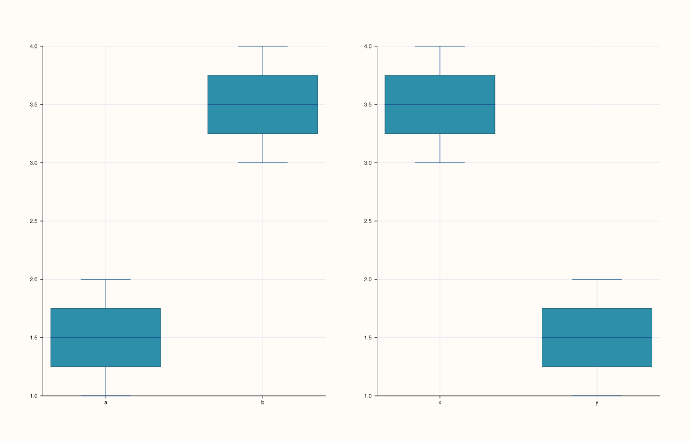
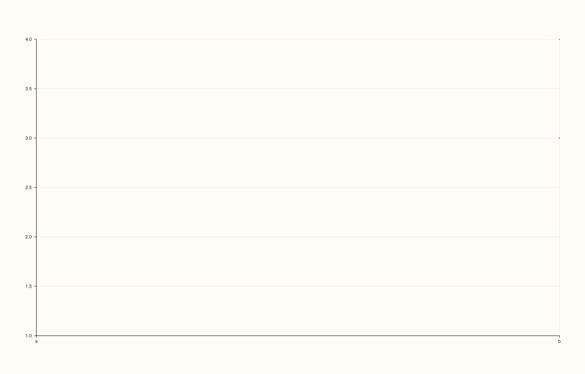
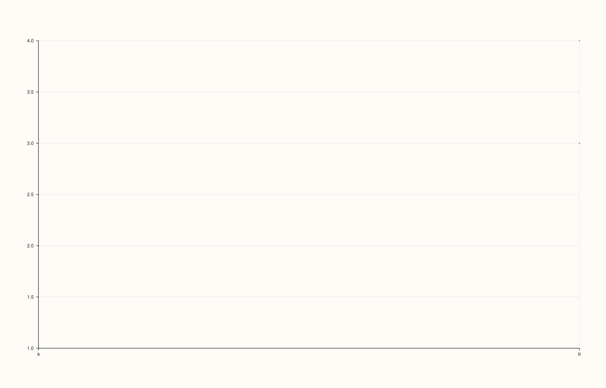

<!-- pluss-hand-authored -->

# flash::catgridplot

[Back to flash API Reference](../../flash_api_reference)

## Signatures

```cpp
Studio& flash::catgridplot(Studio& studio, pluss::msharp::RangeView::Note groups,
                            pluss::msharp::RangeView::Series values,
                            const CatGridPlotOptions& options = {})

Studio& flash::catgridplot(Studio& studio, pluss::msharp::RangeView::Note groups,
                            pluss::msharp::RangeView::Series values,
                            pluss::msharp::RangeView::Note hues,
                            const CatGridPlotOptions& options = {})

Studio& flash::catgridplot(Studio& studio, std::initializer_list<Note> groups,
                            std::initializer_list<Series> values,
                            const CatGridPlotOptions& options = {})

Studio& flash::catgridplot(Studio& studio, std::initializer_list<Note> groups,
                            std::initializer_list<Series> values,
                            std::initializer_list<Note> hues,
                            const CatGridPlotOptions& options = {})
```

## What It Does

Draws one categorical plot per facet across an auto- or explicitly-shaped grid — the
categorical sibling of [`flash::relgridplot`](relgridplot.md), built the same way: lay out
a [`flash::FacetGrid`](FacetGrid.md), then call [`flash::catplot`](catplot.md) once per
cell. Four overloads cover "with/without a per-facet `hue`" crossed with "`RangeView`
inputs vs. `std::initializer_list` inputs".

```{important} No kind-string convenience overload, unlike relgridplot/disgridplot
relgridplot and disgridplot each have a std::string_view kind overload
(flash::relgridplot(studio, xs, ys, "line")) as a shorthand for setting
options.kind. catgridplot has no such overload -- every one of its four
overloads takes a full CatGridPlotOptions (or none at all, using the
all-default struct). To pick a specific categorical kind (box, violin,
strip, ...), set options.cat.kind explicitly, as shown in Example 1 below.
This is a genuine, verified asymmetry in the *gridplot family's surface, not
an oversight in this reference -- confirmed by reading every catgridplot
overload in flash.h.
```

The grid-shape auto-resolution, the `titles`/`x_labels`/`y_labels` positional-and-
short-vector-tolerant behavior, and the overflow-cell-hiding behavior are all identical to
[`flash::relgridplot`](relgridplot.md) — see that page's important callouts for the full
mechanics; they are not re-derived here.

## `CatGridPlotOptions` fields

| Field | Type and default | Description |
|---|---|---|
| `rows`, `cols` | `std::int64_t`, default `0` each | Explicit grid shape hints; `0` means "auto" — resolved the same way as `RelGridPlotOptions::rows`/`cols` on the [`flash::relgridplot`](relgridplot.md) page, including the `rows*cols < facet_count` error. |
| `grid_gap_x`, `grid_gap_y` | `double`, default `16.0` each | Forwarded to the internal [`flash::FacetGrid`](FacetGrid.md) call as its `gx`/`gy` gutter. |
| `show_grid` | `bool`, default `true` | Whether each panel gets `GridStyle::Major` gridlines (`true`) or `GridStyle::None` (`false`). |
| `titles` | `std::vector<std::string>`, default empty | Per-facet panel titles, applied positionally — short vectors leave the remaining panels untitled, exactly like `relgridplot`. |
| `x_labels`, `y_labels` | `std::vector<std::string>`, default empty | Per-facet axis labels, applied positionally, same short-vector tolerance. |
| `cat` | `CatPlotOptions`, default-constructed | Forwarded to [`flash::catplot`](catplot.md) for every panel — every field documented there (`kind`, `hue`, `order`, `dodge`, `jitter`, `estimator`, …) applies here too, per panel. |

## Parameters

**studio** (`Studio&`)
    The figure to lay out and populate.

**groups** (`pluss::msharp::RangeView::Note` or `std::initializer_list<Note>`)
    One entry per facet — `groups[i]` is that facet's complete group-label series.

**values** (`pluss::msharp::RangeView::Series` or `std::initializer_list<Series>`)
    One entry per facet — `values[i]` is that facet's complete numeric series, aligned to
    `groups[i]`.

**hues** (`pluss::msharp::RangeView::Note` or `std::initializer_list<Note>`, hue overloads
only)
    One entry per facet — `hues[i]` is that facet's per-point hue-grouping series.

**options** (`const CatGridPlotOptions&`, optional)
    See the field table above.

## Returns

`Studio&`
    A reference to the same figure, for chaining.

## Examples

Example 1. Default (no-hue) overload — two facets, `options.cat.kind = Box`.

```cpp
using namespace pluss::pl;

auto fig = studio("flash_catgridplot_default");
auto g1 = pluss::note::make({"a", "a", "b", "b"});
auto g2 = pluss::note::make({"x", "x", "y", "y"});
std::vector<pluss::Note> groups{g1, g2};
std::vector<pluss::Series> values{pluss::make_series(std::vector<double>{1.0, 2.0, 3.0, 4.0}, {4}),
                                   pluss::make_series(std::vector<double>{4.0, 3.0, 2.0, 1.0}, {4})};
flash::CatGridPlotOptions opts;
opts.cat.kind = flash::CatPlotKind::Box;
flash::catgridplot(fig, pluss::msharp::RangeView::Note(groups), pluss::msharp::RangeView::Series(values), opts);
fig.show();
```



Example 2. Hue overload — a single facet, split by a per-point hue series (default
`CatGridPlotOptions`, so `options.cat.kind` stays at its own default).

```cpp
using namespace pluss::pl;

auto fig = studio("flash_catgridplot_hue");
auto g1 = pluss::note::make({"a", "a", "b", "b"});
auto h1 = pluss::note::make({"p", "q", "p", "q"});
std::vector<pluss::Note> groups{g1};
std::vector<pluss::Series> values{pluss::make_series(std::vector<double>{1.0, 2.0, 3.0, 4.0}, {4})};
std::vector<pluss::Note> hues{h1};
flash::catgridplot(fig, pluss::msharp::RangeView::Note(groups), pluss::msharp::RangeView::Series(values),
                    pluss::msharp::RangeView::Note(hues));
fig.show();
```



Example 3. `std::initializer_list` overload (no-hue form) — no intermediate `std::vector`
or `RangeView` construction needed.

```cpp
using namespace pluss::pl;

auto fig = studio("flash_catgridplot_il");
auto g1 = pluss::note::make({"a", "a", "b", "b"});
auto v1 = pluss::make_series(std::vector<double>{1.0, 2.0, 3.0, 4.0}, {4});
flash::catgridplot(fig, {g1}, {v1});
fig.show();
```



Example 4 (edge case). Mismatched (empty `values` against a non-empty `groups`) throws.

```cpp
using namespace pluss::pl;

auto fig = studio("flash_catgridplot_mismatch");
auto g1 = pluss::note::make({"a", "a"});
std::vector<pluss::Note> groups{g1};
std::vector<pluss::Series> values{};
try {
  flash::catgridplot(fig, pluss::msharp::RangeView::Note(groups), pluss::msharp::RangeView::Series(values));
} catch (const std::invalid_argument& e) {
  std::cout << "catgridplot(mismatched) threw: " << e.what() << "\n";
}
```

Output:

```text
catgridplot(mismatched) threw: flash::catgridplot requires non-empty aligned group/value facet vectors
```

## Notes

- Not `noexcept`.
- The hue overloads throw a differently-worded message —
  `"flash::catgridplot requires aligned group/value/hue facet vectors"` — when `groups`,
  `values`, or `hues` are empty or unequal in length; the no-hue overloads throw
  `"flash::catgridplot requires non-empty aligned group/value facet vectors"` (shown in
  Example 4 above).
- See the important callout above: there is no kind-string convenience overload here —
  set `options.cat.kind` directly.
- Grid-shape resolution, overflow-cell hiding, and positional short-vector tolerance for
  `titles`/`x_labels`/`y_labels` are shared verbatim with
  [`flash::relgridplot`](relgridplot.md) — see that page for directly-verified examples of
  each.

## See Also

- [`flash::catplot`](catplot.md): the underlying per-panel dispatcher, and the full
  `CatPlotOptions` field reference (nested here via `CatGridPlotOptions::cat`).
- [`flash::FacetGrid`](FacetGrid.md): the underlying grid-layout constructor.
- [`flash::relgridplot`](relgridplot.md), [`flash::disgridplot`](disgridplot.md): sibling
  grid-of-plots functions, sharing the same shape-resolution and positional-vector rules.

<div class="pluss-inline-prev-next">
  <a class="prev-link" href="relgridplot.html">
    <span class="label">Previous</span>
    <span class="title">relgridplot</span>
  </a>
  <a class="next-link" href="disgridplot.html">
    <span class="label">Next</span>
    <span class="title">disgridplot</span>
  </a>
</div>
