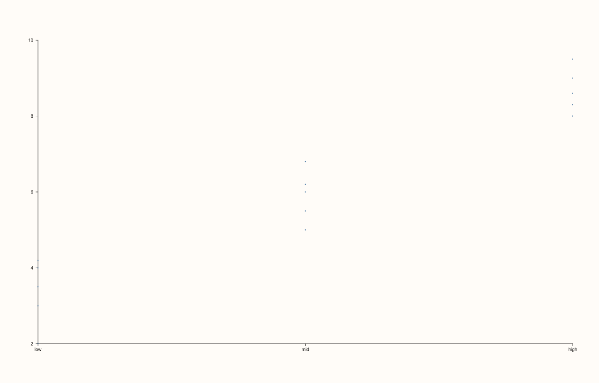
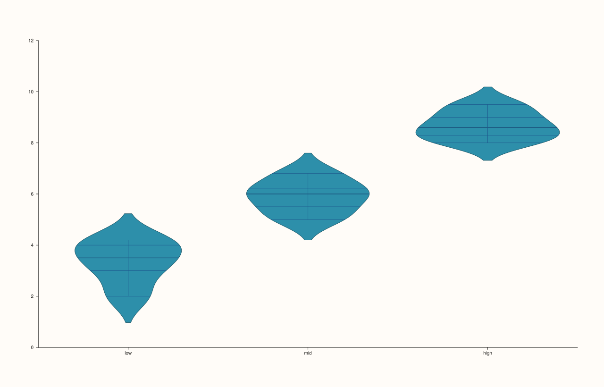
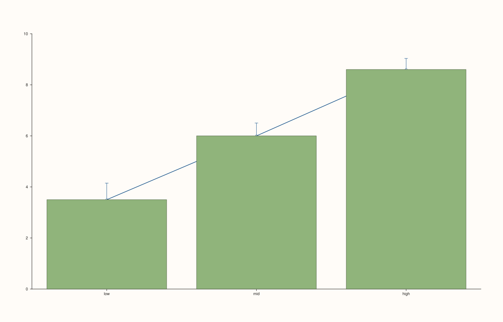
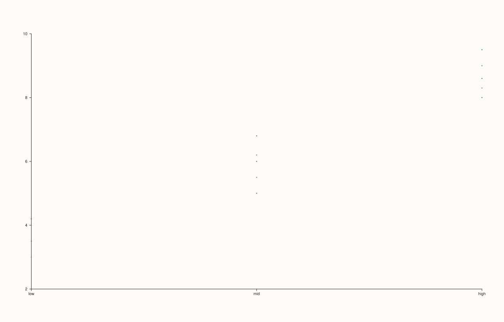
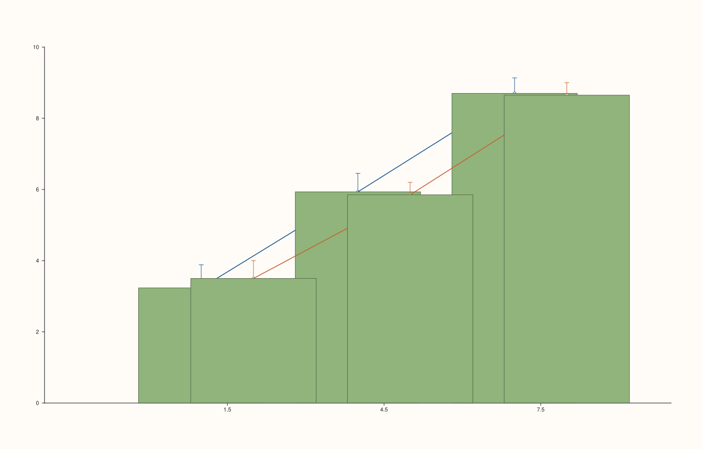
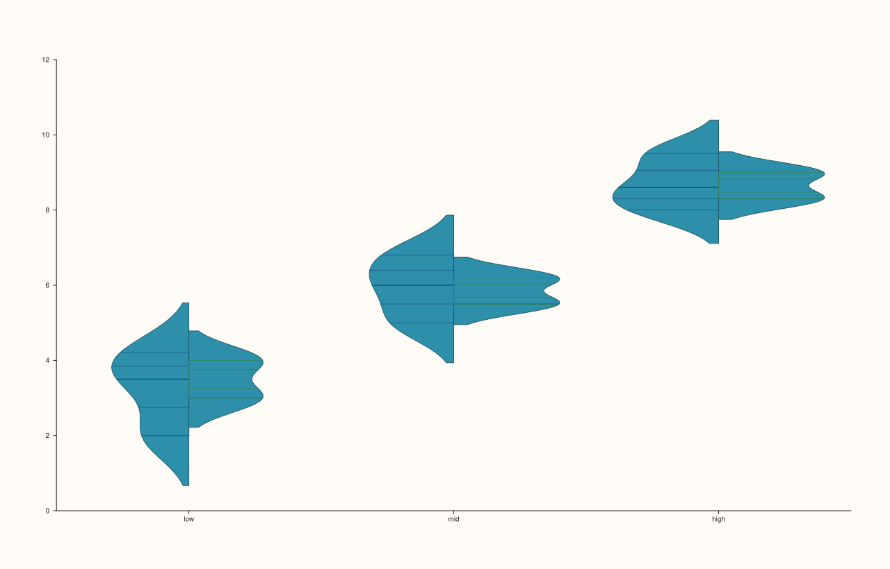
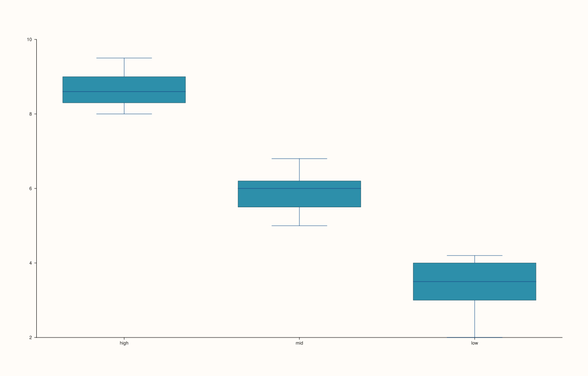
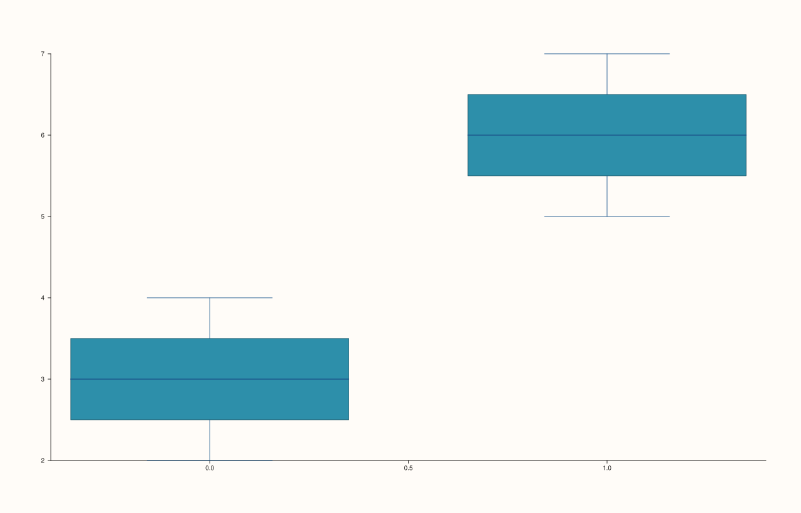

<!-- pluss-hand-authored -->

# flash::catplot

[Back to flash API Reference](../../flash_api_reference)

## Signatures

```cpp
enum class CatPlotKind : std::uint8_t { Strip, Swarm, Box, Violin, Bar, Count };
enum class CatEstimator : std::uint8_t { Mean, Median };
enum class CatErrorBar : std::uint8_t { None, CI, PI, Std, SE };

struct CatPlotOptions {
  CatPlotKind kind = CatPlotKind::Strip;
  CatEstimator estimator = CatEstimator::Mean;
  CatErrorBar errorbar = CatErrorBar::None;
  double confidence_level = 0.95;
  bool dodge = false;
  bool split = false;
  std::vector<std::string> order{};
  std::vector<std::string> hue_order{};
  ViolinOptions violin{};
  float trace_width = 0.9F;
};

Trace& flash::catplot(Pane& pane, const Note& group, const Series& values,
                       const CatPlotOptions& options)

Trace& flash::catplot(Pane& pane, const Note& group, const Series& values,
                       std::string_view kind = "strip")

Trace& flash::catplot(Pane& pane, const Note& group, const Series& values,
                       const Note& hue, const CatPlotOptions& options)

Trace& flash::catplot(Pane& pane, const Note& group, const Series& values,
                       const Note& hue, std::string_view kind = "strip")

template <class Group, class Values>
Trace& flash::catplot(Pane& pane, Group&& group, Values&& values,
                       std::string_view kind = "strip")
```

## What It Does

`catplot` is flash's universal categorical dispatcher — one entry point covering
everything [`stripplot`](stripplot.md), [`swarmplot`](swarmplot.md),
[`boxplot`](boxplot.md), [`violinplot`](violinplot.md), [`barplot`](barplot.md), and
[`countplot`](countplot.md) do individually, **plus** grouped-by-`hue` rendering, custom
category ordering, dodge/split layouts, and estimator/error-bar statistics that none of
those single-purpose functions expose on their own. It is the single richest, most
option-laden function in the entire `flash` namespace — read this page carefully; the
`CatPlotOptions` fields below interact with each other in ways that are easy to get wrong.

Five overloads:

- **`catplot(pane, group, values, options)`** — the full-control entry point for a single
  (non-hued) categorical plot. Requires an explicit `CatPlotOptions` (see the important
  callout on why this argument is *not* optional).
- **`catplot(pane, group, values, kind = "strip")`** — a lightweight convenience form:
  pass just a kind name (`"strip"`, `"swarm"`, `"box"`, `"violin"`, `"bar"`, or `"count"`;
  anything else silently falls back to `"strip"`, mirroring [`relplot`](relplot.md)'s
  documented silent-fallback pattern) and get every other `CatPlotOptions` field at its
  default.
- **`catplot(pane, group, values, hue, options)`** — the full-control entry point with a
  second categorical variable (`hue`) splitting each group into sub-series, each drawn as
  its own trace and optionally dodged or (for violins) split.
- **`catplot(pane, group, values, hue, kind = "strip")`** — the hued convenience form.
- **`catplot(pane, group, values, kind = "strip")`** (template) — the escape hatch for a
  **non-`Note`** (plain numeric) `group`. Manually redispatches by `kind` string to
  [`boxplot`](boxplot.md), [`violinplot`](violinplot.md), [`barplot`](barplot.md),
  [`countplot`](countplot.md), or [`stripplot`](stripplot.md) (default and `"swarm"` both
  fall through to `stripplot`, matching `swarmplot`'s established alias behavior) — none of
  `CatPlotOptions`' hue/order/estimator/errorbar/dodge/split machinery is reachable through
  this overload, since it never constructs a `CatPlotOptions` at all.

```{important} Fixed: catplot(group, values, hue) previously failed to compile
The 4-argument, no-kind/no-options hue call -- catplot(pane, group, values,
hue) -- used to be genuinely ambiguous: two non-template overloads
(...,const Note& hue, const CatPlotOptions& options = {}) and
(...,const Note& hue, std::string_view kind = "strip") both had a defaulted
5th parameter of a DIFFERENT type, and omitting that argument left the
compiler with two equally-good candidates and no way to choose -- a hard
compile error ("call to catplot is ambiguous") on a call shape most users
would reach for immediately. This has been fixed at the source: the
CatPlotOptions-taking overload no longer defaults its options parameter, so
the 4-argument call now resolves unambiguously to the kind-string overload
(defaulting to kind="strip", exactly mirroring the no-hue 3-argument call's
existing behavior). If you want CatPlotOptions with a hue, pass it explicitly:
catplot(pane, group, values, hue, options).
```

```{important} Fixed: the generic template used to silently steal Note calls, bypassing every CatPlotOptions feature
Unlike stripplot/boxplot/violinplot's own generic (Group, Values) templates
-- which all explicitly exclude Note via a requires clause, forcing Note
arguments to their dedicated categorical overloads -- catplot's generic
template overload had NO such exclusion. Because a forwarding reference
(Group&&) binds to a non-const lvalue Note with less cv-qualification than
the dedicated overloads' const Note& parameter, C++ overload resolution
preferred the unconstrained template whenever the trailing argument was a
plain kind string (or omitted entirely, using the "strip" default) --
meaning catplot(pane, note_group, values) and
catplot(pane, note_group, values, "kind") were silently redirected to a bare
stripplot()/boxplot()/violinplot()/barplot()/countplot() call, completely
bypassing CatPlotOptions' order, hue_order, dodge, split, estimator,
errorbar, and violin sub-options -- with no warning, and even producing a
less specific validation error message on a group/value length mismatch
("cloud: series lengths must match..." instead of catplot's own
"flash::catplot group/value length mismatch"). This has been fixed at the
source by adding the same Note exclusion every sibling function already
uses. catplot(pane, note_group, values) and its kind-string sibling now
correctly and consistently route through catplot's own master
implementation. The generic template still applies -- unchanged -- to
genuinely non-Note (numeric) group arguments, which is its intended escape
hatch.
```

## `CatPlotOptions` fields

**kind** (`CatPlotKind`, default `Strip`)
    Which underlying visual to draw. `Strip`/`Swarm` draw one point per observation via
    `Pane::cloud` (both kinds render identically — no swarm point-avoidance algorithm
    exists here either, matching [`swarmplot`](swarmplot.md)'s documented alias behavior).
    `Box` draws quartile summaries via `Pane::quartet`. `Violin` draws KDE density curves
    via `Pane::violin` (styled by the nested `violin` field, below). `Bar` and `Count`
    both take the "bar-like" code path: `Bar` draws one bar per group holding
    `estimator`'s summary statistic (with optional error bars per `errorbar`); `Count`
    draws raw per-group observation counts (ignoring `estimator`/`errorbar` entirely —
    counts are always exact tallies, never estimated).

**estimator** (`CatEstimator`, default `Mean`)
    Only meaningful when `kind == Bar`. `Mean` summarizes each group/hue bucket by its
    arithmetic mean; `Median` uses the sorted-data median instead. Ignored for every other
    `kind`.

**errorbar** (`CatErrorBar`, default `None`)
    Only meaningful when `kind == Bar`. `None` draws bars with no error bars at all. `Std`
    draws ± one sample standard deviation. `SE` draws ± one standard error of the mean
    (`stddev / sqrt(n)`). `CI` draws a symmetric confidence interval, `z * SE`, where `z`
    is derived from `confidence_level`. `PI` draws an empirical percentile interval
    computed directly from the bucket's sorted raw values (not a parametric estimate) —
    and is the **only** `errorbar` mode compatible with `estimator == Median` (all other
    modes compute their spread from the *mean*-based sample variance internally, even when
    `estimator == Median` — a real, verified quirk: requesting `Median` with `errorbar ==
    Std/SE/CI` still centers the bar on the median but derives its error-bar width from the
    mean/variance machinery, not from the median's own dispersion).

**confidence_level** (`double`, default `0.95`)
    Used only by `errorbar == CI` (via a z-score lookup) and `errorbar == PI` (as a direct
    percentile-interval width). Ignored otherwise.

**dodge** (`bool`, default `false`)
    Only takes effect when a `hue` is supplied. When `true`, each hue level's bar/mark is
    offset to sit side-by-side within its group's slot instead of overlapping at the same
    x-position. Automatically disabled (has no effect) when `split_violin` is active — see
    `split`, below.

**split** (`bool`, default `false`)
    Only takes effect when `kind == Violin` **and** a `hue` is supplied. Draws each hue
    level as one **half** of a single mirrored violin at the group's x-position (left half
    for the first hue level, right half for the second), via `ViolinSide::Left`/`Right` —
    the same mechanism [`violinplot`](violinplot.md) exposes directly. **Requires exactly
    two hue levels** — `catplot` throws `std::invalid_argument` if `split == true` and the
    resolved hue level count is anything other than 2 (verified below). When `split` is
    active, `dodge` has no additional effect (split and dodge are mutually exclusive
    layout strategies).

**order** (`std::vector<std::string>`, default empty)
    An explicit x-axis category ordering. Empty (the default) means "first-seen order in
    the data" (via the shared `encode_categories`-style logic). When non-empty, listed
    labels are placed first in the given order; any labels present in the data but *not*
    listed in `order` are appended afterward, in their own first-seen order — `order` does
    not need to be exhaustive.

**hue_order** (`std::vector<std::string>`, default empty)
    The same explicit-ordering behavior as `order`, applied to hue levels instead of
    groups (affects dodge offset order and legend label order, not visibility — every hue
    level present in the data is still drawn regardless of whether it appears in
    `hue_order`).

**violin** (`ViolinOptions`, default-constructed)
    Only consulted when `kind == Violin`. See [`flash::violinplot`](violinplot.md) for the
    full field reference (`width`, `bw_adjust`, `cut`, `scale`, `inner`, `side`). Note that
    when `split == true`, `catplot` overwrites this sub-struct's `side` field per hue level
    (`Left`/`Right`) — any `side` value you set here is ignored in that specific case.

**trace_width** (`float`, default `0.9F`)
    Forwarded to `Trace::width()` on every trace `catplot` draws. Has no visible effect for
    point-based kinds (`Strip`/`Swarm`) — `width()` governs *stroke* width, and points have
    no stroke — but does visibly affect `Box`/`Violin`/`Bar` outlines.

## Parameters

**pane** (`Pane&`)
    The target pane. Must be `Planar` (2D).

**group** (`const Note&`, or series-convertible for the generic template overload)
    The primary categorical (or, via the template escape hatch, numeric) grouping
    variable. Distinct labels become x-axis category positions, via `Pane::x_ticks`.

**values** (`const Series&`, or series-convertible for the generic template overload)
    The observation values, one per `group` entry. Must be the same length as `group` — a
    mismatch throws `std::invalid_argument("flash::catplot group/value length
    mismatch")` (verified below).

**hue** (`const Note&`, hued overloads only)
    A second categorical variable splitting each group into sub-series. Must be the same
    length as `group`/`values` — a mismatch throws `std::invalid_argument("flash::catplot
    hue length must match group/value")`.

**options** (`const CatPlotOptions&`)
    See the field table above. Not defaulted on the options-taking overloads (see the
    important callout) — pass `{}` explicitly for all-default behavior.

**kind** (`std::string_view`, default `"strip"`, kind-string overloads only)
    One of `"strip"`, `"swarm"`, `"box"`, `"violin"`, `"bar"`, `"count"`. Any other value
    silently behaves as `"strip"` (no validation, no exception — the same documented
    pattern as [`relplot`](relplot.md)'s `kind` parameter).

## Returns

`Trace&`
    A reference to the **last** trace drawn. For a single (non-hued) call this is
    unambiguous. For a hued call with multiple levels, only the final hue level's trace is
    returned — the same "last-trace-only" convention documented on
    [`scatterplot`](scatterplot.md)/[`lineplot`](lineplot.md)'s hue overloads.

## Examples

Example 1. The simplest call — a `Note` group, default `kind = "strip"`.

```cpp
using namespace pluss::pl;

auto fig = studio("flash_catplot_default");
auto& pane = fig.pane2();
auto grp = pluss::note::make({"low", "low", "low", "low", "low",
                              "mid", "mid", "mid", "mid", "mid",
                              "high", "high", "high", "high", "high"});
std::vector<double> values{2.0, 3.0, 3.5, 4.0, 4.2, 5.0, 5.5, 6.0, 6.2, 6.8,
                           8.0, 8.3, 8.6, 9.0, 9.5};
flash::catplot(pane, grp, pluss::make_series(values, {15}));
fig.show();
```



Example 2. Explicit `kind = "violin"`.

```cpp
using namespace pluss::pl;

auto fig = studio("flash_catplot_kind_violin");
auto& pane = fig.pane2();
auto grp = pluss::note::make({"low", "low", "low", "low", "low",
                              "mid", "mid", "mid", "mid", "mid",
                              "high", "high", "high", "high", "high"});
std::vector<double> values{2.0, 3.0, 3.5, 4.0, 4.2, 5.0, 5.5, 6.0, 6.2, 6.8,
                           8.0, 8.3, 8.6, 9.0, 9.5};
flash::catplot(pane, grp, pluss::make_series(values, {15}), "violin");
fig.show();
```



Example 3. Explicit `CatPlotOptions` — bar chart with `estimator = Median` and a 90%
confidence interval.

```cpp
using namespace pluss::pl;

auto fig = studio("flash_catplot_options_bar_ci");
auto& pane = fig.pane2();
auto grp = pluss::note::make({"low", "low", "low", "low", "low",
                              "mid", "mid", "mid", "mid", "mid",
                              "high", "high", "high", "high", "high"});
std::vector<double> values{2.0, 3.0, 3.5, 4.0, 4.2, 5.0, 5.5, 6.0, 6.2, 6.8,
                           8.0, 8.3, 8.6, 9.0, 9.5};
flash::CatPlotOptions opts;
opts.kind = flash::CatPlotKind::Bar;
opts.estimator = flash::CatEstimator::Median;
opts.errorbar = flash::CatErrorBar::CI;
opts.confidence_level = 0.90;
flash::catplot(pane, grp, pluss::make_series(values, {15}), opts);
fig.show();
```



Example 4. `group, values, hue` with no `kind`/`options` — the call shape that previously
failed to compile (see the important callout above). Defaults to `kind = "strip"`, drawing
one trace per hue level.

```cpp
using namespace pluss::pl;

auto fig = studio("flash_catplot_hue_fixed");
auto& pane = fig.pane2();
auto grp = pluss::note::make({"low", "low", "low", "low", "low",
                              "mid", "mid", "mid", "mid", "mid",
                              "high", "high", "high", "high", "high"});
std::vector<double> values{2.0, 3.0, 3.5, 4.0, 4.2, 5.0, 5.5, 6.0, 6.2, 6.8,
                           8.0, 8.3, 8.6, 9.0, 9.5};
auto hue = pluss::note::make({"a", "b", "a", "b", "a", "a", "b", "a", "b", "a",
                              "a", "b", "a", "b", "a"});
Trace& t = flash::catplot(pane, grp, pluss::make_series(values, {15}), hue);
std::cout << "pane trace count: " << pane.traces().size() << " (one per hue level)\n";
fig.show();
```

Output:

```text
pane trace count: 2 (one per hue level)
```



Example 5. Hued, dodged bar chart with standard-error bars.

```cpp
using namespace pluss::pl;

auto fig = studio("flash_catplot_hue_dodge_bar");
auto& pane = fig.pane2();
auto grp = pluss::note::make({"low", "low", "low", "low", "low",
                              "mid", "mid", "mid", "mid", "mid",
                              "high", "high", "high", "high", "high"});
std::vector<double> values{2.0, 3.0, 3.5, 4.0, 4.2, 5.0, 5.5, 6.0, 6.2, 6.8,
                           8.0, 8.3, 8.6, 9.0, 9.5};
auto hue = pluss::note::make({"a", "b", "a", "b", "a", "a", "b", "a", "b", "a",
                              "a", "b", "a", "b", "a"});
flash::CatPlotOptions opts;
opts.kind = flash::CatPlotKind::Bar;
opts.dodge = true;
opts.errorbar = flash::CatErrorBar::SE;
flash::catplot(pane, grp, pluss::make_series(values, {15}), hue, opts);
fig.show();
```



Example 6. Split violin — exactly two hue levels, each drawn as one mirrored half.

```cpp
using namespace pluss::pl;

auto fig = studio("flash_catplot_split_violin");
auto& pane = fig.pane2();
auto grp = pluss::note::make({"low", "low", "low", "low", "low",
                              "mid", "mid", "mid", "mid", "mid",
                              "high", "high", "high", "high", "high"});
std::vector<double> values{2.0, 3.0, 3.5, 4.0, 4.2, 5.0, 5.5, 6.0, 6.2, 6.8,
                           8.0, 8.3, 8.6, 9.0, 9.5};
auto hue = pluss::note::make({"a", "b", "a", "b", "a", "a", "b", "a", "b", "a",
                              "a", "b", "a", "b", "a"});
flash::CatPlotOptions opts;
opts.kind = flash::CatPlotKind::Violin;
opts.split = true;
flash::catplot(pane, grp, pluss::make_series(values, {15}), hue, opts);
fig.show();
```



Example 7 (edge case). `split = true` with three hue levels — throws, since split-violin
requires exactly two.

```cpp
using namespace pluss::pl;

auto fig = studio("flash_catplot_split_bad");
auto& pane = fig.pane2();
auto grp = pluss::note::make({"low", "low", "low", "low", "low",
                              "mid", "mid", "mid", "mid", "mid",
                              "high", "high", "high", "high", "high"});
std::vector<double> values{2.0, 3.0, 3.5, 4.0, 4.2, 5.0, 5.5, 6.0, 6.2, 6.8,
                           8.0, 8.3, 8.6, 9.0, 9.5};
auto hue3 = pluss::note::make({"a", "b", "c", "a", "b", "a", "b", "c", "a", "b",
                               "a", "b", "c", "a", "b"});
flash::CatPlotOptions opts;
opts.kind = flash::CatPlotKind::Violin;
opts.split = true;
try {
  flash::catplot(pane, grp, pluss::make_series(values, {15}), hue3, opts);
} catch (const std::invalid_argument& e) {
  std::cout << "threw: " << e.what() << "\n";
}
```

Output:

```text
threw: flash::catplot split=true currently requires exactly two hue levels
```

Example 8. Explicit `order` — categories placed in a custom sequence instead of
first-seen order.

```cpp
using namespace pluss::pl;

auto fig = studio("flash_catplot_explicit_order");
auto& pane = fig.pane2();
auto grp = pluss::note::make({"low", "low", "low", "low", "low",
                              "mid", "mid", "mid", "mid", "mid",
                              "high", "high", "high", "high", "high"});
std::vector<double> values{2.0, 3.0, 3.5, 4.0, 4.2, 5.0, 5.5, 6.0, 6.2, 6.8,
                           8.0, 8.3, 8.6, 9.0, 9.5};
flash::CatPlotOptions opts;
opts.kind = flash::CatPlotKind::Box;
opts.order = {"high", "mid", "low"};
flash::catplot(pane, grp, pluss::make_series(values, {15}), opts);
const auto& ticks = pane.x_axis().ticks;
std::cout << "x_categories: ";
if (ticks.has_value()) {
  for (const auto& lbl : ticks->labels) std::cout << lbl << " ";
}
std::cout << "\n";
fig.show();
```

Output:

```text
x_categories: high mid low 
```



Example 9 (edge case). Group/value length mismatch — throws `catplot`'s own, specific
error message (confirmed to now fire correctly after the overload-resolution fix above).

```cpp
using namespace pluss::pl;

auto fig = studio("flash_catplot_mismatch");
auto& pane = fig.pane2();
auto grp = pluss::note::make({"a", "b", "c"});
auto vals = pluss::make_series(std::vector<double>{1.0, 2.0}, {2});
try {
  flash::catplot(pane, grp, vals);
} catch (const std::invalid_argument& e) {
  std::cout << "threw: " << e.what() << "\n";
}
```

Output:

```text
threw: flash::catplot group/value length mismatch
```

Example 10. The generic template escape hatch — a plain numeric (non-`Note`) `group`,
manually redispatched to `flash::boxplot`.

```cpp
using namespace pluss::pl;

auto fig = studio("flash_catplot_numeric_group");
auto& pane = fig.pane2();
std::vector<double> group_numeric{0.0, 0.0, 0.0, 1.0, 1.0, 1.0};
std::vector<double> values{2.0, 3.0, 4.0, 5.0, 6.0, 7.0};
flash::catplot(pane, group_numeric, values, "box");
fig.show();
```



## Notes

- Not `noexcept`.
- `CatPlotKind::Swarm` renders identically to `CatPlotKind::Strip` (both call
  `Pane::cloud`) — there is no point-avoidance/jitter algorithm anywhere in `flash`,
  matching [`swarmplot`](swarmplot.md)'s documented alias behavior.
- `estimator`/`errorbar`/`confidence_level`/`dodge` only matter for `kind == Bar`;
  `split`/`violin` only matter for `kind == Violin` (and `split` additionally requires a
  `hue`); all are silently ignored (not validated, not warned about) for other `kind`
  values.
- `CatErrorBar::PI` is the only error-bar mode that correctly reflects
  `CatEstimator::Median` — every other mode computes its spread from mean-based sample
  variance regardless of `estimator`.
- The five overloads intentionally mirror the "options struct is not defaulted, kind
  string is defaulted" pattern established by the fix above — if you want the richer
  `CatPlotOptions` control surface, you must always name it explicitly, even as `{}`.

## See Also

- [`flash::stripplot`](stripplot.md), [`flash::swarmplot`](swarmplot.md),
  [`flash::boxplot`](boxplot.md), [`flash::violinplot`](violinplot.md),
  [`flash::barplot`](barplot.md), [`flash::countplot`](countplot.md): the single-purpose
  functions `catplot` dispatches to, each documented with its own overload set and
  edge cases.
- [`Pane::cloud`](../pane/cloud.md), [`Pane::quartet`](../pane/quartet.md),
  [`Pane::violin`](../pane/violin.md), [`Pane::columns`](../pane/columns.md),
  [`Pane::whisk`](../pane/whisk.md), [`Pane::x_ticks`](../pane/x_ticks.md): the underlying
  Pane methods `catplot`'s master implementation calls directly.
- [`flash::relplot`](relplot.md): the relational-family counterpart, sharing the same
  silent-`kind`-string-fallback design.

<div class="pluss-inline-prev-next">
  <a class="prev-link" href="pieplot.html">
    <span class="label">Previous</span>
    <span class="title">pieplot</span>
  </a>
  <a class="next-link" href="regplot.html">
    <span class="label">Next</span>
    <span class="title">regplot</span>
  </a>
</div>
