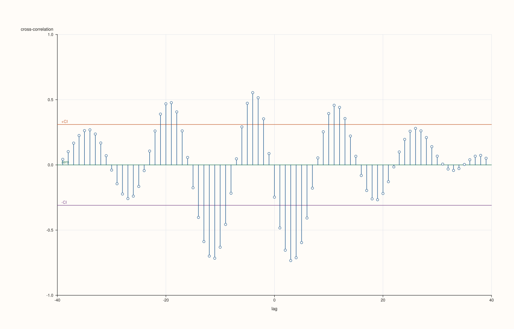

<!-- pluss-hand-authored -->

# flash::ccfplot

[Back to flash API Reference](../../flash_api_reference)

## Signature

```cpp
struct CcfPlotOptions {
  std::int64_t max_lag{40};
  bool show_confidence_band{true};
  double confidence_level{0.95};
  float trace_width{1.2F};
  double marker_area{14.0};
};

template <class X, class Y>
Studio& flash::ccfplot(Studio& studio, X&& x, Y&& y, const CcfPlotOptions& options = {})
```

## What It Does

Draws a cross-correlation-function (CCF) correlogram between *two* series: one
[`Pane::spike`](../pane/spike.md) per lag `k`, from `-max_lag` to `+max_lag`, measuring
the correlation of `x` against `y` shifted by `k` — negative lags mean `y` leads `x`,
positive lags mean `x` leads `y`. Unlike [`flash::acfplot`](acfplot.md)/
[`flash::pacfplot`](pacfplot.md) (one-sided, positive lags only), `ccfplot` is always
symmetric around lag `0`, plotting `2 * max_lag + 1` spikes total.

## Parameters

**studio** (`Studio&`)
    The figure to populate — a single new [`Studio::pane2`](../studio/pane2.md), y-axis
    fixed to `[-1.0, 1.0]`.

**x**, **y** (series-convertible)
    The two sequences to cross-correlate. Must have identical lengths and at least three
    points, or `ccfplot` throws `std::invalid_argument("flash::ccfplot requires aligned
    x/y with at least three points")` — a single check covering both conditions.

**options** (`const CcfPlotOptions&`, optional)
    See the field table below.

## `CcfPlotOptions` fields

**max_lag** (`std::int64_t`, default `40`)
    The largest **magnitude** lag shown in either direction. Clamped to `[1, n - 1]`.
    The plotted lag range is always `[-max_lag, +max_lag]`.

**show_confidence_band** (`bool`, default `true`)
    Whether the `+CI`/`-CI` reference lines are drawn — same constant-width
    normal-approximation mechanics as [`flash::acfplot`](acfplot.md).

**confidence_level** (`double`, default `0.95`)
    Same discrete-bucket z-score lookup as [`flash::acfplot`](acfplot.md).

**trace_width** (`float`, default `1.2F`)
    Stroke width for the correlogram's spikes.

**marker_area** (`double`, default `14.0`)
    Declared, but never read anywhere in `ccfplot`'s implementation — same inert field as
    [`AcfPlotOptions::marker_area`](acfplot.md).

## Returns

`Studio&`
    A reference to the same figure, for chaining.

## Examples

Example 1. Default overload — cross-correlation between two different series, lags
`-40` through `+40` (or `±(n - 1)`).

```cpp
using namespace pluss::pl;

auto fig = studio("flash_ccfplot_default");
std::vector<double> x, y;
for (int i = 0; i < 40; ++i) {
  x.push_back(std::sin(static_cast<double>(i) * 0.4) * 5.0 + static_cast<double>(i) * 0.2);
  y.push_back(std::cos(static_cast<double>(i) * 0.4) * 4.0 - static_cast<double>(i) * 0.1);
}
flash::ccfplot(fig, x, y);
fig.show();
```



Example 2 (edge case). Mismatched `x`/`y` lengths throw — the same check also covers the
too-few-points case.

```cpp
using namespace pluss::pl;

auto fig = studio("flash_ccfplot_mismatch");
std::vector<double> x;
for (int i = 0; i < 40; ++i) {
  x.push_back(std::sin(static_cast<double>(i) * 0.4) * 5.0 + static_cast<double>(i) * 0.2);
}
std::vector<double> short_y{1.0, 2.0};
try {
  flash::ccfplot(fig, x, short_y);
} catch (const std::invalid_argument& e) {
  std::cout << "ccfplot(mismatched) threw: " << e.what() << "\n";
}
```

Output:

```text
ccfplot(mismatched) threw: flash::ccfplot requires aligned x/y with at least three points
```

## Notes

- Not `noexcept`.
- Always symmetric around lag `0` — there is no `include_zero_lag` toggle, since lag `0`
  is always shown (it's the direct, unshifted `x`-vs-`y` correlation, not the
  trivially-`1.0` self-correlation `acfplot`/`pacfplot` optionally hide).
- Every correlation value is clamped to `[-1.0, 1.0]`.

## See Also

- [`flash::acfplot`](acfplot.md), [`flash::pacfplot`](pacfplot.md): the single-series
  correlogram siblings, one-sided rather than symmetric.
- [`Pane::spike`](../pane/spike.md), [`Pane::rule_y`](../pane/rule_y.md): the native
  drawing methods used for the correlogram spikes and confidence band.

<div class="pluss-inline-prev-next">
  <a class="prev-link" href="pacfplot.html">
    <span class="label">Previous</span>
    <span class="title">pacfplot</span>
  </a>
  <a class="next-link" href="actplot.html">
    <span class="label">Next</span>
    <span class="title">actplot</span>
  </a>
</div>
