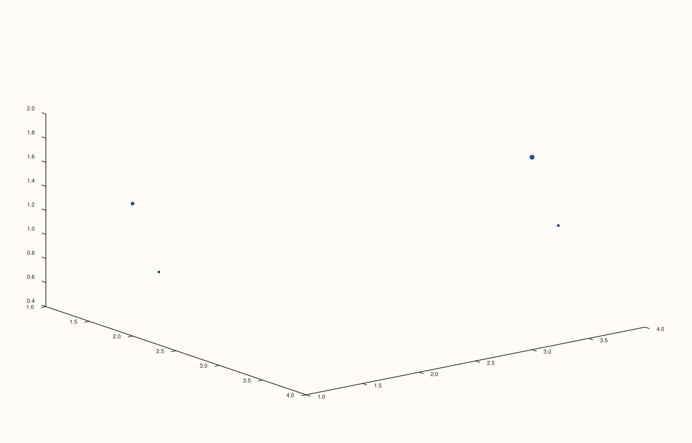
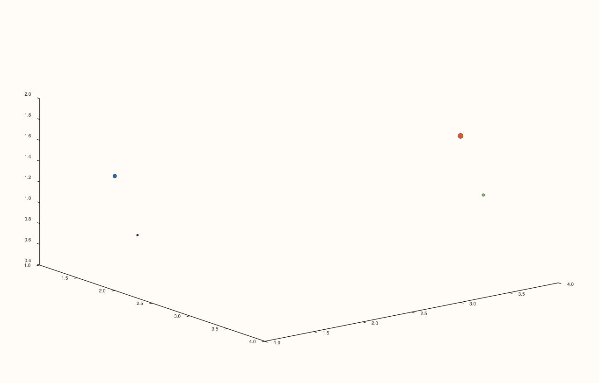
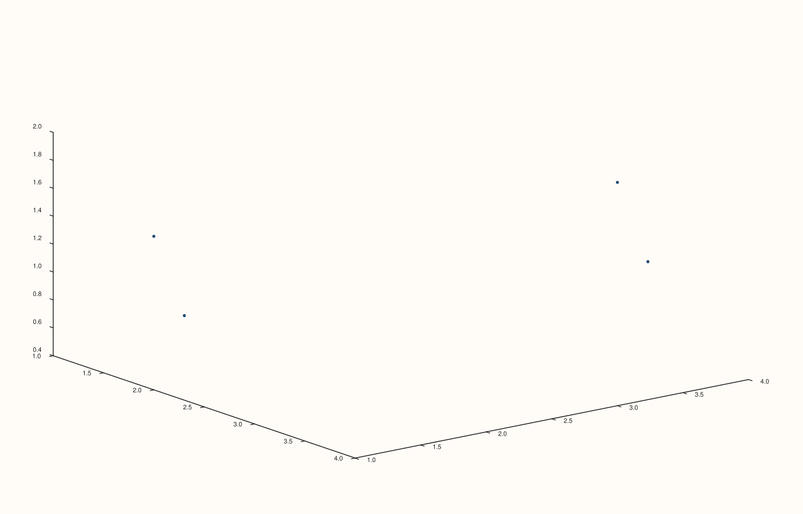

<!-- pluss-hand-authored -->

# flash::cloud3

[Back to flash API Reference](../../flash_api_reference)

## Signatures

```cpp
template <class X, class Y, class Z>
Trace& flash::cloud3(Pane& pane, X&& x, Y&& y, Z&& z)

template <class X, class Y, class Z, class Size>
Trace& flash::cloud3(Pane& pane, X&& x, Y&& y, Z&& z, Size&& size)

template <class X, class Y, class Z, class Size, class Color>
Trace& flash::cloud3(Pane& pane, X&& x, Y&& y, Z&& z, Size&& size, Color&& color)

template <class X, class Y, class Z>
Trace& flash::cloud3(Studio& studio, X&& x, Y&& y, Z&& z, std::string title = {})
```

## What It Does

A thin wrapper around [`Pane::cloud3`](../pane/cloud3.md): converts every argument to
`Series`, validates each is rank ≤ 3, then delegates to the identically-shaped native
`Pane::cloud3` overload. Every `Pane`-overload delegation is byte-identical to calling
`Pane::cloud3` directly — directly verified via SVG comparison. Four overloads: bare
`(x, y, z)`, `(x, y, z, size)`, `(x, y, z, size, color)`, and a `Studio` convenience
overload (matching only the bare-arity `(x, y, z)` shape) that creates the
[`Volumetric`](../studio/pane3.md) pane for you.

## Parameters

**pane** (`Pane&`, Pane overloads)
    The target pane. Must be `Volumetric`.

**studio** (`Studio&`, Studio overload)
    The figure to create a new `Volumetric` pane in.

**x**, **y**, **z** (series-convertible, must each be rank ≤ 3)
    The point coordinates. A rank-4-or-higher input throws
    `std::invalid_argument("flash::cloud3: expected input rank <= 3")`.

**size** (series-convertible, must be rank ≤ 3, three- and five-argument overloads)
    Per-point marker size — see [`Pane::cloud3`](../pane/cloud3.md) for the exact
    length/broadcast rules.

**color** (series-convertible, must be rank ≤ 3, five-argument overload only)
    Per-point marker color value, decoupled from `size`.

**title** (`std::string`, default `{}`, Studio overload only)
    Forwarded to `Studio::pane3` as the new pane's title.

## Returns

`Trace&`
    A reference to the newly created trace, for chaining.

## Examples

Example 1. `(x, y, z)` overload — uniform marker size and color.

```cpp
using namespace pluss::pl;

auto fig = studio("flash_cloud3_xyz");
auto& pane = fig.pane3();
std::vector<double> x{1.0, 2.0, 3.0, 4.0};
std::vector<double> y{2.0, 1.0, 4.0, 3.0};
std::vector<double> z{0.5, 1.5, 1.0, 2.0};
flash::cloud3(pane, x, y, z);
fig.show();
```


Example 2. `(x, y, z, size)` overload — per-point marker size.

```cpp
using namespace pluss::pl;

auto fig = studio("flash_cloud3_xyz_size");
auto& pane = fig.pane3();
std::vector<double> x{1.0, 2.0, 3.0, 4.0};
std::vector<double> y{2.0, 1.0, 4.0, 3.0};
std::vector<double> z{0.5, 1.5, 1.0, 2.0};
std::vector<double> size{20.0, 80.0, 40.0, 150.0};
flash::cloud3(pane, x, y, z, size);
fig.show();
```



Example 3. `(x, y, z, size, color)` overload — per-point size and a separate per-point
color value.

```cpp
using namespace pluss::pl;

auto fig = studio("flash_cloud3_xyz_size_color");
auto& pane = fig.pane3();
std::vector<double> x{1.0, 2.0, 3.0, 4.0};
std::vector<double> y{2.0, 1.0, 4.0, 3.0};
std::vector<double> z{0.5, 1.5, 1.0, 2.0};
std::vector<double> size{20.0, 80.0, 40.0, 150.0};
std::vector<double> color{0.0, 0.3, 0.6, 1.0};
flash::cloud3(pane, x, y, z, size, color);
fig.show();
```



Example 4. `Studio` overload — no explicit `pane3()` call needed.

```cpp
using namespace pluss::pl;

auto fig = studio("flash_cloud3_studio");
std::vector<double> x{1.0, 2.0, 3.0, 4.0};
std::vector<double> y{2.0, 1.0, 4.0, 3.0};
std::vector<double> z{0.5, 1.5, 1.0, 2.0};
flash::cloud3(fig, x, y, z);
fig.show();
```



Example 5 (verification, not a distinct rendering). `flash::cloud3(pane, x, y, z)`
renders byte-identical to `pane.cloud3(x, y, z)` called directly.

```cpp
using namespace pluss::pl;

std::vector<double> x{1.0, 2.0, 3.0, 4.0};
std::vector<double> y{2.0, 1.0, 4.0, 3.0};
std::vector<double> z{0.5, 1.5, 1.0, 2.0};

auto fig1 = studio("flash_cloud3_flash");
auto& pane1 = fig1.pane3();
flash::cloud3(pane1, x, y, z);

auto fig2 = studio("flash_cloud3_native");
auto& pane2 = fig2.pane3();
pane2.cloud3(x, y, z);

std::cout << "flash::cloud3(pane,x,y,z) == pane.cloud3(x,y,z): " << (fig1.to_svg() == fig2.to_svg()) << "\n";
```

Output:

```text
flash::cloud3(pane,x,y,z) == pane.cloud3(x,y,z): 1
```

Example 6 (edge case). A rank-4 coordinate throws.

```cpp
using namespace pluss::pl;

auto fig = studio("flash_cloud3_rank_throw");
auto& pane = fig.pane3();
auto rank4 = pluss::series::linspace(0.0, 1.0, 16, pluss::ScalarType::Float64).reshape({2, 2, 2, 2});
std::vector<double> ok{1.0, 2.0};
try {
  flash::cloud3(pane, rank4, ok, ok);
} catch (const pluss::Error& e) {
  std::string msg(e.what());
  std::cout << "cloud3(rank-4 x) threw: " << msg.substr(0, msg.find('\n')) << "\n";
}
```

Output:

```text
cloud3(rank-4 x) threw: flash::cloud3: expected input rank <= 3
```

## Notes

- Not `noexcept`.
- The rank check throws via `pluss::Error` (a `std::runtime_error` subclass) with the
  message as the first line of `e.what()`, not `std::invalid_argument` — catch
  `pluss::Error` or `std::exception`, not `std::invalid_argument`, for this specific
  check (contrast with [`flash::isoshell`](isoshell.md), whose deeper Pane-level
  rank-3-exact check throws `std::invalid_argument` instead).
- See [`Pane::cloud3`](../pane/cloud3.md) for what actually gets rendered.

## See Also

- [`Pane::cloud3`](../pane/cloud3.md): the underlying native method this function
  delegates to entirely.
- [`flash::path3`](path3.md): the connected-line sibling in this same 3D-native family.
- [`Studio::pane3`](../studio/pane3.md): what the `Studio` overload calls internally.

<div class="pluss-inline-prev-next">
  <a class="prev-link" href="path3.html">
    <span class="label">Previous</span>
    <span class="title">path3</span>
  </a>
  <a class="next-link" href="sheet.html">
    <span class="label">Next</span>
    <span class="title">sheet</span>
  </a>
</div>
